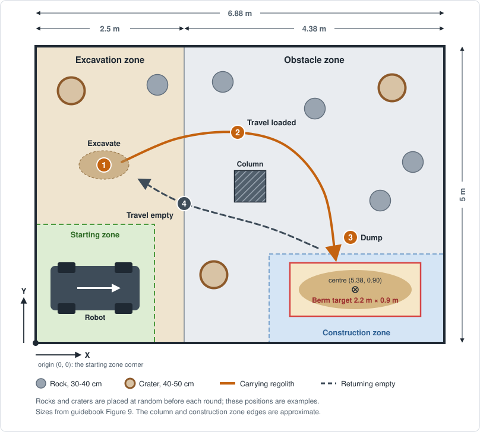
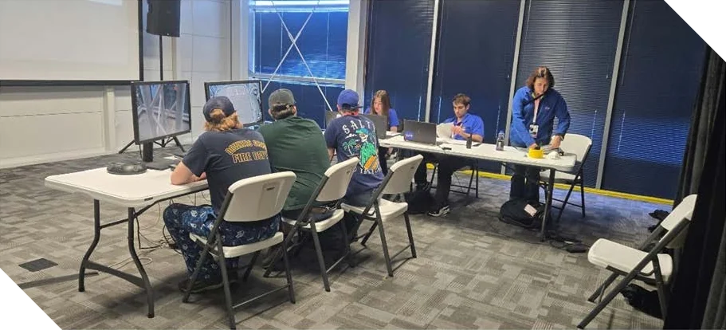
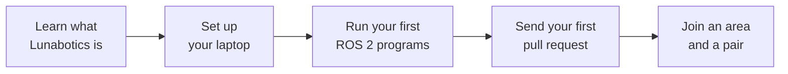

# STAR Lunabotics software

The STAR Robotics Team at Rutgers is building a rover for NASA's Lunabotics Challenge.
These pages are where its software team works in the open: what the competition asks for,
a learning guide that starts from zero, and the design behind every part of the code. They
are also published as a website at
<https://star-robotics-team.github.io/starrt-luna-software/>.

## What we are building

NASA's Lunabotics Challenge asks university teams to build a robot that digs up simulated
Moon soil and piles it into a **berm**, a long mound that could one day shield a Moon base
from the blast of landing rockets
([guidebook §3.1, p. 4](sources.md#nasa-lunabotics-guidebook-2027)). The robots compete
at NASA's Kennedy Space Center in May 2027
([§3.4, p. 5](sources.md#nasa-lunabotics-guidebook-2027)), in an arena of crushed rock,
boulders, and craters, driven from a separate room or, better, entirely on their own. NASA
picks the teams in December from the design reports they send in
([§5.4, p. 13](sources.md#nasa-lunabotics-guidebook-2027)).

*The competition arena from above, with one trip around the dig, carry, and dump cycle.*

The software team writes everything that makes the rover move, see, and decide: driving
it from a laptop, running its digging mechanism, stopping it safely, reading its sensors,
and the autonomy that earns the most points. [The Lunabotics competition](competition/README.md)
explains the whole challenge from scratch.

## Why join

- **Your code runs on a real robot,** built to compete at Kennedy Space Center, where
  judges score every run.
- **No experience needed.** The team is open to all Rutgers students, of any major. The
  [learning guide](learn/README.md) starts from opening a terminal for the first time.
- **You build from your first weeks.** Every new member is paired with a returning member,
  and sends a real change to the robot's code early, instead of watching course videos.
- **You learn the tools by using them:** ROS 2, C++, Linux, Git, and Docker, on problems
  such as localization, mapping, and path planning.
- **The problems are hard and open.** Autonomy is worth up to 1,400 points a run, far
  more than anything else ([How scoring works](competition/scoring.md#what-each-improvement-is-worth)),
  and it has to work without GPS, in dust, over a slow radio link
  ([Rules the robot must follow](competition/robot-rules.md#sensors-and-navigation)).
- **You engineer the way NASA does.** Design reviews, design docs, and a systems
  engineering paper that NASA judges
  ([§18.4, p. 68](sources.md#nasa-lunabotics-guidebook-2027)).

## What you could work on

The software team splits the robot into areas, and each one gets its own design doc. You
pick one and pair with someone who knows it:

| Area | What it involves |
| --- | --- |
| Drivetrain | Turning speed commands into motor outputs over the robot's CAN bus |
| Digging and dumping | Running the excavator, conveyor, and hatch, within safe limits |
| Mission Control | Driving the robot from a laptop, and making it stop by itself when the link drops |
| Sensors | The lidar, cameras, and IMU, and the robot's 3D model |
| Autonomy | Mapping the arena, planning a path around rocks and craters, and digging and dumping with no one at the controls |
| Platform | The development setup, builds, and getting code onto the robot's NVIDIA Jetson computer |

Software works alongside STAR Robotics' mechanical and electrical subteams, who build the
rover and wire it up. The [design docs](design/README.md) show where each area stands.

## What competition week looks like

*Mission Control during a run: the operators see the arena only through the robot's
sensors and two NASA cameras. Figure 14 of the guidebook
([§15, p. 52](sources.md#nasa-lunabotics-guidebook-2027)).*

Each team gets a practice run and two scored 15-minute runs. Before each one, the robot
passes a safety inspection, then up to four teammates in protective suits place it in the
arena while up to four run it from Mission Control.
[The arena and a run](competition/arena-and-runs.md) walks through one minute by minute.

## Your first month

1. **Learn what Lunabotics is:** read [The Lunabotics competition](competition/README.md).
2. **Set up your laptop:** follow the [learning guide](learn/README.md) from the start. It
   covers the command line, Git, and the team's ready-made development setup, and works
   on Windows, macOS, and Linux.
3. **Run your first ROS 2 programs:** [ROS 2 basics](learn/ros2-basics.md) has you
   watching programs talk and driving a simulated turtle.
4. **Send your first pull request,** a real change to the team's code or docs:
   [Your first pull request](learn/first-pull-request.md) walks you through it.
5. **Join an area and a pair,** and start on its design doc and code.
   [Write your first node](learn/ros2-first-node.md) and the pages after it teach what
   your first robot code needs.

## Join the team

- **Who can join:** any Rutgers student, of any major, with no experience required.
- **Say hello on [STAR's Discord](https://discord.gg/vHa52wx9VK)** and ask for the
  Robotics software team, or email <rutgersstar@gmail.com>.
- **Meetings** are usually in The Cage. Times and rooms change each semester, so check
  Discord or email for the current schedule.
- **Follow STAR** on [Instagram](https://www.instagram.com/ruspacetech/) and
  [LinkedIn](https://www.linkedin.com/company/spacetechru/).

To travel to Kennedy Space Center with the team, NASA requires you to be at least 18 and
enrolled at Rutgers in the semester of the competition or the one before
([§4.2, p. 10](sources.md#nasa-lunabotics-guidebook-2027)).

## Already on the team?

- **New to programming, Git, or the command line?** Start with the
  [learning guide](learn/README.md). It assumes no experience at all.
- **Already comfortable with them?** Go straight to [Getting started](getting-started.md).
- **Checking a hardware value or a competition rule?** Go to its primary source on the
  [Sources](sources.md) page: the guidebook, datasheets, and manuals there are the source
  of truth.

### The competition

- **[The Lunabotics competition](competition/README.md):** what NASA's challenge is, the
  season's deadlines, and competition week.
- **[The arena and a run](competition/arena-and-runs.md):** the arena, Mission Control,
  and a run step by step.
- **[Rules the robot must follow](competition/robot-rules.md):** size, mass, the E-stop,
  sensors, and radio rules.
- **[How scoring works](competition/scoring.md):** every point, with worked examples.

### Learn

- **[Learning guide](learn/README.md):** the command line, Git and GitHub, containers,
  setting up, ROS 2, and your first pull request, then writing, launching, and debugging
  your own ROS 2 nodes, in order, with exercises. [Getting started](getting-started.md)
  is step 4.
- **[Glossary](learn/glossary.md):** plain definitions of every term in these docs.

### Reference

- **[Development environment](development-environment.md):** how the dev container works,
  using another editor or no container, and what works on each operating system.
- **[Everyday workflow](everyday-workflow.md):** editing, building, testing, and running
  code, and running commands from your own terminal with `scripts/dev`.
- **[GUI tools](gui-tools.md):** seeing RViz, rqt, and other programs with windows.
- **[CAN bus](can-bus.md):** working with the motor controllers, with or without hardware.
- **[ROS 2 networking](ros-networking.md):** connecting your nodes to the robot or another
  computer.
- **[Building for the robot](building-for-the-robot.md):** why a build only runs where it
  was built for, and how code gets built for the robot's Jetson.

### Design docs

- **[All design docs](design/README.md):** how the robot's software fits together, and
  each subsystem's design: its nodes, interfaces, parameters, and behavior on failure, with
  each doc's status and how to write and review one.
- **[Design doc template](design/template.md):** the starting point for a new design doc.

### Sources

- **[Sources](sources.md):** the competition guidebook, datasheets, manuals, standards, and
  official documentation that the robot's hardware facts and rules come from, with links
  straight to every page these docs cite. They are the source of truth: when a doc
  disagrees with a primary source, the source wins.

### Team process

- **[Contributing](contributing.md):** branches, pull requests, and code style. Read it
  before your first pull request.
- **[Writing docs](writing-docs.md):** adding or changing a page in these docs.

### Package documentation

Each package can have a README next to its code. For example,
`src/ctre_phoenix5_vendor/README.md` explains how the CTRE Phoenix motor controller
libraries are downloaded and upgraded.

### Learning ROS 2

- [ROS 2 Jazzy tutorials](https://docs.ros.org/en/jazzy/Tutorials.html): the official
  introduction to nodes, topics, services, and building packages.
- [Docker's ROS 2 guide](https://docs.docker.com/guides/ros2/): a hands-on turtlesim and
  rqt exercise. It uses ROS 2 Humble and its own sample setup; in our dev container, skip
  its setup and `apt install` steps, because turtlesim and rqt are already installed, and
  start at "Install and run Turtlesim" step 3, `ros2 run turtlesim turtlesim_node`.
- [REP 2000](https://www.ros.org/reps/rep-2000.html): which operating systems each ROS 2
  release supports.
