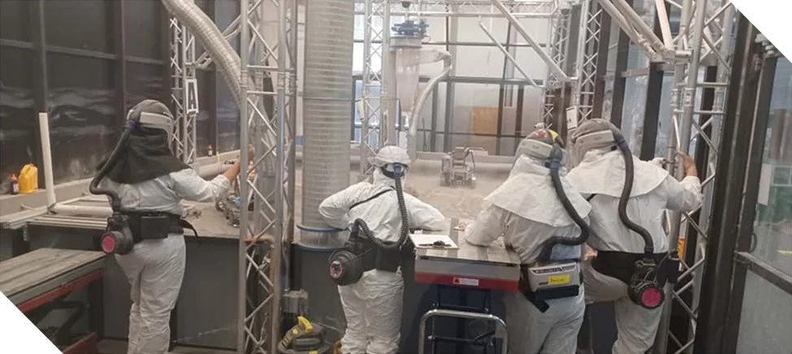
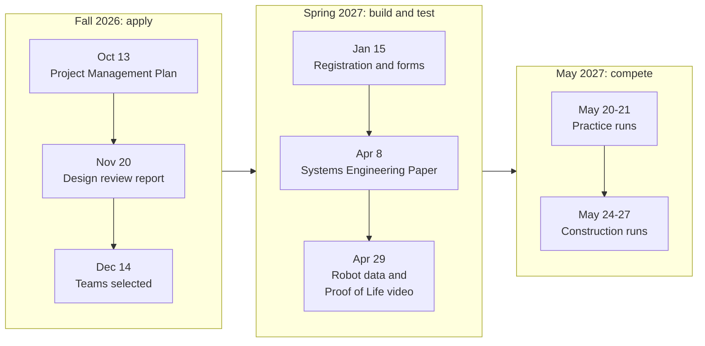

# The Lunabotics competition

What NASA's Lunabotics Challenge is, what our robot has to do, and how the season runs.
Read this first if you are new to the team, or wondering whether to join. It assumes no
background at all.

Everything here comes from the official rulebook, the 2026-2027 guidebook, and each rule
links to the page it comes from. When this page and the guidebook disagree, the guidebook
wins.

## In one minute

- **The challenge:** student teams design, build, and run a robot that digs up simulated
  Moon soil and piles it into a **berm**, a long, low mound, ideally with no human at the
  controls. NASA has run it since 2010, and it ends each year with an in-person event at
  Kennedy Space Center
  ([guidebook §3.1, p. 4](../sources.md#nasa-lunabotics-guidebook-2027)).
- **This season:** the competition is one week in May 2027 at the Astronauts Memorial
  Foundation's Center for Space Education, next to the Kennedy Space Center Visitor Complex
  in Florida, with practice runs on May 20-21 and scored runs on May 24-27
  ([§3.3 and §3.4, p. 5](../sources.md#nasa-lunabotics-guidebook-2027)).
- **The runs:** each team gets one 15-minute practice run and two 15-minute scored runs,
  called construction runs ([§12, p. 39](../sources.md#nasa-lunabotics-guidebook-2027)).
- **The points:** a run earns points for building a big berm with a light robot and little
  energy, for using little radio bandwidth, for keeping dust down, and above all for doing
  the work autonomously. [How scoring works](scoring.md) explains every point.

*The arena from above, drawn to scale, with one trip around the mission cycle. Drawn by
the team from the guidebook's Figure 9
([§11.2, pp. 34-35](../sources.md#nasa-lunabotics-guidebook-2027)).*

## Why NASA wants robots that build berms

NASA's Artemis program is sending astronauts back to the Moon to stay. When a lander
touches down or lifts off, its rocket plume blasts the loose surface into high-speed dust
and gravel, called **ejecta**. A berm between the landing pad and the base catches it. The
guidebook lists more jobs for berms: keeping cryogenic (super-cold) fuel systems at the
right temperature, and shielding habitats and equipment from radiation
([§3.1, p. 4](../sources.md#nasa-lunabotics-guidebook-2027)).

Building with what is already there, instead of shipping everything from Earth, is called
**in-situ resource utilization (ISRU)**
([§3.7.7, p. 6](../sources.md#nasa-lunabotics-guidebook-2027)). Lunabotics robots
practice the most basic version of it: moving Moon dirt to where it is useful.

The Moon's loose surface layer is called **regolith**. The arena is filled with a
**regolith simulant** called Black Point-1 (BP-1): crushed basalt rock that behaves much
more like Moon dust than like beach sand. It is about 45 cm deep, very fine (most grains
are under 0.1 mm across), and dotted with natural rocks
([§11.1, p. 33](../sources.md#nasa-lunabotics-guidebook-2027)). It is also dusty and
abrasive ([§13.8.4, p. 44](../sources.md#nasa-lunabotics-guidebook-2027)), so everyone in
the arena wears protective suits and masks
([§11.7, p. 38](../sources.md#nasa-lunabotics-guidebook-2027)).

*Judges in protective gear watching a run in the arena. Figure 11 of the guidebook
([§11.6, p. 38](../sources.md#nasa-lunabotics-guidebook-2027)).*

## What the robot does

The arena has three main areas, shown in the map above
([§11.2 to §11.4, pp. 34-35](../sources.md#nasa-lunabotics-guidebook-2027)):

- The **excavation zone**, the only place the robot may dig. The **starting zone**, where
  the robot begins each run, sits in one of its corners.
- The **obstacle zone**, with rocks, craters, and a fixed column in the way. The robot must
  carry everything it digs across this zone; pushing dirt across with a blade, like a
  bulldozer, does not count
  ([§13.9.18, p. 45](../sources.md#nasa-lunabotics-guidebook-2027)).
- The **construction zone**, with a marked 2.2 m by 0.9 m target area. Only regolith
  inside that box counts as berm.

The robot repeats the **mission cycle** for the whole run: excavate, travel across the
obstacle zone loaded, dump the regolith on the berm, travel back empty, and repeat
([§3.7.11, p. 7](../sources.md#nasa-lunabotics-guidebook-2027)).

It can do this in two ways
([§13.9.10, p. 44](../sources.md#nasa-lunabotics-guidebook-2027)):

- **Teleoperation:** people drive it remotely, like a remote-controlled car.
- **Autonomy:** the robot does the work itself, with no human input. Autonomy earns by far
  the most points, up to 1,400 in each run
  ([§16, p. 55](../sources.md#nasa-lunabotics-guidebook-2027)).

Either way, nobody can watch the robot directly. The drivers sit outside the arena in the
**Mission Control Center** ([§3.7.10, p. 7](../sources.md#nasa-lunabotics-guidebook-2027)),
and see only what the robot's own sensors send back plus two NASA cameras
([§15.1, p. 53](../sources.md#nasa-lunabotics-guidebook-2027)). It is a small version of
driving a rover on the Moon from Earth.

*A team at work in the Mission Control Center during a run. Figure 14 of the guidebook
([§15, p. 52](../sources.md#nasa-lunabotics-guidebook-2027)).*

## The season

Lunabotics is not only the week in Florida. NASA chooses which teams compete from the
reports they send in the fall, and teams keep sending engineering documents all year
([§5.4, p. 13](../sources.md#nasa-lunabotics-guidebook-2027)). Every deliverable is due by
noon Eastern Time on its date, and dates can change
([§3.4, p. 5](../sources.md#nasa-lunabotics-guidebook-2027)).

| Date | Deliverable | What it is |
| --- | --- | --- |
| Oct 13, 2026 | Project Management Plan, and statements of support and rights of use | The application ([§5, p. 10](../sources.md#nasa-lunabotics-guidebook-2027)): a plan of up to 5 pages with the schedule, the budget, the technical goals, and how they will be tracked ([§18.2, pp. 62-65](../sources.md#nasa-lunabotics-guidebook-2027)) |
| Nov 20, 2026 | Preliminary Design Review (PDR) report | The robot's design, broken into subsystems with a specification for each ([§18.3, pp. 66-68](../sources.md#nasa-lunabotics-guidebook-2027)). NASA uses it to choose the teams ([§5.4, p. 13](../sources.md#nasa-lunabotics-guidebook-2027)) |
| Dec 14, 2026 | Team selections announced | |
| Jan 15, 2027 | Registration, NASA media release, waste management overview | Forms every person who attends must send in ([§6.1 and §6.2, p. 13](../sources.md#nasa-lunabotics-guidebook-2027)) |
| Apr 8, 2027 | Systems Engineering Paper | Up to 25 pages on how the team used systems engineering to design, build, and test the robot ([§18.4, pp. 68-75](../sources.md#nasa-lunabotics-guidebook-2027)) |
| Apr 29, 2027 | Robot Data Report and Proof of Life video | The robot's technical data, and a video proving it is safe and working: its size and mass checked, its E-stop, and it driving, digging, and dumping ([§6.3 and §6.4, p. 15](../sources.md#nasa-lunabotics-guidebook-2027)) |
| May 20-21, 2027 | Practice runs at Kennedy Space Center | |
| May 24-27, 2027 | Construction runs at Kennedy Space Center | |

The team sets its own internal deadline about a week before each of NASA's, so there is
time for review.

New this year, the whole competition is a single week at Kennedy Space Center, with no
separate qualifying round at the University of Central Florida
([§3.5, p. 6](../sources.md#nasa-lunabotics-guidebook-2027)).

## Competition week

At Kennedy Space Center, each team gets a 10 by 10 foot pit in the **RoboPits**, the
shared workshop where teams prepare and fix their robots
([§9 and §10, pp. 21-22](../sources.md#nasa-lunabotics-guidebook-2027)). Before the
robot may enter the arena, it must pass:

- A **safety inspection** before every run: size, mass, the emergency stop button, the
  energy logger, lifting points, and dust protection
  ([§12.1, p. 40](../sources.md#nasa-lunabotics-guidebook-2027)).
- A **communications check**, showing the robot is on the right Wi-Fi channel and can be
  controlled over it ([§14.3, p. 49](../sources.md#nasa-lunabotics-guidebook-2027)).
- An **autonomy review**, where the team walks the judges through how its autonomy works.
  A team that cannot explain it to their satisfaction earns no autonomy points
  ([§16, p. 55](../sources.md#nasa-lunabotics-guidebook-2027)).

Then come the practice run and the two construction runs. Up to four team members in
protective gear place the robot in the arena
([§11.6, p. 36](../sources.md#nasa-lunabotics-guidebook-2027)), and up to four run it
from Mission Control ([§15.1, p. 52](../sources.md#nasa-lunabotics-guidebook-2027)).
[The arena and a run](arena-and-runs.md) walks through a run minute by minute.

The week also has seminars and workshops on topics such as systems engineering,
autonomy, and NASA internships
([§8.1.4, p. 19](../sources.md#nasa-lunabotics-guidebook-2027)).

## Awards

The guidebook lists these awards, and says the list may change
([§21, pp. 76-77](../sources.md#nasa-lunabotics-guidebook-2027)):

| Award | Given for |
| --- | --- |
| Artemis Grand Prize | The most points overall: the Project Management Plan, the Systems Engineering Paper, and the construction runs together |
| Construction Award | The most points from the two construction runs (1st to 3rd place) |
| Caterpillar Autonomy Award | The most successful autonomy (1st to 6th place) |
| Systems Engineering Paper | The best use of NASA's systems engineering process (1st to 3rd place) |
| Systems Engineering Leaps and Bounds | The biggest improvement in systems engineering over past years |
| Systems Engineering Nova Award | Outstanding systems engineering by a school in its first year |
| Innovation Award | The most creative and innovative design |
| Efficient Use of Communications Award | The least communication used for the amount of berm built |

[How scoring works](scoring.md) shows how each score is calculated.

## What this means for the software team

- **Autonomy is where most of the points are.** A fully autonomous run is worth up to
  1,400 points, more than twice everything else in the guidebook's example run put
  together. See
  [What each improvement is worth](scoring.md#what-each-improvement-is-worth).
- **Every bit of radio traffic costs points,** so the software decides what the robot
  streams back and how often. See [bandwidth](scoring.md#4-bandwidth).
- **Safety comes first.** The robot must stop when told, when the link drops, and when its
  E-stop is pressed. The [operating modes design](../design/operating-modes.md) turns these
  rules into software requirements.
- **The design reports draw on our design docs.** The PDR report and the Systems
  Engineering Paper are written from the [design docs](../design/README.md), so keeping
  them current is part of competing.

## Read more

- **[The arena and a run](arena-and-runs.md):** the arena in detail, Mission Control, how
  the robot talks to it, and a run step by step.
- **[Rules the robot must follow](robot-rules.md):** size, mass, the E-stop, sensors that
  are banned, and the radio rules.
- **[How scoring works](scoring.md):** every point, with worked examples.
- **The guidebook itself,** linked from the [Sources](../sources.md) page. Teams must also read the official FAQ, which answers questions about the guidebook
  ([§22.5, p. 78](../sources.md#nasa-lunabotics-guidebook-2027)). It is on the
  [official Lunabotics website](../sources.md#amf-lunabotics-website), where teams also
  apply and send in their deliverables.
