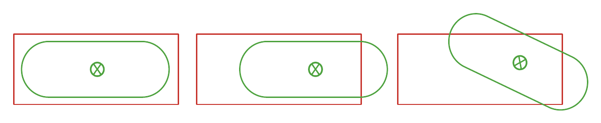
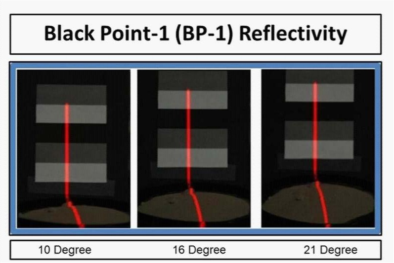
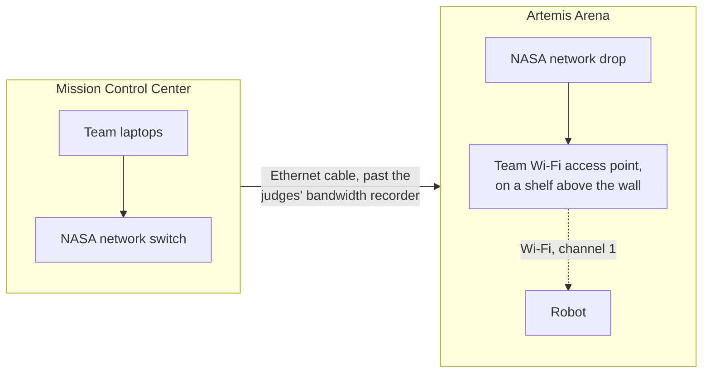
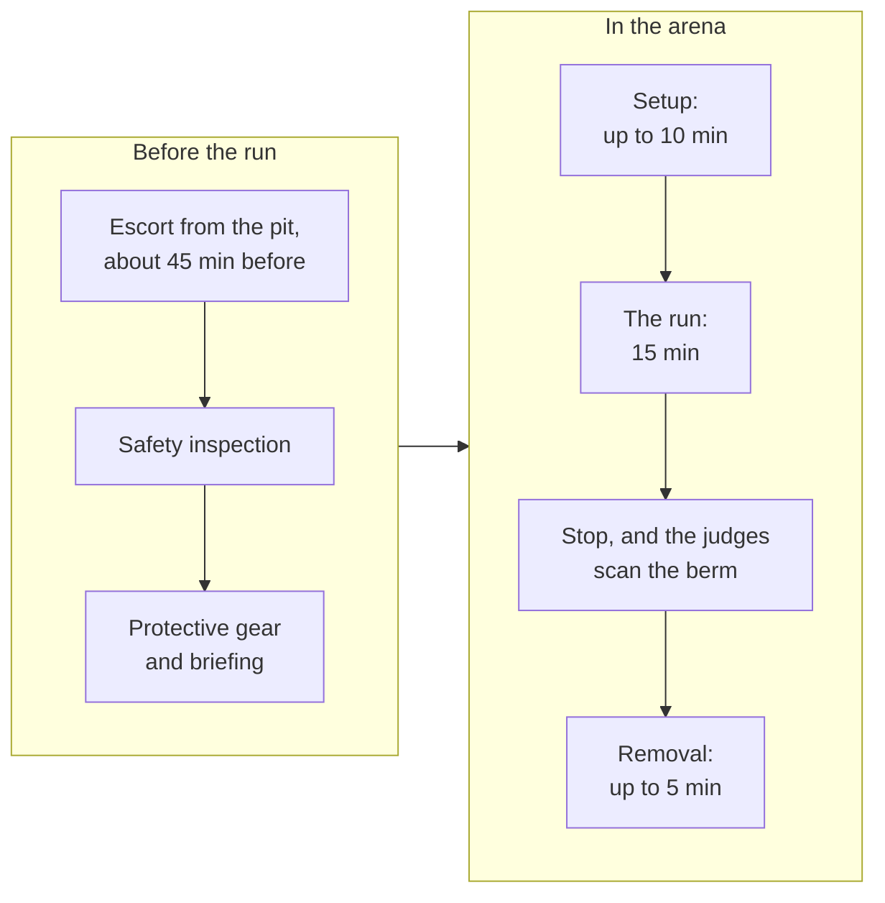

# The arena and a run

What the Artemis Arena is like, where Mission Control is and how the robot talks to it,
and what happens during a run, minute by minute. Read
[The Lunabotics competition](README.md) first for the big picture.

## The arena's layout

The **Artemis Arena** is a walled bin of regolith simulant, about 6.88 m long and 5 m
wide. The guidebook's own drawing of it:

*The arena's dimensions and obstacle layout. Figure 9 of the guidebook
([§11.4, p. 35](../sources.md#nasa-lunabotics-guidebook-2027)).*

| Area | Size and place | What happens there |
| --- | --- | --- |
| Whole arena | About 6.88 m by 5 m. A 17 cm PVC pipe runs along the inside of the walls ([§11.2.1, p. 34](../sources.md#nasa-lunabotics-guidebook-2027)) | The robot must stay inside and never hit the walls ([§13.9.6, p. 44](../sources.md#nasa-lunabotics-guidebook-2027)) |
| Excavation zone | The first 2.5 m of the arena's length ([Figure 9, p. 35](../sources.md#nasa-lunabotics-guidebook-2027)) | The only place the robot may dig. It may move rocks and fill craters here |
| Starting zone | 2 m by 2 m, in a corner of the excavation zone, with no rocks or craters ([Figure 9, p. 35](../sources.md#nasa-lunabotics-guidebook-2027)) | The robot starts here. It counts as part of the excavation zone, so the robot may dig here too ([§16.1.1, p. 55](../sources.md#nasa-lunabotics-guidebook-2027)) |
| Obstacle zone | The other 4.38 m ([Figure 9, p. 35](../sources.md#nasa-lunabotics-guidebook-2027)) | Rocks, craters, and the column. The robot must cross it without touching rocks or driving into craters |
| Construction zone | About 1.5 m deep, in the far corner along the same wall as the starting zone ([Figure 9, p. 35](../sources.md#nasa-lunabotics-guidebook-2027)) | Where the berm is built. Rocks may be moved and craters filled here |
| Berm target | 2.2 m by 0.9 m, centered 5.38 m along and 0.9 m out from the corner of the starting zone ([§11.2, pp. 34-35](../sources.md#nasa-lunabotics-guidebook-2027)) | Only berm inside this box is measured |

The rules on moving rocks and filling craters are in
[§13.9, p. 45](../sources.md#nasa-lunabotics-guidebook-2027) and the obstacle penalty in
[§17.1.8, pp. 60-61](../sources.md#nasa-lunabotics-guidebook-2027).

**Measure from the walls.** The berm's position is measured from the arena wall in the
corner of the starting zone. The PVC pipes and anything mounted on the walls are not
reference points for placing the berm, for localization, or for scoring
([§11.2.3, pp. 34-35](../sources.md#nasa-lunabotics-guidebook-2027)).

**Figure 9 is approximate.** The text calls the arena about 6.8 m by 5.0 m between the
pipes ([§11.2.1, p. 34](../sources.md#nasa-lunabotics-guidebook-2027)), while the figure
labels 6.88 m. The figure also marks the side of the arena in two parts, "~4.5m" and
"~1.5m", which add up to more than its 5 m width; measured on the drawing, the parts are
about 3.5 m and 1.5 m. The construction zone's width and the column's position are not
given in numbers anywhere. And the figure's note allows moving rocks and filling craters
"in the Excavation Zone only", while the rules allow it in the construction zone too
([§13.9.15, p. 45](../sources.md#nasa-lunabotics-guidebook-2027) and
[§17.1.8, p. 61](../sources.md#nasa-lunabotics-guidebook-2027)); section 13 takes
precedence over the rest of the guidebook
([§13, p. 41](../sources.md#nasa-lunabotics-guidebook-2027)). Treat the figure's numbers
as estimates until the team measures the real arena or the FAQ answers them.

## The berm target

Only the part of the berm inside the red target box counts. The berm can be any shape,
height, or number of piles
([§17.1.2, p. 60](../sources.md#nasa-lunabotics-guidebook-2027)):

*Only the green berm inside the red box is measured. Figure 8 of the guidebook
([§11.2.2, p. 34](../sources.md#nasa-lunabotics-guidebook-2027)).*

Judges measure the berm with a 3D scan of the target area before and after the run, and
count only the volume above the original surface
([§17.1.2, p. 60](../sources.md#nasa-lunabotics-guidebook-2027)).

## The regolith

The arena holds about 45 cm of **Black Point-1 (BP-1)**, crushed basalt that stands in for
lunar regolith ([§11.1, p. 33](../sources.md#nasa-lunabotics-guidebook-2027)):

- It does not behave like sand. Most grains are under 100 micrometers (0.1 mm), like a
  silty powder, and its friction has never been measured.
- Packed down, it weighs 1.5 to 1.8 g/cm³. The top layer is raked loose to about
  0.75 g/cm³, similar to the Moon's surface.
- Natural rocks and gravel of about 2 cm are mixed in at random.

For teams using lidar (a laser scanner that measures distance), NASA photographed a laser
line falling across BP-1 and across a white, gray, and black target, so teams can compare
how brightly BP-1 reflects the laser
([§11.1.3, pp. 33-34](../sources.md#nasa-lunabotics-guidebook-2027)):

*How BP-1 reflects a laser, photographed at three angles. Figure 7 of the guidebook
([§11.1.3, p. 34](../sources.md#nasa-lunabotics-guidebook-2027)).*

## Obstacles

The obstacle zone exists to test obstacle detection, mapping, and navigation planning
([§11.3 and §11.4, p. 35](../sources.md#nasa-lunabotics-guidebook-2027)):

- **Boulders:** at least three, 30 to 40 cm across, of varying height. They are placed at
  random before each round, and may also appear in the excavation zone.
- **Craters:** at least three, up to about 40 to 50 cm wide and deep.
- **The column:** a central support column that never moves, and must be avoided.

## Cameras

NASA mounts cameras on the arena's frame: fixed cameras and pan-tilt-zoom (PTZ) cameras
that an operator can aim
([§11.5, p. 36](../sources.md#nasa-lunabotics-guidebook-2027)):

*Where NASA's cameras are mounted. Figure 10 of the guidebook
([§11.5, p. 36](../sources.md#nasa-lunabotics-guidebook-2027)).*

Mission Control can watch two of them on monitors
([§15.1.5, p. 53](../sources.md#nasa-lunabotics-guidebook-2027)). Each one the team turns
on, even for a moment, adds 0.5 Mbit/s to the bandwidth the team is scored on
([§14.1.18, p. 48](../sources.md#nasa-lunabotics-guidebook-2027)), which costs 15 points
(see [bandwidth](scoring.md#4-bandwidth)). Using them during setup is free
([§15.2.5, p. 53](../sources.md#nasa-lunabotics-guidebook-2027)).

## Mission Control

The **Mission Control Center (MCC)** is the room the robot is run from. Its rules
([§15.1, pp. 52-53](../sources.md#nasa-lunabotics-guidebook-2027)):

- Up to four team members, and no faculty or advisors.
- No outside communication once inside, except with the team's arena members during
  setup, on a radio the judges lend out
  ([§15.2.3, p. 53](../sources.md#nasa-lunabotics-guidebook-2027)).
- Only devices needed to run the robot. Anything forgotten stays forgotten.
- Operators may use only data and video from the robot and the competition monitors.
- **Tell the Mission Control Judge before every autonomy attempt starts, and again before
  taking control back.** An attempt the judge was not told about earns no points.
- Judges answer no questions during the run, such as whether a position is good enough or
  whether points were earned.

Team members in the arena may not tell Mission Control where obstacles are, or signal to
it in any way during the run
([§11.6, pp. 36-37](../sources.md#nasa-lunabotics-guidebook-2027)).

## How the robot talks to Mission Control

Each team brings its own Wi-Fi router, called the **wireless access point (WAP)**, and sets
up its own network addresses. NASA provides the cable from the arena to Mission Control
([§14.5, p. 50](../sources.md#nasa-lunabotics-guidebook-2027)):

- The access point sits on a shelf in a corner, up to 0.5 m above the arena wall, within
  1.5 m of a standard 110 V outlet. Dust settles there during runs, so the guidebook suggests a
  dust cover that does not block the signal.
- The only way to reach the robot is through that access point and cable. A back channel,
  such as a phone or laptop connecting to the router directly, means disqualification.
- During runs, the robot uses Wi-Fi channel 1 only
  ([§14.4.1, p. 49](../sources.md#nasa-lunabotics-guidebook-2027)), and the link must
  average no more than 4,000 kbit/s, with no limit on short peaks
  ([§14.1.19, p. 48](../sources.md#nasa-lunabotics-guidebook-2027)).

The guidebook's own drawing of the setup:

*The communications setup, with notes on who supplies each item. Figure 13 of the
guidebook ([§14, p. 47](../sources.md#nasa-lunabotics-guidebook-2027)).*

[Rules the robot must follow](robot-rules.md#communications) lists every radio rule.

## A run, step by step

1. **About 45 minutes before the run,** an escort collects the team and the robot from
   the pit and takes them to the official safety inspection. Up to four students put on
   protective gear at the same time
   ([§12, p. 39](../sources.md#nasa-lunabotics-guidebook-2027)). A team that is not ready
   or cannot be found loses its run.

2. **The Arena Chief briefs the team** at the arena entrance and in the staging area. The
   team tells the judges where the energy logger is on the robot
   ([§11.6, p. 37](../sources.md#nasa-lunabotics-guidebook-2027)).

3. **The starting position and direction are drawn at random** just before the run
   ([§13.9.3, p. 44](../sources.md#nasa-lunabotics-guidebook-2027)). The robot carries an
   arrow marking its forward direction, and the judges spin a direction wheel to choose
   whether it faces north, east, south, or west
   ([§13.5, p. 43](../sources.md#nasa-lunabotics-guidebook-2027)).

4. **Setup, up to 10 minutes.** The arena members place the robot and the access point.
   They may attach navigation beacons or markers to the frame along the starting zone's
   two sides, with tape or clamps
   ([§13.7.2, p. 43](../sources.md#nasa-lunabotics-guidebook-2027)). Meanwhile, Mission
   Control connects its laptops and checks out the robot, then tells the judge it is ready
   ([§15.2, p. 53](../sources.md#nasa-lunabotics-guidebook-2027)).

5. **The run, 15 minutes.** The robot must start a mission cycle within the first 5
   minutes, or it is declared inoperable and the run ends
   ([§15.3.1, p. 54](../sources.md#nasa-lunabotics-guidebook-2027)). It may begin building
   as soon as any part of it reaches the construction zone
   ([§13.9.12, p. 45](../sources.md#nasa-lunabotics-guidebook-2027)).

6. **When time is up,** operations stop. A robot in the middle of an autonomous task must
   be sent a command to stop. Only a dump that had already started may finish
   ([§15.4.1, p. 54](../sources.md#nasa-lunabotics-guidebook-2027)). The team stays
   connected to the robot until the judge says otherwise, in case it must move or unload
   before removal ([§15.4.2, p. 54](../sources.md#nasa-lunabotics-guidebook-2027)).

7. **The judges scan the berm and read the energy logger,** then let the team remove the
   robot ([§13.9.19, p. 45](../sources.md#nasa-lunabotics-guidebook-2027)) within 5
   minutes ([§13.9.2, p. 44](../sources.md#nasa-lunabotics-guidebook-2027)). The logger
   must show the run's energy right after the run
   ([§13.1.4, p. 41](../sources.md#nasa-lunabotics-guidebook-2027)).

8. **Clean up:** the team vacuums the dust off the robot at the HEPA station before
   leaving the arena ([§11.6, p. 37](../sources.md#nasa-lunabotics-guidebook-2027)).

### When a run goes wrong

If the robot can no longer do its job, the team should tell the judge it is ending the
run. The guidebook names five such failures
([§15.3.2, p. 54](../sources.md#nasa-lunabotics-guidebook-2027)):

- **Loss of comm:** the robot works but can no longer talk to Mission Control.
- **Loss of locomotion:** it stops moving, or moves only now and then, for 5 minutes.
- **Loss of excavation:** it can no longer dig.
- **Loss of deposition:** it can no longer unload.
- **Loss of robot:** it cannot do the mission at all.

Judges can end a run that is clearly over, and teams "joyriding" or wasting time can lose
points. A long recovery, such as a full restart, can look like a dead robot, so tell the
judge what is happening
([§15.3.3 and §15.3.4, p. 54](../sources.md#nasa-lunabotics-guidebook-2027)).

## What this means for the software team

- **The robot must find itself.** It starts in a random spot and direction, with no GPS or
  compass allowed, and may not use known wall positions to localize. It may use beacons
  on the starting zone frame. See [navigation rules](robot-rules.md#sensors-and-navigation).
- **It must see obstacles,** because they move every round and touching one costs points.
- **It must be ready fast.** Setup is 10 minutes, and the robot must be moving on the
  mission within 5 minutes of the start.
- **It must stop on command,** including mid-task when time runs out. The
  [operating modes design](../design/operating-modes.md) covers how.
- **The link is shared and scored.** Everything the robot streams counts toward the
  bandwidth score, so the software decides what is worth sending.
