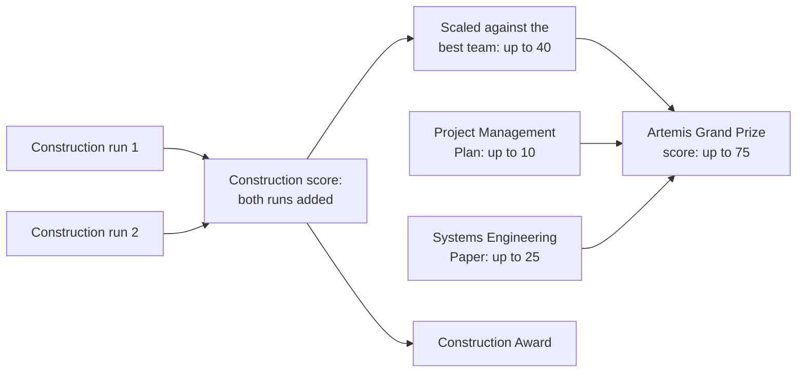
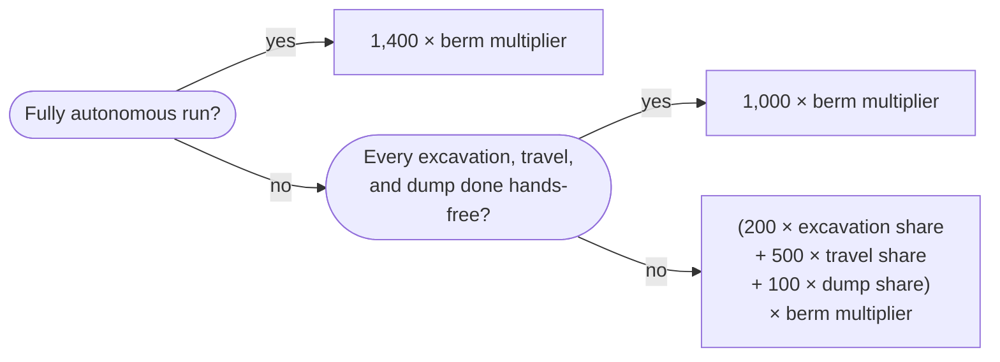

# How scoring works

How every Lunabotics point is earned or lost: the points from each construction run, the
autonomy formula, and the overall Artemis Grand Prize. Each rule links to the guidebook
page it comes from, and every example is worked out in full so you can check the
arithmetic. Read [The Lunabotics competition](README.md) first for the big picture.

## The big picture

Each of the two **construction runs** earns points, and the two are added together into
the team's **construction score**. That decides the Construction Award, and also makes up
most of the **Artemis Grand Prize** score, along with two of the reports
([§17 and §17.2, pp. 59-62](../sources.md#nasa-lunabotics-guidebook-2027)):



The construction score is the total of both runs, not the best run or the average
([§17, p. 59](../sources.md#nasa-lunabotics-guidebook-2027)), so a bad run still counts.

## First, build a berm

**If the berm's volume is zero, the whole run scores zero**, however well everything else
went ([§17.1, p. 59](../sources.md#nasa-lunabotics-guidebook-2027) and
[§17.1.10, p. 62](../sources.md#nasa-lunabotics-guidebook-2027)). Volume only counts
inside the 2.2 m by 0.9 m target box (see [The berm target](arena-and-runs.md#the-berm-target)).
A small berm also scales the autonomy points down; see
[The berm multiplier](#the-berm-multiplier).

## One run's points

| Part | How it is scored | Range |
| --- | --- | --- |
| 1. Inspections | Pass or fail; no points | Must pass to run |
| 2. Berm productivity per kilogram | 4.4 × berm volume (cm³) ÷ run length (min) ÷ robot mass (kg) | 0 and up |
| 3. Berm productivity per watt-hour | 1.5 × berm volume (cm³) ÷ run length (min) ÷ energy used (Wh) | 0 and up, minus 30 if the logger is miswired |
| 4. Bandwidth | 120 − 30 × total Mbit/s, or 0 above 4 Mbit/s | 0 to 120 |
| 5. Dust-tolerant design | Judged at inspection | 0 to 30 |
| 6. Dust-free operation | Judged during the run | 0 to 30 |
| 7. Autonomy | Share of the work done autonomously, times the berm multiplier | 0 to 1,400 |
| 8. Obstacle penalty | Touching a rock or driving into a crater in the obstacle zone | 0 to −100 |

Sources: the scoring table ([§17.1.9, pp. 61-62](../sources.md#nasa-lunabotics-guidebook-2027))
and the rules for each part
([§17.1, pp. 59-61](../sources.md#nasa-lunabotics-guidebook-2027)), with autonomy in
section 16 ([§16, pp. 55-59](../sources.md#nasa-lunabotics-guidebook-2027)).

## Each part, explained

### 1. Inspections

The robot must pass a safety inspection and a communications check before its first run,
and a safety inspection before every run. They earn no points, but a robot that fails
either one may not enter the arena
([§17.1.1, p. 59](../sources.md#nasa-lunabotics-guidebook-2027)). See
[Inspections](robot-rules.md#inspections).

### 2. Berm productivity per kilogram

This rewards building a lot of berm, quickly, with a light robot. A volumetric scan of the
target box before and after the run measures how many cubic centimeters of berm were added
above the original surface
([§17.1.2, p. 60](../sources.md#nasa-lunabotics-guidebook-2027)). Then:

```text
points = 4.4 × berm volume (cm³) ÷ run length (min) ÷ robot mass (kg)
```

The guidebook's example: a 66 kg robot that builds 77,551 cm³ (about 78 liters) in a
15-minute run earns 4.4 × 77,551 ÷ 15 ÷ 66 = **344.6 points**
([§17.1.9, p. 61](../sources.md#nasa-lunabotics-guidebook-2027)).

Mass divides the score, so every kilogram saved counts, and counts more the lighter the
robot already is.

### 3. Berm productivity per watt-hour

This rewards building berm with little energy. A **watt-hour (Wh)** is a unit of energy: a
device drawing 1 watt for an hour uses 1 Wh. The judges read the energy from the robot's
energy logger right after the run
([§17.1.3, p. 60](../sources.md#nasa-lunabotics-guidebook-2027)):

```text
points = 1.5 × berm volume (cm³) ÷ run length (min) ÷ energy used (Wh)
```

The guidebook's example: the same 77,551 cm³ built with 36 Wh earns
1.5 × 77,551 ÷ 15 ÷ 36 = **215.4 points**
([§17.1.9, p. 61](../sources.md#nasa-lunabotics-guidebook-2027)).

A logger not wired between the battery and the E-stop costs 30 points
([§17.1.3, p. 60](../sources.md#nasa-lunabotics-guidebook-2027)), and risks a score of zero
if the E-stop is pressed ([§13.1.3, p. 41](../sources.md#nasa-lunabotics-guidebook-2027)).

### 4. Bandwidth

This rewards a robot that needs little data from Mission Control, as a real Moon rover
would. **Bandwidth** is how much data flows over the radio link each second, measured in
megabits per second (Mbit/s). The judges record the link's average over the run, and each
NASA arena camera the team turns on adds 0.5 Mbit/s
([§17.1.4, p. 60](../sources.md#nasa-lunabotics-guidebook-2027)):

```text
total bandwidth (Mbit/s) = 0.5 × arena cameras used + average bandwidth (Mbit/s)
points = 120 − 30 × total bandwidth, or 0 if the total is over 4 Mbit/s
```

| Total bandwidth | Points |
| --- | --- |
| 0 Mbit/s | 120 |
| 0.5 Mbit/s | 105 |
| 1 Mbit/s | 90 |
| 2 Mbit/s | 60 |
| 3 Mbit/s | 30 |
| 4 Mbit/s or more | 0 |

Every 0.1 Mbit/s costs 3 points, and one camera costs 15. A camera counts if it is turned
on at any moment during the run
([§14.1.18, p. 48](../sources.md#nasa-lunabotics-guidebook-2027)). Separately from the
score, the link must average no more than 4,000 kbit/s (4 Mbit/s)
([§14.1.19, p. 48](../sources.md#nasa-lunabotics-guidebook-2027)).

The guidebook's example: one camera and an average of 0.7 Mbit/s make 1.2 Mbit/s, which
earns 120 − 30 × 1.2 = **84 points**
([§17.1.9, p. 61](../sources.md#nasa-lunabotics-guidebook-2027)).

### 5. Dust-tolerant design

Moon dust gets into everything, so judges award up to 30 points at the safety inspection
for protecting the robot from it
([§17.1.5, p. 60](../sources.md#nasa-lunabotics-guidebook-2027)):

| Feature | Points |
| --- | --- |
| Drivetrain and components enclosed or protected | 15 |
| Active dust control, such as brushing or electrostatics | 5 |
| Custom dust seals, such as bellows | 10 |

Point the features out to the judges at inspection. Their decisions are final.

### 6. Dust-free operation

Judges award up to 30 points for working cleanly during the run, without throwing dust
into the air ([§17.1.6, p. 60](../sources.md#nasa-lunabotics-guidebook-2027)):

| Behavior | Points |
| --- | --- |
| Driving without kicking up regolith | 5 |
| Digging without kicking up regolith | 20 |
| Moving regolith without spilling it on the robot | 5 |

### 7. Autonomy

Autonomy is worth up to **1,400 points in each run**, far more than any other part
([§16, p. 55](../sources.md#nasa-lunabotics-guidebook-2027)). Points depend on how much of
the work the robot does itself, not on showing it once: the guidebook says this year's
rules are meant to make autonomy most of a run, which takes robust software.

#### The cycle segments

The robot's work is split into the segments of the mission cycle, and each segment can be
done **hands-free**, meaning nobody touches the controls:

| Segment | Most points | What counts as an autonomous one |
| --- | --- | --- |
| Excavation | 200 | Go hands-free in the excavation zone before the robot touches the regolith, collect enough regolith for the judge to see, and lift the digging tool clear before taking control back ([§16.1, pp. 55-56](../sources.md#nasa-lunabotics-guidebook-2027)) |
| Travel, loaded and empty | 500 | Go hands-free in the excavation zone and stay hands-free across the obstacle zone into the construction zone, or the other way when empty. The robot must find its own path: no waypoints from Mission Control ([§16.3, pp. 56-57](../sources.md#nasa-lunabotics-guidebook-2027)) |
| Dump | 100 | Go hands-free before crossing into the construction zone, and place enough regolith on the berm for the judge to see ([§16.2, p. 56](../sources.md#nasa-lunabotics-guidebook-2027)) |

The robot may stay hands-free from one segment straight into the next, such as from
excavation into travel. **Every attempt only counts if the team tells the Mission Control
Judge before it starts and before taking control back**
([§15.1.8, p. 53](../sources.md#nasa-lunabotics-guidebook-2027)).

Each segment's score is the share of that segment done autonomously. For example, if the
robot dug 8 times and 2 of those were autonomous, its excavation share is 25%. Travel
counts loaded and empty trips together
([§16.6, p. 58](../sources.md#nasa-lunabotics-guidebook-2027)).

#### The formula

The guidebook's formula ([§16.6.2, p. 58](../sources.md#nasa-lunabotics-guidebook-2027)),
as a flowchart:



- **Every cycle hands-free, 1,000 points:** every excavation, travel, and dump was
  autonomous, but someone still drove by remote control at some point in the run
  ([§16.4, p. 57](../sources.md#nasa-lunabotics-guidebook-2027)).
- **Full autonomy, 1,400 points:** the team may drive by remote control only inside the
  starting zone, to help the robot find where it is. It must then go hands-free before
  leaving the starting zone and stay hands-free for the rest of the run, complete at least
  two whole cycles, and build a berm
  ([§16.5, p. 57](../sources.md#nasa-lunabotics-guidebook-2027)).

#### The berm multiplier

So that a team cannot automate one tiny cycle of each segment and stop, autonomy points
are multiplied by the **berm multiplier**
([§16.6.1, p. 58](../sources.md#nasa-lunabotics-guidebook-2027)):

```text
berm multiplier = 1.0 if the berm is 25,000 cm³ (25 liters) or more
                = berm volume (cm³) ÷ 25,000 otherwise
```

No berm means no autonomy points at all, however well the robot did.

#### The guidebook's two examples

**Example 1: one of each, a big berm**
([§16.6.3, pp. 58-59](../sources.md#nasa-lunabotics-guidebook-2027)). The robot dug 8
times, traveled 15 times (8 loaded, 7 empty), and dumped 8 times, and did each segment
autonomously once. Its berm was 50,000 cm³, so the multiplier is 1.0.

| Segment | Total | Autonomous | Share | Most points | Points |
| --- | --- | --- | --- | --- | --- |
| Excavation | 8 | 1 | 12.5% | 200 | 25 |
| Travel | 15 | 1 | 6.7% | 500 | 34 |
| Dump | 8 | 1 | 12.5% | 100 | 13 |
| **Total** | | | | | **72** |

Autonomy score: 72 × 1.0 = **72**. The guidebook's table rounds each line up (33.3 to 34,
12.5 to 13); unrounded, the total would be 70.8.

**Example 2: everything automated, a small berm**
([§16.6.3, p. 59](../sources.md#nasa-lunabotics-guidebook-2027)). The robot dug twice,
traveled 3 times (2 loaded, 1 empty), and dumped twice, all autonomously, but the team
drove by remote control at some point, so the run is not fully autonomous. Every segment
is at 100%, which earns 1,000. The berm was only 12,500 cm³, so the multiplier is
12,500 ÷ 25,000 = 0.5, and the autonomy score is 1,000 × 0.5 = **500**.

### 8. Obstacle penalty

Touching a rock or driving across a crater in the obstacle zone, as the judges see it,
costs 50 points the first time and 25 each time after, up to 100 per run. In the
excavation and construction zones, moving rocks and filling craters is allowed
([§17.1.8, pp. 60-61](../sources.md#nasa-lunabotics-guidebook-2027)).

## The guidebook's example run

The guidebook adds up one whole run
([§17.1.9, pp. 61-62](../sources.md#nasa-lunabotics-guidebook-2027)): a 66 kg robot builds
77,551 cm³ of berm in 15 minutes using 36 Wh, with one arena camera and 0.7 Mbit/s
average bandwidth.

| Part | Calculation | Points |
| --- | --- | --- |
| Berm productivity per kilogram | 4.4 × 77,551 ÷ 15 ÷ 66 | 344.6 |
| Berm productivity per watt-hour | 1.5 × 77,551 ÷ 15 ÷ 36 | 215.4 |
| Bandwidth | 120 − 30 × (0.5 + 0.7) | 84 |
| Dust-tolerant design | Judged | 30 |
| Dust-free operation | Judged | 25 |
| Autonomy | From section 16 | 75 |
| Obstacle penalty | One hit | −50 |
| **Total** | The berm is over 0 cm³, so the total counts | **724** |

## What each improvement is worth

Starting from that example run, here is how many points each change would add. These are
the team's own calculations with the guidebook's formulas, so check them against
[One run's points](#one-runs-points) if you rely on one.


| Change from the example run | New value | Extra points |
| --- | --- | --- |
| Run fully autonomously (berm over 25 liters) | Autonomy 1,400 instead of 75 | +1,325 |
| Automate every cycle, with some remote control | Autonomy 1,000 instead of 75 | +925 |
| Use 10 Wh less energy (26 Wh) | Per watt-hour 298.3 instead of 215.4 | +83 |
| Build 10 liters more berm (87,551 cm³) | Per kilogram 389.1, per watt-hour 243.2 | +72 |
| Make the robot 10 kg lighter (56 kg) | Per kilogram 406.2 instead of 344.6 | +62 |
| Hit no obstacles | Penalty 0 instead of −50 | +50 |
| Turn off the arena camera | Bandwidth 99 instead of 84 | +15 |

What this shows:

- **Autonomy outweighs everything else.** Full autonomy would almost triple this run's
  score. That is why the software team's biggest goal is robust autonomy.
- **Berm volume multiplies.** Both productivity scores grow in step with the berm, and a
  berm under 25 liters also shrinks the autonomy points.
- **Mass and energy divide.** The productivity scores are divided by them, so each
  kilogram or watt-hour saved is worth more the lower they already are.
- **Bandwidth is capped.** At most 120 points, and only 3 points per 0.1 Mbit/s, but it is
  points the software alone controls.

## The Artemis Grand Prize

The Artemis Grand Prize goes to the team that completes every event and scores the most
points out of 75 ([§17.2, p. 62](../sources.md#nasa-lunabotics-guidebook-2027) and
[§21, p. 77](../sources.md#nasa-lunabotics-guidebook-2027)):

| Part | Points |
| --- | --- |
| Project Management Plan | Up to 10 |
| Systems Engineering Paper | Up to 25 |
| Construction score, scaled against the best team's | Up to 40 |

The guidebook says the construction score is "normalized to the maximum Berm Construction
points achieved by all teams to a scale up to 40 points". Our reading: the team with the
most construction points gets 40, and every other team gets 40 times its share of that
best score. A team with half the leader's construction points would get 20.

Two of the reports are scored on their own as well:

- The **Preliminary Design Review report** is scored out of 100, and decides which teams
  are selected ([§18.3, p. 66](../sources.md#nasa-lunabotics-guidebook-2027) and
  [§5.4, p. 13](../sources.md#nasa-lunabotics-guidebook-2027)). It is not part of the
  Grand Prize score.
- The **Systems Engineering Paper** must score at least 20 of its 25 points to win the
  Systems Engineering Paper award
  ([§18.4.2, p. 69](../sources.md#nasa-lunabotics-guidebook-2027)).

## Other ways to lose points

- **Transmitting on Wi-Fi channel 1 in the pits** without permission: a warning, then 500
  points off the final score, then disqualification
  ([§14.2.5, pp. 48-49](../sources.md#nasa-lunabotics-guidebook-2027)).
- **Breaking rules or unprofessional behavior,** such as photos or unneeded devices in the
  arena, approaching the arena before being called, or signaling to Mission Control:
  penalty points or disqualification
  ([§8, p. 17](../sources.md#nasa-lunabotics-guidebook-2027) and
  [§11.6, pp. 36-37](../sources.md#nasa-lunabotics-guidebook-2027)).
- **"Joyriding"** or wasting run time after the robot can no longer do the mission
  ([§15.3.3, p. 54](../sources.md#nasa-lunabotics-guidebook-2027)).

## Questions to ask in the FAQ

The guidebook leaves these open. Teams ask through the official FAQ, from the team lead or
a `.edu` email address, naming the rule's section number
([§22.5, p. 78](../sources.md#nasa-lunabotics-guidebook-2027)):

1. **Dump share.** The rule for the dump share describes it in terms of excavation cycles,
   which looks like a copy of the excavation rule
   ([§16.6, p. 58](../sources.md#nasa-lunabotics-guidebook-2027)). We assume it means dump
   cycles.
2. **Example 2's dump count.** The text says 3 dump cycles, while its table shows 2
   ([§16.6.3, p. 59](../sources.md#nasa-lunabotics-guidebook-2027)). It does not change
   the result, since all of them were autonomous.
3. **Rounding.** Example 1 rounds each segment's points up
   ([§16.6.3, p. 58](../sources.md#nasa-lunabotics-guidebook-2027)). Is that the rule?
4. **Run length.** The productivity formulas divide by the run's length, and the example
   uses the full 15 minutes ([§17.1.9, p. 61](../sources.md#nasa-lunabotics-guidebook-2027)).
   Is it always 15, even if a run ends early?
5. **The 4.4 and 1.5 factors.** The text of the productivity rules leaves them out
   ([§17.1.2 and §17.1.3, p. 60](../sources.md#nasa-lunabotics-guidebook-2027)), while the
   scoring table uses them. We assume the table is right.
6. **5 GHz or channel 1.** Teams may choose 5 GHz for the robot's link, but robot
   operations happen only on channel 1, a 2.4 GHz channel. See
   [Communications](robot-rules.md#communications).
