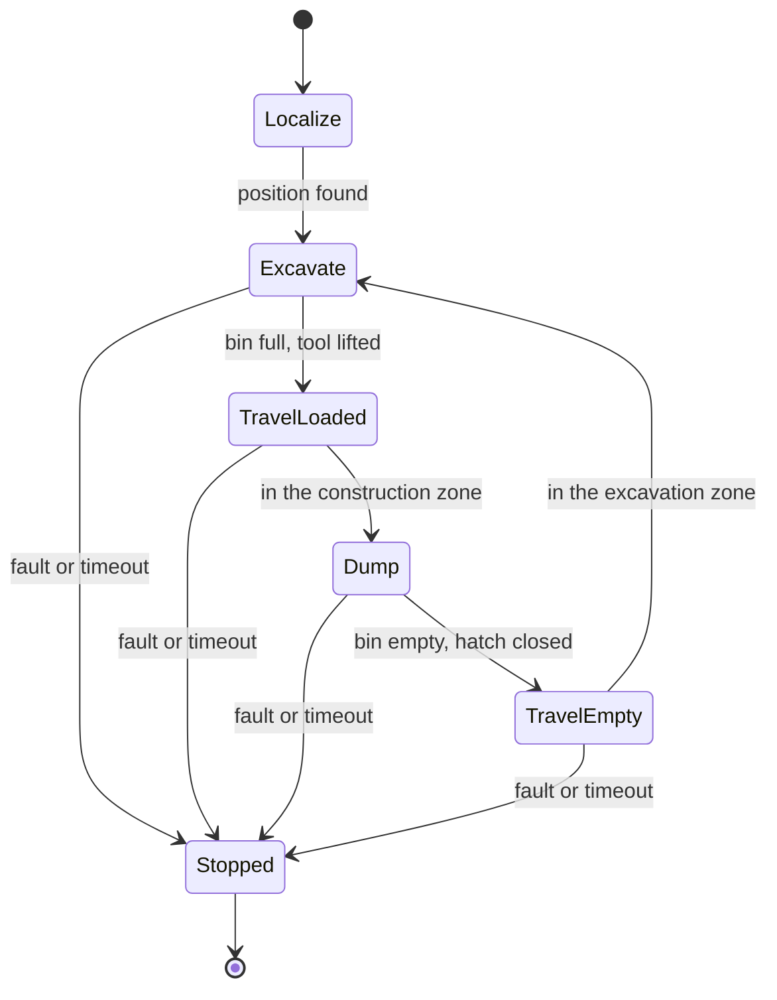
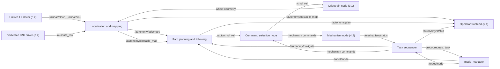

# Autonomy Subsystem Design

| Owner | Status | Last reviewed |
| --- | --- | --- |
| adamlabbate | Draft | 2026-11-08 |

This doc designs the software that runs the mission cycle hands-free: it finds where the
robot is, maps the obstacles, plans and follows a path between the zones, and runs dig,
travel, dump, travel in AUTO. It covers elements SW.2.2, SW.2.3, and SW.2.4 of the
[system design](system.md). The sensors it reads are designed in the sensors doc (6.2), and
everything it commands passes through `mode_manager` and the command selection node, as the
[operating modes design](operating-modes.md) sets out.

## Scoring

### 1. Excavation Autonomy — 200 Points (§16.1, Pg. 55)

- The starting zone is included in the excavation zone.
- Must indicate to MCJ that the excavation attempt is autonomous rather than manual.
- Autonomous operation must begin before the robot engages in the regolith collection process.

### 2. Dump Autonomy — 100 Points (§16.2, Pg. 56)

- Must indicate to MCJ that the dump attempt is autonomous rather than manual.

### 3. Travel Autonomy — 500 Points (§16.3, Pg. 56)

- Touch sensors are not allowed.
- The robot cannot use previous knowledge about the layout of the arena.
  - It must use information gathered from its sensors to make navigation decisions independently.
  - Columns and walls may be used as landmarks.
- The robot cannot simply follow a wall at a fixed distance (e.g., maintaining a distance of 0.5 m).
- Waypoints and "Point and Traverse" navigation methods are not allowed.

### 4. 100% Autonomous Cycles — 1000 Points (§16.4, Pg. 57)

- Awarded if all excavation, travel, and dump cycles were completed autonomously, even if some manual control was used during the run.

### 5. Full Autonomy — 1400 Points (§16.5, Pg. 57)

- The robot may be moved manually within the starting zone at the beginning of the run.
- Autonomous operation must begin while the robot is still in the starting zone and must be maintained throughout the entire run.
- At least **2 complete cycles** of excavation, travel, and dumping must be completed during the construction run.

### 6. Automation Scoring Calculations (§16.6, Pg. 57)

The percentage of automation points earned for excavation, dumping, and travel is determined by the number of successful autonomous cycles divided by the total number of cycles.

**Example:**

- Total excavation cycles: 10
- Autonomous excavation cycles: 5
- Automation percentage: 50%
- Excavation autonomy points earned: 100 out of 200

#### 6.1 Berm Volume Multiplier (§16.6.1, Pg. 58)

A berm volume multiplier is applied to discourage teams from constructing undersized berms.

- **Berm volume ≥ 25 L (25,000 cm³):** Multiplier = 1
- **Berm volume < 25 L:** Multiplier = Berm Volume / 25,000 cm³

**Formula:**

```text
M = min(1, V_berm / 25,000)
```

Where:

- `M` = Berm volume multiplier
- `V_berm` = Berm volume in cm³

**Goal:** Construct a berm of at least **25 L** to receive the full multiplier of 1.

#### 6.2 Scoring Formula (§16.6.2, Pg. 58)

The final autonomy score depends on the level of autonomy achieved.

**Case 1: Full Autonomy Achieved**

If the robot meets all full autonomy requirements:

```text
S = 1400 × M
```

**Case 2: 100% Autonomous Cycles Achieved**

If excavation, dumping, and travel are all 100% autonomous, but full autonomy requirements are not met:

```text
S = 1000 × M
```

**Case 3: Partial Autonomy**

Otherwise, the autonomy score is calculated using the percentage of successfully automated cycles for each task:

```text
S = (200E + 100D + 500T) × M
```

Where:

- `S` = Final autonomy score
- `M` = Berm volume multiplier
- `E` = Fraction of excavation cycles completed autonomously (0–1)
- `D` = Fraction of dump cycles completed autonomously (0–1)
- `T` = Fraction of travel cycles completed autonomously (0–1)

**Note:** The maximum available score for full autonomy is **1400 points**, provided the berm volume multiplier is 1.


## 1. Purpose and requirements

The autonomy subsystem acts as the Lunabotics rover's decision-making and navigation system. Its primary responsibility is to allow the rover to perceive its environment, determine where it needs to go, and navigate safely without relying on human control or prior knowledge of the competition arena. It must also coordinate with the excavation and dumping subsystems to enable fully autonomous regolith collection and transportation cycles.

- R1. The team's approach must meet the defined, allowed use of arena walls.
- R2. Autonomous travel must be achieved without the use of "breadcrumbs".
- R3. The robot must demonstrate visualization of real-time obstacle detection. [Deliverable 7.6]
- R4. The robot must demonstrate mapping of obstacles detected in real time. [Deliverable 7.5]
- R5. The robot must demonstrate path planning based on the associated obstacle mapping, which can be used by Mission Control. [Deliverable 7.6]
- R6. Explanations of the robot's autonomous systems must be satisfactory to the judges.

The requirements below add to R1 to R6 with the guidebook rules and performance measures
that the rest of the design is built against.

- R7. Find the robot's position and heading from its random start in the starting zone,
  using only onboard sensors, while the robot sits still during setup (TPM-3), and again
  within 60 s after a restart (TPM-12).
- R8. Use no GPS and no compass, so no magnetometer
  ([§13.7, p. 43](../sources.md#nasa-lunabotics-guidebook-2027); system design R5).
- R9. Use no prior knowledge of the arena's layout, such as the measurements of its walls
  or column, to find the robot's position. Walls and the column may be detected by the
  sensors and used as landmarks; the PVC pipes and anything mounted on the walls may not
  ([§11.2.3, pp. 34-35](../sources.md#nasa-lunabotics-guidebook-2027)). Never follow a wall
  at a fixed distance, and use no touch sensors
  ([§16.3, p. 56](../sources.md#nasa-lunabotics-guidebook-2027)). This spells out R1.
- R10. Detect and map every rock 30 cm across or more and every crater 40 cm wide or more
  ([§11.4, p. 35](../sources.md#nasa-lunabotics-guidebook-2027)) from at least 2.0 m away,
  and never touch a rock, enter a crater, or hit a wall or the column
  ([§13.9.6, p. 44](../sources.md#nasa-lunabotics-guidebook-2027)). Obstacle contacts:
  at most 1 per run, aiming for 0 (TPM-4).
- R11. Position error after a 2-minute drive: at most 0.20 m, aiming for 0.10 m (TPM-5).
- R12. The live views in R3 to R5 stay within this doc's TPM-6 budget: 150 kbit/s for the
  map and 50 kbit/s for the path in AUTO.
- R13. The task sequencer changes the task mode only through `/robot/request_task`, and can
  never enable the robot or take control from the operator. To stop the robot, it reports an
  ERROR on `/diagnostics`, which puts the robot in FAULT
  ([operating modes, section 3](operating-modes.md#3-interfaces)).
- R14. Follow the segment rules, so each autonomous segment counts: excavation starts
  hands-free in the excavation zone before the robot touches the regolith, and ends with
  the digging tool lifted clear of the regolith before control returns to the operator
  ([§16.1, pp. 55-56](../sources.md#nasa-lunabotics-guidebook-2027)); dump starts
  hands-free before the robot crosses into the construction zone
  ([§16.2, p. 56](../sources.md#nasa-lunabotics-guidebook-2027)). The operator display shows
  when each attempt starts and ends, so the team can tell the Mission Control Judge
  ([§15.1.8, p. 53](../sources.md#nasa-lunabotics-guidebook-2027)).
- R15. Complete a cycle in TPM-2's time: dig in 150 s or less, cross the obstacle zone in
  60 s or less each way, and change task mode in 1 s or less each time.

### Budgets

This doc's share of each technical performance measure, from the
[performance budgets](performance-budgets.md).

<!-- design: budgets (generated from autonomy.toml by scripts/design render: edit that file, not this table) -->

| TPM | Element | Part | Budget |
| --- | --- | --- | --- |
| [TPM-1](performance-budgets.md#tpm-1-autonomous-cycles-completed-per-run) | SW.2.4, SW.2.2 | Excavation (§16.1) (SW.2.4 decides when to dig and stop; SW.1.3 digs; SW.2.2 confirms the robot is in the excavation zone) | 200 points |
| [TPM-1](performance-budgets.md#tpm-1-autonomous-cycles-completed-per-run) | SW.2.2, SW.2.3 | Travel (§16.3) (SW.2.2 localizes and maps; SW.2.3 plans and follows; SW.1.2 drives) | 500 points |
| [TPM-1](performance-budgets.md#tpm-1-autonomous-cycles-completed-per-run) | SW.2.4, SW.2.2 | Dump (§16.2) (SW.2.4 decides; SW.1.3 opens the hatch and runs the conveyor; SW.2.2 confirms the construction zone) | 100 points |
| [TPM-1](performance-budgets.md#tpm-1-autonomous-cycles-completed-per-run) | SW.2.4, SW.2.2, SW.2.3 | Full autonomy (§16.5): at least 2 cycles, starting in the starting zone (All of the above, plus SW.1.1 (stays enabled), SW.1.5 (passes AUTO commands), SW.3.1 (heartbeat), and SW.4 (link and logging)) | 1,400 × berm factor |
| [TPM-2](performance-budgets.md#tpm-2-autonomous-cycle-time) | SW.2.4 | Excavate until the bin is full (SW.1.3 runs the excavator; SW.2.4 decides when to stop) | ≤150 s |
| [TPM-2](performance-budgets.md#tpm-2-autonomous-cycle-time) | SW.2.3, SW.2.2 | Travel loaded across the obstacle zone (4.38 m long) (SW.2.3 plans and follows; SW.2.2 localizes; SW.1.2 drives) | ≤60 s |
| [TPM-2](performance-budgets.md#tpm-2-autonomous-cycle-time) | SW.2.3, SW.2.2 | Travel empty back | ≤60 s |
| [TPM-2](performance-budgets.md#tpm-2-autonomous-cycle-time) | SW.2.4 | Task-mode switches (4 per cycle) (SW.2.4 requests; SW.1.1 grants) | ≤4 (≤1 each) |
| [TPM-3](performance-budgets.md#tpm-3-time-from-run-start-to-the-first-cycle-starting) | SW.2.2 | Find position and heading from the random start | 0, since it is done during the 10-minute setup while the robot sits still (≤60 s of setup time) [TBR: proposed in the PDR (1.6)] |
| [TPM-3](performance-budgets.md#tpm-3-time-from-run-start-to-the-first-cycle-starting) | SW.2.4 | Sequencer picks a dig spot and starts | ≤2 s |
| [TPM-3](performance-budgets.md#tpm-3-time-from-run-start-to-the-first-cycle-starting) | SW.2.3 | Drive to the dig spot (the excavation zone includes the starting zone) | ≤20 s |
| [TPM-4](performance-budgets.md#tpm-4-obstacle-contacts-per-run) | SW.2.2 | Position error | 10 (TPM-5 goal) |
| [TPM-4](performance-budgets.md#tpm-4-obstacle-contacts-per-run) | SW.2.2 | Map cell size | 5 [TBR: proposed in the PDR (1.6)] |
| [TPM-4](performance-budgets.md#tpm-4-obstacle-contacts-per-run) | SW.2.3 | Path-following error (SW.2.3 with SW.1.2) | 10 [TBR: proposed in the PDR (1.6)] |
| [TPM-4](performance-budgets.md#tpm-4-obstacle-contacts-per-run) | SW.2.2 | Smallest rock mapped (guidebook §11.4: rocks are 30 to 40 cm across) | 30 cm across |
| [TPM-4](performance-budgets.md#tpm-4-obstacle-contacts-per-run) | SW.2.2 | Smallest crater mapped (craters are about 40 to 50 cm wide) | 40 cm wide |
| [TPM-4](performance-budgets.md#tpm-4-obstacle-contacts-per-run) | SW.2.2 | Detection range | ≥2.0 [TBR: proposed in the PDR (1.6)] |
| [TPM-5](performance-budgets.md#tpm-5-position-error-after-a-2-minute-drive) | SW.2.2 | Combined estimate (LiDAR, IMU, odometry) | ≤0.10 m |
| [TPM-6](performance-budgets.md#tpm-6-average-link-bandwidth-over-a-run) | SW.2.2 | Obstacle map, on by default in AUTO (a 5 cm grid of the arena is about 110 kbit per update) | 0 kbit/s in TELEOP (default view), 150 kbit/s in AUTO (default view) |
| [TPM-6](performance-budgets.md#tpm-6-average-link-bandwidth-over-a-run) | SW.2.3 | Planned path, on by default in AUTO | 0 kbit/s in TELEOP (default view), 50 kbit/s in AUTO (default view) |
| [TPM-6](performance-budgets.md#tpm-6-average-link-bandwidth-over-a-run) | SW.2.4 | Nothing | 0 kbit/s in TELEOP (default view), 0 kbit/s in AUTO (default view) |
| [TPM-10](performance-budgets.md#tpm-10-energy-used-per-autonomous-cycle) | SW.2.3 | Travel, loaded and empty (SW.1.2 (limits), SW.2.3 (path length)) | [TBD: baseline] |
| [TPM-11](performance-budgets.md#tpm-11-robot-computer-processor-load-averaged-over-a-run) | SW.2.2 | Localization and mapping | [TBD: autonomy doc v1 (7.8)]; expected to be the largest share |
| [TPM-11](performance-budgets.md#tpm-11-robot-computer-processor-load-averaged-over-a-run) | SW.2.3 | Path planning and following | [TBD: autonomy doc v1 (7.8)] |
| [TPM-11](performance-budgets.md#tpm-11-robot-computer-processor-load-averaged-over-a-run) | SW.2.4 | Task sequencer | [TBD: autonomy doc v1 (7.8)] |
| [TPM-12](performance-budgets.md#tpm-12-restart-time) | SW.2.2 | Position found | ≤60 (as in TPM-3) |

<!-- /design -->

## 2. Nodes

<!-- design: nodes (generated from autonomy.toml by scripts/design render: edit that file, not this table) -->

| Node | Package | Runs on | Element | What it does |
| --- | --- | --- | --- | --- |
| Localization and mapping | `luna_autonomy` [TBR: autonomy open question 2] | Robot computer | SW.2.2 Localization and mapping | Finds the robot's position and heading from the random start, and builds the obstacle map, from the LiDAR, the IMUs, and the wheels |
| Path planning and following | `luna_autonomy`, with Nav2 [TBR: autonomy open question 2] | Robot computer | SW.2.3 Path planning and following | Plans a path around the mapped obstacles to the goal the task sequencer sends, follows it in AUTO, and stops when the robot leaves AUTO or loses its position |
| Task sequencer | `luna_autonomy` | Robot computer | SW.2.4 Task sequencer | Runs dig, travel, dump, travel in AUTO: changes the task mode and sends mechanism commands, but can never enable the robot |

<!-- /design -->

Each row above is one element. Inside each, the proposed nodes are
[TBR: autonomy open question 2]:

- **Localization and mapping** runs three parts. A LiDAR-inertial odometry node turns the
  L2's point cloud and built-in IMU into a smooth estimate of the LiDAR's motion. An
  extended Kalman filter (`robot_localization`) fuses it with wheel odometry and the
  dedicated IMU into `/autonomy/odometry`. A mapping node keeps a 5 cm height grid of
  everything the LiDAR has seen and marks rocks and craters in `/autonomy/obstacle_map`.
- **Path planning and following** is Nav2: its planner plans on a costmap built from the
  obstacle map, its controller follows the path, and its navigator serves
  `/autonomy/navigate`. A small node of ours stops the controller's output whenever the robot
  is not ENABLED in AUTO or the position is lost.
- **Task sequencer** is one node of ours: a state machine that steps through the cycle.

The task sequencer's cycle, in AUTO:



Each step requests its task mode before it starts: EXCAVATE for Excavate, TRAVEL for both
travel steps, and DUMP for Dump. A refused request stops the cycle.

## 3. Interfaces

This table is the contract between this subsystem and the rest of the robot. The code must
match it exactly. It is generated from `autonomy.toml`, so a pull request that changes an
interface edits that file and runs `scripts/design render`, in the same pull request as
the code ([Registries](README.md#registries)).

<!-- design: interfaces (generated from autonomy.toml by scripts/design render: edit that file, not this table) -->

| Name | Kind | Type | Rate | Publisher or server | Subscriber or client | QoS |
| --- | --- | --- | --- | --- | --- | --- |
| `/autonomy/odometry` | topic | `nav_msgs/msg/Odometry` | 50 Hz [TBR: autonomy open question 2] | Localization and mapping | Path planning and following, Task sequencer | best effort, volatile, depth 1 |
| `/autonomy/obstacle_map` | topic | `nav_msgs/msg/OccupancyGrid` | `map_publish_rate`, 2 Hz [TBR: autonomy open question 2] | Localization and mapping | Path planning and following, Operator frontend | reliable, transient local, depth 1 |
| `/autonomy/plan` | topic | `nav_msgs/msg/Path` | On each replan, at most 1 Hz | Path planning and following | Operator frontend | reliable, volatile, depth 1 |
| /auto/cmd_vel [TBR: teleop open question 3] | topic | geometry_msgs/msg/TwistStamped [TBR: matches /teleop/cmd_vel] | `command_rate`, 20 Hz | Path planning and following | Command selection node | best effort, volatile, depth 1 |
| `/autonomy/navigate` | action | nav2_msgs/action/NavigateToPose [TBR: autonomy open question 2] | On demand | Path planning and following | Task sequencer | default |
| [TBD: AUTO mechanism command topics, teleop open questions 3 and 5] | topic | [TBD: mechanism doc (4.2)] | 20 Hz [TBR: matches teleop's command_rate] | Task sequencer | Command selection node | [TBD: mechanism doc (4.2)] |
| `/autonomy/status` | topic | luna_interfaces/msg/AutonomyStatus [TBR: proposed in section 3] | 1 Hz and on change | Task sequencer | None yet | reliable, transient local, depth 1 |
| `/diagnostics` | topic | `diagnostic_msgs/msg/DiagnosticArray` | 1 Hz and on change | Drivetrain node, Mechanism node, Camera driver, Dedicated IMU driver, Localization and mapping, Path planning and following, Task sequencer | `mode_manager` | reliable, depth 10 |
| `/robot/mode` | topic | `luna_interfaces/msg/RobotMode` | 10 Hz and on change | `mode_manager` | Drivetrain node, Mechanism node, Command selection node, Path planning and following, Task sequencer, Operator frontend, `teleop_node` | reliable, transient local, depth 1 |
| `/robot/request_task` | service | `luna_interfaces/srv/RequestTask` | On demand | `mode_manager` | Task sequencer | default |
| `/drivetrain/joint_states` | topic | `sensor_msgs/msg/JointState` | 50 Hz [TBR: drivetrain draft, PR #17] | Drivetrain node | Localization and mapping | sensor data: best effort, depth 5 [TBR: drivetrain draft, PR #17] |
| [TBD: wheel odometry topic, system open question 9] | topic | nav_msgs/msg/Odometry [TBR: system open question 9] | [TBD: drivetrain doc (3.1)] | Drivetrain node | Localization and mapping | [TBD: drivetrain doc (3.1)] |
| `/mechanism/status` | topic | [TBD: mechanism doc (4.2)] | [TBD: mechanism doc (4.2)] | Mechanism node | `mode_manager`, Task sequencer, Operator frontend | [TBD: mechanism doc (4.2)] |
| `unilidar/cloud` | topic | `sensor_msgs/msg/PointCloud2` | [TBD: sensors doc (6.2)] | Unitree L2 driver | Localization and mapping | [TBD: sensors doc (6.2)] |
| `unilidar/imu` | topic | `sensor_msgs/msg/Imu` | [TBD: sensors doc (6.2)] | Unitree L2 driver | Localization and mapping | [TBD: sensors doc (6.2)] |
| `imu/data_raw` | topic | `sensor_msgs/msg/Imu` | [TBD: sensors doc (6.2)] | Dedicated IMU driver | Localization and mapping | [TBD: sensors doc (6.2)] |

<!-- /design -->

**Frames.** Localization publishes the `map` to `odom` to `base_link` transforms, as
[REP 105](../sources.md#ros-rep-105) defines them. `map` is fixed where the robot finds
itself at the start, so it does not drift; `odom` is smooth but drifts. The sensors' own
frames come from the robot model (6.3).

**Bandwidth.** A 5 cm grid of the whole arena is about 110 kbit per update (TPM-6), so the
map reaches the operator at no more than 1 Hz: rosbridge throttles it, while the planner
reads every update on the robot. The path is a few hundred bytes, sent on each replan.

[TBR: Proposed] `luna_interfaces/msg/AutonomyStatus`:

```text
uint8 STEP_IDLE=0
uint8 STEP_LOCALIZE=1
uint8 STEP_EXCAVATE=2
uint8 STEP_TRAVEL_LOADED=3
uint8 STEP_DUMP=4
uint8 STEP_TRAVEL_EMPTY=5
uint8 STEP_STOPPED=6
uint8 step
uint16 cycles_completed
string reason                    # why the sequencer stopped, such as "no path"
builtin_interfaces/Time since    # when this step started
```

## 4. Parameters

Every default here is a proposal [TBR: tested in 7.5 and 7.6].

| Parameter | Node | Type | Default | Units | Meaning |
| --- | --- | --- | --- | --- | --- |
| `map_resolution` | Localization and mapping | double | 0.05 | m | Obstacle map cell size (TPM-4) |
| `map_publish_rate` | Localization and mapping | double | 2.0 | Hz | How often the obstacle map is published on the robot |
| `obstacle_min_height` | Localization and mapping | double | 0.10 | m | A cell this much above the local ground is a rock |
| `crater_min_depth` | Localization and mapping | double | 0.10 | m | A cell this much below the local ground is a crater (open question 3) |
| `max_range` | Localization and mapping | double | 4.0 | m | Points farther than this are ignored; R10 needs 2.0 |
| `pose_timeout` | Path planning and following | double | 0.5 | s | With no position this long, drive commands stop |
| `command_rate` | Path planning and following | double | 20.0 | Hz | Rate of `/auto/cmd_vel` |
| `max_speed` | Path planning and following | double | [TBD: drivetrain doc (3.1)] | m/s | Fastest forward speed in AUTO |
| `inflation_radius` | Path planning and following | double | 0.50 | m | How far the costmap keeps the robot's center from an obstacle: half the 0.75 m width plus a margin |
| `goal_tolerance` | Path planning and following | double | 0.15 | m | How close to a goal counts as arrived |
| `progress_timeout` | Path planning and following | double | 10.0 | s | With no progress this long, the goal fails |
| `dig_time_limit` | Task sequencer | double | 150.0 | s | Longest dig before the sequencer stops it (TPM-2) |
| `travel_time_limit` | Task sequencer | double | 60.0 | s | Longest travel leg before the sequencer stops (TPM-2) |
| `task_request_timeout` | Task sequencer | double | 1.0 | s | Longest wait for `/robot/request_task` (TPM-2) |

## 5. Libraries and hardware interfaces

Autonomy talks to no hardware directly. It reads the sensors through the topics the sensors
doc (6.2) defines, and every command it sends goes through the command selection node to
the drivetrain and mechanism nodes, which own the hardware.

- **LiDAR-inertial odometry:** [TBD: chosen in 7.5, autonomy open question 2]. It must
  accept the Unitree L2's point cloud and built-in IMU as Unitree's driver publishes them
  ([unitree_lidar_ros2 launch file](../sources.md#unitree-lidar-ros2-launch)).
- **`robot_localization`:** its extended Kalman filter fuses the odometry sources into one
  estimate [TBR: autonomy open question 2].
- **Nav2:** planner, controller, costmap, and navigator [TBR: autonomy open question 2].
- **`tf2`:** the frame transforms.

Each library is added to the [Sources](../sources.md) page in the pull request that first
cites a fact from it.

## 6. Block diagram



## 7. Behavior on failure

Autonomy never moves an actuator itself, so its failures end in one of two ways: drive
commands stop, or the sequencer reports an ERROR and `mode_manager` puts the robot in
FAULT. Either way the operator takes over.

| Failure | How it is detected | What the subsystem does |
| --- | --- | --- |
| The robot leaves AUTO, or is disabled | `/robot/mode` | The planner stops publishing at once and cancels its goal; the sequencer stops the cycle. Motors stop within the operating modes' limits (TPM-7), whatever autonomy does. |
| `/robot/mode` stops arriving | Older than `mode_timeout` (operating modes, section 4) | Handled below autonomy: the actuator nodes act as DISABLED. The planner also stops. |
| LiDAR scans stop | No `unilidar/cloud` for `pose_timeout` | Localization reports ERROR on `/diagnostics`; FAULT. |
| Position lost or jumps | The filter's covariance grows past its limit, or the odometry sources disagree | Drive commands stop; the sequencer reports ERROR. The operator restores the position in TELEOP. |
| No path to the goal | Nav2's planner fails | The sequencer retries once with a new goal nearby, then stops with the reason "no path". |
| The robot is stuck | No progress for `progress_timeout` | The goal fails; the sequencer stops with the reason "stuck". |
| A step takes too long | `dig_time_limit` or `travel_time_limit` | The sequencer stops. In EXCAVATE it first lifts the tool, so the operator can take over (R14). |
| A task request is refused or times out | `/robot/request_task` answers no, or not within `task_request_timeout` | The sequencer stops with the refusal's reason. |
| The mechanism faults | ERROR on `/diagnostics` or a fault on `/mechanism/status` | `mode_manager` enters FAULT; the sequencer stops. |
| The operator link drops | `mode_manager`'s heartbeat timeout | The robot is DISABLED, as in AUTO too (operating modes, section 7); autonomy stops as when it leaves AUTO. |

## 8. Test plan

Layers as in [Testing layers](testing-layers.md#the-layers). Every test runs at Sim first.

| Requirement | Test | Where | Result |
| --- | --- | --- | --- |
| R1 | Review the design against the wall rules (§16.3, §11.2.3); a run with the walls removed from the Gazebo world still localizes from the column and obstacles | Sim, review | Not run |
| R2 | The operator station sends no goals or waypoints in AUTO; check the recorded topics | Sim, then Robot | Not run |
| R3 | Watch detected obstacles appear in the operator view as they come into range | Sim, then Robot | Not run |
| R4 | Drive past placed rocks and craters; each stays on the map after it leaves view | Sim, then Robot | Not run |
| R5 | Watch the planned path in the operator view change as obstacles are mapped | Sim, then Robot | Not run |
| R6 | Walk the software lead through the design as if they were a judge, before the design report | Review | Not run |
| R7 | Start the robot at 10 random spots and headings in the starting zone; compare the found pose with a tape measure | Sim (Gazebo), then Robot | Not run |
| R8 | Inspect the launch files and every driver's parameters: no magnetometer topic is used | Unit | Not run |
| R9 | Code review against §16.3; covered with R1 | Review | Not run |
| R10 | Place rocks and dug craters of the smallest sizes at 2 m; check each appears in the map. Then 20 crossings of a random obstacle field, counting contacts | Sim, Bench (LiDAR on a cart), Robot | Not run |
| R11 | Drive 2 minutes, stop, and compare the estimate with the measured position | Robot | Not run |
| R12 | Measure the map's and path's bandwidth with `ros2 topic bw` during a run | Sim, then Robot | Not run |
| R13 | With the robot DISABLED, the sequencer's requests are refused and nothing moves; an ERROR from it puts the robot in FAULT | Sim | Not run |
| R14 | Hand control back mid-dig: the tool is lifted first. The operator display shows each attempt's start and end | Sim, then Robot | Not run |
| R15 | Time five full cycles; compare each step with TPM-2 | Sim, then Robot | Not run |

## 9. Open questions

<!-- design: questions (generated from autonomy.toml by scripts/design render: edit that file, not this table) -->

| Question | Status | Turgor |
| --- | --- | --- |
| 1. I added an extra section for scoring, is that fine? | Open | None |
| 2. Which LiDAR-inertial odometry package runs on the Unitree L2, and does it, with Nav2, fit the Jetson inside the TPM-11 budget? Until it is chosen, every rate and package marked with this question is a proposal. | Open | 7.5 |
| 3. How are craters, which sit below the ground, found in the point cloud: cells below the local ground height by more than crater_min_depth, or cells the LiDAR cannot see? Test both on a recording of a dug hole. | Open | 7.5 |
| 4. Find the start position and heading from the LiDAR alone, or add markers on the arena frame beside the starting zone? Markers are allowed there, but count toward the robot's mass (guidebook §13.7, p. 43). | Open | 7.5 |
| 5. How does the task sequencer know the bin is full: a reading on /mechanism/status (motor current, a load cell, a level sensor) or a fixed dig time? For the mechanism doc. | Open | 4.2 |
| 6. May the robot drive to the berm target's published position (guidebook §11.2, pp. 34-35), or does that count as prior knowledge of the arena, which §16.3 forbids for travel? Ask in the FAQ. If it may not, the robot must find the construction zone from what it sees. | Open | None |

<!-- /design -->

## Handoff

- What exists: this design. No autonomy code exists yet.
- Decided: the three elements and their interfaces, the cycle, and how autonomy stops.
- Not decided: the odometry package and the Nav2 setup (open question 2), crater detection
  (3), start-zone markers (4), and how a full bin is detected (5).
- Next: skeleton nodes that match section 3 and publish fake data, then localization on a
  recording of the L2 (7.5).
- Depends on: teleop open question 3 (command topics), the mechanism doc (4.2), the sensors
  doc (6.2), and the drivetrain's wheel odometry (system open question 9).
