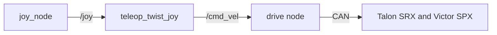

# Autonomy Subsystem Design

| Owner | Pair | Status | Last reviewed |
| --- | --- | --- | --- |
| [Adam] | [Jason] | Draft | [2026-10-26] |

## Scoring

### 1. Excavation Autonomy — 200 Points (§16.1, Pg. 48)

- The starting zone is included in the excavation zone.
- Must indicate to MCJ that the excavation attempt is autonomous rather than manual.
- Autonomous operation must begin before the robot engages in the regolith collection process.

### 2. Dump Autonomy — 100 Points (§16.2, Pg. 49)

- Must indicate to MCJ that the dump attempt is autonomous rather than manual.

### 3. Travel Autonomy — 500 Points (§16.3, Pg. 49)

- Touch sensors are not allowed.
- The robot cannot use previous knowledge about the layout of the arena.
  - It must use information gathered from its sensors to make navigation decisions independently.
  - Columns and walls may be used as landmarks.
- The robot cannot simply follow a wall at a fixed distance (e.g., maintaining a distance of 0.5 m).
- Waypoints and "Point and Traverse" navigation methods are not allowed.

### 4. 100% Autonomous Cycles — 1000 Points (§16.4, Pg. 50)

- Awarded if all excavation, travel, and dump cycles were completed autonomously, even if some manual control was used during the run.

### 5. Full Autonomy — 1400 Points (§16.5, Pg. 50)

- The robot may be moved manually within the starting zone at the beginning of the run.
- Autonomous operation must begin while the robot is still in the starting zone and must be maintained throughout the entire run.
- At least **2 complete cycles** of excavation, travel, and dumping must be completed during the construction run.

### 6. Automation Scoring Calculations (§16.6, Pg. 50)

The percentage of automation points earned for excavation, dumping, and travel is determined by the number of successful autonomous cycles divided by the total number of cycles.

**Example:**
- Total excavation cycles: 10
- Autonomous excavation cycles: 5
- Automation percentage: 50%
- Excavation autonomy points earned: 100 out of 200

#### 6.1 Berm Volume Multiplier (§16.6.1, Pg. 51)

A berm volume multiplier is applied to discourage teams from constructing undersized berms.

- **Berm volume ≥ 25 L (25,000 cm³):** Multiplier = 1
- **Berm volume < 25 L:** Multiplier = Berm Volume / 25,000 cm³

**Formula:**

$$
M = \min\left(1, \frac{V_{\text{berm}}}{25{,}000}\right)
$$

Where:
- `M` = Berm volume multiplier
- `V_berm` = Berm volume in cm³

**Goal:** Construct a berm of at least **25 L** to receive the full multiplier of 1.

#### 6.2 Scoring Formula (§16.6.2, Pg. 51)

The final autonomy score depends on the level of autonomy achieved.

**Case 1: Full Autonomy Achieved**

If the robot meets all full autonomy requirements:

$$
S = 1400 \times M
$$

**Case 2: 100% Autonomous Cycles Achieved**

If excavation, dumping, and travel are all 100% autonomous, but full autonomy requirements are not met:

$$
S = 1000 \times M
$$

**Case 3: Partial Autonomy**

Otherwise, the autonomy score is calculated using the percentage of successfully automated cycles for each task:

$$
S = (200E + 100D + 500T) \times M
$$

Where:
- `S` = Final autonomy score
- `M` = Berm volume multiplier
- `E` = Fraction of excavation cycles completed autonomously (0–1)
- `D` = Fraction of dump cycles completed autonomously (0–1)
- `T` = Fraction of travel cycles completed autonomously (0–1)

**Note:** The maximum available score for full autonomy is **1400 points**, provided the berm volume multiplier is 1.

## 1. Purpose and requirements

The autonomy subsystem acts as the Lunabotics rover's decision-making and navigation system. Its primary responsibility is to allow the rover to perceive its environment, determine where it needs to go, and navigate safely without relying on human control or prior knowledge of the competition arena. It must also coordinate with the excavation and dumping subsystems to enable fully autonomous regolith collection and transportation cycles.

- R1. The team's approach must meet the defined, allowed use of arena walls.
- R2. Autonomous travel must be achieved without the use of "breadcrumbs".
- R3. The robot must demonstrate visualization of real-time obstacle detection. [Deliverable 7.6]
- R4. The robot must demonstrate mapping of obstacles detected in real time. [Deliverable 7.5]
- R5. The robot must demonstrate path planning based on the associated obstacle mapping, which can be used by Mission Control. [Deliverable 7.6]
- R6. Explanations of the robot's autonomous systems must be satisfactory to the judges.

## 2. Nodes

| Node | Package | Runs on | What it does |
| --- | --- | --- | --- |
| [node] | [package] | [Jetson or operator laptop] | [what it does] |

## 3. Interfaces

This table is the contract between this subsystem and the rest of the robot. The code must
match it exactly, and a pull request that changes an interface updates this table in the
same pull request.

> **Delete this:** list every topic, service, and action. Kind is topic, service, or
> action. Use standard message types where they fit; custom types go in
> `luna_interfaces`. The row below is an example; replace it.

| Name | Kind | Type | Rate | Publisher or server | Subscriber or client | QoS |
| --- | --- | --- | --- | --- | --- | --- |
| `/example_topic` | topic | `geometry_msgs/msg/Twist` | 20 Hz | `example_publisher` | `example_subscriber` | reliable, depth 10 |

## 4. Parameters

| Parameter | Node | Type | Default | Units | Meaning |
| --- | --- | --- | --- | --- | --- |
| [parameter] | [node] | [type] | [default] | [units] | [meaning] |

## 5. Libraries and hardware interfaces

> **Delete this:** list the libraries and drivers this subsystem uses, and the hardware it
> talks to: buses, CAN IDs, USB devices, serial ports, and wiring.

## 6. Block diagram

> **Delete this:** draw the diagram in
> [Mermaid](https://mermaid.js.org/syntax/flowchart.html), which GitHub and the docs
> website render, and which diffs like code. The diagram below is an example; replace it.

## 7. Behavior on failure

> **Delete this:** say what happens when inputs stop, hardware faults, or the operator
> link drops. Every actuator must stop on its own.

| Failure | How it is detected | What the subsystem does |
| --- | --- | --- |
| [failure] | [detection] | [response] |

## 8. Test plan

> **Delete this:** say how each requirement is verified: unit tests, bench tests, and
> tests on the robot. Link logs and recordings.

| Requirement | Test | Where | Result |
| --- | --- | --- | --- |
| R1 | [test] | [bench or robot] | [result] |

## 9. Open questions

| Question | Owner | Due |
| --- | --- | --- |
| I added an extra section for scoring, is that fine? | Jason | 2026-10-26 |

## Handoff

