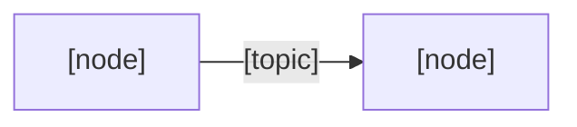

# Autonomy Subsystem Design

| Owner | Pair | Status | Last reviewed |
| --- | --- | --- | --- |
| Adam | Jason | Draft | 2026-10-26 |

## Scoring

### 1. Excavation Autonomy — 200 Points (§16.1, Pg. 55)

- The starting zone is included in the excavation zone.
- Must indicate to MCJ that the excavation attempt is autonomous rather than manual.
- Autonomous operation must begin before the robot engages in the regolith collection process.

### 2. Dump Autonomy — 100 Points (§16.2, Pg. 56)

- Must indicate to MCJ that the dump attempt is autonomous rather than manual.

### 3. Travel Autonomy — 500 Points (§16.3, Pg. 56)

- Touch sensors are not allowed.
- The robot cannot use previous knowledge about the layout of the arena.
  - It must use information gathered from its sensors to make navigation decisions independently.
  - Columns and walls may be used as landmarks.
- The robot cannot simply follow a wall at a fixed distance (e.g., maintaining a distance of 0.5 m).
- Waypoints and "Point and Traverse" navigation methods are not allowed.

### 4. 100% Autonomous Cycles — 1000 Points (§16.4, Pg. 57)

- Awarded if all excavation, travel, and dump cycles were completed autonomously, even if some manual control was used during the run.

### 5. Full Autonomy — 1400 Points (§16.5, Pg. 57)

- The robot may be moved manually within the starting zone at the beginning of the run.
- Autonomous operation must begin while the robot is still in the starting zone and must be maintained throughout the entire run.
- At least **2 complete cycles** of excavation, travel, and dumping must be completed during the construction run.

### 6. Automation Scoring Calculations (§16.6, Pg. 57)

The percentage of automation points earned for excavation, dumping, and travel is determined by the number of successful autonomous cycles divided by the total number of cycles.

**Example:**

- Total excavation cycles: 10
- Autonomous excavation cycles: 5
- Automation percentage: 50%
- Excavation autonomy points earned: 100 out of 200

#### 6.1 Berm Volume Multiplier (§16.6.1, Pg. 58)

A berm volume multiplier is applied to discourage teams from constructing undersized berms.

- **Berm volume ≥ 25 L (25,000 cm³):** Multiplier = 1
- **Berm volume < 25 L:** Multiplier = Berm Volume / 25,000 cm³

**Formula:**

```text
M = min(1, V_berm / 25,000)
```

Where:

- `M` = Berm volume multiplier
- `V_berm` = Berm volume in cm³

**Goal:** Construct a berm of at least **25 L** to receive the full multiplier of 1.

#### 6.2 Scoring Formula (§16.6.2, Pg. 58)

The final autonomy score depends on the level of autonomy achieved.

**Case 1: Full Autonomy Achieved**

If the robot meets all full autonomy requirements:

```text
S = 1400 × M
```

**Case 2: 100% Autonomous Cycles Achieved**

If excavation, dumping, and travel are all 100% autonomous, but full autonomy requirements are not met:

```text
S = 1000 × M
```

**Case 3: Partial Autonomy**

Otherwise, the autonomy score is calculated using the percentage of successfully automated cycles for each task:

```text
S = (200E + 100D + 500T) × M
```

Where:

- `S` = Final autonomy score
- `M` = Berm volume multiplier
- `E` = Fraction of excavation cycles completed autonomously (0–1)
- `D` = Fraction of dump cycles completed autonomously (0–1)
- `T` = Fraction of travel cycles completed autonomously (0–1)

**Note:** The maximum available score for full autonomy is **1400 points**, provided the berm volume multiplier is 1.


## 1. Purpose and requirements

The autonomy subsystem acts as the Lunabotics rover's decision-making and navigation system. Its primary responsibility is to allow the rover to perceive its environment, determine where it needs to go, and navigate safely without relying on human control or prior knowledge of the competition arena. It must also coordinate with the excavation and dumping subsystems to enable fully autonomous regolith collection and transportation cycles.

- R1. The team's approach must meet the defined, allowed use of arena walls.
- R2. Autonomous travel must be achieved without the use of "breadcrumbs".
- R3. The robot must demonstrate visualization of real-time obstacle detection. [Deliverable 7.6]
- R4. The robot must demonstrate mapping of obstacles detected in real time. [Deliverable 7.5]
- R5. The robot must demonstrate path planning based on the associated obstacle mapping, which can be used by Mission Control. [Deliverable 7.6]
- R6. Explanations of the robot's autonomous systems must be satisfactory to the judges.

### Budgets

This doc's share of each technical performance measure, from the
[performance budgets](performance-budgets.md).

<!-- design: budgets (generated from autonomy.toml by scripts/design render: edit that file, not this table) -->

| TPM | Element | Part | Budget |
| --- | --- | --- | --- |
| [TPM-1](performance-budgets.md#tpm-1-autonomous-cycles-completed-per-run) | SW.2.4, SW.2.2 | Excavation (§16.1) (SW.2.4 decides when to dig and stop; SW.1.3 digs; SW.2.2 confirms the robot is in the excavation zone) | 200 points |
| [TPM-1](performance-budgets.md#tpm-1-autonomous-cycles-completed-per-run) | SW.2.2, SW.2.3 | Travel (§16.3) (SW.2.2 localizes and maps; SW.2.3 plans and follows; SW.1.2 drives) | 500 points |
| [TPM-1](performance-budgets.md#tpm-1-autonomous-cycles-completed-per-run) | SW.2.4, SW.2.2 | Dump (§16.2) (SW.2.4 decides; SW.1.3 opens the hatch and runs the conveyor; SW.2.2 confirms the construction zone) | 100 points |
| [TPM-1](performance-budgets.md#tpm-1-autonomous-cycles-completed-per-run) | SW.2.4, SW.2.2, SW.2.3 | Full autonomy (§16.5): at least 2 cycles, starting in the starting zone (All of the above, plus SW.1.1 (stays enabled), SW.1.5 (passes AUTO commands), SW.3.1 (heartbeat), and SW.4 (link and logging)) | 1,400 × berm factor |
| [TPM-2](performance-budgets.md#tpm-2-autonomous-cycle-time) | SW.2.4 | Excavate until the bin is full (SW.1.3 runs the excavator; SW.2.4 decides when to stop) | ≤150 s |
| [TPM-2](performance-budgets.md#tpm-2-autonomous-cycle-time) | SW.2.3, SW.2.2 | Travel loaded across the obstacle zone (4.38 m long) (SW.2.3 plans and follows; SW.2.2 localizes; SW.1.2 drives) | ≤60 s |
| [TPM-2](performance-budgets.md#tpm-2-autonomous-cycle-time) | SW.2.3, SW.2.2 | Travel empty back | ≤60 s |
| [TPM-2](performance-budgets.md#tpm-2-autonomous-cycle-time) | SW.2.4 | Task-mode switches (4 per cycle) (SW.2.4 requests; SW.1.1 grants) | ≤4 (≤1 each) |
| [TPM-3](performance-budgets.md#tpm-3-time-from-run-start-to-the-first-cycle-starting) | SW.2.2 | Find position and heading from the random start | 0, since it is done during the 10-minute setup while the robot sits still (≤60 s of setup time) [TBR: proposed in the PDR (1.6)] |
| [TPM-3](performance-budgets.md#tpm-3-time-from-run-start-to-the-first-cycle-starting) | SW.2.4 | Sequencer picks a dig spot and starts | ≤2 s |
| [TPM-3](performance-budgets.md#tpm-3-time-from-run-start-to-the-first-cycle-starting) | SW.2.3 | Drive to the dig spot (the excavation zone includes the starting zone) | ≤20 s |
| [TPM-4](performance-budgets.md#tpm-4-obstacle-contacts-per-run) | SW.2.2 | Position error | 10 (TPM-5 goal) |
| [TPM-4](performance-budgets.md#tpm-4-obstacle-contacts-per-run) | SW.2.2 | Map cell size | 5 [TBR: proposed in the PDR (1.6)] |
| [TPM-4](performance-budgets.md#tpm-4-obstacle-contacts-per-run) | SW.2.3 | Path-following error (SW.2.3 with SW.1.2) | 10 [TBR: proposed in the PDR (1.6)] |
| [TPM-4](performance-budgets.md#tpm-4-obstacle-contacts-per-run) | SW.2.2 | Smallest rock mapped (guidebook §11.4: rocks are 30 to 40 cm across) | 30 cm across |
| [TPM-4](performance-budgets.md#tpm-4-obstacle-contacts-per-run) | SW.2.2 | Smallest crater mapped (craters are about 40 to 50 cm wide) | 40 cm wide |
| [TPM-4](performance-budgets.md#tpm-4-obstacle-contacts-per-run) | SW.2.2 | Detection range | ≥2.0 [TBR: proposed in the PDR (1.6)] |
| [TPM-5](performance-budgets.md#tpm-5-position-error-after-a-2-minute-drive) | SW.2.2 | Combined estimate (LiDAR, IMU, odometry) | ≤0.10 m |
| [TPM-6](performance-budgets.md#tpm-6-average-link-bandwidth-over-a-run) | SW.2.2 | Obstacle map, on by default in AUTO (a 5 cm grid of the arena is about 110 kbit per update) | 0 kbit/s in TELEOP (default view), 150 kbit/s in AUTO (default view) |
| [TPM-6](performance-budgets.md#tpm-6-average-link-bandwidth-over-a-run) | SW.2.3 | Planned path, on by default in AUTO | 0 kbit/s in TELEOP (default view), 50 kbit/s in AUTO (default view) |
| [TPM-6](performance-budgets.md#tpm-6-average-link-bandwidth-over-a-run) | SW.2.4 | Nothing | 0 kbit/s in TELEOP (default view), 0 kbit/s in AUTO (default view) |
| [TPM-10](performance-budgets.md#tpm-10-energy-used-per-autonomous-cycle) | SW.2.3 | Travel, loaded and empty (SW.1.2 (limits), SW.2.3 (path length)) | [TBD: baseline] |
| [TPM-11](performance-budgets.md#tpm-11-robot-computer-processor-load-averaged-over-a-run) | SW.2.2 | Localization and mapping | [TBD: autonomy doc v1 (7.8)]; expected to be the largest share |
| [TPM-11](performance-budgets.md#tpm-11-robot-computer-processor-load-averaged-over-a-run) | SW.2.3 | Path planning and following | [TBD: autonomy doc v1 (7.8)] |
| [TPM-11](performance-budgets.md#tpm-11-robot-computer-processor-load-averaged-over-a-run) | SW.2.4 | Task sequencer | [TBD: autonomy doc v1 (7.8)] |
| [TPM-12](performance-budgets.md#tpm-12-restart-time) | SW.2.2 | Position found | ≤60 (as in TPM-3) |

<!-- /design -->

## 2. Nodes

<!-- design: nodes (generated from autonomy.toml by scripts/design render: edit that file, not this table) -->

| Node | Package | Runs on | Element | What it does |
| --- | --- | --- | --- | --- |
| Localization and mapping | [TBD: its nodes, autonomy doc (7.2)] | Robot computer | SW.2.2 Localization and mapping | Finds the robot's position and heading from the random start, and builds the obstacle map, from the LiDAR, the IMUs, and the wheels |
| Path planning and following | [TBD: its nodes, autonomy doc (7.2)] | Robot computer | SW.2.3 Path planning and following | Plans a path around the mapped obstacles to the target zone, and follows it in AUTO |
| Task sequencer | [TBD: autonomy doc (7.2)] | Robot computer | SW.2.4 Task sequencer | Runs dig, travel, dump, travel in AUTO: changes the task mode and sends mechanism commands, but can never enable the robot |

<!-- /design -->

## 3. Interfaces

This table is the contract between this subsystem and the rest of the robot. The code must
match it exactly. It is generated from `autonomy.toml`, so a pull request that changes an
interface edits that file and runs `scripts/design render`, in the same pull request as
the code ([Registries](README.md#registries)).

> **Delete this:** the rows below are what the other docs assume autonomy provides and
> uses, from the PDR's element list. Confirm or change each one in `autonomy.toml`, and
> replace each `[TBD]` with the real name, type, rate, and QoS. Use standard message types
> where they fit; custom types go in `luna_interfaces`.

<!-- design: interfaces (generated from autonomy.toml by scripts/design render: edit that file, not this table) -->

| Name | Kind | Type | Rate | Publisher or server | Subscriber or client | QoS |
| --- | --- | --- | --- | --- | --- | --- |
| [TBD: obstacle map topic, autonomy doc (7.2)] | topic | nav_msgs/msg/OccupancyGrid [TBR: autonomy doc (7.2)] | [TBD: autonomy doc (7.2)] | Localization and mapping | Path planning and following, Operator frontend | [TBD: autonomy doc (7.2)] |
| [TBD: planned path topic, autonomy doc (7.2)] | topic | nav_msgs/msg/Path [TBR: autonomy doc (7.2)] | [TBD: autonomy doc (7.2)] | Path planning and following | Operator frontend | [TBD: autonomy doc (7.2)] |
| [TBD: AUTO drive command topic, teleop open question 3] | topic | geometry_msgs/msg/TwistStamped [TBR: matches /cmd_vel] | [TBD: autonomy doc (7.2)] | Path planning and following | Command selection node | [TBD: autonomy doc (7.2)] |
| [TBD: AUTO mechanism command topic, teleop open question 3] | topic | [TBD: mechanism doc (4.2)] | [TBD: autonomy doc (7.2)] | Task sequencer | Command selection node | [TBD: autonomy doc (7.2)] |
| `/diagnostics` | topic | `diagnostic_msgs/msg/DiagnosticArray` | 1 Hz and on change | Drivetrain node, Mechanism node, Camera driver, Dedicated IMU driver, Localization and mapping, Path planning and following, Task sequencer | `mode_manager` | reliable, depth 10 |
| `/robot/mode` | topic | `luna_interfaces/msg/RobotMode` | 10 Hz and on change | `mode_manager` | Drivetrain node, Mechanism node, Command selection node, Path planning and following, Task sequencer, Operator frontend, `teleop_node` | reliable, transient local, depth 1 |
| `/robot/request_task` | service | `luna_interfaces/srv/RequestTask` | On demand | `mode_manager` | Task sequencer | default |
| `/drivetrain/joint_states` | topic | `sensor_msgs/msg/JointState` | 50 Hz [TBR: drivetrain draft, PR #17] | Drivetrain node | Localization and mapping | sensor data: best effort, depth 5 [TBR: drivetrain draft, PR #17] |
| [TBD: wheel odometry topic, system open question 9] | topic | nav_msgs/msg/Odometry [TBR: system open question 9] | [TBD: drivetrain doc (3.1)] | Drivetrain node | Localization and mapping | [TBD: drivetrain doc (3.1)] |
| `/mechanism/status` | topic | [TBD: mechanism doc (4.2)] | [TBD: mechanism doc (4.2)] | Mechanism node | `mode_manager`, Task sequencer, Operator frontend | [TBD: mechanism doc (4.2)] |
| `unilidar/cloud` | topic | `sensor_msgs/msg/PointCloud2` | [TBD: sensors doc (6.2)] | Unitree L2 driver | Localization and mapping | [TBD: sensors doc (6.2)] |
| `unilidar/imu` | topic | `sensor_msgs/msg/Imu` | [TBD: sensors doc (6.2)] | Unitree L2 driver | Localization and mapping | [TBD: sensors doc (6.2)] |
| `imu/data_raw` | topic | `sensor_msgs/msg/Imu` | [TBD: sensors doc (6.2)] | Dedicated IMU driver | Localization and mapping | [TBD: sensors doc (6.2)] |

<!-- /design -->

## 4. Parameters

| Parameter | Node | Type | Default | Units | Meaning |
| --- | --- | --- | --- | --- | --- |
| [parameter] | [node] | [type] | [default] | [units] | [meaning] |

## 5. Libraries and hardware interfaces

> **Delete this:** list the libraries and drivers this subsystem uses, and the hardware it
> talks to: buses, CAN IDs, USB devices, serial ports, and wiring.

## 6. Block diagram

> **Delete this:** draw the diagram in
> [Mermaid](https://mermaid.js.org/syntax/flowchart.html), which GitHub and the docs
> website render, and which diffs like code. The diagram below is an example; replace it.



## 7. Behavior on failure

> **Delete this:** say what happens when inputs stop, hardware faults, or the operator
> link drops. Every actuator must stop on its own.

| Failure | How it is detected | What the subsystem does |
| --- | --- | --- |
| [failure] | [detection] | [response] |

## 8. Test plan

> **Delete this:** say how each requirement is verified: unit tests, bench tests, and
> tests on the robot. Link logs and recordings.

| Requirement | Test | Where | Result |
| --- | --- | --- | --- |
| R1 | [test] | [bench or robot] | [result] |

## 9. Open questions

<!-- design: questions (generated from autonomy.toml by scripts/design render: edit that file, not this table) -->

| Question | Status | Turgor |
| --- | --- | --- |
| 1. I added an extra section for scoring, is that fine? | Open | None |

<!-- /design -->

## Handoff

