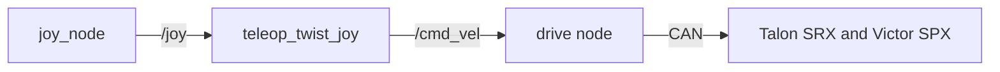

# [Drivetrain] Subsystem Design

>
> Status is one of `Draft` (being written), `Approved` (reviewed, no code yet),
> `In progress` (code being written to match), `Current` (code matches), or `Superseded`
> (replaced; link the replacement). [Design docs](README.md#status) explains each one.

| Owner | Pair | Status | Last reviewed |
| --- | --- | --- | --- |
| [Aadhav] | [name] | Draft | [2026-10-18] |

## 1. Purpose and requirements

- R1. [The robot stays in drivetrain mode]
- R2. [Nothing moves unless the robot is ENABLED and drivetrain mode is actuated. The robot is DISABLED after boot and after a fault is cleared, and it never enables itself]
- R3. [drivetrain mode is zero within 100 ms of a disable command, and within link_timeout plus 100 ms of the last operator heartbeat]
- R4. [After a fault or an E-stop, moving again takes two deliberate operator actions: clear the fault, then enable]
- R5. [In drivetrain mode, the current limits of the actuators it allows, plus the electronics, add up to less than the main breaker's rating. The power budget relies on this]
- R6. [One control on the operator station disables the robot from drivetrain mode, to obey the power-off command and the end-of-run inhibit]
- R7. [Link to operator station must have a total average of 4,000 kbit/s or less across all modes]

## 2. Nodes

| Node | Package | Runs on | What it does |
| --- | --- | --- | --- |
| [drivetrain_node] | [luna_drivetrain] | [Jetson] | [Owns the robot state and task mode, runs the boot self-test, watches the heartbeat, faults, and battery, and accepts or refuses mode requests] |

## 3. Interfaces

This table is the contract between this subsystem and the rest of the robot. The code must
match it exactly, and a pull request that changes an interface updates this table in the
same pull request.

| Name | Kind | Type | Rate | Publisher or server | Subscriber or client | QoS |
| --- | --- | --- | --- | --- | --- | --- |
| `/robot/mode` | topic | `luna_interfaces/msg/RobotMode` | 10 Hz and on change | `mode_manager` | `luna_drivetrain` | reliable, transient, local, depth 1 |

| --- | --- | --- | --- | --- | --- | --- |

## 4. Parameters

| Parameter | Node | Type | Default | Units | Meaning |
| --- | --- | --- | --- | --- | --- |
| [mode_timeout] | [luna_drivetrain] | [double] | [0.3] | [s] | [If the last /robot/mode is older than this, act as DISABLED] |
| [creep_output] | [luna_drivetrain] | [double] | [0.2] | [fraction] | [Largest drive output in EXCAVATE and DUMP] |
| [current_limit.<actuator>.<task>]| [lune_drivetrain] | [double] | --- | --- | --- |

## 5. Libraries and hardware interfaces

> **Delete this:** list the libraries and drivers this subsystem uses, and the hardware it
> talks to: buses, CAN IDs, USB devices, serial ports, and wiring. Cite every hardware
> value and competition rule from its primary source, as
> [Cite sources](../writing-docs.md#cite-sources) explains.

## 6. Block diagram

> **Delete this:** draw the diagram in
> [Mermaid](https://mermaid.js.org/syntax/flowchart.html), which GitHub and the docs
> website render, and which diffs like code. The diagram below is an example; replace it.

## 7. Behavior on failure

> **Delete this:** say what happens when inputs stop, hardware faults, or the operator
> link drops. Every actuator must stop on its own.

| Failure | How it is detected | What the subsystem does |
| --- | --- | --- |
| [failure] | [detection] | [response] |

## 8. Test plan

> **Delete this:** say how each requirement is verified: unit tests, bench tests, and
> tests on the robot. Link logs and recordings.

| Requirement | Test | Where | Result |
| --- | --- | --- | --- |
| R1 | [test] | [bench or robot] | [result] |

## 9. Open questions

| Question | Owner | Due |
| --- | --- | --- |
| [question] | [name] | [YYYY-MM-DD] |

## Handoff

> **Delete this:** fill in at the end of each semester: five lines on what works, what
> does not, and what comes next.