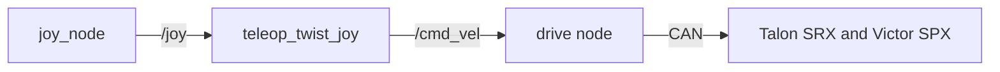

# [Drivetrain] Subsystem Design

>
> Status is one of `Draft` (being written), `Approved` (reviewed, no code yet),
> `In progress` (code being written to match), `Current` (code matches), or `Superseded`
> (replaced; link the replacement). [Design docs](README.md#status) explains each one.

| Owner | Pair | Status | Last reviewed |
| --- | --- | --- | --- |
| [Aadhav] | [name] | Draft | [2026-10-18] |

## 1. Purpose and requirements

- R1. [The robot stays in drivetrain mode]
- R2. [Nothing moves unless the robot is ENABLED and drivetrain mode is actuated. The robot is DISABLED after boot and after a fault is cleared, and it never enables itself]
- R3. [drivetrain mode is zero within 100 ms of a disable command, and within link_timeout plus 100 ms of the last operator heartbeat]
- R4. [After a fault or an E-stop, moving again takes two deliberate operator actions: clear the fault, then enable]
- R5. [In drivetrain mode, the current limits of the actuators it allows, plus the electronics, add up to less than the main breaker's rating. The power budget relies on this]
- R6. [One control on the operator station disables the robot from drivetrain mode, to obey the power-off command and the end-of-run inhibit]
- R7. [Link to operator station must have a total average of 4,000 kbit/s or less across all modes]

## 2. Nodes

| Node | Package | Runs on | What it does |
| --- | --- | --- | --- |
| [drivetrain_node] | [luna_drivetrain] | [Jetson] | [Owns the robot state and task mode, runs the boot self-test, watches the heartbeat, faults, and battery, and accepts or refuses mode requests] |

## 3. Interfaces

This table is the contract between this subsystem and the rest of the robot. The code must
match it exactly, and a pull request that changes an interface updates this table in the
same pull request.

| Name | Kind | Type | Rate | Publisher or server | Subscriber or client | QoS |
| --- | --- | --- | --- | --- | --- | --- |
| `/robot/mode` | topic | `luna_interfaces/msg/RobotMode` | 10 Hz and on change | `mode_manager` | `luna_drivetrain` | reliable, transient, local, depth 1 |

| --- | --- | --- | --- | --- | --- | --- |

## 4. Parameters

| Parameter | Node | Type | Default | Units | Meaning |
| --- | --- | --- | --- | --- | --- |
| [mode_timeout] | [luna_drivetrain] | [double] | [0.3] | [s] | [If the last /robot/mode is older than this, act as DISABLED] |
| [creep_output] | [luna_drivetrain] | [double] | [0.2] | [fraction] | [Largest drive output in EXCAVATE and DUMP] |
| [current_limit.<drive>.<travel>]| [luna_drivetrain] | [double] | [30] | [A] | Current limit for travel |
| [current_limit.<drive>.<excavate>]| [luna_drivetrain] | [double] | [15] | [A] | Current limit for excavate |
| [current_limit.<drive>.<dump>]| [luna_drivetrain] | [double] | [15] | [A] | Current limit for dump |
| [current_limit.<drive>.<service>]| [luna_drivetrain] | [double] | [15] | [A] | Current limit for service |
| [voltage_compensation]| [luna_drivetrain] | [double] | [12.0] | [V] | Motor controllers scale their output to this voltage |

## 5. Libraries and hardware interfaces

- **Phoenix 5 enable.** 
    The motor controllers run only while some process calls `ctre::phoenix::unmanaged::Unmanaged::FeedEnable(timeoutMs)`; they disable themselves when `timeoutMs` passes without another call ([Phoenix C++ API, section "FeedEnable()"](../sources.md#ctre-phoenix5-unmanaged-api)). Our code passes 100 ms, which matches R3. The enable frame (`000401BF` in `candump`, see [CAN bus](../can-bus.md)) carries no device number, so it looks like it enables every CTRE motor controller on the bus, whichever process sends it. Exactly one process may feed it, and only while ENABLED (see open question in section 9).
- **PDP over CAN.** 
    The PDP reports battery voltage, the current on each channel, and the energy used ([PDP User's Guide, pp. 17-20](../sources.md#ctre-pdp-guide)), which feed `/power/battery`. Logging them by mode checks the power budget (R5) against real runs.
- **Motor controller settings.** 
    `drivetrain_node` sets each drive motor controller's current limit, voltage    compensation, and neutral mode at startup from the parameters in section 4. Neutral mode is brake, so the robot holds still when disabled.
- **E-stop, main breaker, and energy logger.** 
    Hardware only, with no software interface. The Jetson is fed straight from the battery (its carrier takes 9 to 20 V, 
[carrier board specification, p. 7](../sources.md#nvidia-orin-nano-carrier-spec)).

## 6. Block diagram

> **Delete this:** draw the diagram in
> [Mermaid](https://mermaid.js.org/syntax/flowchart.html), which GitHub and the docs
> website render, and which diffs like code. The diagram below is an example; replace it.

## 7. Behavior on failure

> **Delete this:** say what happens when inputs stop, hardware faults, or the operator
> link drops. Every actuator must stop on its own.

| Failure | How it is detected | What the subsystem does |
| --- | --- | --- |
| [Operator link lost] | [No heartbeat detected for link_timeout] | [ENABLED becomes DISABLED with the reason "link lost". The operator enables again once the link is back. This applies in AUTO too, because while the link is down the robot cannot hear the power-off command] |
| [mode_manager stops] | [/robot/mode older than mode_timeout] | [Each actuator node sets its outputs to zero and the enable stops being fed] |
| [The node feeding the enable stops] | [The Phoenix enable times out] | [Motor controllers disable themselves within 100 ms] |
| [Drive commands stop] | [/cmd_vel older than the drivetrain's timeout] | [Drive output zero; mode unchanged] |
| --- | --- | --- |

## 8. Test plan

> **Delete this:** say how each requirement is verified: unit tests, bench tests, and
> tests on the robot. Link logs and recordings.

| Requirement | Test | Where | Result |
| --- | --- | --- | --- |
| R1 | [test] | [bench or robot] | [result] |

## 9. Open questions

| Question | Owner | Due |
| --- | --- | --- |
| [question] | [name] | [YYYY-MM-DD] |

## Handoff

> **Delete this:** fill in at the end of each semester: five lines on what works, what
> does not, and what comes next.