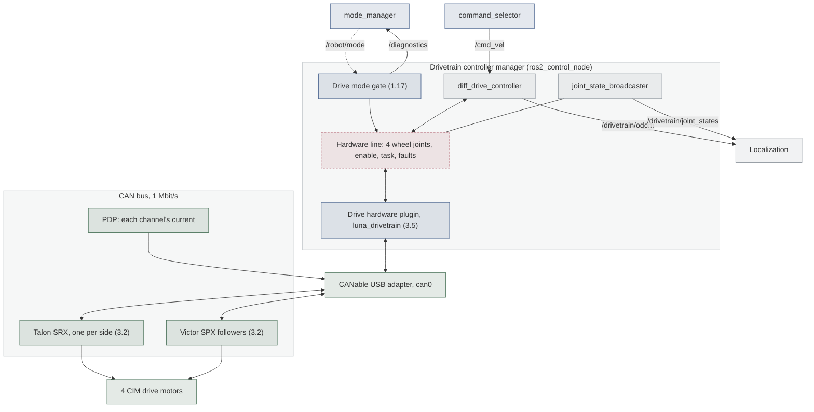

# Drivetrain Subsystem Design

| Owner | Status | Last reviewed |
| --- | --- | --- |
| ja-zoe | Draft | 2026-11-14 |

This doc designs the code that turns a velocity command into turning wheels: SW.1.2 in the
[system design](system.md). It runs on ros2_control: the stock diff drive controller does
the kinematics and the odometry, our hardware plugin talks to the motor controllers over
CAN, and a mode gate of ours enables it only as the
[operating modes design](operating-modes.md) allows. The rover is skid-steer: four wheels,
two per side, each side driven together.

## 1. Purpose and requirements

- R1. Obey `/robot/mode`. If the last `/robot/mode` arrived longer ago than
  `mode_timeout`, or none has arrived, act as DISABLED.
- R2. Turn the wheels only while the robot is ENABLED. Output is zero after boot and after
  a fault is cleared, and the drivetrain never enables the robot itself.
- R3. Stop fast. Output is zero within 100 ms of a disable command, within `link_timeout`
  plus 100 ms of the last operator heartbeat
  ([guidebook §13.9.19, p. 45](../sources.md#nasa-lunabotics-guidebook-2027)), and within
  `mode_timeout` plus 100 ms if `mode_manager` stops. This holds in every task mode. If
  drive commands stop, the robot starts slowing within `cmd_vel_timeout` plus one control
  cycle, as fast as its deceleration limits allow.
- R4. Never replay an old command. A command older than `cmd_vel_timeout` when it arrives
  is dropped, and after the robot is enabled again the first output comes from a new
  command, ramped up from zero.
- R5. Follow the task mode's limits: 30 A per motor in TRAVEL, 15 A in EXCAVATE, DUMP, and
  SERVICE, and creep output in EXCAVATE and DUMP. The power budget relies on this
  ([operating modes R7](operating-modes.md#1-purpose-and-requirements)).
- R6. Detect a stalled drive motor and stop it before it overheats. The current limit
  alone does not protect it
  ([operating modes, Current limits per mode](operating-modes.md#current-limits-per-mode)).
- R7. Run the same drive code on stub hardware, fake motor controllers, Gazebo, and the
  real motor controllers ([system R1](system.md#1-purpose-and-requirements)).
- R8. Keep drivetrain data on the operator link at or below 50 kbit/s [TBR: TPM-6's
  drivetrain row]. Full-rate data stays on the robot computer
  ([operating modes R10](operating-modes.md#1-purpose-and-requirements)).
- R9. Publish wheel odometry for localization, which fuses it with the IMUs and the LiDAR
  ([autonomy design](autonomy.md)).

### Budgets

This doc's share of each technical performance measure, from the
[performance budgets](performance-budgets.md).

<!-- design: budgets (generated from drivetrain.toml by scripts/design render: edit that file, not this table) -->

| TPM | Element | Part | Budget |
| --- | --- | --- | --- |
| [TPM-1](performance-budgets.md#tpm-1-autonomous-cycles-completed-per-run) | SW.1.2 | Travel (§16.3) (SW.2.2 localizes and maps; SW.2.3 plans and follows; SW.1.2 drives) | 500 points |
| [TPM-1](performance-budgets.md#tpm-1-autonomous-cycles-completed-per-run) | SW.1.2 | Full autonomy (§16.5): at least 2 cycles, starting in the starting zone (All of the above, plus SW.1.1 (stays enabled), SW.1.5 (passes AUTO commands), SW.3.1 (heartbeat), and SW.4 (link and logging)) | 1,400 × berm factor |
| [TPM-2](performance-budgets.md#tpm-2-autonomous-cycle-time) | SW.1.2 | Travel loaded across the obstacle zone (4.38 m long) (SW.2.3 plans and follows; SW.2.2 localizes; SW.1.2 drives) | ≤60 s |
| [TPM-2](performance-budgets.md#tpm-2-autonomous-cycle-time) | SW.1.2 | Travel empty back | ≤60 s |
| [TPM-3](performance-budgets.md#tpm-3-time-from-run-start-to-the-first-cycle-starting) | SW.1.2 | Drive to the dig spot (the excavation zone includes the starting zone) | ≤20 s |
| [TPM-4](performance-budgets.md#tpm-4-obstacle-contacts-per-run) | SW.1.2 | Path-following error (SW.2.3 with SW.1.2) | 10 [TBR: proposed in the PDR (1.6)] |
| [TPM-5](performance-budgets.md#tpm-5-position-error-after-a-2-minute-drive) | SW.1.2 | Wheel odometry error around a 2 m square | [TBD: measured in 3.9 (Gazebo) and 3.7 (robot); it needs drive encoders, which 6.1 has not confirmed] |
| [TPM-6](performance-budgets.md#tpm-6-average-link-bandwidth-over-a-run) | SW.1.2 | Drivetrain data [TBR: drivetrain doc (3.1)] | 50 kbit/s in TELEOP (default view), 50 kbit/s in AUTO (default view) |
| [TPM-7](performance-budgets.md#tpm-7-stop-time-after-a-disable-command) | SW.1.2 | Receive DISABLED and send zero output on CAN, in the next 50 Hz control loop (SW.1.2 and SW.1.3, in parallel) | ≤90 ms |
| [TPM-8](performance-budgets.md#tpm-8-stop-time-after-link-loss) | SW.1.2 | Disable chain (TPM-7) | ≤100 ms |
| [TPM-9](performance-budgets.md#tpm-9-peak-current-in-the-worst-task-mode) | SW.1.2 | Drive, 4 motors at 15 A (creep, 20% output) | 60 A |
| [TPM-10](performance-budgets.md#tpm-10-energy-used-per-autonomous-cycle) | SW.1.2 | Travel, loaded and empty (SW.1.2 (limits), SW.2.3 (path length)) | [TBD: baseline] |
| [TPM-11](performance-budgets.md#tpm-11-robot-computer-processor-load-averaged-over-a-run) | SW.1.2 | Robot control (SW.1.1 to SW.1.5) | [TBD: autonomy doc v1 (7.8)] |

<!-- /design -->

## 2. Nodes

The drivetrain runs in its own controller manager, `ros2_control_node`, in the
`/drivetrain` namespace [TBR], so its nodes are named `/drivetrain/controller_manager`,
`/drivetrain/diff_drive_controller`, and so on, apart from the mechanism's. It loads three
controllers, each a node, and our hardware plugin, which is not a node:

- **`diff_drive_controller`** is ros2_controllers' controller for robots that steer by
  turning their two sides at different speeds. It takes `/cmd_vel`, gives each side's two
  wheels the same speed, and works out the odometry
  ([diff_drive_controller](../sources.md#ros2-controllers-diff-drive)). Read the Jazzy
  version of its page, which the link opens: later versions drop parameters that Jazzy
  still has, such as `publish_rate`.
- **`joint_state_broadcaster`** publishes the wheels' states for everything else, such as
  RViz and localization.
- **The drive mode gate** is ours (deliverable 1.17). It follows `/robot/mode` and tells the
  hardware plugin whether it may move, and in which task mode
  ([operating modes, section 5](operating-modes.md#5-libraries-and-hardware-interfaces)).
- **The drive hardware plugin** is ours, in `luna_drivetrain` (deliverable 3.5). It is the
  hardware line: the only code below it is the stand-in or the motor controllers
  (section 5).

The mechanism has a controller manager of its own ([mechanism design](mechanism.md)), so
each subsystem is enabled, and stops, on its own.

<!-- design: nodes (generated from drivetrain.toml by scripts/design render: edit that file, not this table) -->

| Node | Package | Runs on | Element | What it does |
| --- | --- | --- | --- | --- |
| `diff_drive_controller` | `diff_drive_controller` (ros2_controllers), in the drivetrain's controller manager | Robot computer | SW.1.2 Drivetrain control | Turns /cmd_vel into left and right wheel speeds within the speed and acceleration limits, drops a command older than cmd_vel_timeout, zeroes the wheels when commands stop, and publishes wheel odometry |
| `joint_state_broadcaster` (drivetrain) | `joint_state_broadcaster` (ros2_controllers), in the drivetrain's controller manager | Robot computer | SW.1.2 Drivetrain control | Publishes each wheel joint's position and velocity from the drive hardware plugin's state interfaces |
| Drive mode gate | `luna_modes` [TBR: 1.17 builds it], in the drivetrain's controller manager | Robot computer | SW.1.2 Drivetrain control | Writes enable and the task mode to the drive hardware plugin from /robot/mode, writes enable 0 when /robot/mode goes stale, and reports the plugin's faults and stalls on /diagnostics |

<!-- /design -->

## 3. Interfaces

This table is the contract between this subsystem and the rest of the robot. The code must
match it exactly. It is generated from this doc's registry, so a pull request that changes
an interface edits the registry and runs `scripts/design render`, in the same pull request
as the code ([Registries](README.md#registries)).

<!-- design: interfaces (generated from drivetrain.toml by scripts/design render: edit that file, not this table) -->

| Name | Kind | Type | Rate | Publisher or server | Subscriber or client | QoS |
| --- | --- | --- | --- | --- | --- | --- |
| `/drivetrain/odom` | topic | `nav_msgs/msg/Odometry` | `publish_rate`, 50 Hz | `diff_drive_controller` | Localization and mapping | the system default: reliable, volatile |
| `/drivetrain/joint_states` | topic | `sensor_msgs/msg/JointState` | The controller manager's `update_rate`, 50 Hz | `joint_state_broadcaster` (drivetrain) | Localization and mapping | the system default: reliable, volatile |
| `/cmd_vel` | topic | `geometry_msgs/msg/TwistStamped` | The active source's rate: `command_rate`, 20 Hz | `command_selector` | `diff_drive_controller` | reliable, volatile, depth 1 |
| `/diagnostics` | topic | `diagnostic_msgs/msg/DiagnosticArray` | 1 Hz and on change | Drive mode gate, Mechanism node, Camera driver, Dedicated IMU driver, Localization and mapping, Path planning and following, Task sequencer | `mode_manager` | reliable, depth 10 |
| `/robot/mode` | topic | `luna_interfaces/msg/RobotMode` | 10 Hz and on change | `mode_manager` | Drive mode gate, Mechanism node, `command_selector`, Path planning and following, Task sequencer, Operator frontend, `teleop_node` | reliable, transient local, depth 1 |

<!-- /design -->

**How the controller judges a command's age.** The diff drive controller compares each
command's own timestamp, not its arrival time, with the time now. It drops a command that
is already older than `cmd_vel_timeout` when it arrives, and it zeroes the wheels once the
last command it took grows older than that
([diff_drive_controller.cpp](../sources.md#ros2-controllers-diff-drive-source)). So
`command_selector` must forward each command with the timestamp its source gave it
([system design, Conventions](system.md#4-parameters)). A command with a zero timestamp is
stamped with the time it arrived, which is how a test script's `ros2 topic pub` still
drives the robot.

**Why `/cmd_vel` is reliable.** The controller subscribes with the system default QoS,
which is reliable, and a reliable subscription never hears a best effort publisher, so
`command_selector` publishes it reliable
([diff_drive_controller.cpp](../sources.md#ros2-controllers-diff-drive-source)).

**The hardware line.** The plugin offers these interfaces to the controllers, and the stub
and Gazebo stand-ins offer the same ones ([system design, Hardware lines](system.md#hardware-lines)):

| Interface | Kind | Units | Used by |
| --- | --- | --- | --- |
| `<wheel>/velocity`, for each of the 4 wheel joints | Command | rad/s | `diff_drive_controller` |
| `<wheel>/velocity` and `<wheel>/position` | State | rad/s and rad | `diff_drive_controller`, `joint_state_broadcaster` |
| `drive_mode/enable` | Command (GPIO) | 1 or 0 | The drive mode gate |
| `drive_mode/task` | Command (GPIO) | RobotMode's task number | The drive mode gate |
| `drive_mode/fault` and `drive_mode/stalled` | State (GPIO) | 1 or 0 | The drive mode gate, which reports them on `/diagnostics` |

The wheel joints' names come from the robot model: [TBR: `front_left_wheel_joint`,
`rear_left_wheel_joint`, `front_right_wheel_joint`, and `rear_right_wheel_joint`, for the
robot model (6.3) to confirm]. Without drive encoders the velocity and position states
repeat the commands (open question 2).

## 4. Parameters

| Parameter | Node | Type | Default | Units | Meaning |
| --- | --- | --- | --- | --- | --- |
| `update_rate` | Controller manager | int | 50 [TBR] | Hz | Control cycle, which also feeds the Phoenix enable |
| `left_wheel_names`, `right_wheel_names` | `diff_drive_controller` | string array | The two wheel joints on each side | None | Which joints each side drives |
| `wheel_separation` | `diff_drive_controller` | double | [TBD: measured on the drive base] | m | Distance between the left and right wheels' centers |
| `wheel_separation_multiplier` | `diff_drive_controller` | double | 1.0 [TBR: calibrated, open question 5] | None | Corrects the separation for skid-steer slip |
| `wheel_radius` | `diff_drive_controller` | double | [TBD: measured on the drive base] | m | Wheel radius |
| `cmd_vel_timeout` | `diff_drive_controller` | double | 0.25 [TBR] | s | A command older than this is dropped, and the wheels stop when the last one gets this old. Five periods of the sources' 20 Hz. |
| `linear.x.max_velocity` | `diff_drive_controller` | double | [TBD: the drive base's top speed, 3.7] | m/s | Fastest forward or reverse speed |
| `linear.x.max_acceleration` | `diff_drive_controller` | double | [TBD: 3.7] | m/s² | How quickly speed may change, which ramps every start from zero (R4) |
| `angular.z.max_velocity` | `diff_drive_controller` | double | [TBD: 3.7] | rad/s | Fastest turn |
| `linear.x.max_deceleration`, `linear.x.max_deceleration_reverse` | `diff_drive_controller` | double | [TBR: as high as the drive base takes without tipping or skidding, 3.7] | m/s² | How quickly the robot may slow, going forward and in reverse, which also sets how quickly it stops when commands stop |
| `angular.z.max_acceleration` | `diff_drive_controller` | double | [TBD: 3.7] | rad/s² | How quickly turning may change |
| `publish_rate` | `diff_drive_controller` | double | 50.0 | Hz | Odometry rate |
| `enable_odom_tf` | `diff_drive_controller` | bool | false | None | Localization publishes `odom` to `base_link` instead |
| `odom_frame_id`, `base_frame_id` | `diff_drive_controller` | string | `odom`, `base_link` | None | The odometry's frames ([REP 105](../sources.md#ros-rep-105)) |
| `open_loop` | `diff_drive_controller` | bool | false [TBR: true without encoders, open question 2] | None | Odometry from the commands instead of the wheels |
| `pose_covariance_diagonal`, `twist_covariance_diagonal` | `diff_drive_controller` | double array | [TBD: from the 2 m square, 3.9 and 3.7] | None | How far localization trusts the odometry |
| `mode_timeout` | Drive mode gate | double | 0.3 | s | [Operating modes, section 4](operating-modes.md#4-parameters) |
| `enabled_tasks` | Drive mode gate | string array | TRAVEL, EXCAVATE, DUMP, SERVICE | None | Task modes in which the drive may move |
| `can_interface` | Drive hardware plugin | string | `can0` | None | SocketCAN interface of the CANable adapter |
| `<wheel>.can_id`, `<wheel>.follows` | Drive hardware plugin | int, string | [TBD: 3.2 and the wiring] | None | Each wheel's motor controller, and for a follower, the wheel whose controller it copies |
| `<wheel>.pdp_channel` | Drive hardware plugin | int | [TBD: Electrical's wiring] | None | The PDP channel that powers the wheel's motor controller (section 5) |
| `max_wheel_speed` | Drive hardware plugin | double | [TBD: measured, 3.6] | rad/s | Wheel speed at full output, to turn a speed into an output without encoders |
| `creep_output` | Drive hardware plugin | double | 0.2 | fraction | Largest output in EXCAVATE and DUMP |
| `current_limit.drive.<task>` | Drive hardware plugin | double | 30 in TRAVEL, 15 otherwise [TBR] | A | Supply current limit per motor ([operating modes](operating-modes.md#current-limits-per-mode)) |
| `voltage_compensation` | Drive hardware plugin | double | 12.0 | V | Motor controllers scale their output to this voltage |
| `stall_current`, `stall_time` | Drive hardware plugin | double | [TBD: 3.6] | A, s | A motor drawing more than `stall_current` for `stall_time` at low speed counts as stalled (section 5) |

The diff drive controller's parameters and defaults are on its page
([diff_drive_controller, section "Parameters"](../sources.md#ros2-controllers-diff-drive)).
The plugin's parameters go in the robot model's `ros2_control` tag, so each test mode's
stand-in can leave them out.

## 5. Libraries and hardware interfaces

- **ros2_control and the diff drive controller.** The controller takes
  `geometry_msgs/msg/TwistStamped` on `~/cmd_vel`, uses only its forward speed and its turn
  rate, publishes `~/odom` and, unless `enable_odom_tf` is false, the `odom` to `base_link`
  transform, and stops after `cmd_vel_timeout`, 0.5 s unless set
  ([diff_drive_controller, section "ROS 2 Interfaces"](../sources.md#ros2-controllers-diff-drive)).
  Its acceleration limits ramp every change of speed, including the first one after an
  enable (R4). When commands stop, it sets the speed it is aiming for to zero, and its
  deceleration limits ramp the stop too
  ([diff_drive_controller.cpp](../sources.md#ros2-controllers-diff-drive-source)). A
  disable does not wait for that ramp: the mode gate writes `enable` 0, and the plugin
  sends zero in the same control cycle.
- **The drive hardware plugin** (deliverable 3.5) is a ros2_control system interface in
  `luna_drivetrain`
  ([ros2_control: Getting Started](../sources.md#ros2-control-getting-started)). Each
  control cycle:
    - `read()` takes the wheels' velocity and position from the encoders, if the
      gearboxes have them (open question 2), and each motor's current: from its Talon SRX,
      or for a Victor SPX, from its PDP channel (below).
    - `write()`, while `drive_mode/enable` is 1, turns each side's wheel speed into an
      output (speed divided by `max_wheel_speed`, held to `creep_output` in EXCAVATE and
      DUMP), sends it to that side's Talon SRX, and feeds the Phoenix enable for 100 ms.
      While `enable` is 0 it sends zero and feeds nothing.
    - When the task mode changes, it sets each motor controller's current limit for the new
      mode.
    - `on_activate()` sets voltage compensation, brake mode, and each Victor SPX to follow
      its side's Talon SRX; `on_deactivate()` sends zero.
- **The motor controller interface.** The plugin calls Phoenix 5 only through a small
  interface of ours, so the fake motor controllers, which record every call and return
  scripted feedback and faults, can stand in for it in unit tests
  ([testing layers](testing-layers.md)). Each Phoenix 5 device is constructed with the CAN
  interface's name, as `src/luna_drivetrain/src/motor_test.cpp` does with `can0`.
- **Phoenix 5 enable.** The motor controllers run only while some process calls
  `ctre::phoenix::unmanaged::Unmanaged::FeedEnable(timeoutMs)`, and disable themselves
  once `timeoutMs` passes without another call
  ([Phoenix C++ API, section "FeedEnable()"](../sources.md#ctre-phoenix5-unmanaged-api)).
  The plugin passes 100 ms and feeds it from `write()`, so a hung control loop stops it
  (R3). Whether the drivetrain's feed also enables the mechanism's motor controllers is
  operating modes open question 6.
- **CAN bus.** The robot computer reaches the motor controllers and the PDP through the
  CANable USB adapter as `can0` at 1 Mbit/s ([CAN bus](../can-bus.md)).
- **Current from the PDP, for the Victor SPX.** A Victor SPX cannot measure its current
  ([Phoenix 5 docs, section "Plot tab"](../sources.md#ctre-phoenix5-motor-controllers)),
  but the PDP measures the current on each of its channels and sends it over CAN on its
  own, with the battery voltage
  ([WPILib's PDP driver](../sources.md#wpilib-ctre-pdp-driver); the frames are listed in
  [CAN bus](../can-bus.md#the-power-distribution-panel)). Each motor controller is on a
  channel of its own, so a Victor's channel current is its motor's current, and the plugin
  reads it from `can0` with the same decoding as the power panel reading node
  ([operating modes](operating-modes.md#2-nodes)) [TBR: one decoding library, shared by
  both]. Four things limit it:
    - It is the current drawn from the battery, which at low speed is less than the
      current in the motor ([operating modes](operating-modes.md#current-limits-per-mode)),
      so the stall threshold grows with the commanded output (open question 3).
    - How often the PDP sends each channel is [TBD: measured with `candump` on the bench,
      3.6].
    - PDP firmware before 1.37 reads about 2 A with no load
      ([PDP User's Guide, p. 17](../sources.md#ctre-pdp-guide)); the robot's PDP needs 1.40
      or later anyway, for correct power and energy.
    - Which channel powers which motor controller is [TBD: Electrical's wiring], in the
      `pdp_channel` parameters.
- **Stall detection** (R6). A wheel whose motor draws more than `stall_current` for
  `stall_time` while the commanded output is above zero is stalled: the plugin zeroes that
  side and sets `drive_mode/stalled`, which the mode gate reports as a WARN on
  `/diagnostics`. Driving resumes once the command returns to zero [TBR].
- **Motor controller settings.** At activation the plugin sets each controller's voltage
  compensation to 12 V and its neutral mode to brake, so the robot holds still when
  disabled, and it sets each current limit again on every task mode change. Only a Talon
  SRX can enforce a current limit, which a Victor SPX follower obeys by copying its
  Talon's output ([operating modes](operating-modes.md#current-limits-per-mode)).
- **The motor controllers themselves** are [TBD: decided with Electrical in 3.2; new Talon
  SRX and Victor SPX can no longer be bought]. If drive moves to the Talon FXS in the grant
  request, the plugin's motor controller interface calls Phoenix 6 instead, in a process of
  its own ([CAN bus, section "The Phoenix libraries"](../can-bus.md#the-phoenix-libraries)),
  and every motor measures its own current.
- **E-stop, main breaker, and energy logger.** Hardware only, with no software interface.
  See the [power path](operating-modes.md#5-libraries-and-hardware-interfaces).

## 6. Block diagram

Blue is ours and gray is stock ROS code; green is hardware. Below the hardware line, the
stub, the fake motor controllers, and Gazebo each replace the plugin and what is under it,
as [Hardware test modes](hardware-test-modes.md#drivetrain-stub-sim) draws for each mode.

## 7. Behavior on failure

| Failure | How it is detected | What the subsystem does |
| --- | --- | --- |
| Operator link lost | No heartbeat for `link_timeout`, seen by `mode_manager` | `mode_manager` publishes DISABLED; the mode gate writes `enable` 0, so the plugin sends zero and stops feeding the enable |
| `mode_manager` stops | The last `/robot/mode` arrived longer ago than `mode_timeout`, or none has | The mode gate writes `enable` 0. Driving resumes only after a fresh ENABLED. |
| The controller manager stops or hangs | The Phoenix enable stops being fed | The motor controllers disable themselves within 100 ms and hold in brake |
| Drive commands stop | The last command is older than `cmd_vel_timeout` | The diff drive controller brakes to zero, as fast as its deceleration limits allow; the mode is unchanged |
| An old command arrives late, such as after a Wi-Fi stall | Its timestamp is older than `cmd_vel_timeout` | Dropped (R4) |
| A bad drive command | NaN, infinite, or above the limits | Above the limits: the diff drive controller clamps it to its speed and acceleration limits. NaN or infinite: it ignores the message and keeps the previous command, which then times out ([diff_drive_controller.cpp](../sources.md#ros2-controllers-diff-drive-source)). |
| A motor controller or the CAN bus fails | Its CAN status goes missing, or it reports a fault | The plugin sends zero and sets `drive_mode/fault`; the mode gate reports an ERROR on `/diagnostics`, so `mode_manager` enters FAULT |
| A drive motor stalls | Current above `stall_current` for `stall_time` at low speed | That side's output zero and a WARN on `/diagnostics`; driving resumes once the command returns to zero [TBR] |
| Battery low | `mode_manager` halves every current limit | The plugin halves its limits too, once it is told (open question 4) |
| E-stop pressed | Hardware cuts power | Nothing to do in software: every motor controller disappears, `mode_manager` enters FAULT, and the plugin reports the missing motor controllers |

## 8. Test plan

Each test climbs the [testing layers](testing-layers.md): Unit and Sim run in CI, Bench needs
a reviewed bench procedure, and Robot needs a merged Bench log.

| Requirement | Test | Where | Result |
| --- | --- | --- | --- |
| R2, R5, R7 | Unit tests of the plugin with fake motor controllers (3.5): a wheel speed becomes the right output on the right Talon; `enable` 0 sends zero and feeds no enable; each task mode sets its current limit; EXCAVATE and DUMP hold the output to `creep_output`; a missing motor controller sets `drive_mode/fault`. | Unit | Not run |
| R1 | Unit tests of the mode gate (1.17): `enable` is 1 only for ENABLED in an `enabled_tasks` mode, and 0 once `/robot/mode` is older than `mode_timeout` or before any has arrived. | Unit | Not run |
| R3, R4 | Launch test on stub hardware (3.3): a command above `linear.x.max_velocity` is limited to it; when publishing stops, the wheel velocity commands start falling within `cmd_vel_timeout` plus one control cycle and reach zero no slower than the deceleration limits allow; a command stamped 1 s in the past is ignored; a NaN command leaves the previous one in place until it times out. | Sim | Not run |
| R1, R2 | Launch test on stub hardware (1.17): step `/robot/mode` through every state and task mode, then stop publishing it. The wheel commands follow the mode, and `drive_mode/enable` reads 0 within `mode_timeout` plus one control cycle. | Sim | Not run |
| R9 | In Gazebo (3.9): drive a 2 m square and compare `/drivetrain/odom` with Gazebo's true pose; write the error in this doc. | Sim | Not run |
| R3 | One CIM on the bench (3.6): drive, then disable, unplug the operator Wi-Fi, and kill `mode_manager`, one at a time; read the time from each event to zero output in `candump`'s timestamps. Each must be within R3's limit. | Bench | Not run |
| R5, R6 | On the bench (3.6): read each current limit back from the Talon in every task mode. Block the wheel and command output: the plugin stops it within `stall_time` and warns on `/diagnostics`, using the PDP's channel current for a Victor (open question 3). | Bench | Not run |
| R7 | On the bench (3.6): the same launch with only the drivetrain's launch argument changed runs the real motor controllers; the Bench log shows the real plugin publishing what its stub does. | Bench | Not run |
| R2, R3 | On blocks on the drive base (3.7): each wheel turns the right way at low speed, with any inversion fixed in the parameters, not the code; disable, link loss, and the E-stop each stop all four wheels. | Robot | Not run |
| R9 | On the floor (3.7): drive a 2 m square and measure the odometry's error with a tape; calibrate `wheel_separation_multiplier` (open question 5). | Robot | Not run |
| R8 | With the operator frontend's default views open, measure the drivetrain topics' bandwidth at the laptop over a 10-minute session (5.6). | Bench | Not run |

## 9. Open questions

<!-- design: questions (generated from drivetrain.toml by scripts/design render: edit that file, not this table) -->

| Question | Status | Turgor |
| --- | --- | --- |
| 1. Does each side's second motor run behind a Victor SPX that follows the side's Talon SRX, as last season's wiring did, or do the Talon FXS in the grant request replace them? A Talon FXS measures its own current, so with one on every drive motor, stall detection would need no PDP readings (question 3). | Open | 3.2 |
| 2. Do the drive gearboxes have encoders the motor controllers can read? Without them the plugin runs open loop, and the diff drive controller's odometry adds up the commands instead of measured wheel turns (open_loop is true), which the wheel odometry row of TPM-5 cannot rely on. | Open | 6.1 |
| 3. How is a stall caught on a motor behind a Victor SPX, which cannot measure its own current? Proposed (section 5): from its PDP channel's current, which the plugin decodes from the PDP's CAN frames, with a threshold that grows with the commanded output. It needs the channel each Victor is wired to, from Electrical, and the PDP's frame period, measured with candump on the bench. | Open | 3.6 |
| 4. How does the drive plugin learn that the battery is low, so it halves its current limits (operating modes, section 7)? Proposed: a current limit scale in RobotMode, 1.0 or 0.5, which the mode gate writes to the plugin with enable and the task mode. | Open | 1.17 |
| 5. What wheel_separation_multiplier makes the odometry's turns right on the arena's surface? A skid-steer robot's wheels slide sideways as it turns, so it turns as if its wheels were farther apart than they are. Calibrate by spinning in place 10 times on ground like the arena's and comparing the odometry's heading with a mark on the floor. | Open | 3.7 |

<!-- /design -->

## Handoff

Not yet written: this doc is a draft.
