# Hardware Test Modes

Block diagrams of every test mode for every hardware system: what runs, from the input
at the top down to the hardware, and what a stand-in replaces below the hardware line.
[Testing layers](testing-layers.md) defines the layers, the stand-ins, and the hardware
line; this page draws each system in each mode.

## How to read the diagrams

- **Above the hardware line, every mode runs the same code.** Below it, a stand-in
  replaces the real part, so the code above can run before the hardware exists or
  arrives.
- **Each box's first line says whose code it is,** with the deliverable that builds it,
  such as "Ours · C++ · 3.5". The colors say the same:

    | Color | What it is |
    | --- | --- |
    | Blue | Our code |
    | Gray | ROS or vendor code |
    | Sand | A stand-in for hardware |
    | Green | Hardware |
    | Rose, dashed | The hardware line |
    | Gray, dashed | No hardware in this mode |

- **A titled box around several boxes is one running program,** such as
  `ros2_control_node`.
- **Two kinds of controller appear.** A *motor controller* is a hardware box, such as a
  Talon SRX. A *ros2_control controller* is software, such as `diff_drive_controller`.
- **Stub or fake motor controllers?** In a Stub mode, ROS's ready-made stand-in replaces
  our hardware plugin, so none of our code below the line runs. In a Fake motor
  controllers mode, our plugin runs as it will on the robot, and only the motor
  controllers it talks to are pretend.
  [Testing layers](testing-layers.md#stub-or-fake-motor-controllers) compares them.
- **Arrows at both ends** carry commands down and feedback up. **Arrows pointing up**
  carry data up from a sensor.
- **Things that move,** the drivetrain and the mechanism, go through ros2_control, so
  their line is the joints and their command and state interfaces. **Things that
  report,** the sensors, the gamepad, and the battery readings, publish ROS topics, so
  their line is the topics, message types, frames, and rates.
- **The Robot layer comes in two steps,** because the rover is built in stages. First the
  drive base: the frame, wheels, and 4 drive motors, wired with the drive controllers,
  battery, power panel, E-stop, Jetson, and radio. If it is ready by Nov 22, the
  drivetrain, battery, gamepad, and radio link are tested on it this term. The mechanism
  and the sensors wait for the whole rover in spring.

**Not decided yet.** [TBD: The launch arguments are an example; deliverable 1.4 names the
real ones by Oct 21.] Each mode shows its system's own argument, such as `drivetrain:=stub`;
the other systems run on whatever the whole-robot argument (`backend:=`) picks, within
the rules in
[Choosing stand-ins per system](testing-layers.md#choosing-stand-ins-per-system).

[TBR: The drivetrain diagrams assume the drive controller decision (3.2) keeps the 2 Talon
SRX and 2 Victor SPX.] If it picks other controllers, only the motor controller interface's
implementation and the hardware below it change. The mechanism's controllers are
[TBD: decided in 4.3].

## Drivetrain

*Moves, through ros2_control.* **Hardware line:** 4 wheel joints, 2 per side. The full contract is in [Hardware lines](system.md#hardware-lines).

### Drivetrain: Stub (Sim)

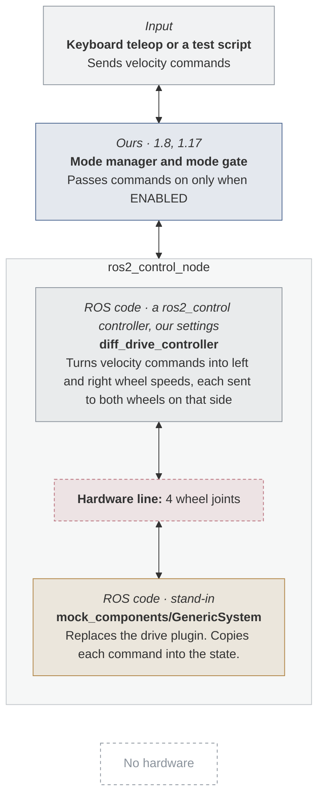

- **Deliverable:** 3.3, Drivetrain on stub hardware
- **Runs on:** Any laptop in the dev container, and CI
- **Launch:** [TBD: `drivetrain:=stub`]
- **Proves:** Everything above the line: modes, speed limits, the timeout, the operator view
- **Can't catch:** Anything in our plugin, or about the motors

### Drivetrain: Fake motor controllers (Sim)

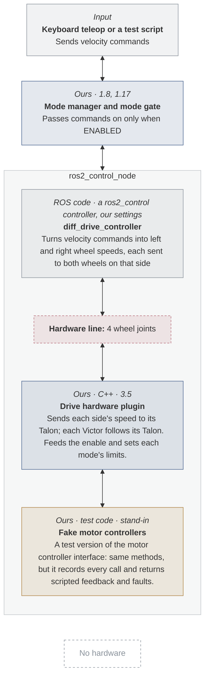

- **Deliverable:** 3.5, Drive hardware plugin with fake motor controllers
- **Runs on:** Any laptop in the dev container, and CI
- **Launch:** [TBD: `drivetrain:=fake_motor_controllers`]
- **Proves:** Our plugin sends what we believe the Talon and Victor motor controllers need
- **Can't catch:** A belief about the hardware that is wrong

3.5's unit tests call the plugin directly, without the blocks above the line.

### Drivetrain: Gazebo (Sim)

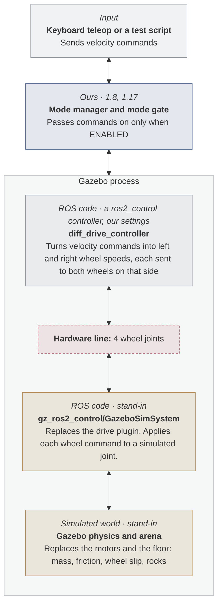

- **Deliverable:** 3.4, Drivetrain in Gazebo
- **Runs on:** A laptop in the dev container; every node uses sim time
- **Launch:** [TBD: `drivetrain:=gazebo`]
- **Proves:** Driving with physics: wheel slip and odometry drift
- **Can't catch:** Anything in our plugin, or about the motors

The controller runs inside Gazebo, so there is no separate ros2_control_node.

### Drivetrain: Bench

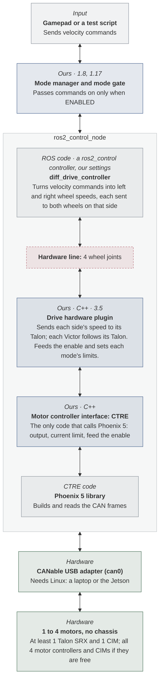

- **Deliverable:** 3.6, Drivetrain on the bench
- **Runs on:** A Linux laptop or the Jetson
- **Launch:** [TBD: `drivetrain:=real`]
- **Proves:** Our beliefs about the Talons hold; with all 4, each Victor follows its Talon
- **Can't catch:** The chassis: weight, wheel slip, the floor

### Drivetrain: Drive base (Robot)

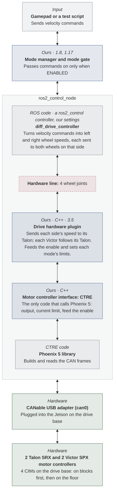

- **Deliverable:** 3.7, Drivetrain on the drive base
- **Runs on:** The Jetson on the drive base
- **Launch:** [TBD: `drivetrain:=real`]
- **Proves:** The whole drivetrain: wheel directions, every stop, odometry on the floor
- **Needs first:** 3.6, and 1.18 on the same drive base

Only if the drive base is ready by Nov 22; otherwise this moves to spring. It runs again on the whole rover in spring.

## Mechanism

*Moves, through ros2_control.* **Hardware line:** each mechanism joint, plus its limit switch and stowed signals. The full contract is in [Hardware lines](system.md#hardware-lines).

### Mechanism: Stub (Sim)

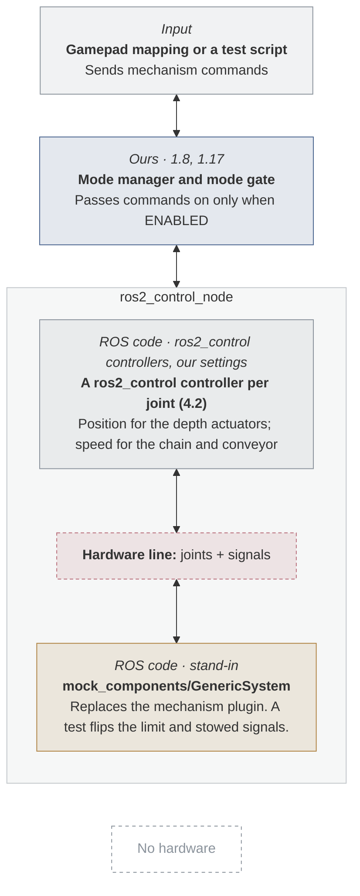

- **Deliverable:** 4.4, Mechanism on stub hardware
- **Runs on:** Any laptop in the dev container, and CI
- **Launch:** [TBD: `mechanism:=stub`]
- **Proves:** Joint limits and the mode check work with no hardware
- **Can't catch:** Anything in our plugin, or about the actuators

### Mechanism: Fake motor controllers (Sim)

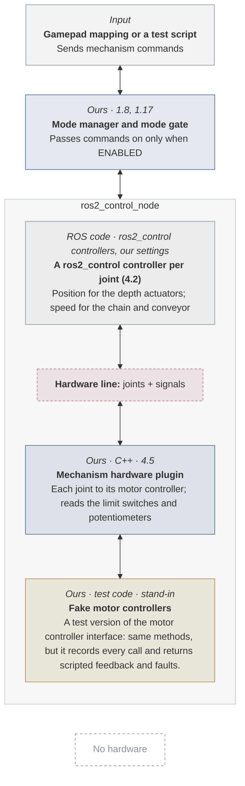

- **Deliverable:** 4.5, Mechanism hardware plugin with fake motor controllers
- **Runs on:** Any laptop in the dev container, and CI
- **Launch:** [TBD: `mechanism:=fake_motor_controllers`]
- **Proves:** Our plugin turns commands into the right outputs and stops at the limit switches
- **Can't catch:** A belief about the motor controllers that is wrong

If 4.3 picks the drivetrain's motor controller family, this reuses 3.5's motor controller interface and its fake.

### Mechanism: Bench

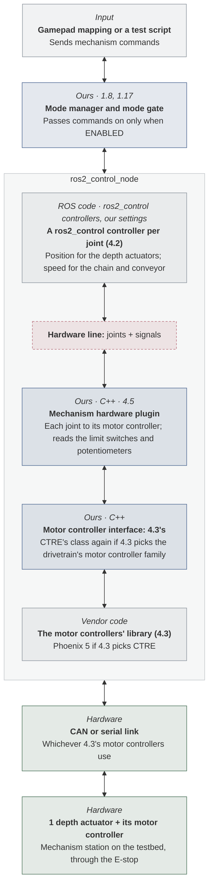

- **Deliverable:** 4.6, One actuator on the bench
- **Runs on:** A Linux laptop or the Jetson
- **Launch:** [TBD: `mechanism:=real`]
- **Proves:** One actuator runs its full stroke and stops at its limits, on disable, and on link loss
- **Can't catch:** The other joints, and the mechanism under load

Other modes:

- **Gazebo (Sim):** Not planned this term.
- **Whole rover (Robot):** Spring: dig, raise, and dump from the gamepad, once the mechanism is on the rover.

## Battery and power

*Reports, on ROS topics.* **Hardware line:** `/power/battery` and `/diagnostics`. The full contract is in [Hardware lines](system.md#hardware-lines).

### Battery and power: Stub (Sim)

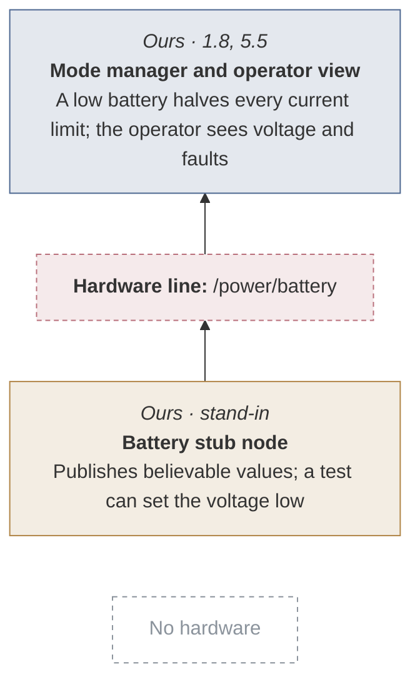

- **Deliverable:** 3.3, Drivetrain on stub hardware
- **Runs on:** Any laptop in the dev container, and CI
- **Proves:** The mode manager and operator view react to battery and faults
- **Can't catch:** How we read the real panel

### Battery and power: Fake power panel (Sim)

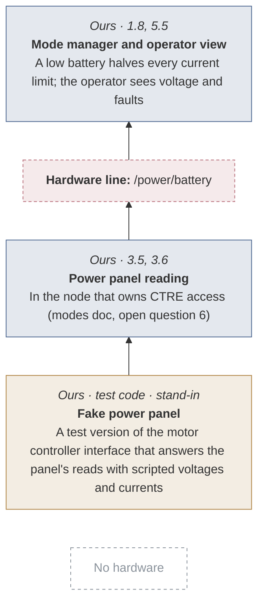

- **Deliverable:** 3.5, Drive hardware plugin with fake motor controllers
- **Runs on:** Any laptop in the dev container, and CI
- **Proves:** Our panel reading turns raw values into the right /power/battery
- **Can't catch:** What the real panel reports

Only if open question 6 puts the panel reading in the drive plugin's node.

### Battery and power: Bench

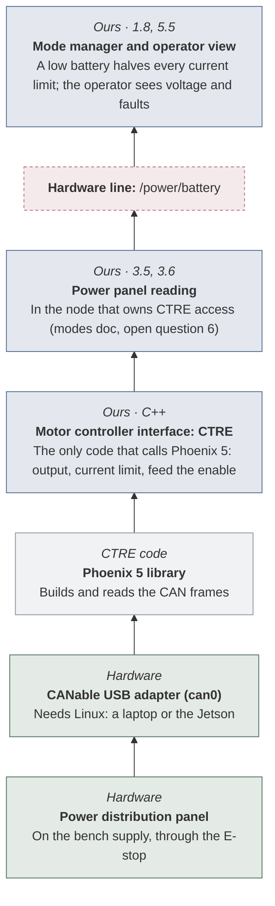

- **Deliverable:** 3.6, Drivetrain on the bench
- **Runs on:** A Linux laptop or the Jetson
- **Proves:** Bus voltage, currents, and faults read from the real panel
- **Can't catch:** The rover's battery under a full load

### Battery and power: Drive base (Robot)

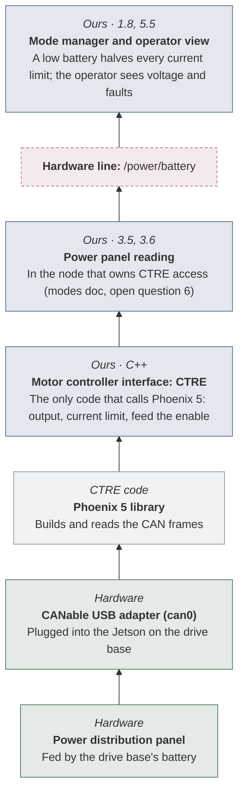

- **Deliverable:** 3.7, Drivetrain on the drive base
- **Runs on:** The Jetson on the drive base
- **Proves:** Real battery readings while the drive base drives

Only if the drive base is ready by Nov 22; otherwise this moves to spring. It runs again on the whole rover in spring.

Other modes:

- **Gazebo (Sim):** The battery stub runs alongside Gazebo.

## LiDAR

*Reports, on ROS topics.* **Hardware line:** the L2 driver's point cloud and its built-in IMU's topic. The full contract is in [Hardware lines](system.md#hardware-lines).

The L2 scans 360 by 90 degrees, or 360 by 96 in its negative angle mode, out to 30 m, and its built-in IMU is a 3-axis accelerometer and a 3-axis gyroscope, reporting at 500 Hz ([Unitree L2 manual, p. 17](../sources.md#unitree-l2-manual)).

### LiDAR: Stub (Sim)

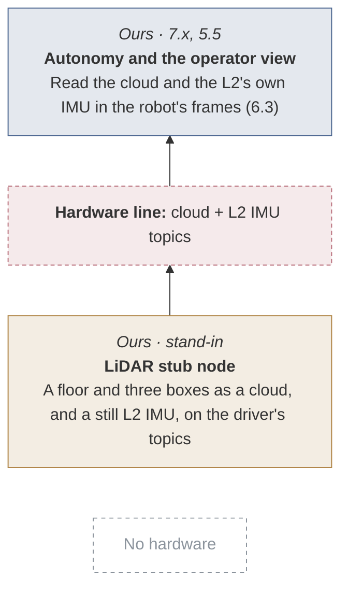

- **Deliverable:** 6.4, LiDAR stub, with the L2's built-in IMU
- **Runs on:** Any laptop in the dev container, and CI
- **Launch:** [TBD: `lidar:=stub`]
- **Proves:** Our code reads the right topics and frames
- **Can't catch:** Real noise, dust, and the real point pattern

### LiDAR: Recording (Sim)

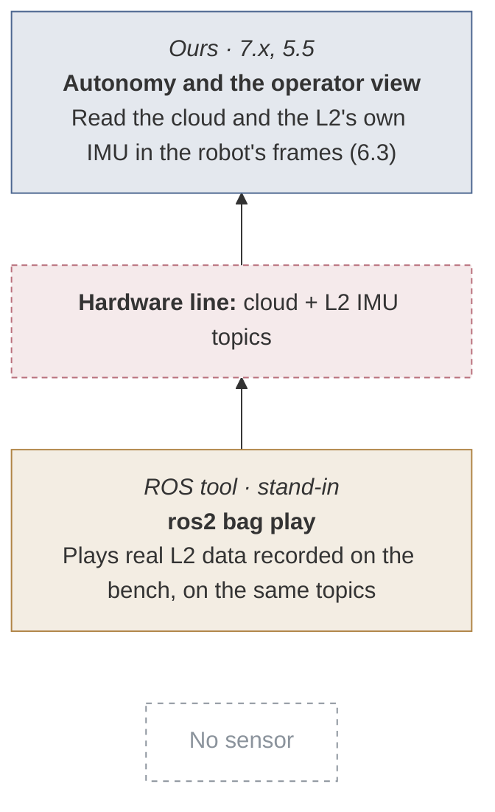

- **Deliverable:** 6.6, Unitree L2 on the bench
- **Runs on:** Any laptop in the dev container
- **Proves:** Our processing works on real L2 data
- **Can't catch:** Anything the recording did not see

Available once 6.6 stores its first recording (Nov 15).

### LiDAR: Gazebo (Sim)

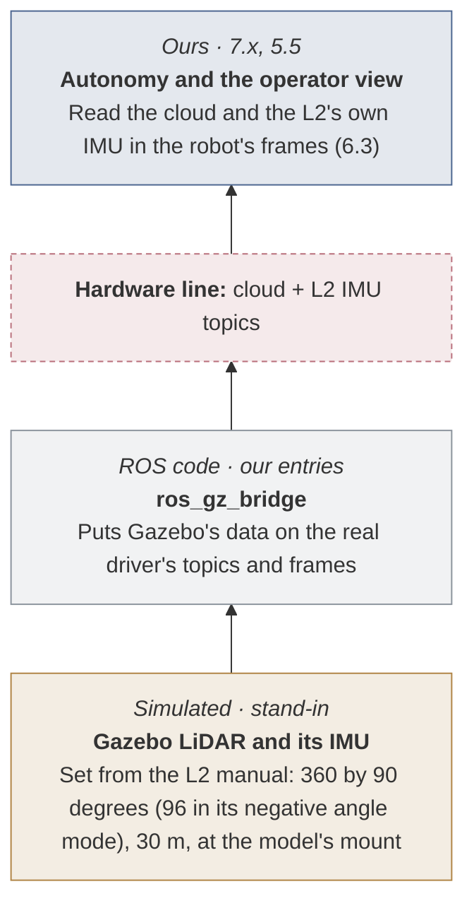

- **Deliverable:** 6.5, LiDAR in Gazebo, with the L2's built-in IMU
- **Runs on:** A laptop in the dev container
- **Launch:** [TBD: `lidar:=gazebo`]
- **Proves:** The sensor sees the arena while the robot drives
- **Can't catch:** The real driver's quirks

### LiDAR: Bench

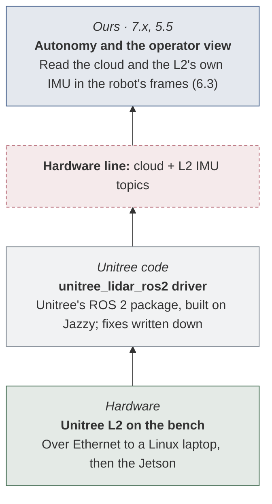

- **Deliverable:** 6.6, Unitree L2 on the bench
- **Runs on:** A Linux laptop, then the Jetson
- **Launch:** [TBD: `lidar:=real`]
- **Proves:** The real driver publishes exactly what the stub does
- **Can't catch:** The final mount and its vibration

Other modes:

- **Whole rover (Robot):** Spring: mounted on the rover, with its position measured and corrected in the model. It serves autonomy, which is spring work.

## Dedicated IMU

*Reports, on ROS topics.* **Hardware line:** one `sensor_msgs/Imu`, with no magnetometer. The full contract is in [Hardware lines](system.md#hardware-lines).

### Dedicated IMU: Stub (Sim)

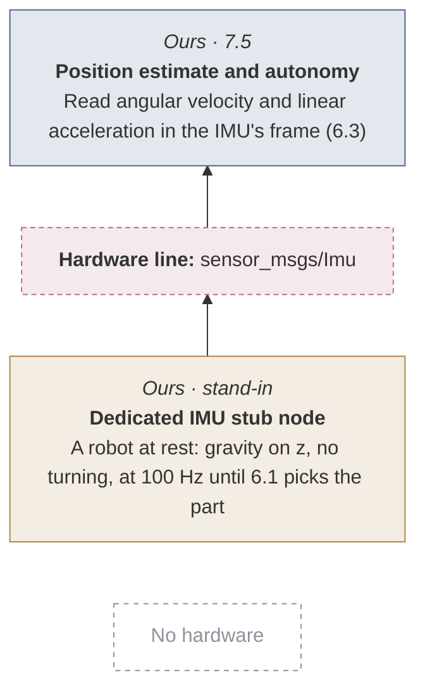

- **Deliverable:** 6.9, Dedicated IMU stub
- **Runs on:** Any laptop in the dev container, and CI
- **Launch:** [TBD: `imu:=stub`]
- **Proves:** Our code reads the right topic, frame, and units
- **Can't catch:** Real noise, bias, and vibration

### Dedicated IMU: Recording (Sim)

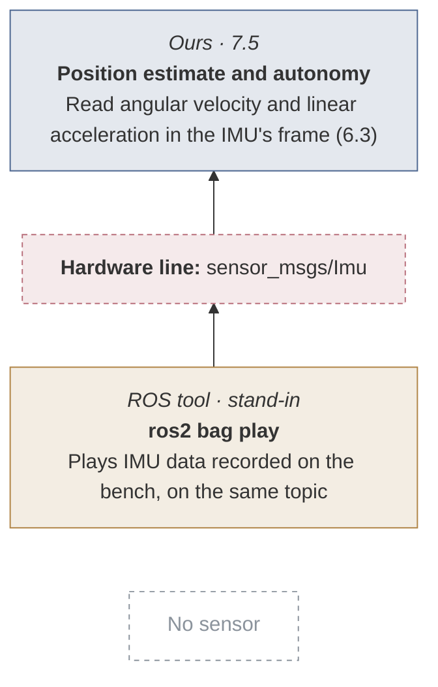

- **Deliverable:** 6.11, Dedicated IMU on the bench
- **Runs on:** Any laptop in the dev container
- **Proves:** The estimate works with real noise and bias
- **Can't catch:** Anything the recording did not see

Only once the IMU is bought and 6.11 records.

### Dedicated IMU: Gazebo (Sim)

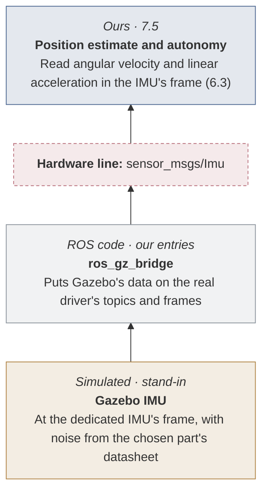

- **Deliverable:** 6.10, Dedicated IMU in Gazebo
- **Runs on:** A laptop in the dev container
- **Launch:** [TBD: `imu:=gazebo`]
- **Proves:** The estimate follows the robot as it drives and turns
- **Can't catch:** The real driver and the mount's vibration

### Dedicated IMU: Bench

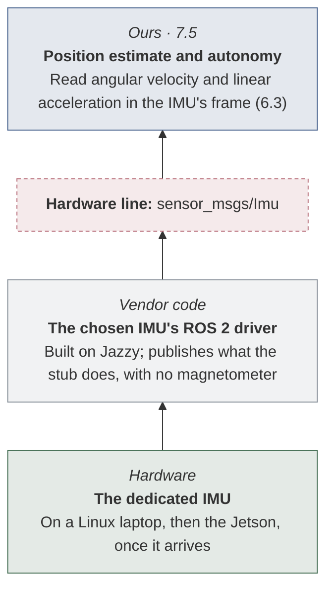

- **Deliverable:** 6.11, Dedicated IMU on the bench
- **Runs on:** A Linux laptop, then the Jetson
- **Launch:** [TBD: `imu:=real`]
- **Proves:** Gravity, axes, and signs are right; the gyroscope's bias is measured
- **Can't catch:** The final mount near the center of mass

Moves to spring if the IMU has not arrived by Dec 6.

Other modes:

- **Whole rover (Robot):** Spring: mounted rigidly near the center of mass, with its position measured in the model.

## Cameras

*Reports, on ROS topics.* **Hardware line:** the chosen cameras' image topics. The full contract is in [Hardware lines](system.md#hardware-lines).

### Cameras: Stub (Sim)

```mermaid
---
config:
  flowchart:
    wrappingWidth: 260
---
flowchart BT
  b1["`*Ours · 5.5, 7.x*
**Operator view and autonomy**
Show and read the images`"]
  line2["`**Hardware line:** image topics`"]
  b3["`*Ours · stand-in*
**Test-pattern image publisher**
At each camera's resolution and rate, on its topics and frame`"]
  none4["No hardware"]
  line2 --> b1
  b3 --> line2
  none4 ~~~ b3
  classDef ours fill:#4c669026,stroke:#4c6690
  classDef ros fill:#8b939c1f,stroke:#8b939c
  classDef stand fill:#b0844526,stroke:#b08445
  classDef hw fill:#4a725926,stroke:#4a7259
  classDef hwline fill:#b9707c26,stroke:#b9707c,stroke-dasharray:4 3
  classDef ghost fill:none,stroke:#8b939c,stroke-dasharray:4 4,color:#8b939c
  class b1 ours
  class line2 hwline
  class b3 stand
  class none4 ghost
```

- **Deliverable:** 6.7, Cameras on stubs and in Gazebo
- **Runs on:** Any laptop in the dev container, and CI
- **Launch:** [TBD: `cameras:=stub`]
- **Proves:** The operator view and its bandwidth, with no camera bought
- **Can't catch:** Real images, light, and dust

### Cameras: Recording (Sim)

```mermaid
---
config:
  flowchart:
    wrappingWidth: 260
---
flowchart BT
  b1["`*Ours · 5.5, 7.x*
**Operator view and autonomy**
Show and read the images`"]
  line2["`**Hardware line:** image topics`"]
  b3["`*ROS tool · stand-in*
**ros2 bag play**
Plays real images recorded on the bench, on the same topics`"]
  none4["No camera"]
  line2 --> b1
  b3 --> line2
  none4 ~~~ b3
  classDef ours fill:#4c669026,stroke:#4c6690
  classDef ros fill:#8b939c1f,stroke:#8b939c
  classDef stand fill:#b0844526,stroke:#b08445
  classDef hw fill:#4a725926,stroke:#4a7259
  classDef hwline fill:#b9707c26,stroke:#b9707c,stroke-dasharray:4 3
  classDef ghost fill:none,stroke:#8b939c,stroke-dasharray:4 4,color:#8b939c
  class b1 ours
  class line2 hwline
  class b3 stand
  class none4 ghost
```

- **Deliverable:** 6.8, Cameras on the bench
- **Runs on:** Any laptop in the dev container
- **Proves:** Our image processing works on real images
- **Can't catch:** Anything the recording did not see

Only once a camera is bought and 6.8 records.

### Cameras: Gazebo (Sim)

```mermaid
---
config:
  flowchart:
    wrappingWidth: 260
---
flowchart BT
  b1["`*Ours · 5.5, 7.x*
**Operator view and autonomy**
Show and read the images`"]
  line2["`**Hardware line:** image topics`"]
  b3["`*ROS code · our entries*
**ros_gz_bridge**
Puts Gazebo's data on the real driver's topics and frames`"]
  b4["`*Simulated · stand-in*
**Gazebo cameras**
At each planned mount`"]
  line2 --> b1
  b3 --> line2
  b4 --> b3
  classDef ours fill:#4c669026,stroke:#4c6690
  classDef ros fill:#8b939c1f,stroke:#8b939c
  classDef stand fill:#b0844526,stroke:#b08445
  classDef hw fill:#4a725926,stroke:#4a7259
  classDef hwline fill:#b9707c26,stroke:#b9707c,stroke-dasharray:4 3
  classDef ghost fill:none,stroke:#8b939c,stroke-dasharray:4 4,color:#8b939c
  class b1 ours
  class line2 hwline
  class b3 ros
  class b4 stand
```

- **Deliverable:** 6.7, Cameras on stubs and in Gazebo
- **Runs on:** A laptop in the dev container
- **Launch:** [TBD: `cameras:=gazebo`]
- **Proves:** What each mount can see while the robot drives
- **Can't catch:** The real driver and lens

### Cameras: Bench

```mermaid
---
config:
  flowchart:
    wrappingWidth: 260
---
flowchart BT
  b1["`*Ours · 5.5, 7.x*
**Operator view and autonomy**
Show and read the images`"]
  line2["`**Hardware line:** image topics`"]
  b3["`*Vendor code*
**Each camera's ROS 2 driver**
For the cameras chosen in 6.1, such as the planned RealSense D456`"]
  b4["`*Hardware*
**The chosen cameras**
On a Linux laptop, then the Jetson, once they arrive`"]
  line2 --> b1
  b3 --> line2
  b4 --> b3
  classDef ours fill:#4c669026,stroke:#4c6690
  classDef ros fill:#8b939c1f,stroke:#8b939c
  classDef stand fill:#b0844526,stroke:#b08445
  classDef hw fill:#4a725926,stroke:#4a7259
  classDef hwline fill:#b9707c26,stroke:#b9707c,stroke-dasharray:4 3
  classDef ghost fill:none,stroke:#8b939c,stroke-dasharray:4 4,color:#8b939c
  class b1 ours
  class line2 hwline
  class b3 ros
  class b4 hw
```

- **Deliverable:** 6.8, Cameras on the bench
- **Runs on:** A Linux laptop, then the Jetson
- **Launch:** [TBD: `cameras:=real`]
- **Proves:** The real drivers publish what the stub does
- **Can't catch:** The final mounts

Moves to spring if no camera arrives by Dec 6.

Other modes:

- **Whole rover (Robot):** Spring: mounted on the rover with the other sensors.

## Gamepad

*Reports, on ROS topics.* **Hardware line:** `/joy`. The full contract is in [Hardware lines](system.md#hardware-lines).

### Gamepad: Stub (Sim)

```mermaid
---
config:
  flowchart:
    wrappingWidth: 260
---
flowchart BT
  b1["`*Ours*
**Drive, mechanism, mode manager**
Get commands and mode requests`"]
  b2["`*Ours · 5.3*
**Teleop mapping**
teleop_twist_joy plus our node for the mechanism and mode buttons`"]
  line3["`**Hardware line:** /joy`"]
  b4["`*ROS tool · stand-in*
**ros2 bag play**
A /joy recording of every stick and button, kept beside its test`"]
  none5["No gamepad"]
  b2 --> b1
  line3 --> b2
  b4 --> line3
  none5 ~~~ b4
  classDef ours fill:#4c669026,stroke:#4c6690
  classDef ros fill:#8b939c1f,stroke:#8b939c
  classDef stand fill:#b0844526,stroke:#b08445
  classDef hw fill:#4a725926,stroke:#4a7259
  classDef hwline fill:#b9707c26,stroke:#b9707c,stroke-dasharray:4 3
  classDef ghost fill:none,stroke:#8b939c,stroke-dasharray:4 4,color:#8b939c
  class b1,b2 ours
  class line3 hwline
  class b4 stand
  class none5 ghost
```

- **Deliverable:** 5.3, Gamepad drives the stub robot
- **Runs on:** Any laptop in the dev container, and CI
- **Proves:** The mapping, the deadband, and no motion without the enable button
- **Can't catch:** What the real gamepad does when it disconnects

### Gamepad: Bench

```mermaid
---
config:
  flowchart:
    wrappingWidth: 260
---
flowchart BT
  b1["`*Ours*
**Drive, mechanism, mode manager**
Get commands and mode requests`"]
  b2["`*Ours · 5.3*
**Teleop mapping**
teleop_twist_joy plus our node for the mechanism and mode buttons`"]
  line3["`**Hardware line:** /joy`"]
  b4["`*ROS code*
**joy game_controller_node**
Reads the gamepad`"]
  b5["`*Hardware*
**The gamepad chosen in 5.2**
On the Linux operator laptop`"]
  b2 --> b1
  line3 --> b2
  b4 --> line3
  b5 --> b4
  classDef ours fill:#4c669026,stroke:#4c6690
  classDef ros fill:#8b939c1f,stroke:#8b939c
  classDef stand fill:#b0844526,stroke:#b08445
  classDef hw fill:#4a725926,stroke:#4a7259
  classDef hwline fill:#b9707c26,stroke:#b9707c,stroke-dasharray:4 3
  classDef ghost fill:none,stroke:#8b939c,stroke-dasharray:4 4,color:#8b939c
  class b1,b2 ours
  class line3 hwline
  class b4 ros
  class b5 hw
```

- **Deliverable:** 5.6, Teleop over the team's access point
- **Runs on:** The operator laptop, on Linux
- **Proves:** The real gamepad drives the bench motor over the access point
- **Can't catch:** Competition distance and interference

### Gamepad: Drive base (Robot)

```mermaid
---
config:
  flowchart:
    wrappingWidth: 260
---
flowchart BT
  b1["`*Ours*
**Drive, mechanism, mode manager**
Get commands and mode requests`"]
  b2["`*Ours · 5.3*
**Teleop mapping**
teleop_twist_joy plus our node for the mechanism and mode buttons`"]
  line3["`**Hardware line:** /joy`"]
  b4["`*ROS code*
**joy game_controller_node**
Reads the gamepad`"]
  b5["`*Hardware*
**The gamepad chosen in 5.2**
On the operator laptop; its commands cross the radio link`"]
  b2 --> b1
  line3 --> b2
  b4 --> line3
  b5 --> b4
  classDef ours fill:#4c669026,stroke:#4c6690
  classDef ros fill:#8b939c1f,stroke:#8b939c
  classDef stand fill:#b0844526,stroke:#b08445
  classDef hw fill:#4a725926,stroke:#4a7259
  classDef hwline fill:#b9707c26,stroke:#b9707c,stroke-dasharray:4 3
  classDef ghost fill:none,stroke:#8b939c,stroke-dasharray:4 4,color:#8b939c
  class b1,b2 ours
  class line3 hwline
  class b4 ros
  class b5 hw
```

- **Deliverable:** 1.14, Teleoperated MVP on the drive base
- **Runs on:** The operator laptop and the drive base
- **Proves:** Driving the drive base from the operator station

Only if the drive base is ready by Nov 22; otherwise this moves to spring. It runs again on the whole rover in spring.

Other modes:

- **Gazebo (Sim):** The same recording drives the robot in Gazebo (with 3.4).

## Radio link

*Carries topics between two machines.* **Hardware line:** the topics that cross between the operator laptop and the robot. The full contract is in [Hardware lines](system.md#hardware-lines).

### Radio link: One computer (Sim)

```mermaid
---
config:
  flowchart:
    wrappingWidth: 260
---
flowchart TB
  b1["`*Ours · 5.4, 5.5*
**Operator laptop**
Sends commands and the heartbeat at 10 Hz; shows the operator view`"]
  subgraph band2["The link: topics both ways"]
    direction TB
    b3["`*Stand-in*
**Both sides on one computer**
DDS on one machine; Ctrl+Z on the operator process cuts the link`"]
  end
  b4["`*Ours · 1.8*
**Robot side: mode manager**
Disables within link_timeout plus 100 ms once the heartbeat stops`"]
  b1 <--> band2
  band2 <--> b4
  classDef ours fill:#4c669026,stroke:#4c6690
  classDef ros fill:#8b939c1f,stroke:#8b939c
  classDef stand fill:#b0844526,stroke:#b08445
  classDef hw fill:#4a725926,stroke:#4a7259
  classDef hwline fill:#b9707c26,stroke:#b9707c,stroke-dasharray:4 3
  classDef ghost fill:none,stroke:#8b939c,stroke-dasharray:4 4,color:#8b939c
  class b1,b4 ours
  class b3 stand
  style band2 fill:#b9707c1a,stroke:#b9707c,stroke-dasharray:4 3
```

- **Deliverable:** 5.4, Operator heartbeat and link loss on stubs
- **Runs on:** Any laptop in the dev container, and CI
- **Proves:** The robot disables on its own when the heartbeat stops
- **Can't catch:** Real Wi-Fi dropouts and bandwidth

### Radio link: Bench

```mermaid
---
config:
  flowchart:
    wrappingWidth: 260
---
flowchart TB
  b1["`*Ours · 5.4, 5.5*
**Operator laptop**
Sends commands and the heartbeat at 10 Hz; shows the operator view`"]
  subgraph band2["The link: topics both ways"]
    direction TB
    b3["`*Hardware*
**Access point and radio (5.7)**
Linux operator laptop to the Jetson on the testbed; pull the Wi-Fi to cut it`"]
  end
  b4["`*Ours · 1.8*
**Robot side: mode manager**
Disables within link_timeout plus 100 ms once the heartbeat stops`"]
  b1 <--> band2
  band2 <--> b4
  classDef ours fill:#4c669026,stroke:#4c6690
  classDef ros fill:#8b939c1f,stroke:#8b939c
  classDef stand fill:#b0844526,stroke:#b08445
  classDef hw fill:#4a725926,stroke:#4a7259
  classDef hwline fill:#b9707c26,stroke:#b9707c,stroke-dasharray:4 3
  classDef ghost fill:none,stroke:#8b939c,stroke-dasharray:4 4,color:#8b939c
  class b1,b4 ours
  class b3 hw
  style band2 fill:#b9707c1a,stroke:#b9707c,stroke-dasharray:4 3
```

- **Deliverable:** 5.6, Teleop over the team's access point
- **Runs on:** Two machines on the team's access point
- **Proves:** A Wi-Fi cut stops the bench motor; bandwidth stays under the cap
- **Can't catch:** The rover's radio and the arena's distance

### Radio link: Drive base (Robot)

```mermaid
---
config:
  flowchart:
    wrappingWidth: 260
---
flowchart TB
  b1["`*Ours · 5.4, 5.5*
**Operator laptop**
Sends commands and the heartbeat at 10 Hz; shows the operator view`"]
  subgraph band2["The link: topics both ways"]
    direction TB
    b3["`*Hardware*
**Access point and drive base radio**
Chosen in 5.7 to meet the radio rules`"]
  end
  b4["`*Ours · 1.8*
**Robot side: mode manager**
Disables within link_timeout plus 100 ms once the heartbeat stops`"]
  b1 <--> band2
  band2 <--> b4
  classDef ours fill:#4c669026,stroke:#4c6690
  classDef ros fill:#8b939c1f,stroke:#8b939c
  classDef stand fill:#b0844526,stroke:#b08445
  classDef hw fill:#4a725926,stroke:#4a7259
  classDef hwline fill:#b9707c26,stroke:#b9707c,stroke-dasharray:4 3
  classDef ghost fill:none,stroke:#8b939c,stroke-dasharray:4 4,color:#8b939c
  class b1,b4 ours
  class b3 hw
  style band2 fill:#b9707c1a,stroke:#b9707c,stroke-dasharray:4 3
```

- **Deliverable:** 1.14, Teleoperated MVP on the drive base
- **Runs on:** The operator laptop and the drive base
- **Proves:** The drive base stops itself when the link drops

Only if the drive base is ready by Nov 22; otherwise this moves to spring. It runs again on the whole rover in spring.

Other modes:

- **Gazebo (Sim):** Not needed.
