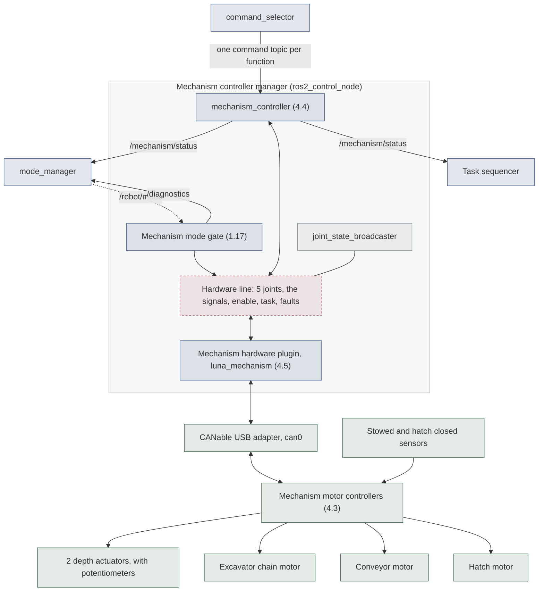

# Mechanism Subsystem Design

| Owner | Status | Last reviewed |
| --- | --- | --- |
| ja-zoe | Draft | 2026-11-14 |

This doc designs the code that runs the excavation and deposition mechanism: SW.1.3 in the
[system design](system.md). Four functions move on their own: the depth actuators that
raise and lower the excavator, the excavator chain, the conveyor, and the hatch. Like the
drivetrain, the mechanism runs on ros2_control, with a controller of our own, a hardware
plugin of our own, and a mode gate that enables it only as the
[operating modes design](operating-modes.md) allows.

## 1. Purpose and requirements

- R1. Obey `/robot/mode`. If the last `/robot/mode` arrived longer ago than
  `mode_timeout`, or none has arrived, act as DISABLED.
- R2. Move an actuator only while the robot is ENABLED and the task mode allows it:
  EXCAVATE allows the chain, the depth actuators, and the conveyor; DUMP allows the hatch,
  and the conveyor [TBR: operating modes open question 3]; SERVICE allows each one at
  reduced limits; TRAVEL allows none
  ([operating modes, Task modes](operating-modes.md#task-modes-software-only-while-enabled)).
- R3. Stop fast. Every output is zero within 100 ms of a disable command, within
  `link_timeout` plus 100 ms of the last operator heartbeat, and within `mode_timeout` plus
  100 ms if `mode_manager` stops
  ([operating modes R3](operating-modes.md#1-purpose-and-requirements)). A function whose
  commands stop is zero within `command_timeout` plus one control cycle.
- R4. Never replay an old command. A command older than `command_timeout` when it arrives
  is dropped.
- R5. Follow the task mode's current limits
  ([operating modes, Current limits per mode](operating-modes.md#current-limits-per-mode)).
  The power budget relies on them.
- R6. Move the two depth actuators together, and stop both if their positions differ by
  more than `depth_max_mismatch` (open question 1).
- R7. Report whether the excavator is stowed and the hatch is closed, for
  `mode_manager`'s entry guards and the task sequencer
  ([operating modes, Task modes](operating-modes.md#task-modes-software-only-while-enabled)).
- R8. Detect a stalled excavator chain or depth actuator and stop it, since a current
  limit alone does not protect a stalled motor
  ([operating modes, Current limits per mode](operating-modes.md#current-limits-per-mode)).
- R9. Run the same mechanism code on stub hardware, fake motor controllers, and the real
  motor controllers ([system R1](system.md#1-purpose-and-requirements)).
- R10. Keep mechanism data on the operator link at or below 20 kbit/s [TBR: TPM-6's
  mechanism row].

### Budgets

This doc's share of each technical performance measure, from the
[performance budgets](performance-budgets.md).

<!-- design: budgets (generated from mechanism.toml by scripts/design render: edit that file, not this table) -->

| TPM | Element | Part | Budget |
| --- | --- | --- | --- |
| [TPM-1](performance-budgets.md#tpm-1-autonomous-cycles-completed-per-run) | SW.1.3 | Excavation (§16.1) (SW.2.4 decides when to dig and stop; SW.1.3 digs; SW.2.2 confirms the robot is in the excavation zone) | 200 points |
| [TPM-1](performance-budgets.md#tpm-1-autonomous-cycles-completed-per-run) | SW.1.3 | Dump (§16.2) (SW.2.4 decides; SW.1.3 opens the hatch and runs the conveyor; SW.2.2 confirms the construction zone) | 100 points |
| [TPM-1](performance-budgets.md#tpm-1-autonomous-cycles-completed-per-run) | SW.1.3 | Full autonomy (§16.5): at least 2 cycles, starting in the starting zone (All of the above, plus SW.1.1 (stays enabled), SW.1.5 (passes AUTO commands), SW.3.1 (heartbeat), and SW.4 (link and logging)) | 1,400 × berm factor |
| [TPM-2](performance-budgets.md#tpm-2-autonomous-cycle-time) | SW.1.3 | Excavate until the bin is full (SW.1.3 runs the excavator; SW.2.4 decides when to stop) | ≤150 s |
| [TPM-2](performance-budgets.md#tpm-2-autonomous-cycle-time) | SW.1.3 | Dump (SW.1.3 opens the hatch and runs the conveyor) | ≤60 s |
| [TPM-6](performance-budgets.md#tpm-6-average-link-bandwidth-over-a-run) | SW.1.3 | Stowed and hatch status [TBD: mechanism doc (4.2)] | 20 kbit/s in TELEOP (default view), 20 kbit/s in AUTO (default view) |
| [TPM-7](performance-budgets.md#tpm-7-stop-time-after-a-disable-command) | SW.1.3 | Receive DISABLED and send zero output on CAN, in the next 50 Hz control loop (SW.1.2 and SW.1.3, in parallel) | ≤90 ms |
| [TPM-8](performance-budgets.md#tpm-8-stop-time-after-link-loss) | SW.1.3 | Disable chain (TPM-7) | ≤100 ms |
| [TPM-9](performance-budgets.md#tpm-9-peak-current-in-the-worst-task-mode) | SW.1.3 | Excavator chain | 30 A |
| [TPM-9](performance-budgets.md#tpm-9-peak-current-in-the-worst-task-mode) | SW.1.3 | Depth actuators, 2 at 15 A | 30 A |
| [TPM-9](performance-budgets.md#tpm-9-peak-current-in-the-worst-task-mode) | SW.1.3 | Conveyor (the NeveRest stalls at 11.5 A, so it needs no limit) | 11.5 A |
| [TPM-9](performance-budgets.md#tpm-9-peak-current-in-the-worst-task-mode) | SW.1.3 | Hatch (off in EXCAVATE) | 0 A |
| [TPM-10](performance-budgets.md#tpm-10-energy-used-per-autonomous-cycle) | SW.1.3 | Excavate (SW.1.3 (limits, and how it digs)) | [TBD: baseline] |
| [TPM-10](performance-budgets.md#tpm-10-energy-used-per-autonomous-cycle) | SW.1.3 | Dump | [TBD: baseline] |
| [TPM-11](performance-budgets.md#tpm-11-robot-computer-processor-load-averaged-over-a-run) | SW.1.3 | Robot control (SW.1.1 to SW.1.5) | [TBD: autonomy doc v1 (7.8)] |

<!-- /design -->

## 2. Nodes

The mechanism runs in its own controller manager, `ros2_control_node`, in the `/mechanism`
namespace [TBR], apart from the drivetrain's, so each is enabled, and stops, on its own
([operating modes, section 5](operating-modes.md#5-libraries-and-hardware-interfaces)). It
loads three controllers, each a node, and our hardware plugin, which is not a node:

- **`mechanism_controller`** is ours, in `luna_mechanism` (deliverable 4.4). It turns the
  four functions' commands into the joints' commands, and publishes `/mechanism/status`.
- **`joint_state_broadcaster`** publishes the joints' positions for the robot model.
- **The mechanism mode gate** is ours (deliverable 1.17), the same code as the drive mode
  gate, enabling the mechanism only in EXCAVATE, DUMP, and SERVICE.
- **The mechanism hardware plugin** is ours, in `luna_mechanism` (deliverable 4.5). It is
  the hardware line (section 5).

**Why a controller of our own.** ros2_controllers' stock forward command controllers
would need no code, but they write their last command to the joints on every cycle, with
no timestamp and no timeout, so a command source that stops while the chain runs would
leave it running until the mode changes
([forward_controllers_base.cpp](../sources.md#ros2-controllers-forward-command-source)).
That breaks R3 and R4, and every actuator must stop on its own when its commands stop
([system design, Conventions](system.md#4-parameters)). The drivetrain needs no controller
of its own, because the diff drive controller already times out.

<!-- design: nodes (generated from mechanism.toml by scripts/design render: edit that file, not this table) -->

| Node | Package | Runs on | Element | What it does |
| --- | --- | --- | --- | --- |
| `mechanism_controller` | `luna_mechanism`, in the mechanism's controller manager | Robot computer | SW.1.3 Mechanism control | Takes one stamped command per function, drops a command older than command_timeout, zeroes a function whose commands stop, moves both depth actuators together, and reports the mechanism's state, including whether the excavator is stowed and the hatch is closed |
| `joint_state_broadcaster` (mechanism) | `joint_state_broadcaster` (ros2_controllers), in the mechanism's controller manager | Robot computer | SW.1.3 Mechanism control | Publishes each mechanism joint's position, where it is measured, for the robot model |
| Mechanism mode gate | `luna_modes` [TBR: 1.17 builds it], in the mechanism's controller manager | Robot computer | SW.1.3 Mechanism control | Writes enable and the task mode to the mechanism hardware plugin from /robot/mode, with enable 1 only in EXCAVATE, DUMP, and SERVICE; writes enable 0 when /robot/mode goes stale; and reports the plugin's faults and stalls on /diagnostics |

<!-- /design -->

## 3. Interfaces

This table is the contract between this subsystem and the rest of the robot. The code must
match it exactly. It is generated from this doc's registry, so a pull request that changes
an interface edits the registry and runs `scripts/design render`, in the same pull request
as the code ([Registries](README.md#registries)).

<!-- design: interfaces (generated from mechanism.toml by scripts/design render: edit that file, not this table) -->

| Name | Kind | Type | Rate | Publisher or server | Subscriber or client | QoS |
| --- | --- | --- | --- | --- | --- | --- |
| `/mechanism/status` | topic | luna_interfaces/msg/MechanismStatus [TBR: proposed in section 3] | 10 Hz and on change [TBR] | `mechanism_controller` | `mode_manager`, Task sequencer, Operator frontend | reliable, transient local, depth 1 |
| `/mechanism/joint_states` | topic | `sensor_msgs/msg/JointState` | The controller manager's `update_rate`, 50 Hz | `joint_state_broadcaster` (mechanism) | None yet | the system default: reliable, volatile |
| `/mechanism/<function>/command` | topic | luna_interfaces/msg/ActuatorCommand [TBR: proposed in the mechanism doc (4.2)] | The active source's rate: `command_rate`, 20 Hz | `command_selector` | `mechanism_controller` | reliable, volatile, depth 1 |
| `/diagnostics` | topic | `diagnostic_msgs/msg/DiagnosticArray` | 1 Hz and on change | Drive mode gate, Mechanism mode gate, Camera driver, Dedicated IMU driver, Localization and mapping, Path planning and following, Task sequencer | `mode_manager` | reliable, depth 10 |
| `/robot/mode` | topic | `luna_interfaces/msg/RobotMode` | 10 Hz and on change | `mode_manager` | Drive mode gate, Mechanism mode gate, `command_selector`, Path planning and following, Task sequencer, Operator frontend, `teleop_node` | reliable, transient local, depth 1 |

<!-- /design -->

**Commands.** Each function that moves on its own has its own command topic, from
`command_selector`: `/mechanism/depth/command`, `/mechanism/excavator/command`,
`/mechanism/conveyor/command`, and `/mechanism/hatch/command`. One topic per function lets
teleop and autonomy drive any combination of them, and lets each stop on its own. Each
carries [TBR: Proposed] `luna_interfaces/msg/ActuatorCommand`:

```text
uint8 MODE_OUTPUT=0     # value is a fraction of full output, -1 to 1
uint8 MODE_POSITION=1   # value is a target position, in the joint's units (depth: m)

std_msgs/Header header  # stamp: when the input that caused the command was read
uint8 mode
float64 value
```

Only depth takes `MODE_POSITION`, because only the depth actuators measure their position
(section 5, open question 2); the controller refuses it for the others. Positive raises
the excavator, runs the chain and the conveyor the way they run while digging, and opens
the hatch [TBR: open question 4].

**Status.** `/mechanism/status` carries [TBR: Proposed]
`luna_interfaces/msg/MechanismStatus`:

```text
std_msgs/Header header
bool excavator_stowed     # the stowed signal (operating modes open question 4)
bool hatch_closed         # the hatch closed signal (operating modes open question 4)
float64 depth_position    # m, the two depth actuators' mean; NaN if unknown
float64 depth_mismatch    # m, how far apart the two depth actuators are
FunctionStatus[] functions
```

with one `luna_interfaces/msg/FunctionStatus` for each function:

```text
string name               # depth, excavator, conveyor, or hatch
float64 output            # fraction of full output sent, -1 to 1
float64 current           # A, from its motor controller or its PDP channel; NaN if unknown
bool stalled
bool fault
string reason             # why it is stopped, such as "command timed out"
```

At 10 Hz this is about 16 kbit/s [TBR: about 200 bytes a message], inside R10's 20 kbit/s.

**The hardware line.** The plugin offers these interfaces, and the stub offers the same
ones ([system design, Hardware lines](system.md#hardware-lines)):

| Interface | Kind | Units | Used by |
| --- | --- | --- | --- |
| `<joint>/output`, for each joint | Command | fraction, -1 to 1 | `mechanism_controller` |
| `<joint>/output` and `<joint>/current` | State | fraction, A | `mechanism_controller` |
| `depth_left_joint/position`, `depth_right_joint/position` | State | m | `mechanism_controller`, `joint_state_broadcaster` |
| `mechanism_signals/excavator_stowed`, `mechanism_signals/hatch_closed`, and each joint's `at_lower_limit` and `at_upper_limit` | State (GPIO) | 1 or 0 | `mechanism_controller` |
| `mechanism_mode/enable` and `mechanism_mode/task` | Command (GPIO) | 1 or 0, and RobotMode's task number | The mechanism mode gate |
| `mechanism_mode/fault` and each joint's `stalled` | State (GPIO) | 1 or 0 | The mechanism mode gate, which reports them on `/diagnostics` |

The joints are [TBR: `depth_left_joint`, `depth_right_joint`, `excavator_chain_joint`,
`conveyor_joint`, and `hatch_joint`, for the robot model (6.3) and 4.4 to confirm]. On the
stub, a test sets the signals through the mock hardware's GPIO interfaces
([Mock Components](../sources.md#ros2-control-mock-components)).

## 4. Parameters

| Parameter | Node | Type | Default | Units | Meaning |
| --- | --- | --- | --- | --- | --- |
| `update_rate` | Controller manager | int | 50 [TBR] | Hz | Control cycle |
| `command_timeout` | `mechanism_controller` | double | 0.25 [TBR] | s | A command older than this is dropped, and a function stops when its last command gets this old. Five periods of the sources' 20 Hz. |
| `depth_sync_gain` | `mechanism_controller` | double | [TBD: tuned on the bench, 4.6] | 1/m | How much the leading depth actuator is slowed for each meter it is ahead |
| `depth_max_mismatch` | `mechanism_controller` | double | [TBD: open question 1] | m | Stop both depth actuators if they get this far apart |
| `depth_position_gain` | `mechanism_controller` | double | [TBD: 4.6] | 1/m | Output per meter of error when depth runs to a position |
| `depth_min`, `depth_max` | `mechanism_controller` | double | [TBD: 4.1] | m | Depth travel the controller allows, inside the actuators' usable stroke of about 0.44 m (section 5) |
| `status_rate` | `mechanism_controller` | double | 10.0 [TBR] | Hz | `/mechanism/status` rate, plus a message on any change |
| `mode_timeout` | Mechanism mode gate | double | 0.3 | s | [Operating modes, section 4](operating-modes.md#4-parameters) |
| `enabled_tasks` | Mechanism mode gate | string array | EXCAVATE, DUMP, SERVICE | None | Task modes in which the mechanism may move |
| `allowed.<task>` | Mechanism hardware plugin | string array | EXCAVATE: depth, excavator, conveyor. DUMP: hatch, conveyor [TBR]. SERVICE: all. | None | Functions each task mode allows (R2) |
| `can_interface` | Mechanism hardware plugin | string | `can0` | None | SocketCAN interface of the CANable adapter |
| `<joint>.can_id` | Mechanism hardware plugin | int | [TBD: 4.3 and the wiring] | None | Each joint's motor controller |
| `<joint>.pdp_channel` | Mechanism hardware plugin | int | [TBD: Electrical's wiring] | None | The PDP channel that powers the joint's motor controller, for a controller that cannot measure current |
| `depth_<side>.pot_min`, `depth_<side>.pot_max` | Mechanism hardware plugin | int | [TBD: read on the bench, 4.6] | ADC counts | The potentiometer's reading at each end of the stroke, to turn it into meters |
| `current_limit.<actuator>.<task>` | Mechanism hardware plugin | double | See [Current limits per mode](operating-modes.md#current-limits-per-mode) | A | Supply current limit for each actuator in each task mode |
| `voltage_compensation` | Mechanism hardware plugin | double | 12.0 | V | Motor controllers scale their output to this voltage |
| `<joint>.stall_current`, `<joint>.stall_time` | Mechanism hardware plugin | double | [TBD: 4.6] | A, s | A joint drawing more than `stall_current` for `stall_time` counts as stalled |

## 5. Libraries and hardware interfaces

| Function | Actuator | Motor controller | What software can read | Neutral |
| --- | --- | --- | --- | --- |
| Depth | 2 Glideforce LACT18-500APL linear actuators | [TBR: Talon SRX each, operating modes open question 5; 4.3] | Position from each one's potentiometer (open question 2); current from the Talon SRX | Brake |
| Excavator | AndyMark 775 RedLine on the chain | [TBR: Talon SRX, operating modes open question 5; 4.3] | Current from the Talon SRX | Coast |
| Conveyor | AndyMark NeveRest | [TBD: 4.3] | Current, if its controller measures it, or from its PDP channel | Brake [TBR] |
| Hatch | AndyMark NeveRest | [TBD: 4.3] | The hatch closed signal (operating modes open question 4); current as for the conveyor | Brake |

- **The depth actuators.** Each has an 18 in stroke, 17.5 in (about 0.44 m) of it usable, a
  feedback potentiometer that gives its position in the stroke, and a limit switch at each
  end that stops it there by itself. It holds its position with no power and moves at up
  to 16.8 mm/s with no load ([Pololu product page](../sources.md#pololu-lact18-500apl)),
  and it stalls at about 50 A
  ([Pololu product page, section "Using the actuator"](../sources.md#pololu-lact18-500apl)). The limit switches cut the
  motor inside the actuator, so software sees the end of travel only as a position that
  stops changing. The two actuators raise and lower the excavator together:
    - With an output command, both get the same output, and the one ahead is slowed by
      `depth_sync_gain` for each meter it leads.
    - With a position command, each runs to the target on its own position, at
      `depth_position_gain`, and the leading one waits the same way.
    - If they get more than `depth_max_mismatch` apart, both stop, and the controller
      reports a fault (R6).
- **The excavator chain.** A 775 RedLine stalls at 130 A
  ([test report, p. 1](../sources.md#andymark-775-redline-report)), far above its channel's
  breaker, so it needs a Talon SRX's current limit, and a stall detector (R8): a current
  above `stall_current` for `stall_time` stops it, and it moves again once its command
  returns to zero [TBR].
- **The conveyor and the hatch.** A NeveRest stalls at 11.5 A, under its 20 A channel's
  breaker, so it needs no software current limit
  ([NeveRest Series Motor Only](../sources.md#andymark-neverest-page)) and can run on any
  motor controller, a Victor SPX included.
- **The stowed and hatch closed signals** come from sensors [TBD: operating modes open
  question 4, for Mechanical and Electrical]. The plugin reads them as GPIO state
  interfaces, wherever they are wired [TBR: a Talon SRX's limit switch input is one place
  to wire them, for 4.3].
- **The hardware plugin** (deliverable 4.5) is a ros2_control system interface in
  `luna_mechanism`, built the way the drive plugin is
  ([drivetrain design, section 5](drivetrain.md#5-libraries-and-hardware-interfaces)):
  it calls Phoenix only through our motor controller interface, so fake motor controllers
  stand in for it in unit tests; it feeds the Phoenix enable only while
  `mechanism_mode/enable` is 1; it zeroes any function `allowed.<task>` leaves out, so a
  task mode change stops it at once; and it sets each actuator's current limit on every
  task mode change. For a motor controller that cannot measure current, it reads the
  motor's PDP channel, as the drive plugin does.
- **Phoenix 5 or Phoenix 6.** If 4.3 puts the mechanism on the Talon FXS in the grant
  request, its plugin calls Phoenix 6, which runs in a process of its own
  ([CAN bus, section "The Phoenix libraries"](../can-bus.md#the-phoenix-libraries)). The
  mechanism already has its own controller manager, so that changes only the plugin.

## 6. Block diagram



Blue is ours and gray is stock ROS code; green is hardware. The sensors are drawn wired to
the motor controllers, one of the places 4.3 may choose. Below the hardware line, the stub
and the fake motor controllers each replace the plugin and what is under it, as
[Hardware test modes](hardware-test-modes.md#mechanism-stub-sim) draws.

## 7. Behavior on failure

| Failure | How it is detected | What the subsystem does |
| --- | --- | --- |
| Operator link lost | No heartbeat for `link_timeout`, seen by `mode_manager` | `mode_manager` publishes DISABLED; the mode gate writes `enable` 0, so the plugin sends zero and stops feeding the enable |
| `mode_manager` stops | The last `/robot/mode` arrived longer ago than `mode_timeout`, or none has | The mode gate writes `enable` 0 |
| The controller manager stops or hangs | The Phoenix enable stops being fed | The motor controllers disable themselves within 100 ms |
| A function's commands stop | Its last command is older than `command_timeout` | That function's output is zero, and its status says "command timed out"; the others keep going |
| An old command arrives late, such as after a Wi-Fi stall | Its timestamp is older than `command_timeout` | Dropped (R4) |
| A bad command | NaN, infinite, outside -1 to 1, or a position command for a function with no position | Dropped, with a WARN on `/diagnostics`; the function's previous command stands until it times out |
| The task mode changes | The mode gate writes the new task | The plugin zeroes every function the new mode does not allow, in the same cycle |
| The depth actuators get too far apart | `depth_mismatch` above `depth_max_mismatch` | Both stop, and an ERROR on `/diagnostics` puts the robot in FAULT; the team fixes it in SERVICE |
| A depth actuator's potentiometer fails | Its position jumps, or does not change while it moves | Depth refuses position commands, and an ERROR on `/diagnostics` |
| The chain or a depth actuator stalls | Current above `stall_current` for `stall_time` | It stops, with a WARN on `/diagnostics`; it moves again once its command returns to zero [TBR] |
| A stowed or hatch closed sensor fails | Its signal is missing or contradicts the joint's position | The status reports it; `mode_manager` refuses the task modes it guards ([operating modes, section 7](operating-modes.md#7-behavior-on-failure)) |
| A motor controller or the CAN bus fails | Its CAN status goes missing, or it reports a fault | The plugin sends zero and sets `mechanism_mode/fault`; the mode gate reports an ERROR, so `mode_manager` enters FAULT |
| E-stop pressed | Hardware cuts power | Nothing to do in software; the depth actuators hold where they are, since they hold with no power |

## 8. Test plan

| Requirement | Test | Where | Result |
| --- | --- | --- | --- |
| R4, R6 | Unit tests of `mechanism_controller` (4.4): a command older than `command_timeout` is dropped; a function zeroes `command_timeout` after its last command while the others keep going; one depth output moves both depth joints; the leading one slows; a mismatch above `depth_max_mismatch` stops both; a position command for the chain is refused. | Unit | Not run |
| R2, R5, R9 | Unit tests of the plugin with fake motor controllers (4.5): a command becomes the right output on the right motor controller; `enable` 0 sends zero and feeds no enable; each task mode zeroes the functions it does not allow and sets each current limit; the end of travel stops a depth actuator. | Unit | Not run |
| R1, R2, R3 | Launch test on stub hardware (4.4 and 1.17): step `/robot/mode` through every state and task mode and command every function; only the functions R2 allows move. Stop publishing a function's command: its output is zero within `command_timeout` plus one control cycle. Stop publishing `/robot/mode`: every output is zero within `mode_timeout` plus one control cycle. | Sim | Not run |
| R7 | Launch test on stub hardware (4.4): a test flips the stowed and hatch closed signals through the mock hardware; `/mechanism/status` follows within one status period, and `mode_manager` refuses TRAVEL while the excavator is not stowed. | Sim | Not run |
| R6, R8 | One depth actuator on the bench (4.6): run its full stroke from a ROS command, and its reported position matches a tape measure at both ends and the middle, within 5 mm [TBR]. Hold it against a stop: it stops within `stall_time` and warns on `/diagnostics`. | Bench | Not run |
| R3 | On the bench (4.6): with the actuator moving, disable, unplug the operator Wi-Fi, and kill `mode_manager`, one at a time; read the time from each event to zero output in `candump`'s timestamps. Each must be within R3's limit. | Bench | Not run |
| R10 | With the operator frontend's default views open, measure `/mechanism/status`'s bandwidth at the laptop (5.6). | Bench | Not run |
| R2 to R8 | The whole mechanism on the rover, on blocks, then digging: in spring, when the rover is built ([hardware test modes](hardware-test-modes.md#mechanism-bench)). | Robot | Not run |

## 9. Open questions

The operating modes doc holds the mechanism questions that shape the modes: whether the
robot drives while digging (its question 2), whether the conveyor runs in DUMP (3), which
sensors give the stowed and hatch closed signals (4), which motor controller runs each
mechanism motor (5), and whether anything deploys after the start (10). How the task
sequencer knows the bin is full is autonomy's question 5, which may add a field to
`/mechanism/status`.

<!-- design: questions (generated from mechanism.toml by scripts/design render: edit that file, not this table) -->

| Question | Status | Turgor |
| --- | --- | --- |
| 1. Do the two depth actuators lift one excavator frame, so that one getting ahead of the other twists it? If so, how far apart may their positions get before the controller stops both (depth_max_mismatch)? | Open | 4.1 |
| 2. How does software read each depth actuator's potentiometer: through its motor controller's analog input, or another input? It decides whether depth can take position commands on the robot. | Open | 4.3 |
| 3. What tells software the hatch is fully open, and how far does it travel? With a sensor at each end, the hatch can take an open or close command and stop by itself; without one, it runs only while its button is held. | Open | 4.1 |
| 4. Which way is positive for each function, once Mechanical mounts them? Proposed in section 3: positive raises the excavator, runs the chain and the conveyor the way they run while digging, and opens the hatch. | Open | 4.1 |

<!-- /design -->

## Handoff

Not yet written: this doc is a draft.
