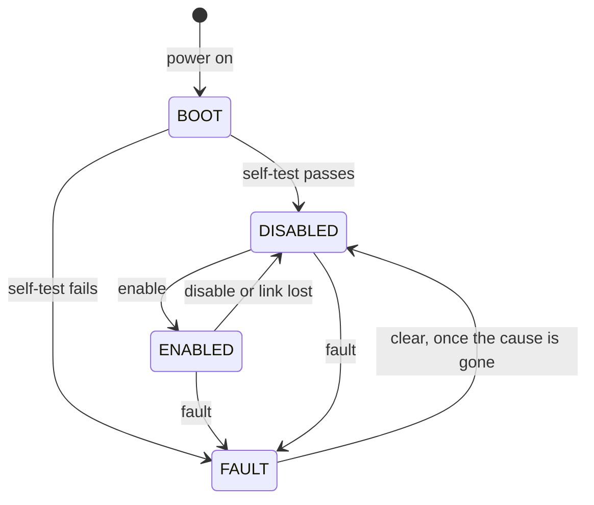
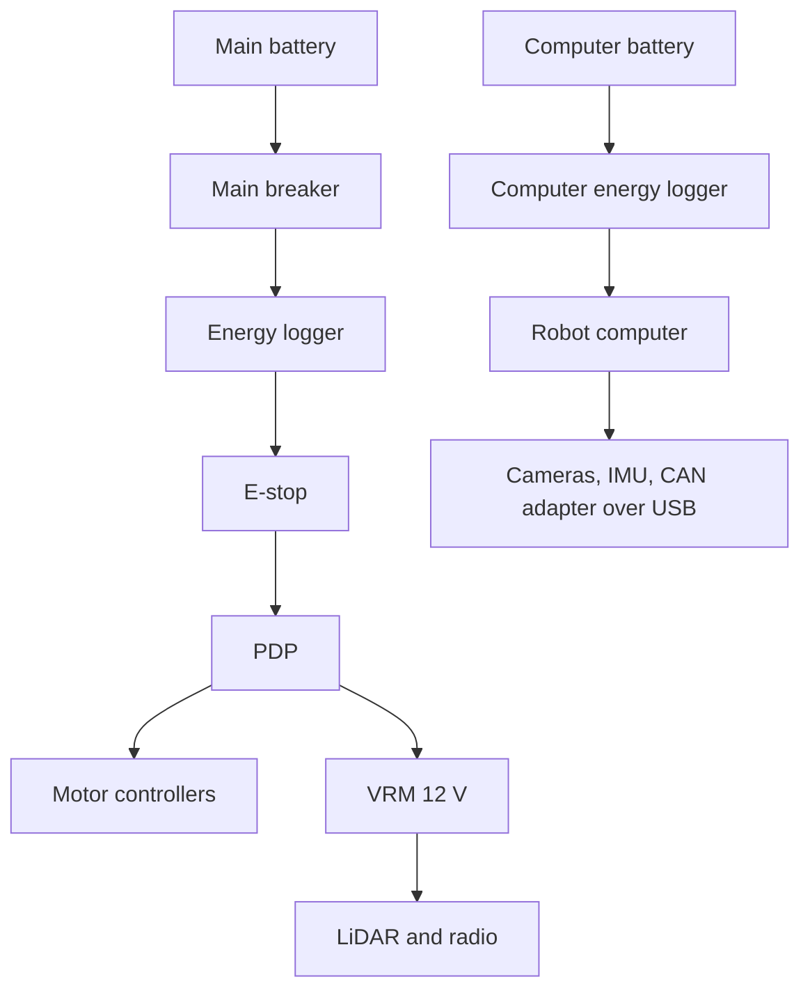
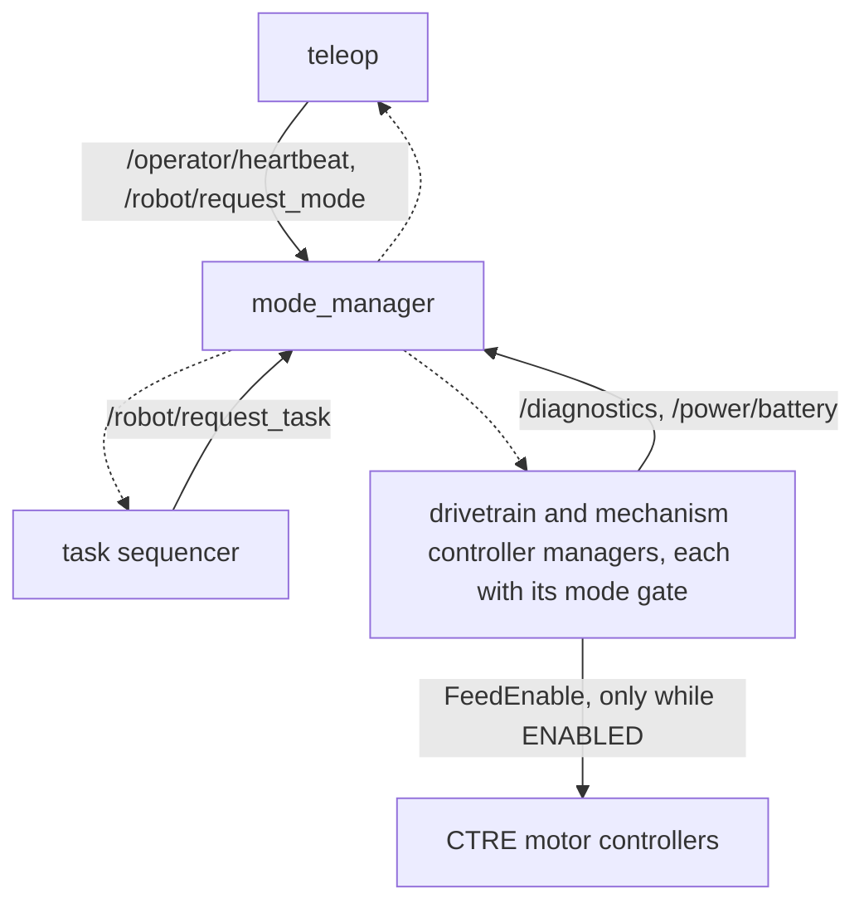

# Operating Modes Design

| Owner | Status | Last reviewed |
| --- | --- | --- |
| ja-zoe | Draft | 2026-10-07 |

This doc defines every mode the robot can be in: what has power, what may move, which
software runs, and how the robot moves between modes. Software enforces these modes, and
the power budget computes one load case per mode, so both describe the same robot. The
[system design](system.md) (deliverable 1.5) builds on it, and the drivetrain, mechanism,
teleoperation, and autonomy docs follow it.

## 1. Purpose and requirements

Last season's modes existed only as power budget scenarios ("driving", "excavating",
"building"), with no matching software, so neither could check the other. Here a mode is a
contract between three groups:

- **Software** guarantees that only the actuators a mode allows can move, within that
  mode's current limits.
- **Electrical** sizes the battery, breakers, and wires for the worst mode, relying on
  software to enforce it.
- **Operations** (teleop and autonomy) use modes that match the competition's task cycle,
  so each mode is a unit that autonomy can earn points on.

Requirements:

- R1. The robot is always in exactly one mode and publishes it. Every actuator node obeys
  it.
- R2. Nothing moves unless the robot is ENABLED and its task mode allows that actuator.
  The robot is DISABLED after boot and after a fault is cleared, and it never enables
  itself.
- R3. Every actuator output is zero within 100 ms of a disable command, and within
  `link_timeout` plus 100 ms of the last operator heartbeat.
- R4. After a fault or an E-stop, moving again takes two deliberate operator actions:
  clear the fault, then enable. This follows [guidebook §13.2.7, p. 42](../sources.md#nasa-lunabotics-guidebook-2027):
  "resetting of the E-STOP alone shall not resume operation."
- R5. The hardware E-stop meets [guidebook §13.2, pp. 41-42](../sources.md#nasa-lunabotics-guidebook-2027): an unmodified COTS red button at least
  40 mm across, at the highest point, reachable from any side, latching, and with one push
  disconnecting the batteries from all controllers and the other active subsystems. No
  software is in its path.
- R6. The energy logger sits between the battery and the E-stop ([guidebook §13.1.2, p. 41](../sources.md#nasa-lunabotics-guidebook-2027)), so
  pressing the E-stop does not erase its reading.
- R7. In every task mode, the current limits of the actuators it allows, plus the
  electronics, add up to less than the main breaker's rating. The power budget relies on
  this.
- R8. While ENABLED, the operator can switch between TELEOP and AUTO without stopping, by
  an explicit command only. Gamepad input is ignored in AUTO, because an autonomous attempt
  must be hands-free ([guidebook §16, pp. 55-57](../sources.md#nasa-lunabotics-guidebook-2027)).
- R9. One control on the operator station disables the robot from any mode, to obey the
  power-off command ([§13.9.19, p. 45](../sources.md#nasa-lunabotics-guidebook-2027)) and the end-of-run inhibit
  ([§15.4.1, p. 54](../sources.md#nasa-lunabotics-guidebook-2027)).
- R10. What the robot streams to the operator station by default depends on the mode, to
  keep average bandwidth low. The link must average 4,000 kbit/s or less ([§14.1.19, p. 48](../sources.md#nasa-lunabotics-guidebook-2027)). For
  the score, each arena camera used adds 0.5 Mbit/s to the average, every 1 Mbit/s of the
  total costs 30 of the 120 points, and a total over 4 Mbit/s scores zero
  ([§17.1.4, p. 60](../sources.md#nasa-lunabotics-guidebook-2027)).

### The modes

The robot's mode has three layers. Hardware sets the power state; `mode_manager` sets the
robot state and the task mode.

#### Power states (hardware)

| Power state | How it is entered | What has power |
| --- | --- | --- |
| OFF | Main breaker open | Nothing |
| E-STOPPED | E-stop pressed | Only the energy loggers, which sit before the E-stop, and the robot computer, which has its own battery ([§13.2.11, p. 42](../sources.md#nasa-lunabotics-guidebook-2027), open question 7) |
| POWERED | Main breaker closed and E-stop released | Everything. Motors still move only when software enables them. |

#### Robot states (software)

| Robot state | Meaning | Actuators |
| --- | --- | --- |
| BOOT | Software is starting and running its self-test | Disabled |
| DISABLED | Safe and ready. The robot's resting state: during setup, after a run, and whenever the operator disables it | Disabled |
| ENABLED | Actuators may move, as the task mode allows. Commands come from one control source: TELEOP or AUTO | As the task mode allows |
| FAULT | Something needs a person to look at it. It stays until the operator clears it and its cause is gone | Disabled |

Disabled means the motor controllers have power but get no enable signal, so their output
stays at zero in their configured neutral mode (brake or coast).



An E-stop cuts power to everything but the energy loggers and the robot computer, which
stays up on its own battery. `mode_manager` sees every motor controller disappear and
enters FAULT with the reason "main power lost", so the robot cannot move again until the
operator clears and enables it (R4).

#### Task modes (software, only while ENABLED)

The task modes follow the competition's mission cycle ([guidebook §3.7.11, p. 7](../sources.md#nasa-lunabotics-guidebook-2027)):
excavate, travel loaded, dump, travel empty. Each is also a unit that autonomy earns
points on: excavation automation, travel automation, and dump automation
([§16, pp. 55-56](../sources.md#nasa-lunabotics-guidebook-2027)).

| Task mode | What it is for | Allowed to move |
| --- | --- | --- |
| TRAVEL | Driving between zones, loaded or empty | Drive motors at full limits. The mechanism is stowed and held off. |
| EXCAVATE | Digging regolith into the robot | Excavator chain, depth actuators, and conveyor. Drive at creep speed only (open question 2). |
| DUMP | Depositing regolith on the berm | Hatch, and the conveyor if it unloads (open question 3). Drive at creep speed only. |
| SERVICE | Pit and bench work, such as moving one actuator to check it | Any actuator at reduced limits. TELEOP only. Refused unless the `allow_service` parameter is true, which it never is at competition. |

An enable request names the task mode to start in. After that, any task mode can follow
any other, as long as the new mode's entry guard holds:

| Task mode | Entry guard, proposed for mechanical to confirm [TBR] |
| --- | --- |
| TRAVEL | Excavator stowed and hatch closed |
| EXCAVATE | Hatch closed |
| DUMP | Excavator stowed |
| SERVICE | `allow_service` is true and the control source is TELEOP |

When the task mode changes, every actuator the new mode does not allow ramps to zero
straight away, and the new limits apply from the next control cycle. Switching between
TELEOP and AUTO changes neither the task mode nor the limits; the new source's commands
take over and the old source's are ignored.

The guidebook says excavation tools must be "completely removed from contact with the
regolith before returning to remote control operation" ([§16.1.5, p. 55](../sources.md#nasa-lunabotics-guidebook-2027)). When the operator takes
control back during EXCAVATE with the excavator lowered, `mode_manager` warns but does not
refuse: the operator must always be able to take control.

### What is on in each mode

This is the electrical contract: which loads can draw current in each mode. The power
budget workbook turns it into amps and watt-hours.

| Load | E-STOPPED | BOOT | DISABLED, FAULT | TRAVEL | EXCAVATE | DUMP |
| --- | --- | --- | --- | --- | --- | --- |
| Drive motors (4 CIM) | No power | Neutral | Neutral | Active | Creep | Creep |
| Excavator chain (775 RedLine) | No power | Neutral | Neutral | Off | Active | Off |
| Depth actuators (2 Glideforce) | No power | Neutral | Neutral | Off, stowed | Active | Off |
| Conveyor (NeveRest) | No power | Neutral | Neutral | Off | Active | [TBD: open question 3] |
| Hatch (NeveRest) | No power | Neutral | Neutral | Off, closed | Off, closed | Active |
| Motor controllers, PDP, regulators | No power | Standby | Standby | Standby | Standby | Standby |
| Robot computer, on its own battery | On | Booting | On | On | On | On |
| LiDAR, cameras, IMU | No power | On | On | On | On | On |
| Radio | No power | On | On | On | On | On |
| Energy logger | On | On | On | On | On | On |

Neutral and Off draw the same current: zero, plus each motor controller's small standby
draw.
They differ only in why: Neutral because the robot is not enabled, Off because the task
mode does not allow that load.

### Current limits per mode

Each task mode sets supply current limits that the motor controllers enforce. Every limit
must be at or below its PDP channel's breaker, and each mode's total must stay under the
main breaker (R7). [TBR: These are starting values for the electrical lead to confirm];
the power budget workbook checks them against a 150 A main breaker, where the worst mode,
EXCAVATE, comes to about 135 A.

| Actuator | Motor controller | TRAVEL [TBR] | EXCAVATE [TBR] | DUMP [TBR] | SERVICE [TBR] | PDP breaker |
| --- | --- | --- | --- | --- | --- | --- |
| Drive, per motor | [TBR: Talon SRX leader, Victor SPX follower (3.2)] | 30 A | Creep: 20% output, 15 A | Creep: 20% output, 15 A | 15 A | 40 A |
| Excavator chain | [TBR: Talon SRX, open question 5] | Off | 30 A | Off | 15 A | 40 A |
| Depth actuators, each | [TBR: Talon SRX, open question 5] | Off | 15 A | Off | 10 A | 20 A |
| Conveyor | [TBD: open question 5] | Off | Full (11.5 A at stall) | [TBD: open question 3] | Full | 20 A |
| Hatch | [TBD: open question 5] | Off | Off | Full (11.5 A at stall) | Full | 20 A |

"Full" means no software limit is needed, because the motor cannot draw more than its
channel breaker even when stalled at 12 V: a NeveRest stalls at 11.5 A
([NeveRest Series Motor Only](../sources.md#andymark-neverest-page)).

Only a Talon SRX can enforce these limits. CTRE documents current limiting for the Talon
SRX ([Phoenix 5 docs, section "Current Limit"](../sources.md#ctre-phoenix5-motor-controllers)),
and a Victor SPX cannot even measure its current
([Phoenix 5 docs, section "Plot tab"](../sources.md#ctre-phoenix5-motor-controllers)), so
it cannot limit it. A Victor can only follow a Talon (as the drive followers do, copying
its output) or run a motor whose stall current is already under its breaker, like the
NeveRest motors.

The limits are on supply current, which is what the battery and breakers see. At low speed
a motor carries more current than it draws from the battery. A CIM stalls at 131 A at 12 V
([CIM motor curve, p. 1](../sources.md#andymark-cim-curve)), so a stalled CIM under a 30 A
supply limit on a 14.8 V battery still carries about 70 A, and the drivetrain and mechanism docs need their own
stall detection.

Every motor controller also runs voltage compensation at 12 V, so a motor behaves the same
on a full battery as on a nearly empty one, and the 12 V motors and actuators never see
more than 12 V on average.

### Budgets

This doc's share of each technical performance measure, from the
[performance budgets](performance-budgets.md).

<!-- design: budgets (generated from operating-modes.toml by scripts/design render: edit that file, not this table) -->

| TPM | Element | Part | Budget |
| --- | --- | --- | --- |
| [TPM-1](performance-budgets.md#tpm-1-autonomous-cycles-completed-per-run) | SW.1.1 | Full autonomy (§16.5): at least 2 cycles, starting in the starting zone (All of the above, plus SW.1.1 (stays enabled), SW.1.5 (passes AUTO commands), SW.3.1 (heartbeat), and SW.4 (link and logging)) | 1,400 × berm factor |
| [TPM-2](performance-budgets.md#tpm-2-autonomous-cycle-time) | SW.1.1 | Task-mode switches (4 per cycle) (SW.2.4 requests; SW.1.1 grants) | ≤4 (≤1 each) |
| [TPM-3](performance-budgets.md#tpm-3-time-from-run-start-to-the-first-cycle-starting) | SW.1.1 | Operator enables in AUTO (after telling the judge) (SW.3.1 sends; SW.1.1 accepts) | ≤5 s |
| [TPM-6](performance-budgets.md#tpm-6-average-link-bandwidth-over-a-run) | SW.1.1 | /robot/mode, 10 Hz | 20 kbit/s in TELEOP (default view), 20 kbit/s in AUTO (default view) |
| [TPM-6](performance-budgets.md#tpm-6-average-link-bandwidth-over-a-run) | SW.1.4 | /power/battery, 10 Hz | 30 kbit/s in TELEOP (default view), 30 kbit/s in AUTO (default view) |
| [TPM-7](performance-budgets.md#tpm-7-stop-time-after-a-disable-command) | SW.1.1 | Accept the disable request and publish DISABLED | ≤10 ms |
| [TPM-8](performance-budgets.md#tpm-8-stop-time-after-link-loss) | SW.1.1 | Declare the link lost | 500 after the last heartbeat (`link_timeout`) [TBR: operating modes open question 9] |
| [TPM-8](performance-budgets.md#tpm-8-stop-time-after-link-loss) | SW.1.1 | Disable chain (TPM-7) | ≤100 ms |
| [TPM-10](performance-budgets.md#tpm-10-energy-used-per-autonomous-cycle) | SW.1.4 | Measuring it: energy per task mode, checked against the main energy logger (SW.1.4 logs it) | None: it measures |
| [TPM-11](performance-budgets.md#tpm-11-robot-computer-processor-load-averaged-over-a-run) | SW.1.1, SW.1.4 | Robot control (SW.1.1 to SW.1.5) | [TBD: autonomy doc v1 (7.8)] |
| [TPM-12](performance-budgets.md#tpm-12-restart-time) | SW.1.1 | Self-test finds every CAN device | ≤10, with FAULT at 60 [TBR: proposed in the PDR (1.6)] |

<!-- /design -->

## 2. Nodes

<!-- design: nodes connected (generated from operating-modes.toml by scripts/design render: edit that file, not this table) -->

| Node | Package | Runs on | Element | Design doc | What it does |
| --- | --- | --- | --- | --- | --- |
| `mode_manager` | `luna_modes` [TBR: proposed name] | Robot computer | SW.1.1 Mode manager | [Operating Modes Design](operating-modes.md) | Owns the robot state and task mode, runs the boot self-test, watches the heartbeat, faults, and battery, and accepts or refuses mode requests |
| Power panel reading node | [TBD: operating modes v1 (1.19)] | Robot computer | SW.1.4 Power telemetry | [Operating Modes Design](operating-modes.md) | Decodes the PDP's CAN frames from can0 (section 5) and publishes the battery voltage, each channel's current, and the energy used. It is a node of its own, since reading the PDP needs no Phoenix library. |
| Drive mode gate | `luna_modes` [TBR: 1.17 builds it], in the drivetrain's controller manager | Robot computer | SW.1.2 Drivetrain control | [Drivetrain Subsystem Design](drivetrain.md) | Writes enable and the task mode to the drive hardware plugin from /robot/mode, writes enable 0 when /robot/mode goes stale, and reports the plugin's faults and stalls on /diagnostics |
| Mechanism mode gate | `luna_modes` [TBR: 1.17 builds it], in the mechanism's controller manager | Robot computer | SW.1.3 Mechanism control | [Mechanism Subsystem Design](mechanism.md) | Writes enable and the task mode to the mechanism hardware plugin from /robot/mode, with enable 1 only in EXCAVATE, DUMP, and SERVICE; writes enable 0 when /robot/mode goes stale; and reports the plugin's faults and stalls on /diagnostics |
| `mechanism_controller` | `luna_mechanism`, in the mechanism's controller manager | Robot computer | SW.1.3 Mechanism control | [Mechanism Subsystem Design](mechanism.md) | Takes one stamped command per function, drops a command older than command_timeout, zeroes a function whose commands stop, moves both depth actuators together, and reports the mechanism's state, including whether the excavator is stowed and the hatch is closed |
| `command_selector` | `luna_modes` | Robot computer | SW.1.5 Command selection | [System Design](system.md) | Forwards, unchanged, the drive and mechanism commands of the control source /robot/mode names, and drops the other source's. It never falls back to the other source, forwards nothing unless the robot is ENABLED, and sends one zero command on each output when the source changes. |
| Camera driver | [TBD: the cameras, sensor suite evaluation (6.1)] | Robot computer | SW.2.1 Sensor interface and robot model | `sensors.md`, not written yet (6.2) | Publishes the driving camera's compressed images for the operator view |
| Dedicated IMU driver | [TBD: the IMU, sensor suite evaluation (6.1)] | Robot computer | SW.2.1 Sensor interface and robot model | `sensors.md`, not written yet (6.2) | Publishes the dedicated IMU's gyroscope and accelerometer in one message, with no magnetometer (system design R5) |
| Localization and mapping | `luna_autonomy` [TBR: autonomy open question 2] | Robot computer | SW.2.2 Localization and mapping | [Autonomy Subsystem Design](autonomy.md) | Finds the robot's position and heading from the random start, and builds the obstacle map, from the LiDAR, the IMUs, and the wheels |
| Path planning and following | `luna_autonomy`, with Nav2 [TBR: autonomy open question 2] | Robot computer | SW.2.3 Path planning and following | [Autonomy Subsystem Design](autonomy.md) | Plans a path around the mapped obstacles to the goal the task sequencer sends, follows it in AUTO, and stops when the robot leaves AUTO or loses its position |
| Task sequencer | `luna_autonomy` | Robot computer | SW.2.4 Task sequencer | [Autonomy Subsystem Design](autonomy.md) | Runs dig, travel, dump, travel in AUTO: changes the task mode and sends mechanism commands, but can never enable the robot |
| Operator frontend | Custom frontend with `roslibjs` | Operator laptop, in a browser, through rosbridge | SW.3.1 Operator frontend | [Teleoperation Subsystem Design](teleoperation.md) | Reads the gamepad through the browser's Gamepad API, sends /joy, the heartbeat, and mode requests through rosbridge, and shows each control source's default view, which the operator can change, with live link bandwidth. It is not a ROS node: rosbridge publishes and calls for it. |
| `teleop_node` | `luna_teleop` | Robot computer | SW.3.2 Teleop mapping | [Teleoperation Subsystem Design](teleoperation.md) | Turns fresh /joy input into drive and mechanism commands, each stamped with its /joy message's stamp, zeroes them when the hold button is released, drops stale input, and requests DISABLED when the controller's input is lost |

<!-- /design -->

The robot computer is the Jetson today. [TBD: A mini PC replaces it on the rover if the
Hacker Initiative grant pays for one; the Jetson then runs the bench testbed (system design,
open question 7).]

### What runs in each mode

| Node | BOOT | DISABLED | ENABLED, TELEOP | ENABLED, AUTO | FAULT |
| --- | --- | --- | --- | --- | --- |
| `mode_manager` | Self-test | Watches heartbeat, faults, battery | Same | Same | Same; waits for a clear |
| Drivetrain node | Output zero; checks its motor controllers | Output zero; telemetry | Follows `/cmd_vel` within task limits | Same | Output zero |
| Mechanism node | Output zero; checks its motor controllers | Output zero; telemetry | Follows operator commands within task limits | Follows sequencer commands within task limits | Output zero |
| `command_selector` | Forwards nothing | Forwards nothing | Forwards teleop's commands | Forwards autonomy's commands | Forwards nothing |
| Teleop (frontend on the operator laptop, `teleop_node` on the robot computer) | Heartbeat | Heartbeat; mode requests | Gamepad commands | Heartbeat and mode requests only; gamepad ignored | Heartbeat; clear request |
| Sensor drivers | Starting | Running | Running | Running | Running |
| Localization and mapping | Starting | Running, so AUTO needs no warm-up | Running | Running | Running |
| Planner and task sequencer | Idle | Idle | Idle | Active | Idle |
| Default operator view | Telemetry, low rate | Telemetry, low rate | Camera and telemetry | Obstacle map and planned path; camera off | Telemetry and fault detail |
| Logging (`ros2 bag`) | Starting | Recording | Recording | Recording | Recording |

In AUTO the default view carries the obstacle map and planned path because the judges require
"visualization of the real time obstacle detection and associated mapping of obstacles
and the resulting path planning" ([§16, p. 55](../sources.md#nasa-lunabotics-guidebook-2027)), and leaves the camera off to save bandwidth (R10).
These are defaults: the operator can change the view at runtime, such as turning the camera
on in AUTO, and the operator station shows live link bandwidth so the cost is visible
[TBR: chosen in the PR #14 review, 2026-10-26; the teleoperation doc (5.1) holds the details].

## 3. Interfaces

<!-- design: interfaces (generated from operating-modes.toml by scripts/design render: edit that file, not this table) -->

| Name | Kind | Type | Rate | Publisher or server | Subscriber or client | QoS |
| --- | --- | --- | --- | --- | --- | --- |
| `/robot/mode` | topic | `luna_interfaces/msg/RobotMode` | 10 Hz and on change | `mode_manager` | Drive mode gate, Mechanism mode gate, `command_selector`, Path planning and following, Task sequencer, Operator frontend, `teleop_node` | reliable, transient local, depth 1 |
| `/robot/request_mode` | service | `luna_interfaces/srv/RequestMode` | On demand | `mode_manager` | Operator frontend, `teleop_node` | default |
| `/robot/request_task` | service | `luna_interfaces/srv/RequestTask` | On demand | `mode_manager` | Task sequencer | default |
| `/power/battery` | topic | `sensor_msgs/msg/BatteryState` | 10 Hz | Power panel reading node | `mode_manager`, Operator frontend | best effort, depth 1 |
| `/diagnostics` | topic | `diagnostic_msgs/msg/DiagnosticArray` | 1 Hz and on change | Drive mode gate, Mechanism mode gate, Camera driver, Dedicated IMU driver, Localization and mapping, Path planning and following, Task sequencer | `mode_manager` | reliable, depth 10 |
| `/mechanism/status` | topic | luna_interfaces/msg/MechanismStatus [TBR: proposed in section 3] | 10 Hz and on change [TBR] | `mechanism_controller` | `mode_manager`, Task sequencer, Operator frontend | reliable, transient local, depth 1 |
| `/operator/heartbeat` | topic | `std_msgs/msg/Header` | `heartbeat_rate`, 10 Hz, including in AUTO and with the hold button released | Operator frontend | `mode_manager` | best effort, depth 1 |

<!-- /design -->

`mode_manager` refuses `/robot/request_task` unless the robot is ENABLED in AUTO, so the
sequencer can change task mode but can never enable the robot or take control. To stop
the robot, for example when it loses its position, the sequencer reports an ERROR on
`/diagnostics`, which puts the robot in FAULT.

[TBR: Proposed] `luna_interfaces/msg/RobotMode`:

```text
uint8 STATE_BOOT=0
uint8 STATE_DISABLED=1
uint8 STATE_ENABLED=2
uint8 STATE_FAULT=3

uint8 SOURCE_NONE=0
uint8 SOURCE_TELEOP=1
uint8 SOURCE_AUTO=2

uint8 TASK_NONE=0
uint8 TASK_TRAVEL=1
uint8 TASK_EXCAVATE=2
uint8 TASK_DUMP=3
uint8 TASK_SERVICE=4

uint8 state
uint8 source                    # SOURCE_NONE unless ENABLED
uint8 task                      # TASK_NONE unless ENABLED
string reason                   # why the robot is in this state, such as "link lost"
builtin_interfaces/Time since   # when the robot entered this state
```

[TBR: Proposed] `luna_interfaces/srv/RequestMode`, for the operator:

```text
uint8 state    # RobotMode STATE_ENABLED or STATE_DISABLED; DISABLED while in FAULT clears the fault
uint8 source   # for ENABLED: SOURCE_TELEOP or SOURCE_AUTO
uint8 task     # for ENABLED: the task mode to run
---
bool accepted
string reason  # why a request was refused, such as "excavator not stowed"
```

[TBR: Proposed] `luna_interfaces/srv/RequestTask`, for the task sequencer:

```text
uint8 task     # RobotMode TASK_TRAVEL, TASK_EXCAVATE, or TASK_DUMP
---
bool accepted
string reason
```

## 4. Parameters

| Parameter | Node | Type | Default | Units | Meaning |
| --- | --- | --- | --- | --- | --- |
| `link_timeout` | `mode_manager` | double | 0.5 | s | Heartbeat age that counts as link lost (open question 9) |
| `mode_timeout` | Each mode gate: the drivetrain's and the mechanism's | double | 0.3 | s | If the last `/robot/mode` arrived longer ago than this, act as DISABLED |
| `allow_service` | `mode_manager` | bool | false | | Allow the SERVICE task mode. False at competition. |
| `selftest_timeout` | `mode_manager` | double | 60.0 | s | Time BOOT waits for every check before entering FAULT |
| `expected_can_devices` | `mode_manager` | string array | | | The motor controllers and PDP the self-test requires |
| `creep_output` | Drivetrain hardware plugin | double | 0.2 | fraction | Largest drive output in EXCAVATE and DUMP |
| `current_limit.<actuator>.<task>` | Drivetrain and mechanism hardware plugins | double | See [Current limits per mode](#current-limits-per-mode) | A | Supply current limit for each actuator in each task mode |
| `voltage_compensation` | Drivetrain and mechanism hardware plugins | double | 12.0 | V | Motor controllers scale their output to this voltage |
| `battery_cells` | `mode_manager` | int | 4 | | Cells in series in the main battery |
| `cell_warn_v` | `mode_manager` | double | 3.5 | V | Below this per cell, warn the operator (4S LiPo value) |
| `cell_critical_v` | `mode_manager` | double | 3.3 | V | Below this per cell for `low_voltage_hold`, halve every current limit (4S LiPo value) |
| `low_voltage_hold` | `mode_manager` | double | 2.0 | s | How long the voltage must stay low, so brief sag under load is ignored |

The battery thresholds are for LiPo cells and change if the battery does (open question 1).

**Why `mode_timeout` is 0.3 s.** `mode_manager` publishes `/robot/mode` at 10 Hz on the
same computer as the mode gates, so the message never crosses Wi-Fi. A 0.3 s gap is three
missed messages in a row, which happens only when `mode_manager` has stopped or the
computer is overloaded, and both should stop the robot. A message's age is measured from
when it arrived, on a clock that never jumps, so a change to the system time cannot trip
the timeout or hide a stale mode. The Sim test in section 8 measures the longest gap under
full load, to show the margin.

## 5. Libraries and hardware interfaces

- **Phoenix 5 enable.** The motor controllers run only while some process calls
  `ctre::phoenix::unmanaged::Unmanaged::FeedEnable(timeoutMs)`; they disable themselves
  when `timeoutMs` passes without another call
  ([Phoenix C++ API, section "FeedEnable()"](../sources.md#ctre-phoenix5-unmanaged-api)).
  Our code passes 100 ms. The enable frame (`000401BF` in
  `candump`, see [CAN bus](../can-bus.md)) carries no device number, so it looks like it
  enables every CTRE motor controller on the bus, whichever process sends it. Each
  subsystem's hardware plugin feeds it only while its own mode gate allows (below). On one
  bus, the drivetrain's feed may then also enable the mechanism's motor controllers, which
  its plugin still holds at zero; open question 6 tests this.
- **Phoenix 6 enable.** The Talon FXS controllers the team plans to buy use Phoenix 6,
  which has its own enable, fed the same way outside FRC
  ([Phoenix 6 docs, section "Non-FRC Applications"](../sources.md#ctre-phoenix6-enabling-actuators)).
  Other teams report that Phoenix 5 and Phoenix 6 fail in one program, so each library gets
  its own driver node [TBR: reported by other teams, not tried on our bus]. Each node feeds
  its own library's enable only while ENABLED, and both follow `/robot/mode`, so one disable
  stops both.
- **PDP over CAN.** The robot's panel is CTRE's original Power Distribution Panel, the one
  with CAN. The team has one, and no spare. The PDP 2.0 cannot stand in for it: it has
  breaker slots and wire terminals, but no CAN and no current sensing
  ([PDP 2.0 User's Guide, p. 5](../sources.md#ctre-pdp2-guide)). The PDP sends battery
  voltage, the current on each channel, and the energy used in status frames, without
  being asked ([WPILib's PDP driver](../sources.md#wpilib-ctre-pdp-driver)). Power and
  energy are only right on PDP firmware 1.40 or later
  ([PDP User's Guide, p. 17](../sources.md#ctre-pdp-guide)). Phoenix 5 cannot read these
  frames, because CTRE leaves the PDP's API to WPILib
  ([Phoenix 5 primer](../sources.md#ctre-phoenix5-primer)), so our code decodes them from
  `can0` itself; [CAN bus](../can-bus.md#the-power-distribution-panel) lists their IDs. The
  readings feed `/power/battery`. Logging them by mode checks the power budget against
  real runs, and shows the energy score before the judges' logger does.
- **Mode gates.** The drivetrain and the mechanism each run in their own ros2_control
  controller manager, and each runs a mode gate of ours: a ros2_control controller that
  subscribes to `/robot/mode` and writes two values to its hardware plugin's command
  interfaces, `enable` and `task` [TBR: proposed here for 1.17, which builds it]. So the
  drivetrain and the mechanism are enabled separately:

    | Mode gate | `enable` is 1 when the robot is | Otherwise |
    | --- | --- | --- |
    | Drivetrain's | ENABLED, in any task mode | 0 |
    | Mechanism's | ENABLED, in EXCAVATE, DUMP, or SERVICE | 0, so in TRAVEL the mechanism is held at zero and its plugin feeds no enable |

    The gate writes `enable` 0 when the last `/robot/mode` arrived longer ago than
    `mode_timeout`, or none has arrived since it started. The hardware plugin feeds the
    Phoenix enable only while `enable` is 1, writes zero output while it is 0, and sets each
    actuator's current limit, and the drive's creep, from `task`. Running the gate inside
    the controller manager means each subsystem stops on its own when `mode_manager` stops,
    without any other node's help. Separate gates do not separate the motor controllers in
    hardware while both subsystems share one CAN bus and one Phoenix library (open question
    6); a second CAN bus would. ros2_control's mock hardware can offer `enable` and `task`
    as GPIO interfaces, so the gate works the same on stubs
    ([Mock Components](../sources.md#ros2-control-mock-components)). [TBR: Whether
    Gazebo's simulated hardware offers them too is not checked. If it does not, the gate
    also goes between the diff drive controller and the wheel joints, as a chainable
    controller, so it can zero the joints in every test mode; 1.17 decides.]
- **Motor controller settings.** Each hardware plugin sets its motor controllers' current limits,
  voltage compensation, and neutral mode from parameters at startup: brake for the drive
  motors and hatch, so they hold still when disabled, and coast for the excavator chain.
- **E-stop, main breaker, and energy loggers.** Hardware only, with no software interface.
  The robot computer has its own battery and its own energy logger, so an E-stop neither
  reboots it nor cuts its logs, and the logger covers the case where judges count its
  energy (open questions 7 and 8). The Jetson's carrier takes 9 to 20 V
  ([carrier board specification, p. 7](../sources.md#nvidia-orin-nano-carrier-spec)), so it
  runs straight from that battery. The two batteries' negatives are tied together at one
  point, so the CAN adapter and the USB devices, which connect the computer to the rest of
  the robot, share one ground [TBR: the point, for the electrical lead]. The LiDAR and radio
  stay on the main battery, behind the E-stop, because only the computer may stay powered
  through an E-stop ([§13.2.11, p. 42](../sources.md#nasa-lunabotics-guidebook-2027)).
  [TBR: Once the grant's Mean Well RSD-30G converters replace the VRM, their output ground
  is tied to the computer's ground. They isolate input from output
  ([RSD-30 datasheet, p. 2](../sources.md#meanwell-rsd-30-spec)), so the sensors then share
  the computer's ground with no second path to the main battery's. The VRM's output must not
  be tied to it, since that would join the two grounds a second time.] The power path:



## 6. Block diagram



The dotted arrows are `/robot/mode`, which every node follows.

## 7. Behavior on failure

| Failure | How it is detected | What happens |
| --- | --- | --- |
| Operator link lost | No heartbeat for `link_timeout` | ENABLED becomes DISABLED with the reason "link lost". The operator enables again once the link is back. This applies in AUTO too, because while the link is down the robot cannot hear the power-off command ([§13.9.19, p. 45](../sources.md#nasa-lunabotics-guidebook-2027)). The heartbeat comes from the teleop program itself, so this also catches a network that still answers pings while the operator's commands stop arriving. |
| `mode_manager` stops | `/robot/mode` older than `mode_timeout` at a mode gate | Each mode gate writes `enable` 0: its hardware plugin sets its outputs to zero and stops feeding the enable |
| The node feeding the enable stops | The Phoenix enable times out | Motor controllers disable themselves within 100 ms |
| Drive commands stop | The last `/cmd_vel` older than `cmd_vel_timeout` ([drivetrain design](drivetrain.md#7-behavior-on-failure)) | Drive output zero; mode unchanged |
| A mechanism function's commands stop | Its last command older than `command_timeout` ([mechanism design](mechanism.md#7-behavior-on-failure)) | That function's output zero; mode unchanged |
| A motor controller or the PDP is missing or faulted | Missing CAN status, or an ERROR on `/diagnostics` | FAULT |
| E-stop pressed | Hardware cuts power | Everything but the robot computer and the energy loggers loses power. The computer enters FAULT ("main power lost"); after the reset, the operator clears and enables. |
| Battery low | `/power/battery` below `cell_critical_v` per cell for `low_voltage_hold` | Every current limit halves and the operator is warned. The robot keeps running. |
| The CAN adapter drops off USB, for example after a short | `can0` goes down and every motor controller's status goes missing | FAULT. The motor controllers stop on their own within 100 ms, because the enable no longer reaches them. |
| The main battery sags below the sensor converters' minimum input in a stall | The LiDAR's scans and the radio's link stop; `/power/battery` shows the sag | The converters shut off below their 9 V minimum input ([RSD-30 datasheet, p. 2](../sources.md#meanwell-rsd-30-spec)) and restart by themselves ([RSD-30 datasheet, p. 4](../sources.md#meanwell-rsd-30-spec)), so the LiDAR and radio reboot. The robot stops: a lost heartbeat disables it, and the planner stops on missing scans. Prevented by current limits on every motor, a low-resistance power path, and healthy packs; the drive-base transient test measures how deep a stall pulls the pack ([hardware test modes](hardware-test-modes.md#battery-and-power-drive-base-robot)). |
| Robot computer resets | The computer reboots | The enable stops, so motor controllers disable within 100 ms; the robot boots to DISABLED. On its own battery the computer does not see the main battery sag when motors stall; the VRM does, and the current limits keep the main battery above its minimum input. |
| A mode request breaks a guard | `mode_manager` checks guards | Refused with a reason; the mode does not change |
| A guard sensor fails | Mechanism status missing or implausible | Modes guarded by it are refused. The team uses SERVICE in the pits to fix it. |

## 8. Test plan

| Requirement | Test | Where | Result |
| --- | --- | --- | --- |
| R1 | Launch test: step through every state and task mode on fake data, and check `/robot/mode` and each node's output | Laptop | Not run |
| R2 | After boot, send drive and mechanism commands: nothing moves. Clear a fault: the robot stays DISABLED. | Bench | Not run |
| R3 | Disable mid-drive; separately unplug the operator Wi-Fi mid-drive; and separately stop the teleop program while the Wi-Fi stays up and the robot still answers pings. Wheels off the ground. Measure the time to zero output in the bag. | Bench | Not run |
| R3 | Launch test on stubs with every CPU core of the computer kept busy (for example by `stress-ng --cpu 0`): record, at each mode gate, the longest gap between `/robot/mode` messages over 10 minutes. It must stay below half of `mode_timeout`, 0.15 s [TBR: the margin], so the timeout never trips by itself. Then stop `mode_manager`: both gates write `enable` 0 within `mode_timeout` plus one control cycle. | Sim | Not run |
| R4 | Press and reset the E-stop while ENABLED; nothing moves until clear and enable | Robot | Not run |
| R5 | Inspection checklist ([§12.1, p. 40](../sources.md#nasa-lunabotics-guidebook-2027)); with the E-stop pressed, measure every rail at zero except the loggers and the computer's battery | Robot | Not run |
| R6 | Read the logger, press and reset the E-stop, read it again: unchanged. On the bench supply, drop the voltage below the logger's minimum input and back: its energy total is unchanged. With the E-stop pressed, measure the logger's own draw, to know how long it takes to drain a pack left connected. | Bench, then Robot | Not run |
| R7 | The budget workbook's Protection sheet passes for every mode, and each limit read back from its motor controller matches the parameter | Bench | Not run |
| R8 | Switch TELEOP to AUTO and back while driving on fake planner output; gamepad input in AUTO has no effect | Laptop | Not run |
| R9 | Disable from every state and task mode | Bench | Not run |
| R10 | Measure average bandwidth in each mode with `ros2 topic bw` | Bench | Not run |

## 9. Open questions

<!-- design: questions (generated from operating-modes.toml by scripts/design render: edit that file, not this table) -->

| Question | Status | Turgor |
| --- | --- | --- |
| 1. Keep the 4S LiPo (16.8 V full), and charge the rover's packs to at most 4.00 V per cell (16.0 V) while the rover still has the Victor SPX ([User's Guide, p. 3](../sources.md#ctre-victor-spx-guide)), PDP ([User's Guide, p. 6](../sources.md#ctre-pdp-guide)), and VRM ([User's Guide, p. 5](../sources.md#ctre-vrm-guide)), which are rated to 16 V. That keeps all three in range, at about 73% of the energy a full charge stores ([BU-808, section "What Causes Lithium-ion to Age?"](../sources.md#battery-university-bu-808)). The bench testbed charges its packs fully, since every part on it is rated to 18 V or more. The ToolkitRC M7 charges LiPo to 4.20 V per cell ([M7 Manual, p. 14](../sources.md#toolkitrc-m7-manual)) and can lower that by only 50 mV ([M7 Manual, p. 19](../sources.md#toolkitrc-m7-manual)), so the team is buying a charger that can stop at 4.00 V [TBR: the iCharger X6, whose retailer lists a per-pack end voltage of 3.85 to 4.35 V per cell]. [TBR: The boot self-test refuses to enable while the PDP reads above 16.0 V, so one full charge cannot slip through.] | Decided 2026-10-27 | None |
| 2. Does the robot drive while digging? A comment on the Spring 2026 power budget (cell M3) asks the same. If not, EXCAVATE allows no drive. [TBR: the software lead answered yes, at creep output, in the teleoperation review on 2026-10-23; for Mechanical to confirm.] | Open | 4.1 |
| 3. Does the conveyor run during DUMP? [TBR: the software lead answered yes in the teleoperation review on 2026-10-23; for Mechanical to confirm.] | Open | 4.1 |
| 4. Which sensors tell software that the excavator is stowed and the hatch is closed? The entry guards need them. For Mechanical and Electrical. | Open | 4.1 |
| 5. Which motor controller runs each mechanism motor? Motors that need a current limit must be on a Talon SRX: the excavator's 775 RedLine (130 A stall, [test report, p. 1](../sources.md#andymark-775-redline-report)) and the depth actuators (about 50 A stall, [Pololu product page, section "Using the actuator"](../sources.md#pololu-lact18-500apl)). For Electrical. | Open | 4.3 |
| 6. Does one process's Phoenix enable keep another process's motor controllers enabled? The drivetrain and the mechanism each feed the enable from their own hardware plugin, only while their own mode gate allows (section 5), so this decides whether those separate enables also separate the motor controllers. With Phoenix 5 and Phoenix 6 in separate nodes, also check whether either library's enable reaches the other's controllers. Test on the bench. If one enable reaches every motor controller on the bus, a second CAN bus, one for each subsystem, would separate them in hardware. | Open | 3.6 |
| 7. The robot computer gets its own battery ([§13.2.11, p. 42](../sources.md#nasa-lunabotics-guidebook-2027)) and its own energy logger, with the two batteries' negatives tied at one point, so an E-stop does not reboot it or cut its logs (section 5). | Decided 2026-10-28 | None |
| 8. Ask the organizers: does energy used during the 10-minute setup count, and does a separate compute battery have to go through the energy logger? | Open | None |
| 9. Should `link_timeout` be longer in AUTO, to ride through Wi-Fi dropouts? Measure dropouts in the pits first. | Open | 5.6 |
| 10. Does anything deploy after the run starts (stowed envelope 150 × 75 × 75 cm, [§13.3, p. 42](../sources.md#nasa-lunabotics-guidebook-2027))? If so, add a DEPLOY step. For Mechanical. | Open | 4.1 |

<!-- /design -->

## Handoff

Not yet written: this doc is a draft.
