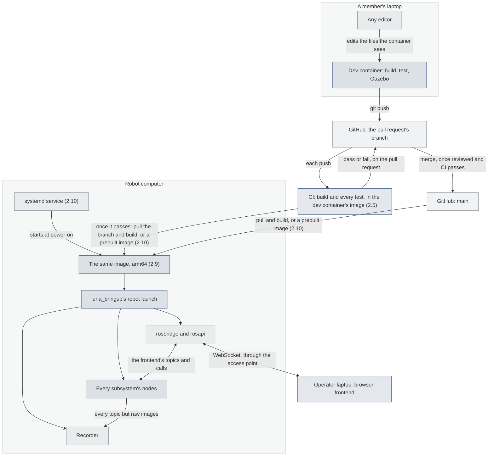
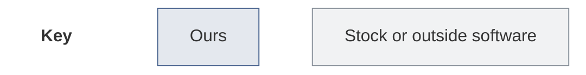

# Platform Design

| Owner | Status | Last reviewed |
| --- | --- | --- |
| ja-zoe | Draft | 2026-11-14 |

This doc designs what every other subsystem runs on: the repository and its packages, the
dev container, CI, the Gazebo world, the robot computer, how the robot starts and records
every run, and rosbridge, which carries everything between the operator laptop and the
robot. Bringup, the link, and logging are SW.4 in the [system design](system.md). The
pages on [Development environment](../development-environment.md),
[Everyday workflow](../everyday-workflow.md), and
[Building for the robot](../building-for-the-robot.md) explain how to use what this doc
designs.

## 1. Purpose and requirements

- R1. Any member can build, test, and simulate the robot software on their own laptop, on
  Windows (through WSL 2), macOS, or Linux, with the dev container and `scripts/dev`, and
  without help.
- R2. CI builds the workspace and runs every test on each pull request, in the dev
  container's image, and a failing test fails the check (2.5). Launch tests that run at
  the same time cannot hear each other (2.6).
- R3. The robot computer runs the same ROS 2 Jazzy environment as the dev container, so code
  that passes in Sim runs unchanged on the robot.
- R4. At power-on, the robot software starts by itself, with no keyboard, and reaches
  DISABLED (2.10). TPM-12 budgets how long that takes.
- R5. Every run is recorded, and the recording and the logs can be taken off the robot after
  the run (2.10).
- R6. The operator laptop reaches the robot only through rosbridge, so only what the
  frontend subscribes to crosses the radio link
  ([system R3 and R4](system.md#1-purpose-and-requirements)).
- R7. Launch arguments pick stand-ins or real hardware, one for the whole robot and one per
  system, with no code change ([system R2](system.md#1-purpose-and-requirements)).

### Budgets

This doc's share of each technical performance measure, from the
[performance budgets](performance-budgets.md).

<!-- design: budgets (generated from platform.toml by scripts/design render: edit that file, not this table) -->

| TPM | Element | Part | Budget |
| --- | --- | --- | --- |
| [TPM-1](performance-budgets.md#tpm-1-autonomous-cycles-completed-per-run) | SW.4 | Full autonomy (§16.5): at least 2 cycles, starting in the starting zone (All of the above, plus SW.1.1 (stays enabled), SW.1.5 (passes AUTO commands), SW.3.1 (heartbeat), and SW.4 (link and logging)) | 1,400 × berm factor |
| [TPM-5](performance-budgets.md#tpm-5-position-error-after-a-2-minute-drive) | SW.4 | Sensor timestamp mismatch | ≤10 [TBR: proposed in the PDR (1.6)] |
| [TPM-6](performance-budgets.md#tpm-6-average-link-bandwidth-over-a-run) | SW.4 | rosbridge connection overhead (WebSocket over TCP) [TBR: measured in 5.6] | 30 kbit/s in TELEOP (default view), 30 kbit/s in AUTO (default view) |
| [TPM-11](performance-budgets.md#tpm-11-robot-computer-processor-load-averaged-over-a-run) | SW.4 | Bringup, link (rosbridge), and logging | [TBD: autonomy doc v1 (7.8)] |
| [TPM-12](performance-budgets.md#tpm-12-restart-time) | SW.4 | Operating system boots (SW.4 (robot computer configuration)) | [TBD: measured in 2.10] |
| [TPM-12](performance-budgets.md#tpm-12-restart-time) | SW.4 | Every robot program starts | [TBD: measured in 2.10] |

<!-- /design -->

## 2. Nodes

The platform's own nodes are rosbridge and the recorder. Everything else it starts comes
from `luna_bringup`'s launch files, which start each subsystem's nodes with the launch
arguments that pick their stand-ins (deliverables 1.4 and 1.11).

<!-- design: nodes (generated from platform.toml by scripts/design render: edit that file, not this table) -->

| Node | Package | Runs on | Element | What it does |
| --- | --- | --- | --- | --- |
| `rosbridge_websocket` | `rosbridge_server`, with `rosapi` | Robot computer | SW.4 Bringup, link and logging | Carries the operator frontend's topics and service calls over one WebSocket connection, so what crosses the radio link is only what the frontend subscribes to. rosapi, beside it, serves get_time, which the frontend uses to stamp /joy in the robot's time (teleoperation open question 6). |
| `ros2 bag` recorder | `rosbag2` | Robot computer | SW.4 Bringup, link and logging | Records every run to the robot computer's storage: every topic except raw images, from DISABLED on [TBR: 2.10] |

<!-- /design -->

## 3. Interfaces

The platform defines no topics of its own. rosbridge publishes, subscribes, and calls for
the operator frontend, so the frontend's interfaces are in the
[teleoperation design](teleoperation.md#3-interfaces), and the recorder subscribes to
every topic it records.

## 4. Parameters

| Parameter | Where | Default | Meaning |
| --- | --- | --- | --- |
| `port` | `rosbridge_websocket` | 9090 [TBR: rosbridge's default, for 5.7 to confirm] | The WebSocket port the frontend connects to |
| Topics recorded | The recorder | Every topic except raw images [TBR: 2.10] | Compressed images are recorded; raw ones would fill the storage |
| Storage folder, split size | The recorder | [TBD: open question 3] | Where each run's recording goes, and how large one file may grow |
| `ROS_AUTOMATIC_DISCOVERY_RANGE` | Every process on the robot computer | [TBR: `LOCALHOST`, open question 4] | Which computers ROS 2 discovery reaches: `LOCALHOST` is this computer only; `SUBNET` is every node multicast reaches, on every network the computer is on |
| The robot's Wi-Fi address and subnet | The robot computer's network settings | [TBD: 5.7] | The network the access point gives the robot, which rosbridge and any `SUBNET` discovery use |
| The network interface DDS uses | The DDS middleware's own configuration file, on the robot computer | The Wi-Fi interface [TBR: how to set it for the middleware the robot uses, checked in 5.6] | Keeps discovery off the LiDAR's Ethernet, where no ROS nodes are |
| `ROS_STATIC_PEERS` | Every process, when working across computers | [TBD: the bench laptop's address, 5.6] | Addresses discovery also tries, separated by semicolons |
| `ROS_DOMAIN_ID` | Every process; each launch test its own in CI | [TBD: the team's ID for bench work across computers, 5.6] | Keeps separate groups of nodes apart ([ROS 2 networking](../ros-networking.md)) |
| Launch arguments | `luna_bringup` | [TBD: named in deliverable 1.4] | One for the whole robot and one per system, picking stub, fake motor controllers, Gazebo, a recording, or the real hardware |
| `use_sim_time` | Every node, in Gazebo | true in Gazebo, false otherwise | Follow Gazebo's clock (2.8) |

## 5. Libraries and hardware interfaces

**Packages.** One workspace in the team repository, under `src/`:

| Package | What it holds | Deliverables |
| --- | --- | --- |
| `luna_interfaces` | The custom messages and services: `RobotMode`, `RequestMode`, `RequestTask`, `ActuatorCommand`, `MechanismStatus`, `FunctionStatus`, `AutonomyStatus` | 1.7 |
| `luna_modes` | `mode_manager`, `command_selector`, and the mode gate controller | 1.8, 1.17 |
| `luna_drivetrain` | The drive hardware plugin, and the motor test | 3.3, 3.5 |
| `luna_mechanism` | `mechanism_controller` and the mechanism hardware plugin | 4.4, 4.5 |
| `luna_teleop` | `teleop_node`, and `heartbeat_publisher`, the frontend's heartbeat stand-in | 5.3, 5.4 |
| `luna_description` | The robot model | 6.3 |
| `luna_autonomy` | Localization, planning, and the task sequencer | 7.x |
| `luna_bringup` | The launch files and their arguments | 1.11 |
| `ctre_phoenix5_vendor` | Downloads the pinned Phoenix 5 libraries | 2.1 |

**The dev container** is one image, `.devcontainer/Dockerfile`, with ROS 2 Jazzy on Ubuntu
24.04, which is Jazzy's Tier 1 platform
([REP 2000, section "Jazzy Jalisco (May 2024 - May 2029)"](../sources.md#ros-rep-2000)).
`scripts/dev` runs it from any terminal; on Windows, from WSL 2's Ubuntu
([Everyday workflow](../everyday-workflow.md)). Code is edited the same way on the laptop
and in the container, since the container sees the repository as `/ws`; only ROS commands,
builds, and tests have to run in the container. The image gains the packages the design
uses beyond `ros-jazzy-desktop`, such as ros2_control, ros2_controllers, xacro, and the
rosbridge suite [TBD: 2.2].

**CI** (deliverables 2.5 and 2.6) runs on every pull request, in the dev container's image:

- `colcon build`, then `colcon test`, then a result check that fails the job if any test
  failed, the same way `scripts/dev test` does.
- Each launch test that starts nodes gets its own `ROS_DOMAIN_ID`, so tests running at once
  do not hear each other, and every launch test runs with no display.
- Unit and Sim tests run in CI, which is what the [testing layers](testing-layers.md)' Bench
  gate requires before any hardware.

**Gazebo** (2.7 and 2.8) runs in the dev container's VNC desktop: a world, the robot model
spawned from `robot_state_publisher`'s description, one bridge configuration for the clock
and the robot's true pose to which each sensor adds its entries, and `use_sim_time` on every
node started in Gazebo mode. The drivetrain runs in Gazebo through gz_ros2_control
([gz_ros2_control](../sources.md#gz-ros2-control)).

**The robot computer** is the Jetson today [TBD: a mini PC replaces it if the grant pays,
system open question 7]:

- **ROS 2 runs in the dev container's image.** JetPack 6's sample root file systems are
  Ubuntu 22.04, "jammy"
  ([Jetson Linux r36.5, Root File System](../sources.md#nvidia-jetson-rootfs-r36-5)), and
  Jazzy supports arm64 only on Ubuntu 24.04
  ([REP 2000, section "Jazzy Jalisco (May 2024 - May 2029)"](../sources.md#ros-rep-2000)),
  so the robot runs the same image as the laptops, built for arm64
  ([Building for the robot](../building-for-the-robot.md)) [TBR: open question 1; 2.9
  records our Jetson's JetPack version].
- **Host networking.** The container shares the robot computer's network, so it sees
  `can0`, which is a network interface, the LiDAR's Ethernet port, and the Wi-Fi.
- **CAN.** JetPack 6's kernel leaves out the CANable's driver, so it is built and installed
  on the Jetson ([CAN bus](../can-bus.md#what-you-need)); `can0` comes up at boot at 1
  Mbit/s (2.9).

**Start at power-on** (2.10). A systemd service starts the container, and in it
`luna_bringup`'s robot launch, at boot, and restarts it if it stops [TBR]. The robot reaches
DISABLED only once `mode_manager`'s self-test passes
([operating modes](operating-modes.md#robot-states-software)), so a launch that fails
partway leaves it in BOOT or FAULT, with nothing enabled.

**Recording.** The recorder starts with bringup and records each run to the robot
computer's storage, one recording per power-on [TBR: open question 3]. Its logs and
recordings come off the robot after the run (2.10). The operating modes design shows it
recording in every robot state but BOOT
([operating modes, What runs in each mode](operating-modes.md#what-runs-in-each-mode)).

**rosbridge** runs on the robot computer, with `rosapi` beside it. The frontend opens one
WebSocket connection for commands and status and a second one for the camera in CBOR
([teleoperation design, section 5](teleoperation.md#5-libraries-and-hardware-interfaces)).
Because the laptop runs no ROS 2 of its own, the robot's DDS discovery never has to cross
the Wi-Fi (open question 4).

**Discovery.** ROS 2 nodes find each other through DDS discovery, which
`ROS_AUTOMATIC_DISCOVERY_RANGE` limits. `SUBNET`, the default, reaches every node multicast
can reach, and `ROS_STATIC_PEERS` adds addresses to try
([Improved Dynamic Discovery](../sources.md#ros2-jazzy-discovery)). `SUBNET` takes no
subnet of its own: it reaches every network the computer is on. The robot computer is on
two, its Ethernet to the LiDAR and its Wi-Fi to the access point, so when a laptop on the
bench works with the robot over `SUBNET`, the DDS middleware is limited to the Wi-Fi
interface, and the laptop's address can be listed in `ROS_STATIC_PEERS` (section 4). At
competition, discovery may stay on the robot computer instead (open question 4).

**Time.** The robot computer is the only computer on the robot, so its clock is the robot's
time. The operator frontend measures its offset from it through rosapi's `get_time`
(teleoperation open question 6), so no clock needs setting at competition.

## 6. Block diagram

A pull request's branch can run on the robot before it merges, so anything physical is
tested on the robot first, but only once CI passes on it. A merge to `main` waits for CI
and a review [TBR: branch protection enforces it once 2.5 sets it].

## 7. Behavior on failure

| Failure | How it is detected | What happens |
| --- | --- | --- |
| The robot launch stops or crashes | systemd sees the container's process exit | systemd starts it again [TBR]; the robot comes back in BOOT and must be enabled again |
| A node in the launch crashes | Its topics stop; `mode_manager` sees missing diagnostics or a stale input | The subsystem stops on its own (operating modes, section 7); FAULT if it was a node the self-test needs |
| rosbridge stops | The frontend's WebSocket closes | No heartbeat arrives, so the robot disables within `link_timeout` ([operating modes](operating-modes.md#7-behavior-on-failure)) |
| The recorder's storage fills | Free space below [TBD: 2.10] | A WARN on `/diagnostics`; the robot keeps running, since recording is not needed to move |
| `can0` does not come up at boot | The self-test finds no motor controllers | FAULT; nothing can be enabled |
| The robot computer's clock jumps | The frontend's measured offset changes | The frontend measures again before sending input [TBR: teleoperation open question 6] |

## 8. Test plan

| Requirement | Test | Where | Result |
| --- | --- | --- | --- |
| R1 | A member who has not set it up before follows [Getting started](../getting-started.md) on Windows (WSL 2), macOS, and Linux, then builds, tests, and opens RViz, with no help; the "What works where" table records the result (2.2). | Laptop | Not run |
| R2 | A pull request with a unit test that fails on purpose turns the check red, and so does one with a failing launch test; two launch tests run at once without hearing each other (2.5, 2.6). | CI | Not run |
| R3 | The image built for arm64 runs on the Jetson; `scripts/dev test` passes there; `candump can0` from inside the container shows the bench motor controller (2.9). | Bench | Not run |
| R4 | Power-cycle the robot computer ten times with no keyboard; every time, `/robot/mode` reaches DISABLED, and the time from power-on is written in the Bench log for TPM-12 (2.10). | Bench | Not run |
| R5 | After a 10-minute session, take the recording and logs off the robot as the deployment procedure says, and play the recording back on a laptop (2.10). | Bench | Not run |
| R6 | During a session through the access point, capture the robot's Wi-Fi traffic: everything to and from the operator laptop is rosbridge's WebSocket (5.6). | Bench | Not run |
| R7 | The whole robot launches on stubs from the whole-robot argument, then one system switches to real hardware with its own argument (1.11). | Sim, then Bench | Not run |

## 9. Open questions

<!-- design: questions (generated from platform.toml by scripts/design render: edit that file, not this table) -->

| Question | Status | Turgor |
| --- | --- | --- |
| 1. Does the robot computer run ROS 2 in the dev container's image, or natively? On the Jetson, JetPack 6's Ubuntu 22.04 has no Jazzy for arm64, so the container is proposed (section 5); a mini PC (system open question 7) could run either. | Open | 2.9 |
| 2. How does code reach the robot: pull a commit and build on the robot computer, or install a prebuilt arm64 image? | Open | 2.10 |
| 3. Where do recordings live on the robot, how do they come off it after a run, and how long are they kept? The system design's conventions say where recordings live for good (1.5). | Open | 2.10 |
| 4. Should the robot's ROS 2 discovery stay on the robot computer (ROS_AUTOMATIC_DISCOVERY_RANGE set to LOCALHOST), since the operator laptop reaches it only through rosbridge? Discovery traffic would then never cross the Wi-Fi, and a teammate debugging from a laptop would use rosbridge or ssh instead. | Open | 5.6 |

<!-- /design -->

## Handoff

Not yet written: this doc is a draft.
