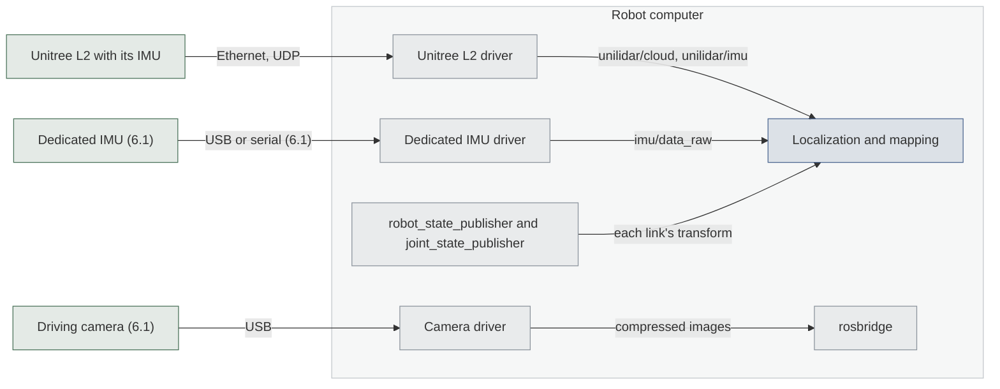

# Sensors and Robot Model Design

| Owner | Status | Last reviewed |
| --- | --- | --- |
| ja-zoe | Draft | 2026-11-14 |

This doc designs how the robot's sensors reach ROS, and the robot model that places them:
SW.2.1 in the [system design](system.md). The robot has a Unitree L2 LiDAR with its
built-in IMU, a dedicated IMU near the center of mass, and driving cameras; which IMU and
cameras is [TBD: the sensor suite evaluation (6.1), the system design's open question 2].
The system design's [Hardware lines](system.md#hardware-lines),
[The two IMUs](system.md#the-two-imus), and [Adding a sensor](system.md#adding-a-sensor)
set the contracts this doc fills in.

## 1. Purpose and requirements

- R1. Each sensor publishes its hardware line's topics, message types, frames, and rates,
  the same from its driver and from every stand-in
  ([system R1](system.md#1-purpose-and-requirements)).
- R2. No magnetometer feeds the robot, since it is a compass
  ([system R5](system.md#1-purpose-and-requirements)).
- R3. Every sensor's frame sits in the robot model at its mount, from Mechanical's CAD,
  within 0.01 m [TBR: TPM-5's sensor position row].
- R4. The sensors' timestamps agree within 10 ms [TBR: TPM-5's timestamp row].
- R5. Each sensor instance has its own frame, topics, and stub, so adding a sensor of a kind
  the robot already has changes no code ([system R6](system.md#1-purpose-and-requirements)).
- R6. The driving camera's compressed stream fits its link budget: 750 kbit/s in the TELEOP
  default view, none in AUTO's [TBR: TPM-6's camera row].
- R7. A sensor that stops publishing is noticed, and the robot does not drive on what it
  last saw (section 7).
- R8. Every sensor publishes within the restart budget after power-on [TBD: TPM-12's
  sensor row, measured in 2.10].

### Budgets

This doc's share of each technical performance measure, from the
[performance budgets](performance-budgets.md).

<!-- design: budgets (generated from sensors.toml by scripts/design render: edit that file, not this table) -->

| TPM | Element | Part | Budget |
| --- | --- | --- | --- |
| [TPM-4](performance-budgets.md#tpm-4-obstacle-contacts-per-run) | SW.2.1 | Error in the robot's outline in the robot model (SW.2.1, from Mechanical's CAD) | 2 [TBR: proposed in the PDR (1.6)] |
| [TPM-4](performance-budgets.md#tpm-4-obstacle-contacts-per-run) | SW.2.1 | Smallest rock mapped (guidebook §11.4: rocks are 30 to 40 cm across) | 30 cm across |
| [TPM-4](performance-budgets.md#tpm-4-obstacle-contacts-per-run) | SW.2.1 | Smallest crater mapped (craters are about 40 to 50 cm wide) | 40 cm wide |
| [TPM-4](performance-budgets.md#tpm-4-obstacle-contacts-per-run) | SW.2.1 | Detection range | ≥2.0 [TBR: proposed in the PDR (1.6)] |
| [TPM-5](performance-budgets.md#tpm-5-position-error-after-a-2-minute-drive) | SW.2.1 | IMU heading drift | [TBD: sensor suite evaluation (6.1)] |
| [TPM-5](performance-budgets.md#tpm-5-position-error-after-a-2-minute-drive) | SW.2.1 | Sensor position error in the robot model | ≤0.01, from CAD [TBR: proposed in the PDR (1.6)] |
| [TPM-5](performance-budgets.md#tpm-5-position-error-after-a-2-minute-drive) | SW.2.1 | Sensor timestamp mismatch | ≤10 [TBR: proposed in the PDR (1.6)] |
| [TPM-6](performance-budgets.md#tpm-6-average-link-bandwidth-over-a-run) | SW.2.1 | Compressed driving camera, as CBOR on its own connection: on by default in TELEOP, and the operator can turn it on in AUTO | 750 kbit/s in TELEOP (default view), 0 kbit/s in AUTO (default view) |
| [TPM-11](performance-budgets.md#tpm-11-robot-computer-processor-load-averaged-over-a-run) | SW.2.1 | Sensor drivers, including camera compression | [TBD: autonomy doc v1 (7.8)] |
| [TPM-12](performance-budgets.md#tpm-12-restart-time) | SW.2.1 | Sensor drivers publishing | [TBD: sensors doc (6.2)] |

<!-- /design -->

## 2. Nodes

Each sensor's driver is a node of its maker's or the ROS community's, not ours, so the
hardware line is the driver's topics. The robot model is ROS's standard pair:
`joint_state_publisher` merges the drivetrain's and the mechanism's joint states into
`joint_states`, since each controller manager publishes its own
([drivetrain design](drivetrain.md#2-nodes)), and `robot_state_publisher` publishes the
model and each link's transform from them [TBR: merging with `joint_state_publisher`'s
`source_list`, checked in 6.3].

<!-- design: nodes (generated from sensors.toml by scripts/design render: edit that file, not this table) -->

| Node | Package | Runs on | Element | What it does |
| --- | --- | --- | --- | --- |
| Unitree L2 driver | `unitree_lidar_ros2` | Robot computer | SW.2.1 Sensor interface and robot model | Reads the L2 over Ethernet and publishes its point cloud and its built-in IMU, with Unitree's default names and frames |
| Dedicated IMU driver | [TBD: the IMU, sensor suite evaluation (6.1)] | Robot computer | SW.2.1 Sensor interface and robot model | Publishes the dedicated IMU's gyroscope and accelerometer in one message, with no magnetometer (system design R5) |
| Camera driver | [TBD: the cameras, sensor suite evaluation (6.1)] | Robot computer | SW.2.1 Sensor interface and robot model | Publishes the driving camera's compressed images for the operator view |
| `robot_state_publisher` and `joint_state_publisher` | `robot_state_publisher`, `joint_state_publisher`; the model in `luna_description` (6.3) | Robot computer | SW.2.1 Sensor interface and robot model | joint_state_publisher merges the drivetrain's and the mechanism's joint states into joint_states, and robot_state_publisher publishes the robot model and the transforms of every link it describes |

<!-- /design -->

## 3. Interfaces

This table is the contract between this subsystem and the rest of the robot. The code must
match it exactly. It is generated from this doc's registry, so a pull request that changes
an interface edits the registry and runs `scripts/design render`, in the same pull request
as the code ([Registries](README.md#registries)).

<!-- design: interfaces (generated from sensors.toml by scripts/design render: edit that file, not this table) -->

| Name | Kind | Type | Rate | Publisher or server | Subscriber or client | QoS |
| --- | --- | --- | --- | --- | --- | --- |
| `unilidar/cloud` | topic | `sensor_msgs/msg/PointCloud2` | About 12 Hz [TBR: 18 scans a cloud, measured on the bench (6.6)] | Unitree L2 driver | Localization and mapping | reliable, volatile, depth 10, as the driver publishes it |
| `unilidar/imu` | topic | `sensor_msgs/msg/Imu` | 500 Hz [TBR: the L2's reporting rate, measured on the bench (6.6)] | Unitree L2 driver | Localization and mapping | reliable, volatile, depth 10, as the driver publishes it |
| `imu/data_raw` | topic | `sensor_msgs/msg/Imu` | 100 Hz [TBR: the stub's rate (6.9), until 6.1 picks the part] | Dedicated IMU driver | Localization and mapping | reliable, volatile, depth 10 [TBR: until the driver from 6.1 is known] |
| [TBD: the driving camera's topic, once 6.1 picks the camera] | topic | sensor_msgs/msg/CompressedImage [TBR] | [TBD: the camera's rate; the operator view takes 5 Hz] | Camera driver | Operator frontend | [TBD: the driver's QoS] |
| `/diagnostics` | topic | `diagnostic_msgs/msg/DiagnosticArray` | 1 Hz and on change | Drive mode gate, Mechanism mode gate, Camera driver, Dedicated IMU driver, Localization and mapping, Path planning and following, Task sequencer | `mode_manager` | reliable, depth 10 |
| `/drivetrain/joint_states` | topic | `sensor_msgs/msg/JointState` | The controller manager's `update_rate`, 50 Hz | `joint_state_broadcaster` (drivetrain) | `robot_state_publisher` and `joint_state_publisher`, Localization and mapping | the system default: reliable, volatile |
| `/mechanism/joint_states` | topic | `sensor_msgs/msg/JointState` | The controller manager's `update_rate`, 50 Hz | `joint_state_broadcaster` (mechanism) | `robot_state_publisher` and `joint_state_publisher` | the system default: reliable, volatile |

<!-- /design -->

**The LiDAR's topics** keep the names and frames Unitree's driver uses by default
([unitree_lidar_ros2 launch file](../sources.md#unitree-lidar-ros2-launch)), so its
stub, its recordings, and Gazebo use them too. The driver publishes both with the default
QoS and a depth of 10, which is reliable
([unitree_lidar_ros2 node](../sources.md#unitree-lidar-ros2-node)). Each cloud gathers 18
of the mirror's scans (`cloud_scan_num`), and the mirror sweeps vertically 216 times a
second ([L2 manual, p. 17](../sources.md#unitree-l2-manual)), so the cloud comes about 12
times a second [TBR: if one scan is one sweep, measured in 6.6].

**The dedicated IMU** publishes one `sensor_msgs/msg/Imu` on `imu/data_raw` in its own
frame, with angular velocity and linear acceleration and no orientation from a compass
([system design, The two IMUs](system.md#the-two-imus)).

**Cameras** are named instances, each in a namespace with its name
([system design, Adding a sensor](system.md#adding-a-sensor)). The driving camera, named
`front`, would publish `camera/front/image_raw/compressed` and `camera/front/camera_info`
in frame `camera_front_optical_frame` [TBR: once 6.1 picks the camera and its driver].

**Publish reliable.** A reliable publisher reaches both reliable and best effort
subscribers, but a best effort publisher reaches only best effort ones, so each sensor's
stub publishes reliable, as the L2's driver does.

## 4. Parameters

| Parameter | Node | Type | Default | Units | Meaning |
| --- | --- | --- | --- | --- | --- |
| `initialize_type` | Unitree L2 driver | int | 2 | None | 2 reads the L2 over Ethernet (UDP), 1 over its serial port |
| `lidar_ip`, `lidar_port` | Unitree L2 driver | string, int | `192.168.1.62`, 6101 | None | The L2's address |
| `local_ip`, `local_port` | Unitree L2 driver | string, int | `192.168.1.2`, 6201 | None | The robot computer's address on its Ethernet port, which the L2 sends to |
| `cloud_scan_num` | Unitree L2 driver | int | 18 | scans | Scans gathered into each cloud |
| `use_system_timestamp` | Unitree L2 driver | bool | true | None | Stamp clouds with the computer's clock when they arrive (open question 4) |
| `range_min`, `range_max` | Unitree L2 driver | double | 0.0, 100.0 [TBR: open question 3] | m | Distances kept in the cloud |
| `cloud_frame`, `imu_frame` | Unitree L2 driver | string | `unilidar_lidar`, `unilidar_imu` | None | Frames, placed in the robot model |
| `frame_id`, rate | Dedicated IMU driver | string, double | `imu_link`, 100 [TBR: 6.1] | None, Hz | The IMU's frame and rate |
| Resolution, rate, JPEG quality | Camera driver | | [TBD: 6.1 and 6.7] | | Set so the stream fits R6 |
| `source_list` | `joint_state_publisher` | string array | `/drivetrain/joint_states`, `/mechanism/joint_states` | None | Joint state topics it merges |
| `robot_description` | `robot_state_publisher` | string | The model from `luna_description`'s xacro | None | The robot model |

The L2 driver's defaults are those of Unitree's launch file
([unitree_lidar_ros2 launch file](../sources.md#unitree-lidar-ros2-launch)).

## 5. Libraries and hardware interfaces

- **The Unitree L2.** It sees from 0.05 m to 30 m on a 90% reflective surface and 15 m on a
  10% one, over 360° by 90°, or 96° in its negative angle mode, with 64,000 points a second
  that count, to within 2.0 cm. Its mirror turns 5.55 times a second, and its built-in IMU
  reports at 500 Hz ([L2 manual, p. 17](../sources.md#unitree-l2-manual)). It sends over
  Ethernet (UDP) or its serial port, one at a time
  ([L2 manual, p. 12](../sources.md#unitree-l2-manual)).
    - **Connection: Ethernet,** to the robot computer's Ethernet port, at the driver's
      default addresses. The robot's radio is then the computer's own Wi-Fi [TBR: system
      open question 8; the Jetson developer kit's carrier board has one Ethernet port, for
      2.9 to confirm on ours]. If the Wi-Fi proves too weak, a wired radio needs a second
      port (open question 2).
    - **Mount.** Nothing may block its field of view, not even clear glass
      ([L2 manual, p. 9](../sources.md#unitree-l2-manual)), and the field of view is a
      hemisphere above it ([L2 manual, p. 8](../sources.md#unitree-l2-manual)), so how it
      is mounted decides how much ground it sees (open question 1).
    - **Power** comes from the main battery behind the E-stop, through an isolated
      converter
      ([operating modes, section 5](operating-modes.md#5-libraries-and-hardware-interfaces)).
- **The dedicated IMU** is [TBD: 1 to 3 candidates in 6.1's IMU row, each with its noise,
  interface, Jazzy driver, mass, and price]. It mounts rigidly near the center of mass,
  away from motor vibration, and its driver must leave any magnetometer out
  ([system design, The two IMUs](system.md#the-two-imus)).
- **Cameras** are [TBD: 6.1's driving cameras row, and whether the planned Intel RealSense
  D456 depth camera adds what the L2 misses]. Each connects to the robot computer over USB
  and is compressed on the robot, so only the compressed stream crosses the link.
- **The robot model** is the `luna_description` package (6.3): an xacro file with the
  chassis, the four wheel joints the drivetrain names, the mechanism's joints, and a frame
  for each sensor at its mount, with each number's source in a comment. Its
  `ros2_control` tags name each subsystem's hardware plugin, or the stub or Gazebo in its
  place, chosen by launch argument [TBD: deliverable 1.4]. Every link has inertia and a
  collision shape, so Gazebo can spawn it (2.7).
- **Stand-ins,** one per sensor instance, started with the instance's name, frame, and
  topics as parameters ([system design, Adding a sensor](system.md#adding-a-sensor)):
    - The L2's stub publishes a floor and three boxes as a cloud at the L2's rate, plus
      still IMU messages (6.4).
    - The dedicated IMU's stub publishes a robot at rest, with gravity on z and zero angular
      velocity, at 100 Hz (6.9).
    - A camera's stub publishes a test pattern (6.7).
    - Recordings play back with `ros2 bag play` in place of a driver (6.6), and Gazebo
      simulates each sensor on the same topics and frames (6.5, 6.7, 6.10).

## 6. Block diagram

Gray is stock or vendor code, blue is ours, and green is hardware. Each sensor's stand-ins
replace its driver and the sensor, as
[Hardware test modes](hardware-test-modes.md#lidar-stub-sim) draws for each mode.

## 7. Behavior on failure

| Failure | How it is detected | What happens |
| --- | --- | --- |
| The L2 stops sending, or its cable is pulled | No cloud for [TBD: autonomy's timeout] at localization | Localization reports an ERROR on `/diagnostics` and the planner stops on missing scans ([autonomy design](autonomy.md#7-behavior-on-failure)) |
| The main battery sags below the converters' minimum | The L2's clouds stop | The L2 reboots with its converter, as the [operating modes design](operating-modes.md#7-behavior-on-failure) describes; the row above applies until it is back |
| The dedicated IMU stops | No `imu/data_raw` for [TBD: autonomy's timeout] | Its driver, or localization, reports an ERROR on `/diagnostics` |
| A camera stops | The operator view's image stops updating | The view shows the image as stale; the robot does nothing, since no robot code depends on the camera |
| Dust on the L2's window | Fewer points than usual in each cloud [TBR: a threshold from the bench recording, 6.6] | A WARN on `/diagnostics` for the operator |
| A sensor's frame is missing from the robot model | Transform lookups fail at localization | Caught in Sim, since every launch test runs the robot model |

## 8. Test plan

| Requirement | Test | Where | Result |
| --- | --- | --- | --- |
| R3 | The model's xacro converts and parses in CI, and every sensor frame sits where the CAD puts it (6.3). | Unit | Not run |
| R1, R5 | Unit tests of each stub: frame name, rate, and units; the L2 stub's floor and boxes are where they are put; the IMU stub's gravity has the right sign (6.4, 6.9). | Unit | Not run |
| R1 | In Gazebo, the L2 and the dedicated IMU publish on the stubs' topics, frames, and rates; turning in place shows angular velocity about z (6.5, 6.10). | Sim | Not run |
| R1 | The L2 on a Linux machine over Ethernet: its topics, frames, types, and rates match the stub, and any difference is fixed in the stub (6.6). | Bench | Not run |
| R4 | On the bench, the delay between each sensor's stamp and the computer's clock, for the L2 and the dedicated IMU (6.6, 6.11, open question 4). | Bench | Not run |
| R1, R2 | The dedicated IMU at rest reads about 9.8 m/s² on z; turned by hand, each axis has the right sign; no magnetometer topic or orientation from one (6.11). | Bench | Not run |
| R6 | The driving camera at its chosen settings, measured with `ros2 topic bw` at the laptop (6.8). | Bench | Not run |
| R7 | Pull the L2's Ethernet cable during a stub-free Bench run; localization reports an ERROR and the robot stops in AUTO. | Bench | Not run |
| R8 | From power-on, the time until each sensor's first message (2.10). | Robot | Not run |

## 9. Open questions

<!-- design: questions (generated from sensors.toml by scripts/design render: edit that file, not this table) -->

| Question | Status | Turgor |
| --- | --- | --- |
| 1. How is the L2 mounted, so it sees the ground ahead? Its field of view is a hemisphere above it, 90° tall, or 96° in negative angle mode ([L2 manual, p. 17](../sources.md#unitree-l2-manual)), so mounted level it sees little of the ground where the rocks and craters are. Tilted forward, or upside down? For Mechanical, with the mount's height. | Open | 6.1 |
| 2. If the Jetson's own Wi-Fi proves too weak for the robot's radio (5.6), a wired radio needs a second Ethernet port beside the L2's: a USB Ethernet adapter, or a small switch the two share? | Open | 5.6 |
| 3. Which parts of the robot itself does the L2 see, such as the excavator or the bin, and how are they cut out of the cloud: a box around the robot in base_link, or the driver's range_min? | Open | 6.5 |
| 4. The L2 driver stamps each cloud with the computer's time when it arrives (use_system_timestamp is true). Is that within TPM-5's 10 ms timestamp mismatch of the IMUs' stamps? Measure on the bench, and if not, use the L2's own time. | Open | 6.6 |

<!-- /design -->

## Handoff

Not yet written: this doc is a draft.
