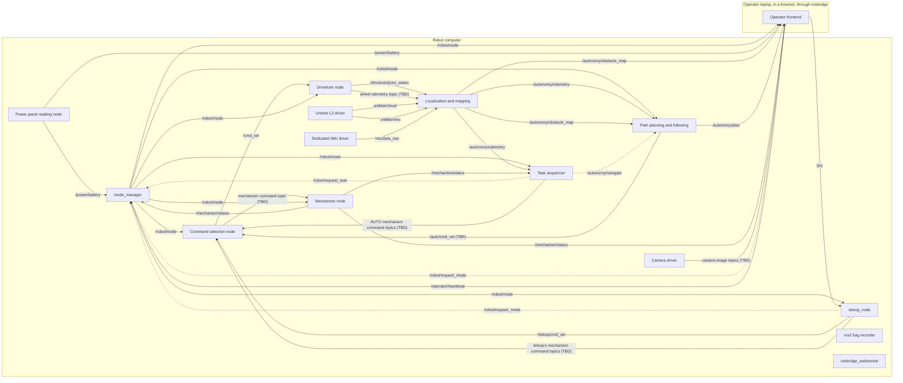
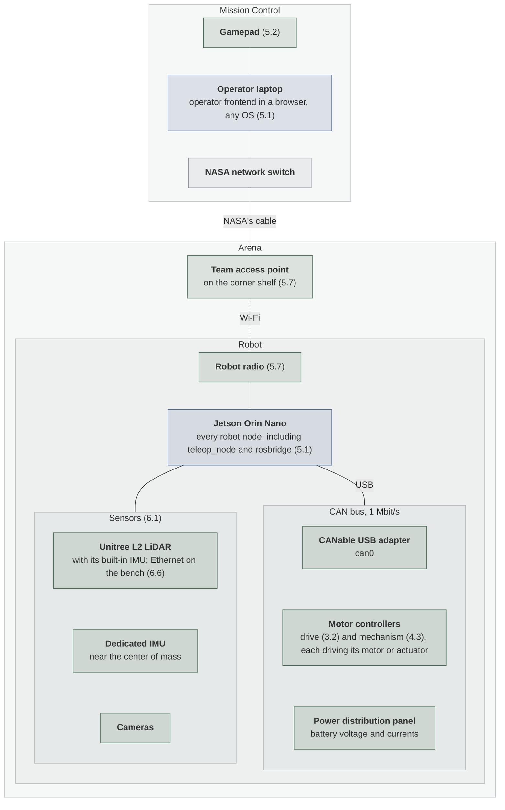
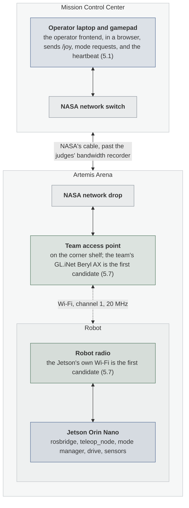

# System Design

| Owner | Status | Last reviewed |
| --- | --- | --- |
| ja-zoe | Draft | 2026-10-18 |

This doc shows how the robot's computer, motor controllers, sensors, operator station,
and network connect, and the contracts between subsystems at the hardware. Each
subsystem's own design doc covers its insides; this one covers how they fit together. It
is written in steps (deliverable 1.5): the block diagrams and the hardware lines first,
then the node graph, the team's conventions, and the list of components with their owners
by Oct 28.

## 1. Purpose and requirements

- R1. Every hardware system has one hardware line, which its stand-ins and its real driver
  all meet, so the code above the line runs unchanged in every test mode
  ([Testing layers](testing-layers.md#the-hardware-line)).
- R2. Launch arguments pick stand-ins or real hardware with no code change: one for the
  whole robot, and one per system that overrides it, so a run can mix a real drivetrain
  with stubs for everything else
  ([Testing layers](testing-layers.md#choosing-stand-ins-per-system)). Deliverable 1.4
  decides how.
- R3. The operator station reaches the robot only through the team's access point and
  NASA's cable. A back channel, such as a phone or laptop connecting to the access point
  directly, means disqualification ([§14.5, p. 50](../sources.md#nasa-lunabotics-guidebook-2027)).
- R4. The link averages 4,000 kbit/s or less over a run
  ([§14.1.19, p. 48](../sources.md#nasa-lunabotics-guidebook-2027)). The
  [operating modes design](operating-modes.md#1-purpose-and-requirements) (R10) budgets it
  by mode.
- R5. No GPS or compass feeds the robot's calculations
  ([§13.7, p. 43](../sources.md#nasa-lunabotics-guidebook-2027)), so no magnetometer
  does either.
- R6. A sensor of a kind the robot already has is added as a named instance, with its own
  frame, topics, and stub, without changing the code that reads the others (see
  [Adding a sensor](#adding-a-sensor)).

### Budgets

This doc's share of each technical performance measure, from the
[performance budgets](performance-budgets.md).

<!-- design: budgets (generated from system.toml by scripts/design render: edit that file, not this table) -->

| TPM | Element | Part | Budget |
| --- | --- | --- | --- |
| [TPM-1](performance-budgets.md#tpm-1-autonomous-cycles-completed-per-run) | SW.1.5 | Full autonomy (§16.5): at least 2 cycles, starting in the starting zone (All of the above, plus SW.1.1 (stays enabled), SW.1.5 (passes AUTO commands), SW.3.1 (heartbeat), and SW.4 (link and logging)) | 1,400 × berm factor |
| [TPM-6](performance-budgets.md#tpm-6-average-link-bandwidth-over-a-run) | SW.1.5 | Nothing: it runs on the robot | 0 kbit/s in TELEOP (default view), 0 kbit/s in AUTO (default view) |
| [TPM-11](performance-budgets.md#tpm-11-robot-computer-processor-load-averaged-over-a-run) | SW.1.5 | Robot control (SW.1.1 to SW.1.5) | [TBD: autonomy doc v1 (7.8)] |

<!-- /design -->

## 2. Nodes

### Software elements

The PDR's system hierarchy splits the robot software into elements, each designed in one
design doc. The Turgor column gives the deliverable that writes that doc.

<!-- design: elements (generated from docs/design/*.toml by scripts/design render: edit those files, not this block) -->

| ID | Element | Function | Connects to (other teams' parts) | Design doc | Turgor |
| --- | --- | --- | --- | --- | --- |
| SW | Robot software | Controls and monitors the rover, by remote control and on its own | Robot computer, operator laptop, radio link | [System Design](system.md) | 1.20 |
| SW.1 | Robot control software | Moves actuators only as the current mode allows | Motor controllers and power distribution panel (PDP), over CAN | [Operating Modes Design](operating-modes.md) | 1.19 |
| SW.1.1 | Mode manager | Owns the robot's state and task mode; disables the robot on link loss, a fault, or a command | None directly; it hears about CAN devices through SW.1.2 to SW.1.4 | [Operating Modes Design](operating-modes.md) | 1.19 |
| SW.1.2 | Drivetrain control | Sends drive motor commands and per-mode current limits; computes wheel odometry [TBD: which node, system open question 9] | Drive motor controllers; wheel and track geometry | `drivetrain.md`, not written yet (3.1) | 3.1 |
| SW.1.3 | Mechanism control | Sends mechanism commands and per-mode limits; reports whether the excavator is stowed and the hatch is closed | Mechanism motor controllers, stowed and hatch sensors, limit switches | `mechanism.md`, not written yet (4.2) | 4.2 |
| SW.1.4 | Power telemetry | Reports battery voltage, each channel's current, and energy used, decoded from the PDP's CAN frames | PDP (CAN ID 0, firmware 1.40 or later) | [Operating Modes Design](operating-modes.md) | 1.19 |
| SW.1.5 | Command selection | Passes on drive and mechanism commands from the active control source, TELEOP or AUTO, and drops the other source's [TBR: proposed in the PDR; whether it is a node of its own, and which doc designs it, wait on teleop open question 3] | None outside Software | [System Design](system.md) | None |
| SW.2 | Perception and autonomy software | Sees the arena and runs the mission cycle hands-free | Sensors | [Autonomy Subsystem Design](autonomy.md) | 7.2 |
| SW.2.1 | Sensor interface and robot model | Publishes each sensor's data in its own frame, plus the robot's geometry | LiDAR, IMUs, cameras; Mechanical's CAD | `sensors.md`, not written yet (6.2) | 6.2 |
| SW.2.2 | Localization and mapping | Finds position and heading from a random start and builds the obstacle map, using only onboard sensors | Start-zone markers, if used | [Autonomy Subsystem Design](autonomy.md) | 7.2 |
| SW.2.3 | Path planning and following | Plans a path around obstacles to the target zone and follows it | None outside Software | [Autonomy Subsystem Design](autonomy.md) | 7.2 |
| SW.2.4 | Task sequencer | Runs dig, travel, dump, travel in AUTO, through the mode manager | None outside Software | [Autonomy Subsystem Design](autonomy.md) | 7.2 |
| SW.3 | Operator station software | Gives Mission Control control of the robot and a view of it, from a browser on any member's laptop | Operator laptop, gamepad, NASA's network switch | `teleoperation.md`, not written yet (5.1) | 5.1 |
| SW.3.1 | Operator frontend | Reads the gamepad, sends /joy, the heartbeat, and mode requests over rosbridge, and shows the operator views and live link bandwidth | Gamepad (Xbox Model 1914, USB-C cable); operator laptop [TBR: an HTTPS page served by the robot, or a desktop app, teleoperation doc (5.1)] | `teleoperation.md`, not written yet (5.1) | 5.1 |
| SW.3.2 | Teleop mapping | Turns /joy into drive and mechanism commands on the robot computer, zeroes them when the hold button is released, and drops stale input | None outside Software | `teleoperation.md`, not written yet (5.1) | 5.1 |
| SW.4 | Bringup, link and logging | Starts all robot software at power-on, runs the rosbridge server that decides which topics cross the radio link, and records every run | Robot computer, robot radio, access point | `platform.md`, not written yet (2.11) | 2.11 |

<!-- /design -->

### Node graph

Every node in the design docs' registries, grouped by the computer it runs on. A solid
arrow is a topic, from publisher to subscriber; a dashed arrow is a service call, from
client to server. A name not decided yet shows "(TBD)". Every node of ours that can fail
also publishes `/diagnostics` to `mode_manager`, which the graph leaves out to stay
readable. The docs that are not written yet
each have a registry with what the other docs assume of them, so this graph is complete
in shape, but most of its names and rates wait on those docs.
[Interfaces](interfaces.md) lists every node and interface in full.

<!-- design: graph (generated from docs/design/*.toml by scripts/design render: edit those files, not this block) -->

<!-- /design -->

## 3. Interfaces

Each subsystem's design doc owns the topics, services, and actions its nodes publish or
serve, in its registry ([Registries](README.md#registries)), and
[Interfaces](interfaces.md) lists them all. This doc owns the contracts at the hardware,
and the interfaces that belong to no subsystem yet.

### Between subsystems

The command selection the PDR proposes (SW.1.5) has no design doc yet, and every node of
ours that can fail publishes `/diagnostics`, so both are defined here.

<!-- design: nodes (generated from system.toml by scripts/design render: edit that file, not this table) -->

| Node | Package | Runs on | Element | What it does |
| --- | --- | --- | --- | --- |
| Command selection node | [TBD: teleop open question 3] | Robot computer | SW.1.5 Command selection | Passes on the drive and mechanism commands of the active control source, as /robot/mode names it, and drops the other source's |

<!-- /design -->

<!-- design: interfaces (generated from system.toml by scripts/design render: edit that file, not this table) -->

| Name | Kind | Type | Rate | Publisher or server | Subscriber or client | QoS |
| --- | --- | --- | --- | --- | --- | --- |
| `/cmd_vel` | topic | geometry_msgs/msg/TwistStamped [TBR: the drivetrain draft (PR #17) uses Twist; Turgor 3.1 and 5.3 and the teleop draft use TwistStamped] | 20 Hz [TBR: drivetrain draft, PR #17] | Command selection node | Drivetrain node | best effort, depth 1 [TBR: drivetrain draft, PR #17] |
| [TBD: mechanism command topic, teleop open question 3] | topic | [TBD: in the mechanism doc (4.2)] | [TBD: in the mechanism doc (4.2)] | Command selection node | Mechanism node | [TBD: in the mechanism doc (4.2)] |
| `/diagnostics` | topic | `diagnostic_msgs/msg/DiagnosticArray` | 1 Hz and on change | Drivetrain node, Mechanism node, Camera driver, Dedicated IMU driver, Localization and mapping, Path planning and following, Task sequencer | `mode_manager` | reliable, depth 10 |
| `/robot/mode` | topic | `luna_interfaces/msg/RobotMode` | 10 Hz and on change | `mode_manager` | Drivetrain node, Mechanism node, Command selection node, Path planning and following, Task sequencer, Operator frontend, `teleop_node` | reliable, transient local, depth 1 |
| /auto/cmd_vel [TBR: teleop open question 3] | topic | geometry_msgs/msg/TwistStamped [TBR: matches /teleop/cmd_vel] | `command_rate`, 20 Hz | Path planning and following | Command selection node | best effort, volatile, depth 1 |
| [TBD: AUTO mechanism command topics, teleop open questions 3 and 5] | topic | [TBD: mechanism doc (4.2)] | 20 Hz [TBR: matches teleop's command_rate] | Task sequencer | Command selection node | [TBD: mechanism doc (4.2)] |
| `/teleop/cmd_vel` | topic | geometry_msgs/msg/TwistStamped [TBR: teleop draft, PR #14] | `command_rate`, 20 Hz [TBR: teleop draft, PR #14] | `teleop_node` | Command selection node | best effort, volatile, depth 1 [TBR: teleop draft, PR #14] |
| [TBD: teleop's mechanism command topics, teleop open questions 3 and 5] | topic | [TBD: mechanism doc (4.2)] | `command_rate`, 20 Hz [TBR: teleop draft, PR #14, for the mechanism doc (4.2) to confirm] | `teleop_node` | Command selection node | [TBD: teleoperation doc (5.1)] |

<!-- /design -->

### Hardware lines

A hardware line is what every stand-in for a hardware system, and its real driver, must
provide, so the code above it cannot tell them apart. [Testing layers](testing-layers.md)
explains how the line is used, and [Hardware test modes](hardware-test-modes.md) draws
each system in each test mode.

| System | What crosses the line | Stand-ins below it | Design doc |
| --- | --- | --- | --- |
| Drivetrain | 4 wheel joints, 2 per side: a velocity command in; velocity and position out, and current where the motor controller measures it | Stub hardware, fake motor controllers, Gazebo | `drivetrain.md` (3.1) |
| Mechanism | Each mechanism joint's command and state, plus [TBD: the limit switch and stowed signals, which the mechanism doc defines (4.2)] | Stub hardware, fake motor controllers | `mechanism.md` (4.2) |
| Battery and power | `/power/battery` (`sensor_msgs/msg/BatteryState`, 10 Hz) and `/diagnostics` | A stub node, a fake power panel | [Operating modes](operating-modes.md#3-interfaces) |
| LiDAR | The Unitree L2's point cloud and its built-in IMU, as Unitree's driver publishes them: by default `unilidar/cloud` in frame `unilidar_lidar` and `unilidar/imu` in frame `unilidar_imu` ([unitree_lidar_ros2 launch file](../sources.md#unitree-lidar-ros2-launch)) | A stub node, a recording, Gazebo | `sensors.md` (6.2) |
| Dedicated IMU | One `sensor_msgs/msg/Imu`: angular velocity from the gyroscope and linear acceleration from the accelerometer, in the IMU's own frame near the center of mass. No magnetometer. | A stub node, a recording, Gazebo | `sensors.md` (6.2) |
| Cameras | [TBD: the image and camera info topics and frames of the cameras chosen in 6.1] | A test-pattern stub, a recording, Gazebo | `sensors.md` (6.2) |
| Gamepad | `/joy`, sent by the operator frontend from the browser's Gamepad API [TBR: chosen in the PR #14 review, 2026-10-26], with [TBD: the button and stick numbers from the gamepad's table (5.2)] | A recording | `teleoperation.md` (5.1) |
| Radio link | The messages that cross between the operator laptop and the robot over one rosbridge connection (WebSocket over TCP): `/joy`, the heartbeat, mode requests, and telemetry [TBR: chosen in the PR #14 review, 2026-10-26] | Both sides on one computer | `teleoperation.md` (5.1) |

The design docs in code font are not written yet; the number after each is its
deliverable.

### The two IMUs

The robot has two IMUs, each fixed to what it measures:

- **The L2's built-in IMU stays part of the LiDAR.** It is a 3-axis accelerometer and a
  3-axis gyroscope ([Unitree L2 manual, p. 17](../sources.md#unitree-l2-manual)), fixed to
  the LiDAR, so it measures the LiDAR's own motion, which is what LiDAR-inertial odometry
  needs.
- **A dedicated IMU near the center of mass** feeds the robot's position estimate
  (deliverable 7.5). Which part: [TBD: the sensor suite evaluation (6.1) picks it].

The gyroscope and the accelerometer stay together in one message, as ROS's convention for
IMU drivers groups them in one `sensor_msgs/Imu` on `imu/data_raw`
([REP 145, section "Topics"](../sources.md#ros-rep-145)). On a typical IMU they come
from one chip with one clock, so splitting them would only add timestamps to line up. A
magnetometer, which REP 145 publishes on its own topic, is a compass, so nothing on the
robot may use one (R5). If the chosen IMU estimates its orientation on the chip, the
driver must use a mode that leaves the magnetometer out.

**Where it mounts.** A gyroscope reads the same anywhere on a rigid frame, because every
point of a rigid body turns at the same rate. An accelerometer away from the robot's
reference point also reads the turning itself, which the estimate can remove once the
robot model (6.3) records where the IMU sits. The center of mass also moves as the bin
fills. So a rigid mount, away from motor vibration, matters more than the exact spot.

### Adding a sensor

The robot can gain sensors without a change to this design. Each sensor is a named
instance of its kind, such as a camera named `front`:

- **Its own frame,** placed in the robot model (6.3) at its mount.
- **Its own topics,** in a namespace with its name. For IMUs, ROS's convention puts the
  main IMU in the `imu` namespace and any other in its own `imu_...` namespace
  ([REP 145, section "Namespacing"](../sources.md#ros-rep-145)); the dedicated IMU is the
  main one.
- **Its own stub,** started once per instance with the instance's name, frame, and topics
  as parameters, so the stand-ins grow with the robot.

A sensor of a new kind gets a new row in [Hardware lines](#hardware-lines), and its own
stub, recording, and Gazebo modes, as [Testing layers](testing-layers.md) describes.

## 4. Parameters

- **Launch arguments** that pick stand-ins or real hardware, one for the whole robot and
  one per system: [TBD: named in deliverable 1.4, by Oct 21].
- **Conventions** for topic names, QoS, frames, and parameter files: [TBD: written with
  the node graph, by Oct 28].

## 5. Libraries and hardware interfaces

| Link | Between | What it carries | Decided in |
| --- | --- | --- | --- |
| CAN bus, 1 Mbit/s ([CAN bus](../can-bus.md)) | The Jetson, through the CANable USB adapter (`can0`), and the motor controllers and power distribution panel | Commands, status, and the enable | [TBD: the controllers, in 3.2 (drive) and 4.3 (mechanism)] |
| Ethernet (UDP) or a serial port (TTL UART), one at a time ([Unitree L2 manual, p. 12](../sources.md#unitree-l2-manual)) | The Jetson and the Unitree L2 | The point cloud and its IMU | Ethernet on the bench (6.6); [TBD: the robot's link, in the sensors doc (6.2)] |
| [TBD] | The Jetson and the cameras and the dedicated IMU | Images and IMU data | 6.1 |
| Wi-Fi | The team's access point and the robot's radio | The rosbridge connection, both ways | [TBD: the parts, in 5.7] |
| NASA's Ethernet cable | NASA's switch in Mission Control and the team's access point | The rosbridge connection, both ways, past the judges' bandwidth recorder | Supplied by NASA |
| USB cable to the Xbox Model 1914's USB-C port, read by the browser's Gamepad API | The operator laptop and the gamepad | Stick and button input | 5.2 |

The power path, from the battery through the main breaker, energy logger, and E-stop, is
in the [operating modes design](operating-modes.md#5-libraries-and-hardware-interfaces).

## 6. Block diagram

### The whole robot

Blue boxes run our code, gray is NASA's, and green is the team's hardware. A number names
the deliverable that picks that part. Lines are physical connections; the dotted one is
radio.

### How the operator station reaches the robot

- **The access point lives in the arena,** on a shelf in a corner, up to 0.5 m above the
  wall, plugged into NASA's network drop: not on the robot, and not in Mission Control
  ([§14.5, p. 50](../sources.md#nasa-lunabotics-guidebook-2027)).
  [The arena and a run](../competition/arena-and-runs.md#how-the-robot-talks-to-mission-control)
  has the guidebook's drawing.
- **During runs, the robot uses Wi-Fi channel 1 only**
  ([§14.4.1, p. 49](../sources.md#nasa-lunabotics-guidebook-2027)), at a 20 MHz channel
  width, on the team's network name "Team_##" with encryption on
  ([§14.1, pp. 47-48](../sources.md#nasa-lunabotics-guidebook-2027)).
- **The laptop and the robot must share one network.** ROS 2 nodes find each other only
  when both machines are on the same network
  ([ROS 2 networking](../ros-networking.md#talk-to-the-robot-or-another-computer)). A
  router between them that translates addresses (NAT) hides the robot from the laptop. In
  Router mode, the Beryl AX runs NAT and its own DHCP server, which hands out addresses; in
  Access Point mode it "disables its NAT and DHCP functions"
  ([GL.iNet network modes guide, section "For models with Wi-Fi"](../sources.md#glinet-network-modes)).
  So [TBD: either NASA's cable goes into one of its LAN ports, or the Beryl AX runs in
  Access Point mode and every device gets a fixed address; 5.7 decides].
  [TBR: With rosbridge (PR #14 review, 2026-10-26), only the laptop's WebSocket connection has to reach
  the robot; ROS 2 discovery stays on the robot.]
- **Deliverable 5.7 decides the parts and the network,** by Oct 28: the access point, the
  robot's radio and antennas, the addresses, and how ROS 2 crosses the link. It also
  settles whether the team's Open-Mesh OM5P-AC radio can be used, and asks the organizers
  about 5 GHz (open question 6).

## 7. Behavior on failure

| Failure | How it is detected | What happens |
| --- | --- | --- |
| The link drops: the access point, the robot's radio, or the cable | No operator heartbeat for `link_timeout` | The robot disables itself, as the [operating modes design](operating-modes.md#7-behavior-on-failure) says |
| The CANable is unplugged or the CAN bus fails | Every motor controller's status goes missing | FAULT, as the operating modes design says |
| A sensor stops publishing | [TBD: defined in the sensors doc (6.2)] | [TBD: defined in the sensors doc (6.2)] |
| A stand-in no longer matches its real driver | The Bench run compares the driver's topics, message types, frames, and rates with the stub | The stub is fixed to match, in the pull request that records the Bench run |

## 8. Test plan

| Requirement | Test | Where | Result |
| --- | --- | --- | --- |
| R1 | Each system's Bench log shows the real driver providing exactly what its stub does | Bench | Not run |
| R2 | The whole robot launches on stubs from the whole-robot argument (deliverable 1.11). Then one system's own argument switches it to real hardware while the rest stay on stubs, and a mix that breaks the rules is refused. | Sim, then Bench | Not run |
| R3 | Communications check rehearsal: control the robot through the access point, with every other radio off | Robot | Not run |
| R4 | Measure the average bandwidth of a practice run at the access point's cable | Bench | Not run |
| R5 | `ros2 topic list` on the running robot shows no magnetometer topic, and the dedicated IMU's driver settings leave the magnetometer out | Robot | Not run |
| R6 | Launch two instances of one sensor stub with different names: each has its own topics and frame, and the code reading the first is unchanged | Sim | Not run |

## 9. Open questions

<!-- design: questions (generated from system.toml by scripts/design render: edit that file, not this table) -->

| Question | Status | Turgor |
| --- | --- | --- |
| 1. Which access point, robot radio, and network setup: NASA's cable in a LAN port, or Access Point mode with fixed addresses? | Open | 5.7 |
| 2. Which dedicated IMU and cameras, and how does each connect to the Jetson? | Open | 6.1 |
| 3. Which drive motor controllers? | Open | 3.2 |
| 4. Which mechanism motor controllers? | Open | 4.3 |
| 5. How do stand-ins swap in for hardware, system by system, and what are the launch arguments called? | Open | 1.4 |
| 6. May the robot use 5 GHz during runs? The guidebook's §14.1.17 and §14.4 disagree ([Rules the robot must follow](../competition/robot-rules.md#communications)). Ask the organizers. Asked through 5.7; [TBD: no answer yet as of 2026-11-04]. | Open | 5.7 |
| 7. Does a mini PC replace the Jetson on the rover? The team's Hacker Initiative grant application budgets one, an ASRock 4X4 BOX-AI340 with 32 GB of memory, for its faster CPU and hardware video encoding, plus an isolated CANable 2.0 Pro clone. The Jetson would then run the bench testbed. [TBD: decided by the grant, announced by Dec 21, 2026.] If it does, this doc's Jetson references become the mini PC, and on its standard Ubuntu kernel the CANable needs no driver build ([CAN bus](../can-bus.md#what-you-need)). | Open | 1.16 |
| 8. Should the robot's radio be the robot computer's own Wi-Fi? The computer runs on its own battery, so a main-battery sag in a stall could not drop the link, while a separate radio on the main battery reboots if the pack falls below its converter's 9 V minimum ([operating modes, section 7](operating-modes.md#7-behavior-on-failure)). It must still meet the radio rules ([Rules the robot must follow](../competition/robot-rules.md#communications)). | Open | 5.7 |
| 9. Which node publishes wheel odometry, and on which topic? The drivetrain draft (PR #17) has one drivetrain_node that publishes joint states only; Turgor 3.3 and 3.5 plan ros2_control, whose diff drive controller publishes odometry. Localization (7.5) and the position error budget depend on it. | Open | 3.1 |

<!-- /design -->

## Handoff

Not yet written: this doc is a draft.
