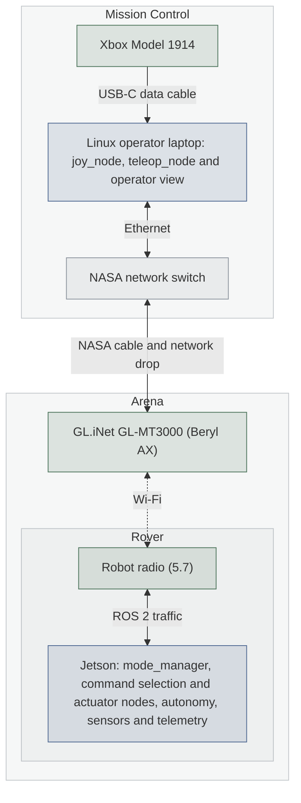

# Teleoperation Subsystem Design

| Owner | Pair | Status | Last reviewed |
| --- | --- | --- | --- |
| Nick | [TBD: software lead to assign] | Draft | 2026-10-23 |

Design for the team’s Linux operator station and ROS 2 Jazzy environment. Hardware validation is pending. TBR means a proposal needs review; TBD means a detail remains undecided.

## 1. Purpose and requirements

Teleoperation maps gamepad inputs to robot commands and provides operator controls. Robot permissions and stopping behavior follow [Operating Modes Design](operating-modes.md).

- R1. Read every required gamepad input inside the team’s Linux development container.
- R2. Require ENABLED, TELEOP, hold-to-enable, and task permission for manual motion.
- R3. Provide enable, disable, clear-fault, control-source, and task controls; never automatically enable.
- R4. Stop on input or link loss; reconnection must not automatically resume motion.
- R5. Display acknowledged state and mode-appropriate streams.
- R6. Record the mapping, configuration, and test results so another supported Linux station can repeat the setup.

Tasks are TRAVEL, EXCAVATE, DUMP, and SERVICE. EXCAVATE permits creep driving; DUMP requires the conveyor for unloading with the hatch. SERVICE requires TELEOP and `allow_service=true`. Entry guards and limits follow operating modes. Selecting a task does not itself issue a manual demand.

## 2. Nodes

| Node | Package | Runs on | What it does |
| --- | --- | --- | --- |
| `joy_node` | `joy` | Linux operator station, in container | Reads gamepad input. |
| `teleop_node` | `luna_teleop` | Linux operator station, in container | [TBR: proposed names.] Maps inputs, sends heartbeat and mode requests, and provides operator controls. |
| `rviz2` | `rviz2` | Linux operator station | [TBR: proposed viewer.] Displays selected robot data. |

Actuator nodes enforce limits, source selection, and timeouts.

## 3. Interfaces

This table is the contract between this subsystem and the rest of the robot. The code must
match it exactly, and a pull request that changes an interface updates this table in the
same pull request.

Mode interfaces follow the operating-modes design. Drive and mechanism interfaces require agreement with the controls owners. “Teleop” below refers to `teleop_node`.

| Name | Kind | Type | Rate | Publisher or server | Subscriber or client | QoS |
| --- | --- | --- | --- | --- | --- | --- |
| `/joy` | topic | `sensor_msgs/msg/Joy` | [TBR: 20 Hz + changes] | `joy_node` | Teleop | [TBD: verify driver QoS] |
| `/robot/mode` | topic | `luna_interfaces/msg/RobotMode` | 10 Hz + changes | `mode_manager` | Teleop | Reliable, transient local, depth 1 |
| `/robot/request_mode` | service | `luna_interfaces/srv/RequestMode` | On demand | `mode_manager` | Teleop | Default |
| `/operator/heartbeat` | topic | `std_msgs/msg/Header` | 10 Hz | Teleop | `mode_manager` | Best effort, depth 1 |
| `/power/battery` | topic | `sensor_msgs/msg/BatteryState` | 10 Hz | Node owning CTRE access | Teleop | Best effort, depth 1 |
| [TBR: `/teleop/cmd_vel`] | topic | [TBR: `geometry_msgs/msg/TwistStamped`] | [TBR: 20 Hz] | Teleop | Robot command selection | [TBR: best effort, volatile, depth 1] |
| Mechanism commands | topic | [TBD: mechanism contract] | [TBD] | Teleop | Mechanism command selection | [TBD] |
| Camera/map/path streams | topic | [TBD: sensor/autonomy contracts] | Mode-dependent | Sensor/autonomy nodes | Operator view | [TBD] |

`RequestMode` carries `state`, `source`, and `task`. From FAULT, request DISABLED to clear once the cause is gone, then separately request ENABLED. Display rejection reasons and confirm accepted changes through `/robot/mode`. **Actions:** None.

## 4. Parameters

| Parameter | Node | Type | Default | Units | Meaning |
| --- | --- | --- | --- | --- | --- |
| `device_name` | `joy_node` | string | [TBD: enumerate] | None | Selected controller. |
| `deadzone` | `joy_node` | double | [TBR: 0.05] | Fraction | Ignore small stick drift. |
| `autorepeat_rate` | `joy_node` | double | [TBR: 20] | Hz | Refresh unchanged input. |
| `hold_button` | Teleop | integer | [TBD: measured index] | None | Manual-motion permission. |
| `input_timeout` | Teleop | double | [TBR: 0.15] | s | Reject stale input. |
| `state_timeout` | Teleop | double | [TBR: 0.3] | s | Inhibit manual demands when robot state updates stop. |
| speed/mechanism limits | Teleop | Configuration | [TBD: owners approve] | Per actuator | Match robot-side limits. |

The operating-modes design owns `link_timeout=0.5 s` and actuator `mode_timeout=0.3 s`. Robot command timeouts require agreement with the controls owners.

## 5. Libraries and hardware interfaces

Use `joy`, the proposed `luna_teleop` package, `luna_interfaces`, and the team Ubuntu 24.04/ROS 2 Jazzy container ([Development environment](../development-environment.md)).

**Operator station:** Initial testing uses the software lead’s Ubuntu 24.04.5 LTS laptop. Support other Linux machines through the team container, repository-controlled mappings, and host overrides for device access and network settings. Avoid fixed usernames and laptop-specific paths. Test portability on a second machine.

**Gamepad:** Xbox Model 1914, connected to the Linux operator laptop by a USB data cable with USB-C at the controller. A cable is available. The physical control mapping below was accepted in review; measured axis and button indices remain pending bench testing.

| Control | Action |
| --- | --- |
| LB held | Permit manual actuator demands. |
| Left stick vertical / horizontal | Drive forward or reverse / steer. |
| Right stick vertical | Coordinated depth raise/lower. |
| RT / LT | Excavator chain forward/reverse. |
| D-pad up/down | Conveyor forward/reverse. |
| A / X | Hatch open/close. |
| Laptop controls | Enable, disable, clear fault, select control source and task. |

Releasing LB zeros all manual demands. Opposing commands for the same actuator produce zero. Task permissions apply; AUTO ignores gamepad input. After input loss, require explicit enable and a fresh LB release and press before manual motion resumes.

**Hardware testing:** Verify controller detection and `/joy` inside the Linux development container. Record device identity, button and axis indices, signs, and disconnect behavior. Confirm that repeated input messages cannot conceal a disconnected controller. Use these results to select device access and permissions.

**Network:** The team access point is the **GL.iNet GL-MT3000 (Beryl AX)**. Follow [System Design](system.md): operator laptop → NASA switch and cable → GL-MT3000 in the arena → Wi-Fi → robot radio and Jetson. Decision 5.7 still supplies the radio choice, network mode, addresses, and ROS 2 discovery settings. Validate the whole path using [ROS 2 networking](../ros-networking.md).

**View:** [TBR: RViz2 plus operator controls.] TELEOP displays camera and telemetry. AUTO displays the obstacle map and planned path, with camera streaming off. Other states show low-rate status and faults. Follow the operating-modes bandwidth rules.

[TBR: Save the proposed TELEOP and AUTO layouts as `config/teleop.rviz` and `config/auto.rviz` in `luna_teleop`; these files are not yet implemented.] The operator controls show acknowledged state, source, task, battery, connection status, and refusal/fault reasons. They provide enable, disable, clear-fault, source, and task controls. The final viewer and control-interface implementation remain open in question 4.

Other subsystems own CAN, motor wiring, current limits, and the physical E-stop.

## 6. Block diagram

**Placement and network.** Blue is software/computers, green is team hardware, and gray is NASA equipment, using the team palette. Decision 5.7 supplies the robot radio and network settings.

## 7. Behavior on failure

Teleop publishes `/operator/heartbeat` at 10 Hz while running, including AUTO and with LB released. After a disconnect, require fresh acknowledged state and explicit enable; controller loss also requires a fresh LB release and press. A retained old mode message must not rearm motion.

| Failure | How it is detected | What the subsystem does |
| --- | --- | --- |
| Controller/input lost in TELEOP | Connection check and input timeout | Zero manual demands; request DISABLED. |
| Robot state updates stop | Operator `state_timeout` | Show connection unconfirmed; inhibit manual demands. |
| Operator or Wi-Fi lost | Robot `link_timeout=0.5 s` | `mode_manager` disables, including in AUTO. |
| Mode manager stops | Robot `mode_timeout=0.3 s` | Actuator nodes independently zero outputs. |
| Command publisher stops | Robot command timeout | Affected actuator nodes zero outputs. |
| Fault/E-stop | Robot safety/hardware | Use laptop clear-fault, then a separate enable; never automatically enable. |

Verify operating-modes requirement R3 on hardware: zero outputs within 100 ms of disable, and within `link_timeout + 100 ms` of the last heartbeat. Robot controls own recovery and current limits.

## 8. Test plan

Follow [Testing Layers](testing-layers.md). In Sim, fake or recorded `/joy` messages replace the gamepad, with robot hardware on stand-ins. Bench requires passing Sim tests and a reviewed procedure; Robot requires a merged Bench log. Record results and recordings in the run logs.

| Requirement | Test | Where | Result |
| --- | --- | --- | --- |
| R1 | Enumerate device; observe every required input on `/joy` inside the Linux development container. | Bench | Not run |
| R2 | Test deadzone, axis signs, opposing commands, and hold release; verify task restrictions, creep driving during EXCAVATE, conveyor control during DUMP, and AUTO ignoring input. | Unit, then Sim | Not run |
| R3 | Check accepted and rejected requests and clear-then-enable recovery. | Sim, then Bench | Not run |
| R4 | Stop input and state updates in Sim; disconnect controller and Wi-Fi on hardware. Measure stopping times; verify heartbeat continues in AUTO and without LB, and reconnection requires rearming. | Sim, Bench, Robot | Not run |
| R2–R4 | Repeat manual control, task restrictions, stopping, and recovery on the rover, on blocks before floor tests. | Robot | Not run |
| R5 | Verify acknowledged status and stream changes with stand-ins, then across the real network. | Sim, Bench, Robot | Not run |
| R6 | Teammate repeats setup and mapping on a second supported Linux machine using configuration overrides. | Bench | Not run |

## 9. Open questions

| Question | Owner | Due |
| --- | --- | --- |
| 3. What topics/message types carry movement commands, and which code selects TELEOP/AUTO commands? | Controls/mechanism owners | Before integration |
| 4. What final network settings and operator viewer will be used? | Networking/teleop owners | Before integration |

Review confirmed the controller and cable, initial Linux station, control mapping, creep driving during EXCAVATE, conveyor use during DUMP, and laptop clear-fault controls. The shared operating-modes document still lists its excavation-driving and DUMP-conveyor questions as open; those entries need the same decisions recorded.

## Handoff

- Design draft complete for team review.
- Implementation and hardware validation remain pending.
- Controller indices, saved layouts, and portability verification remain pending.
- Network and mechanism interfaces still need team agreement.
- Next: bench-test `/joy`, mapping, hold release, and disconnection.
