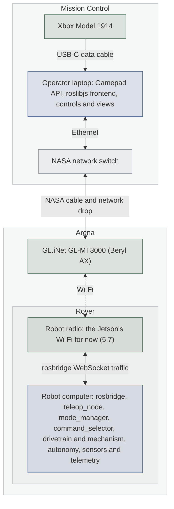

# Teleoperation Subsystem Design

| Owner | Status | Last reviewed |
| --- | --- | --- |
| ja-zoe | Draft | 2026-11-14 |

This doc designs the operator station and the code that turns the gamepad into robot
commands: SW.3 in the [system design](system.md). The operator frontend runs in a browser
on any member's Windows, macOS, or Linux laptop and reaches the robot through rosbridge;
`teleop_node` runs on the robot computer. Robot permissions and stopping behavior follow
the [operating modes design](operating-modes.md). Hardware validation is pending.

## 1. Purpose and requirements

Teleoperation maps gamepad inputs to robot commands and gives the operator the controls
and views the run needs.

- R1. Run the operator frontend on any member's laptop (Windows, macOS, or Linux), reading
  every required gamepad input through the browser's Gamepad API.
- R2. Require ENABLED, TELEOP, the hold button, and the task mode's permission for manual
  motion.
- R3. Provide enable, disable, clear-fault, control-source, and task controls; never
  enable automatically.
- R4. Stop on input or link loss, and reject stale commands after a TCP or Wi-Fi stall.
  Reconnecting must not resume motion by itself.
- R5. Display the acknowledged state, live link bandwidth, and the TELEOP and AUTO default
  views, which the operator can change at runtime.
- R6. Record the mapping, configuration, and test results, so another Windows, macOS, or
  Linux station can repeat the setup.

Tasks are TRAVEL, EXCAVATE, DUMP, and SERVICE. EXCAVATE permits creep driving; DUMP uses
the conveyor to unload with the hatch. SERVICE requires TELEOP and `allow_service` true.
Entry guards and limits follow the operating modes design. Selecting a task does not by
itself command any motion.

### Budgets

This doc's share of each technical performance measure, from the
[performance budgets](performance-budgets.md).

<!-- design: budgets (generated from teleoperation.toml by scripts/design render: edit that file, not this table) -->

| TPM | Element | Part | Budget |
| --- | --- | --- | --- |
| [TPM-1](performance-budgets.md#tpm-1-autonomous-cycles-completed-per-run) | SW.3.1 | Full autonomy (§16.5): at least 2 cycles, starting in the starting zone (All of the above, plus SW.1.1 (stays enabled), SW.1.5 (passes AUTO commands), SW.3.1 (heartbeat), and SW.4 (link and logging)) | 1,400 × berm factor |
| [TPM-3](performance-budgets.md#tpm-3-time-from-run-start-to-the-first-cycle-starting) | SW.3.1 | Operator enables in AUTO (after telling the judge) (SW.3.1 sends; SW.1.1 accepts) | ≤5 s |
| [TPM-6](performance-budgets.md#tpm-6-average-link-bandwidth-over-a-run) | SW.3.1 | /joy, the heartbeat, and mode requests (laptop to robot) | 50 kbit/s in TELEOP (default view), 50 kbit/s in AUTO (default view) |
| [TPM-6](performance-budgets.md#tpm-6-average-link-bandwidth-over-a-run) | SW.3.2 | Nothing: it runs on the robot | 0 kbit/s in TELEOP (default view), 0 kbit/s in AUTO (default view) |
| [TPM-8](performance-budgets.md#tpm-8-stop-time-after-link-loss) | SW.3.1 | Send a heartbeat every 100 ms, which sets how soon a loss can be seen | 100 (the period), not counted |
| [TPM-11](performance-budgets.md#tpm-11-robot-computer-processor-load-averaged-over-a-run) | SW.3.2 | Teleop mapping | [TBD: autonomy doc v1 (7.8)]; expected to be small |

<!-- /design -->

## 2. Nodes

The operator frontend is not a ROS node: `rosbridge_websocket` on the robot computer
publishes and calls for it over one WebSocket connection, and the
[platform design](platform.md) designs rosbridge. `teleop_node` turns `/joy` into commands
on the robot computer. `command_selector` passes teleop's commands on only while the control
source is TELEOP ([system design, Command selection](system.md#command-selection)), and the
drivetrain and the mechanism enforce their limits and timeouts.

<!-- design: nodes (generated from teleoperation.toml by scripts/design render: edit that file, not this table) -->

| Node | Package | Runs on | Element | What it does |
| --- | --- | --- | --- | --- |
| Operator frontend | Custom frontend with `roslibjs` | Operator laptop, in a browser, through rosbridge | SW.3.1 Operator frontend | Reads the gamepad through the browser's Gamepad API, sends /joy, the heartbeat, and mode requests through rosbridge, and shows each control source's default view, which the operator can change, with live link bandwidth. It is not a ROS node: rosbridge publishes and calls for it. |
| `teleop_node` | `luna_teleop` | Robot computer | SW.3.2 Teleop mapping | Turns fresh /joy input into drive and mechanism commands, each stamped with its /joy message's stamp, zeroes them when the hold button is released, drops stale input, and requests DISABLED when the controller's input is lost |

<!-- /design -->

## 3. Interfaces

This table is the contract between this subsystem and the rest of the robot. The code must
match it exactly. It is generated from this doc's registry, so a pull request that changes
an interface edits the registry and runs `scripts/design render`, in the same pull request
as the code ([Registries](README.md#registries)). The WebSocket link to the laptop uses
TCP; the QoS in the table is on the robot's side.

<!-- design: interfaces (generated from teleoperation.toml by scripts/design render: edit that file, not this table) -->

| Name | Kind | Type | Rate | Publisher or server | Subscriber or client | QoS |
| --- | --- | --- | --- | --- | --- | --- |
| `/joy` | topic | `sensor_msgs/msg/Joy` | `autorepeat_rate`, 20 Hz, and on change [TBR] | Operator frontend | `teleop_node` | [TBD: as rosbridge publishes it, 5.4] |
| `/operator/heartbeat` | topic | `std_msgs/msg/Header` | `heartbeat_rate`, 10 Hz, including in AUTO and with the hold button released | Operator frontend | `mode_manager` | best effort, depth 1 |
| `/teleop/cmd_vel` | topic | `geometry_msgs/msg/TwistStamped` | `command_rate`, 20 Hz [TBR] | `teleop_node` | `command_selector` | best effort, volatile, depth 1 |
| `/teleop/mechanism/<function>/command` | topic | luna_interfaces/msg/ActuatorCommand [TBR: proposed in the mechanism doc (4.2)] | `command_rate`, 20 Hz [TBR] | `teleop_node` | `command_selector` | best effort, volatile, depth 1 |
| `/robot/mode` | topic | `luna_interfaces/msg/RobotMode` | 10 Hz and on change | `mode_manager` | Drive mode gate, Mechanism mode gate, `command_selector`, Path planning and following, Task sequencer, Operator frontend, `teleop_node` | reliable, transient local, depth 1 |
| `/robot/request_mode` | service | `luna_interfaces/srv/RequestMode` | On demand | `mode_manager` | Operator frontend, `teleop_node` | default |
| `/power/battery` | topic | `sensor_msgs/msg/BatteryState` | 10 Hz | Power panel reading node | `mode_manager`, Operator frontend | best effort, depth 1 |
| `/autonomy/obstacle_map` | topic | `nav_msgs/msg/OccupancyGrid` | `map_publish_rate`, 2 Hz [TBR: autonomy open question 2] | Localization and mapping | Path planning and following, Operator frontend | reliable, transient local, depth 1 |
| `/autonomy/plan` | topic | `nav_msgs/msg/Path` | On each replan, at most 1 Hz | Path planning and following | Operator frontend | reliable, volatile, depth 1 |
| `/autonomy/status` | topic | luna_interfaces/msg/AutonomyStatus [TBR: proposed in section 3] | 1 Hz and on change | Task sequencer | Operator frontend | reliable, transient local, depth 1 |
| `/mechanism/status` | topic | luna_interfaces/msg/MechanismStatus [TBR: proposed in section 3] | 10 Hz and on change [TBR] | `mechanism_controller` | `mode_manager`, Task sequencer, Operator frontend | reliable, transient local, depth 1 |
| [TBD: camera image topics, sensors doc (6.2)] | topic | sensor_msgs/msg/CompressedImage [TBR: sensors doc (6.2)] | [TBD: sensors doc (6.2)] | Camera driver | Operator frontend | [TBD: sensors doc (6.2)] |

<!-- /design -->

**Mode requests.** `RequestMode` carries `state`, `source`, and `task`
([operating modes, section 3](operating-modes.md#3-interfaces)). From FAULT, request
DISABLED to clear once the cause is gone, then separately request ENABLED. Display
rejection reasons, and confirm accepted changes through `/robot/mode`. Pending enable,
clear-fault, and source or task requests are dropped on link loss: a delayed request must
never run after the link recovers without a fresh operator action. **Actions:** none.

**Commands carry the gamepad's time.** `teleop_node` stamps each drive and mechanism
command with the stamp of the `/joy` message it came from, and nothing downstream stamps it
again ([system design, Conventions](system.md#4-parameters)). TCP can deliver old inputs
in a burst after a Wi-Fi stall; the drivetrain and the mechanism drop any command older than
their timeouts, so a burst cannot move the robot. That works only if `/joy`'s stamp is in the
robot's time (open question 6).

**Mechanism commands** are `luna_interfaces/msg/ActuatorCommand` output commands, one topic
per function ([mechanism design, section 3](mechanism.md#3-interfaces)).

## 4. Parameters

| Parameter | Node | Type | Default | Units | Meaning |
| --- | --- | --- | --- | --- | --- |
| `device_name` | Operator frontend | string | [TBD: enumerated on each laptop] | None | Selected controller |
| `deadzone` | Operator frontend | double | 0.05 [TBR] | fraction | Ignore small stick drift |
| `autorepeat_rate` | Operator frontend | double | 20 [TBR] | Hz | Poll and resend unchanged input |
| `heartbeat_rate` | Operator frontend | double | 10 | Hz | Send the operator heartbeat, including in AUTO and with the hold button released |
| `camera_rate`, `map_rate`, `path_rate` | Operator frontend | double | 5, 1, 1 [TBR] | Hz | Rate each stream is forwarded at while it is on |
| `bandwidth_rate` | Operator frontend | double | 1 [TBR] | Hz | Update the displayed link statistics |
| `state_timeout` | Operator frontend and `teleop_node` | double | 0.3 [TBR] | s | Inhibit manual commands when robot state updates stop |
| `command_rate` | `teleop_node` | double | 20 [TBR] | Hz | Publish drive and active mechanism commands |
| `hold_button` | `teleop_node` | integer | [TBD: measured index, 5.2] | None | Button that permits manual motion |
| `input_timeout` | `teleop_node` | double | 0.15 [TBR] | s | Reject stale input |
| `max_speed`, `max_turn` | `teleop_node` | double | [TBD: the drivetrain's limits, 3.7] | m/s, rad/s | Full stick deflection |

`link_timeout` (0.5 s) and `mode_timeout` (0.3 s) belong to the
[operating modes design](operating-modes.md#4-parameters), and the actuators' command
timeouts to the [drivetrain](drivetrain.md#4-parameters) and
[mechanism](mechanism.md#4-parameters) designs.

Frontend rates are configuration values; the robot's publication rates are parameters of
the nodes that publish them. Validate at startup and on every rate change: reject rates that
are not positive and finite, and require `1 / heartbeat_rate < link_timeout`,
`1 / autorepeat_rate < input_timeout`, `1 / command_rate` below each actuator's command
timeout, and `1 / mode_rate` below both `state_timeout` and `mode_timeout`. Refuse an
incompatible change with a reason. Throttle optional subscriptions on the robot computer
before they cross the link, keeping the latest sample rather than a backlog.

## 5. Libraries and hardware interfaces

The frontend is our own, built on `roslibjs` and the browser's Gamepad API, with rosbridge
on the robot computer, `teleop_node` in `luna_teleop`, and the team's ROS 2 Jazzy
environment ([Development environment](../development-environment.md)).

**Operator station.** Initial testing uses the software lead's Ubuntu 24.04 laptop. The
same frontend and repository-controlled mappings support Windows, macOS, and Linux, with no
ROS or container USB passthrough on the laptop. Avoid fixed usernames and laptop-specific
paths. [TBR: Serve the frontend from the robot computer over HTTPS with secure rosbridge
WebSockets, or package it as a desktop app; open question 4 decides.] Keep the frontend's
files available offline for Mission Control.

**Gamepad.** An Xbox Model 1914, connected to the operator laptop by a USB data cable with
USB-C at the controller. The physical mapping below was accepted in review; the measured
axis and button numbers wait on bench testing (5.2).

| Control | Action |
| --- | --- |
| LB held | Permit manual actuator commands |
| Left stick vertical, horizontal | Drive forward or reverse; steer |
| Right stick vertical | Raise or lower the excavator (depth) |
| RT, LT | Excavator chain forward, reverse |
| D-pad up, down | Conveyor forward, reverse |
| A, X | Hatch open, close |
| Laptop controls | Enable, disable, clear fault, select the control source and task |

Releasing LB zeroes every manual command. Opposite commands for one actuator give zero.
Task permissions apply, and AUTO ignores the gamepad. After input loss, moving again takes
an explicit enable and a fresh release and press of LB.

**Hardware testing.** Check that the browser's Gamepad API finds the controller and that
`/joy` reaches the robot computer through rosbridge, on Windows, macOS, and Linux. Record the
device's identity, the browser's button and axis numbers, their signs, and what happens on
a disconnect. Confirm that repeated input messages cannot hide a disconnected controller.

**Network.** The team's access point is the GL.iNet GL-MT3000 (Beryl AX). The path is the
operator laptop, NASA's switch and cable, the GL-MT3000 in the arena, Wi-Fi, and the robot's
radio and computer ([system design](system.md#how-the-operator-station-reaches-the-robot)).
The robot's radio is [TBR: the Jetson's own Wi-Fi for now, while its Ethernet port serves
the LiDAR; system open question 8]. Decision 5.7 supplies the network mode, addresses, and
rosbridge connection settings. Validate the whole path with
[ROS 2 networking](../ros-networking.md).

**Views.** The TELEOP default view shows the camera and telemetry. The AUTO default view
shows the obstacle map and planned path for judging, with the camera off. The operator may
change either view at runtime, such as turning the camera on in AUTO; views never change
robot permissions. Other states show low-rate status and faults, following the operating
modes design's bandwidth rules. The controls show the acknowledged state, source, task,
battery, connection status, and refusal or fault reasons, and provide enable, disable,
clear-fault, source, and task controls, plus view and stream selection and live link
bandwidth.

[TBR: The stream rates and bandwidth estimates below are starting values for testing.
Estimates use bytes per message × Hz × 8 / 1000 kbit/s, and leave out transport overhead
and retransmissions.]

| Display or control feedback | Source topic or interface | Default rate | Estimated bandwidth | Default views |
| --- | --- | --- | --- | --- |
| Acknowledged state, source, task, fault reason | `/robot/mode` | 10 Hz and on change | 24 kbit/s, assuming 300 B a message | TELEOP, AUTO, other states |
| Battery | `/power/battery` | 10 Hz | 40 kbit/s, assuming 500 B a message | TELEOP, AUTO, other states |
| Mechanism state, stowed and hatch closed | `/mechanism/status` | 10 Hz and on change | 16 kbit/s, assuming 200 B a message | TELEOP, AUTO, other states |
| Autonomy's cycle step and stop reasons | `/autonomy/status` | 1 Hz and on change | Under 1 kbit/s | AUTO |
| Enable, disable, clear-fault, source and task results | `/robot/request_mode`'s response, confirmed by `/robot/mode` | On demand | About 500 B an exchange | TELEOP, AUTO, other states |
| Controller and connection status | Gamepad API, WebSocket state, and how fresh `/robot/mode` is | 20 Hz for input; connection events | Shown on the laptop, so nothing crosses the link; `/joy` is counted in TPM-6 | TELEOP, AUTO, other states; manual commands ignored in AUTO |
| Camera | The driving camera's compressed image ([sensors design](sensors.md#3-interfaces)) | `camera_rate`, 5 Hz | 800 kbit/s, assuming 20 kB a frame | TELEOP; optional in AUTO and other states |
| Obstacle map | `/autonomy/obstacle_map` ([autonomy design](autonomy.md#3-interfaces)) | `map_rate`, 1 Hz | 80 kbit/s, assuming 10 kB an update | AUTO; optional in other views |
| Planned path | `/autonomy/plan` | Each replan, at most 1 Hz | 16 kbit/s, assuming 2 kB an update | AUTO; optional in other views |
| Live link bandwidth | [TBD: the statistics source, 5.7] | `bandwidth_rate`, 1 Hz | 1.6 kbit/s, assuming 200 B an update | TELEOP, AUTO, other states |

Subscribe to the camera with CBOR, so frames stay binary, on a separate rosbridge WebSocket
connection from commands and status. Unsubscribe from optional streams when they are
switched off, since hiding a widget alone saves no bandwidth. Include both connections in
the live bandwidth display.

Other subsystems own the CAN bus, motor wiring, current limits, and the physical E-stop.

## 6. Block diagram

**Placement and network.** Blue is software and computers, green is team hardware, and
gray is NASA's equipment, in the team's palette. Decision 5.7 supplies the network
settings.

## 7. Behavior on failure

The frontend publishes `/operator/heartbeat` at `heartbeat_rate` (10 Hz by default) while
it runs, including in AUTO and with LB released. Running teleop on the robot computer must
never replace this with a heartbeat made on the robot. After a disconnect, moving again
takes a fresh acknowledged state and an explicit enable; a lost controller also takes a
fresh release and press of LB. A retained old mode message must not rearm motion. TCP can
deliver old inputs after a Wi-Fi stall, so freshness is judged from each input's own stamp,
not from when it arrived, and an expired message neither refreshes a timeout nor replays a
command (section 3, open question 6).

| Failure | How it is detected | What the subsystem does |
| --- | --- | --- |
| Controller or input lost in TELEOP | The connection check and `input_timeout` | Zero manual commands; request DISABLED |
| Robot state updates stop | The frontend's `state_timeout` | Show the connection as unconfirmed; inhibit manual commands |
| Operator or Wi-Fi lost | The robot's `link_timeout`, 0.5 s | `mode_manager` disables, including in AUTO. Only fresh heartbeats refresh the timeout. |
| `mode_manager` stops | The mode gates' `mode_timeout`, 0.3 s | The drivetrain and the mechanism zero their outputs on their own |
| `teleop_node` stops | The actuators' command timeouts | The drivetrain brakes to zero and each mechanism function stops; the mode is unchanged |
| A burst of old commands after a stall | Each command's stamp is older than the actuator's timeout | Dropped by the drivetrain and the mechanism |
| Fault or E-stop | The robot's safety checks or the hardware | Clear the fault from the laptop, then enable separately; never enable automatically |

Check operating modes requirement R3 on hardware: zero outputs within 100 ms of a disable,
and within `link_timeout` plus 100 ms of the last heartbeat. The robot's controls own
recovery and current limits.

## 8. Test plan

Follow [Testing layers](testing-layers.md). In Sim, recorded or scripted `/joy` messages
pass through rosbridge in place of the gamepad, `heartbeat_publisher` in `luna_teleop`
stands in for the frontend's heartbeat, and the robot's hardware is on stand-ins. Bench
needs passing Sim tests and a reviewed procedure; Robot needs a merged Bench log.

| Requirement | Test | Where | Result |
| --- | --- | --- | --- |
| R1 | Find the controller through the Gamepad API on Windows, macOS, and Linux; see every required input on `/joy` through rosbridge (5.2). | Bench | Not run |
| R2 | Unit tests of `teleop_node` (5.3): deadzone, axis signs, opposite commands, and releasing LB; task restrictions, creep driving in EXCAVATE, the conveyor in DUMP, and AUTO ignoring input. | Unit, then Sim | Not run |
| R2, R4 | Launch test (5.3): a `/joy` recording drives the stub robot; once LB is released, `/teleop/cmd_vel` and every mechanism command are zero within one `command_rate` period. | Sim | Not run |
| R4 | Launch test (5.4): with `heartbeat_publisher` running, freeze it with Ctrl+Z during a stub drive; the robot disables within `link_timeout` plus 100 ms. | Sim | Not run |
| R3 | Accepted and refused requests, and clear-then-enable recovery; after the link recovers, no queued operator request runs. | Sim, then Bench | Not run |
| R4 | Stop input and state updates in Sim; disconnect the controller and the Wi-Fi on hardware. Measure the stopping times; check that the heartbeat continues in AUTO and with LB released, and that reconnecting needs a fresh enable. | Sim, Bench, Robot | Not run |
| R2 to R4 | Repeat manual control, task restrictions, stopping, and recovery on the rover, on blocks before the floor. | Robot | Not run |
| R5 | The view table, acknowledged status, default views, runtime changes (including the camera in AUTO), live bandwidth, and the CBOR camera on its own connection (5.5). | Sim, Bench, Robot | Not run |
| R6 | A teammate repeats the setup and mapping on Windows, macOS, and Linux from the repository's configuration; check the chosen delivery and the offline files. | Bench | Not run |
| R4 | With `tc netem` packet loss and a Wi-Fi stall, measure button-to-motor latency and false disables. A burst of old input after the stall moves nothing, the stopping deadlines hold, and reconnecting does not resume motion (5.6, open question 6). | Bench | Not run |
| R4 | Reject rate changes whose periods do not fit the heartbeat, input, mode, or actuator command timeouts. | Unit, then Sim | Not run |

## 9. Open questions

Review confirmed the controller and cable, the initial Linux station, the control mapping,
creep driving in EXCAVATE, the conveyor in DUMP, and the laptop's clear-fault control. The
operating modes doc still lists driving while digging and the conveyor in DUMP as open
(its questions 2 and 3), for Mechanical to confirm.

<!-- design: questions (generated from teleoperation.toml by scripts/design render: edit that file, not this table) -->

| Question | Status | Turgor |
| --- | --- | --- |
| 3. Movement commands are TwistStamped on /teleop/cmd_vel and /auto/cmd_vel, and ActuatorCommand on one topic per mechanism function. command_selector forwards only the source /robot/mode names, and never falls back to the other ([system design, Command selection](system.md#command-selection)). | Decided 2026-11-14 | None |
| 4. What final network settings and frontend delivery will be used: HTTPS and secure WebSockets served from the robot computer, or a packaged desktop app? | Open | 5.7 |
| 5. One command topic for each function that moves on its own: drive, depth, excavator, conveyor, and hatch ([mechanism design, section 3](mechanism.md#3-interfaces)). Telemetry comes one topic per source, such as /mechanism/status and /power/battery, not one per motor or button. | Decided 2026-11-14 | None |
| 6. How does the robot judge the age of a command whose stamp starts on the laptop? The frontend stamps /joy, so a stale command after a Wi-Fi stall is caught only if the laptop's clock agrees with the robot's. Proposed: the frontend measures the offset with rosapi's get_time service, part of the rosbridge suite, from round trips, and stamps /joy in the robot's time; an operator laptop's own clock cannot be relied on to be set. | Open | 5.4 |

<!-- /design -->

## Handoff

Not yet written: this doc is a draft.
