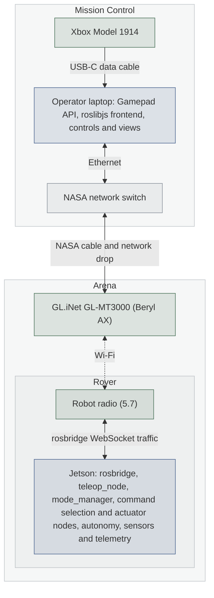

# Teleoperation Subsystem Design

| Owner | Pair | Status | Last reviewed |
| --- | --- | --- | --- |
| Nick | [TBD: software lead to assign] | Draft | 2026-10-23 |

Design for the team’s Windows, macOS, or Linux operator station and ROS 2 Jazzy robot environment. Hardware validation is pending. TBR means a proposal needs review; TBD means a detail remains undecided.

## 1. Purpose and requirements

Teleoperation maps gamepad inputs to robot commands and provides operator controls. Robot permissions and stopping behavior follow [Operating Modes Design](operating-modes.md).

- R1. Run the operator frontend on any member’s laptop (Windows, macOS, or Linux), reading every required gamepad input through the browser Gamepad API.
- R2. Require ENABLED, TELEOP, hold-to-enable, and task permission for manual motion.
- R3. Provide enable, disable, clear-fault, control-source, and task controls; never automatically enable.
- R4. Stop on input or link loss; reject stale commands after a TCP/Wi-Fi stall. Reconnection must not automatically resume motion.
- R5. Display acknowledged state, live link bandwidth, and TELEOP/AUTO default views that the operator can change at runtime.
- R6. Record the mapping, configuration, and test results so another supported Windows, macOS, or Linux station can repeat the setup.

Tasks are TRAVEL, EXCAVATE, DUMP, and SERVICE. EXCAVATE permits creep driving; DUMP requires the conveyor for unloading with the hatch. SERVICE requires TELEOP and `allow_service=true`. Entry guards and limits follow operating modes. Selecting a task does not itself issue a manual demand.

## 2. Nodes

| Node/component | Package | Runs on | What it does |
| --- | --- | --- | --- |
| Operator frontend | Custom frontend with `roslibjs` | Operator laptop browser | Reads the Gamepad API; sends `/joy`, heartbeat, and mode requests through rosbridge; provides controls and views. Not a ROS node. |
| `rosbridge_websocket` | `rosbridge_server` | Jetson | Connects the frontend’s WebSocket traffic to ROS topics and services. |
| `teleop_node` | `luna_teleop` | Jetson | [TBR: proposed names.] Maps fresh `/joy` inputs to manual commands. |

Actuator nodes enforce limits, source selection, and timeouts.

## 3. Interfaces

This table is the contract between this subsystem and the rest of the robot. The code must
match it exactly, and a pull request that changes an interface updates this table in the
same pull request.

Mode interfaces follow the operating-modes design. Drive and mechanism interfaces require agreement with the controls owners. “Teleop” below refers to `teleop_node`; frontend topic and service traffic passes through rosbridge. Rate parameters are listed in section 4. QoS describes the ROS side; the WebSocket link uses TCP.

| Name | Kind | Type | Rate | Publisher or server | Subscriber or client | QoS |
| --- | --- | --- | --- | --- | --- | --- |
| `/joy` | topic | `sensor_msgs/msg/Joy` | [TBR: `autorepeat_rate`, 20 Hz + changes] | Frontend | Teleop | [TBD: verify bridge QoS] |
| `/robot/mode` | topic | `luna_interfaces/msg/RobotMode` | `mode_rate`, 10 Hz + changes | `mode_manager` | Teleop and frontend | Reliable, transient local, depth 1 |
| `/robot/request_mode` | service | `luna_interfaces/srv/RequestMode` | On demand | `mode_manager` | Frontend; Teleop for failure-triggered disable | Default |
| `/operator/heartbeat` | topic | `std_msgs/msg/Header` | `heartbeat_rate`, 10 Hz | Frontend | `mode_manager` | Best effort, depth 1 |
| `/power/battery` | topic | `sensor_msgs/msg/BatteryState` | `battery_rate`, 10 Hz | Node owning CTRE access | Frontend | Best effort, depth 1 |
| [TBR: `/teleop/cmd_vel`] | topic | [TBR: `geometry_msgs/msg/TwistStamped`] | [TBR: `command_rate`, 20 Hz] | Teleop | Robot command selection | [TBR: best effort, volatile, depth 1] |
| Mechanism commands | topic | [TBD: mechanism contract] | [TBR: `command_rate`, 20 Hz; controls owners confirm] | Teleop | Mechanism command selection | [TBD] |
| Camera/map/path streams | topic | [TBD: sensor/autonomy contracts] | Per-stream rates in the view table | Sensor/autonomy nodes | Frontend | [TBD] |

`RequestMode` carries `state`, `source`, and `task`. From FAULT, request DISABLED to clear once the cause is gone, then separately request ENABLED. Display rejection reasons and confirm accepted changes through `/robot/mode`. Invalidate pending enable, clear-fault, and source/task-change requests on link loss; delayed requests must not execute after recovery without a fresh operator action. Confirm request-freshness enforcement with the mode-manager owner. **Actions:** None.

## 4. Parameters

| Parameter | Node/component | Type | Default | Units | Meaning |
| --- | --- | --- | --- | --- | --- |
| `device_name` | Frontend | string | [TBD: enumerate] | None | Selected controller. |
| `deadzone` | Frontend | double | [TBR: 0.05] | Fraction | Ignore small stick drift. |
| `autorepeat_rate` | Frontend | double | [TBR: 20] | Hz | Poll and refresh unchanged input. |
| `heartbeat_rate` | Frontend | double | 10 | Hz | Send operator heartbeat, including AUTO and with LB released. |
| `command_rate` | Teleop | double | [TBR: 20] | Hz | Publish drive and active mechanism commands. |
| `mode_rate` | `mode_manager` | double | 10 | Hz | Periodic `/robot/mode` publication, plus changes. |
| `battery_rate` | Battery publisher | double | 10 | Hz | `/power/battery` publication. |
| `camera_rate` / `map_rate` / `path_rate` | Frontend subscriptions | double | [TBR: 5 / 1 / 2] | Hz | Forwarded rates when each stream is enabled. |
| `bandwidth_rate` | Frontend | double | [TBR: 1] | Hz | Update the displayed live link statistics. |
| `hold_button` | Teleop | integer | [TBD: measured index] | None | Manual-motion permission. |
| `input_timeout` | Teleop | double | [TBR: 0.15] | s | Reject stale input. |
| `state_timeout` | Teleop and frontend | double | [TBR: 0.3] | s | Inhibit manual demands when robot state updates stop. |
| speed/mechanism limits | Teleop | Configuration | [TBD: owners approve] | Per actuator | Match robot-side limits. |

The operating-modes design owns `link_timeout=0.5 s` and actuator `mode_timeout=0.3 s`. Robot command timeouts require agreement with the controls owners.

Frontend rates are configuration values; robot publication rates are parameters owned by their publishers. Validate at startup and on rate changes: reject nonpositive/nonfinite rates and require `1 / heartbeat_rate < link_timeout`, `1 / autorepeat_rate < input_timeout`, `1 / command_rate <` each affected actuator’s command timeout, and `1 / mode_rate <` both `state_timeout` and actuator `mode_timeout`. Reject incompatible changes with a reason. Throttle optional subscriptions on the Jetson before transmission; keep latest samples rather than a backlog.

## 5. Libraries and hardware interfaces

Use a custom frontend with `roslibjs` and the Gamepad API, rosbridge on the Jetson, the proposed `luna_teleop` package, `luna_interfaces`, and the team ROS 2 Jazzy environment ([Development environment](../development-environment.md)).

**Operator station:** Initial testing uses the software lead’s Ubuntu 24.04.5 LTS laptop. Support Windows, macOS, and Linux through the same frontend and repository-controlled mappings, without laptop ROS or container USB passthrough. Avoid fixed usernames and laptop-specific paths. [TBR: serve the frontend from the Jetson over HTTPS with secure rosbridge WebSockets, or package it as a desktop app; question 4 decides.] Keep frontend assets available offline for Mission Control.

**Gamepad:** Xbox Model 1914, connected to the operator laptop by a USB data cable with USB-C at the controller. A cable is available. The physical control mapping below was accepted in review; measured axis and button indices remain pending bench testing.

| Control | Action |
| --- | --- |
| LB held | Permit manual actuator demands. |
| Left stick vertical / horizontal | Drive forward or reverse / steer. |
| Right stick vertical | Coordinated depth raise/lower. |
| RT / LT | Excavator chain forward/reverse. |
| D-pad up/down | Conveyor forward/reverse. |
| A / X | Hatch open/close. |
| Laptop controls | Enable, disable, clear fault, select control source and task. |

Releasing LB zeros all manual demands. Opposing commands for the same actuator produce zero. Task permissions apply; AUTO ignores gamepad input. After input loss, require explicit enable and a fresh LB release and press before manual motion resumes.

**Hardware testing:** Verify controller detection through the Gamepad API and `/joy` on the Jetson through rosbridge on Windows, macOS, and Linux. Record device identity, browser button and axis indices, signs, and disconnect behavior. Confirm that repeated input messages cannot conceal a disconnected controller.

**Network:** The team access point is the **GL.iNet GL-MT3000 (Beryl AX)**. Follow [System Design](system.md): operator laptop → NASA switch and cable → GL-MT3000 in the arena → Wi-Fi → robot radio and Jetson. Decision 5.7 still supplies the radio choice, network mode, addresses, and rosbridge connection settings. Validate the whole path using [ROS 2 networking](../ros-networking.md).

**View:** The custom frontend’s TELEOP default view displays camera and telemetry. The AUTO default view displays the obstacle map and planned path for judging, with camera streaming off by default. The operator may change either view at runtime, including turning the camera on in AUTO. Views do not change robot permissions. Other states show low-rate status and faults. Follow the operating-modes bandwidth rules.

The operator controls show acknowledged state, source, task, battery, connection status, and refusal/fault reasons. They provide enable, disable, clear-fault, source, and task controls, plus view/stream selection and live link bandwidth.

[TBR: Stream rates and bandwidth estimates below are starting values for testing. Estimates use `message bytes × Hz × 8 / 1000` kbit/s; they exclude transport overhead and retransmissions. Sensor/autonomy owners confirm their source topics.]

| Display or control feedback | Source topic or interface | Default rate | Estimated bandwidth | Default views |
| --- | --- | --- | --- | --- |
| Acknowledged state, source, task, fault reason | `/robot/mode` | `mode_rate`: 10 Hz + changes | 24 kbit/s, assuming 300 B/message, plus changes | TELEOP, AUTO, other states |
| Battery | `/power/battery` | `battery_rate`: 10 Hz | 40 kbit/s, assuming 500 B/message | TELEOP, AUTO, other states |
| Enable/disable, clear-fault, source/task request result | `/robot/request_mode` response; confirmed by `/robot/mode` | On demand | Event traffic only; approximately 500 B/exchange | TELEOP, AUTO, other states |
| Controller and connection status | Gamepad API, WebSocket state, and freshness of `/robot/mode` | `autorepeat_rate`: 20 Hz for input; connection events | Local display adds no traffic; `/joy` traffic is separate | TELEOP, AUTO, other states; manual demands ignored in AUTO |
| Camera | [TBD: camera topic, sensor contract] | `camera_rate`: 5 Hz | 800 kbit/s, assuming 20 kB/frame | TELEOP; optional in AUTO/other states |
| Obstacle map | [TBD: map topic, autonomy contract] | `map_rate`: 1 Hz | 80 kbit/s, assuming 10 kB/update | AUTO; optional in other views |
| Planned path | [TBD: path topic, autonomy contract] | `path_rate`: 2 Hz | 32 kbit/s, assuming 2 kB/update | AUTO; optional in other views |
| Live TX/RX link bandwidth | [TBD: network owner to confirm statistics source] | `bandwidth_rate`: 1 Hz | 1.6 kbit/s, assuming 200 B/update; statistics interface pending | TELEOP, AUTO, other states |

Subscribe to the camera with CBOR so frames stay binary, on a separate rosbridge WebSocket connection from commands/status. Unsubscribe from optional streams when switched off; hiding a widget alone does not save bandwidth. Include both connections in the live bandwidth display.

Other subsystems own CAN, motor wiring, current limits, and the physical E-stop.

## 6. Block diagram

**Placement and network.** Blue is software/computers, green is team hardware, and gray is NASA equipment, using the team palette. Decision 5.7 supplies the robot radio and network settings.

## 7. Behavior on failure

The frontend publishes `/operator/heartbeat` at `heartbeat_rate` (default 10 Hz) while running, including AUTO and with LB released. Moving Teleop to the Jetson must not replace this with a robot-generated heartbeat. After a disconnect, require fresh acknowledged state and explicit enable; controller loss also requires a fresh LB release and press. A retained old mode message must not rearm motion. TCP can deliver old inputs after a Wi-Fi stall: validate original input/command freshness, not just time since arrival, and drop expired messages without refreshing watchdogs or replaying demands. The final command freshness contract is part of questions 3 and 5.

| Failure | How it is detected | What the subsystem does |
| --- | --- | --- |
| Controller/input lost in TELEOP | Connection check and input timeout | Zero manual demands; request DISABLED. |
| Robot state updates stop | Operator `state_timeout` | Show connection unconfirmed; inhibit manual demands. |
| Operator or Wi-Fi lost | Robot `link_timeout=0.5 s` | `mode_manager` disables, including in AUTO. Only fresh heartbeats refresh the timeout. |
| Mode manager stops | Robot `mode_timeout=0.3 s` | Actuator nodes independently zero outputs. |
| Command publisher stops | Robot command timeout | Affected actuator nodes zero outputs. |
| Fault/E-stop | Robot safety/hardware | Use laptop clear-fault, then a separate enable; never automatically enable. |

Verify operating-modes requirement R3 on hardware: zero outputs within 100 ms of disable, and within `link_timeout + 100 ms` of the last heartbeat. Robot controls own recovery and current limits.

## 8. Test plan

Follow [Testing Layers](testing-layers.md). In Sim, fake or recorded `/joy` messages pass through rosbridge in place of the gamepad, with robot hardware on stand-ins. Bench requires passing Sim tests and a reviewed procedure; Robot requires a merged Bench log. Record results and recordings in the run logs.

| Requirement | Test | Where | Result |
| --- | --- | --- | --- |
| R1 | Enumerate the controller through the Gamepad API on Windows, macOS, and Linux; observe every required input on `/joy` through rosbridge. | Bench | Not run |
| R2 | Test deadzone, axis signs, opposing commands, and hold release; verify task restrictions, creep driving during EXCAVATE, conveyor control during DUMP, and AUTO ignoring input. | Unit, then Sim | Not run |
| R3 | Check accepted and rejected requests and clear-then-enable recovery; verify link recovery does not replay queued operator requests. | Sim, then Bench | Not run |
| R4 | Stop input and state updates in Sim; disconnect controller and Wi-Fi on hardware. Measure stopping times; verify heartbeat continues in AUTO and without LB, and reconnection requires rearming. | Sim, Bench, Robot | Not run |
| R2–R4 | Repeat manual control, task restrictions, stopping, and recovery on the rover, on blocks before floor tests. | Robot | Not run |
| R5 | Verify the information table, acknowledged status, default views, runtime overrides (including camera in AUTO), live bandwidth, and binary CBOR camera on its own connection. | Sim, Bench, Robot | Not run |
| R6 | Teammate repeats setup and mapping on Windows, macOS, and Linux using configuration overrides; verify the selected HTTPS/desktop route and offline assets. | Bench | Not run |
| R4 | Use `tc netem` packet loss and a Wi-Fi stall; measure button-to-motor latency and false disables. Verify expired TCP backlog is dropped, stopping deadlines hold, and reconnection does not resume motion. | Bench | Not run |
| R4 | Reject rate changes whose periods do not fit the heartbeat, input, mode, or actuator command timeouts. | Unit, then Sim | Not run |

## 9. Open questions

| Question | Owner | Due |
| --- | --- | --- |
| 3. What topics/message types carry movement commands, and which code selects TELEOP/AUTO commands? | Controls/mechanism owners | Before integration |
| 4. What final network settings and frontend delivery will be used: Jetson HTTPS/secure WebSockets or a packaged desktop app? | Networking/teleop owners | Before integration |
| 5. What granular command and telemetry interfaces let teleop expose any combination of functions? Agree one command topic per independently moving function (drive, coordinated depth raise/lower, excavator, conveyor, hatch) and one telemetry topic per source, not per motor or button. | Drivetrain, mechanism, and architecture owners | Before integration |

Drive coordination: retain `TwistStamped`. The lead has asked the drivetrain PR #17 owner to change its `Twist` type to match; the final topic name remains open in question 3. Both endpoints must agree before integration.

Review confirmed the controller and cable, initial Linux station, control mapping, creep driving during EXCAVATE, conveyor use during DUMP, and laptop clear-fault controls. The shared operating-modes document still lists its excavation-driving and DUMP-conveyor questions as open; those entries need the same decisions recorded.

## Handoff

- Design draft complete for team review.
- Implementation and hardware validation remain pending.
- Browser controller indices, frontend views/delivery, and portability verification remain pending.
- Network and mechanism interfaces still need team agreement.
- Next: bench-test `/joy`, mapping, hold release, and disconnection.
