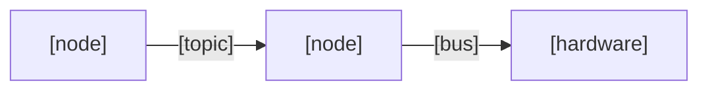

# [Subsystem] Subsystem Design

> **Delete this block after copying.** How to use this template:
>
> 1. Copy this file to `docs/design/<subsystem>.md`, using the file name listed in
>    [Design docs](README.md#the-docs).
> 2. Replace every `[bracketed]` placeholder, including `[Subsystem]` in the title above
>    (for example, "Drivetrain Subsystem Design").
> 3. Your doc's nodes, interfaces, and open questions live in its registry,
>    `docs/design/<subsystem>.toml`, and `scripts/design render` writes their tables into
>    sections 2, 3, and 9. If the registry already exists, it holds what the other docs
>    assume your subsystem provides: confirm or change each entry. Otherwise, create it.
>    [Registries](README.md#registries) explains the format.
> 4. Fill in every section. Write "None" rather than deleting a section, so readers know
>    it was considered.
> 5. Delete every quote block that starts with **Delete this**, like this one. Everything
>    else stays.
>
> Status is one of `Draft` (being written), `Approved` (reviewed, no code yet),
> `In progress` (code being written to match), `Current` (code matches), or `Superseded`
> (replaced; link the replacement). [Design docs](README.md#status) explains each one.

| Owner | Status | Last reviewed |
| --- | --- | --- |
| [GitHub username] | Draft | [YYYY-MM-DD] |

## 1. Purpose and requirements

> **Delete this:** say what this subsystem does for the robot and what it must achieve.
> Number the requirements so tests and reviews can refer to them.

- R1. [requirement]
- R2. [requirement]

### Budgets

This doc's share of each technical performance measure, from the
[performance budgets](performance-budgets.md).

> **Delete this:** the table below lists the budget rows that name your elements in
> `performance-budgets.toml`. Change a budget there, not here.

<!-- design: budgets -->
<!-- /design -->

## 2. Nodes

> **Delete this:** list your nodes in your registry as `[[node]]` entries. The table
> below is generated from them.

<!-- design: nodes -->
<!-- /design -->

## 3. Interfaces

This table is the contract between this subsystem and the rest of the robot. The code must
match it exactly. It is generated from this doc's registry, so a pull request that changes
an interface edits the registry and runs `scripts/design render`, in the same pull request
as the code ([Registries](README.md#registries)).

> **Delete this:** under each node in your registry, define every topic it publishes as a
> `[[node.publishes]]` entry, every service it serves as a `[[node.serves]]` entry, and
> every action it serves as a `[[node.serves_actions]]` entry. List what each node uses
> under its `subscribes` and `calls`. Use standard message types where they fit; custom
> types go in `luna_interfaces`. [Registries](README.md#registries) lists every field.

<!-- design: interfaces -->
<!-- /design -->

## 4. Parameters

| Parameter | Node | Type | Default | Units | Meaning |
| --- | --- | --- | --- | --- | --- |
| [parameter] | [node] | [type] | [default] | [units] | [meaning] |

## 5. Libraries and hardware interfaces

> **Delete this:** list the libraries and drivers this subsystem uses, and the hardware it
> talks to: buses, CAN IDs, USB devices, serial ports, and wiring. Cite every hardware
> value and competition rule from its primary source, as
> [Cite sources](../writing-docs.md#cite-sources) explains.

## 6. Block diagram

> **Delete this:** draw the diagram in
> [Mermaid](https://mermaid.js.org/syntax/flowchart.html), which GitHub and the docs
> website render, and which diffs like code. The diagram below is an example; replace it.

## 7. Behavior on failure

> **Delete this:** say what happens when inputs stop, hardware faults, or the operator
> link drops. Every actuator must stop on its own.

| Failure | How it is detected | What the subsystem does |
| --- | --- | --- |
| [failure] | [detection] | [response] |

## 8. Test plan

> **Delete this:** say how each requirement is verified: unit tests, bench tests, and
> tests on the robot. Link logs and recordings.

| Requirement | Test | Where | Result |
| --- | --- | --- | --- |
| R1 | [test] | [bench or robot] | [result] |

## 9. Open questions

> **Delete this:** list each question as a `[[question]]` entry in your registry. Who
> answers it, and by when, belongs in Turgor; give the Turgor deliverable's number.

<!-- design: questions -->
<!-- /design -->

## Handoff

> **Delete this:** fill in at the end of each semester: five lines on what works, what
> does not, and what comes next.
