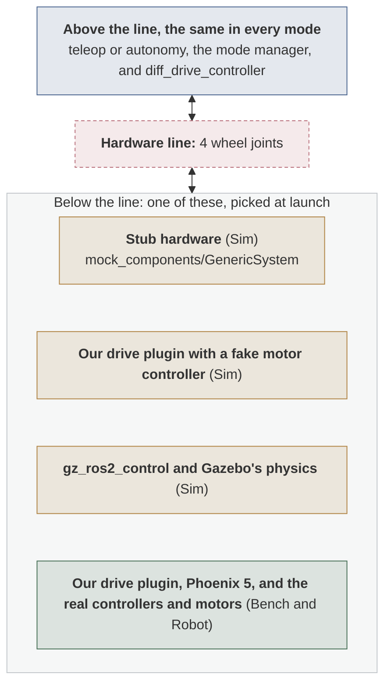

# Testing Layers

| Owner | Pair | Status | Last reviewed |
| --- | --- | --- | --- |
| Julian V | To assign | Draft | 2026-10-18 |

Every component of the robot software is tested in the same four layers, from a laptop
with no hardware up to the rover. This page defines the layers, the hardware line that
lets the same code run in all of them, the gate to move up a layer, and how Bench and
Robot runs are logged (deliverable 1.3). [Hardware test modes](hardware-test-modes.md)
draws every hardware system in every mode.

## The layers

| Layer | What runs | Where | Drivetrain example |
| --- | --- | --- | --- |
| Unit | Tests of one function or class, with no ROS graph and no hardware. Written with the code, at every layer. | Any laptop, and CI on every pull request | The drive hardware plugin's tests call it directly, against a fake motor controller (3.5) |
| Sim | The real nodes, with every device replaced by a [stand-in](#stand-ins). Always the first layer a component reaches. | Any laptop in the dev container, and CI | The drivetrain on stub hardware (3.3), against a fake controller (3.5), and in Gazebo (3.4) |
| Bench | The real device on the bench testbed (1.9) | A Linux laptop or the Jetson | 1 to 4 drive motors and their controllers, with no chassis (3.6) |
| Robot | The rover: on blocks first, then on the floor | The Jetson on the robot | The drive base, if it is ready by Nov 22 (3.7); the whole rover in spring |

**Bench and Robot work needs Linux,** on the Jetson or a Linux laptop. The dev container
on macOS and Windows cannot reach USB devices, such as the CANable, and usually cannot
reach other computers ([What works where](../development-environment.md#what-works-where)).

**Every Bench run follows the testbed's safety checklist,** agreed with Electrical in
deliverable 1.9: a current-limited supply, the E-stop in reach, the device clamped, and
two people present.

### Stand-ins

In the Sim layer, a stand-in sits where the hardware would be and meets the same
[hardware line](#the-hardware-line):

| Stand-in | What it is | Used for |
| --- | --- | --- |
| Stub | A fake that takes the same commands and answers the way the device would. For things that move, ros2_control's `mock_components/GenericSystem`, which mirrors each command to its state ([ros2_control mock components, section "Mock Components"](../sources.md#ros2-control-mock-components)). For sensors, a small node of ours that publishes on the real driver's topics. | Every system, first |
| Our code with a fake | Our own hardware plugin, running against a fake motor controller that records every call and returns scripted feedback and faults | The drivetrain, the mechanism, and the battery reading |
| Recording | `ros2 bag play` of data recorded from the real device on the bench, on the same topics | Sensors and the gamepad, once the device has been recorded |
| Gazebo | The simulator, where motion or the world matters. For things that move, `gz_ros2_control` runs the controller manager inside Gazebo ([gz_ros2_control, section "gz_ros2_control"](../sources.md#gz-ros2-control)) and applies each command to a simulated joint ([gz_ros2_control, section "Notes on the command interface"](../sources.md#gz-ros2-control)). Sensors publish through `ros_gz_bridge` on the real driver's topics. | Driving with physics, and what each sensor sees |

## The hardware line

Each hardware system has one contract, its **hardware line**, that its stand-ins and its
real driver all meet:

- **For things ros2_control moves,** such as the drivetrain, the line is the joints and
  their command and state interfaces.
- **For sensors and the gamepad,** it is the topics, message types, frames, and rates the
  real driver publishes.

Code above the line is the same in every mode; only what sits below it changes, picked at
launch for each system on its own (see
[Choosing stand-ins per system](#choosing-stand-ins-per-system)). Each system's design doc
states its line, and the [system design](system.md#hardware-lines) lists them all.

The drivetrain's line, with the four things that can sit below it. Exactly one of them
runs at a time:



**A pull request that adds or changes a hardware driver also updates its stub,** so the
two keep meeting the same line. When a Bench run finds the real driver publishing
something the stub does not, the stub is fixed to match.

## Choosing stand-ins per system

Each system picks what sits below its own line, so one run can mix them, such as the real
drivetrain on the bench with every sensor on a stub. One launch argument sets every system
at once, and each system's own argument overrides it. Deliverable 1.4 names the arguments;
with the names these pages use as an example, that bench run would start like this:

```bash
ros2 launch luna_bringup robot.launch.py backend:=stub drivetrain:=real
```

- **Things that move:** ros2_control describes each hardware component in its own
  `<ros2_control>` tag in the robot description, each with its own plugin
  ([ros2_control getting started, section "Hardware Description in URDF"](../sources.md#ros2-control-getting-started)).
  The drivetrain and the mechanism are separate components, so each one's argument picks
  its plugin: stub hardware, our plugin with a fake, Gazebo's, or our plugin with the real
  controllers.
- **Things that report:** each sensor's argument picks which node the launch file starts on
  that sensor's topics: its stub, its real driver, or its Gazebo sensor.

Not every mix works. The launch file refuses one that breaks these rules, and says which:

| Rule | Why |
| --- | --- |
| Real hardware never runs with Gazebo or a recording | Every node must run on one clock. A real driver stamps its data with the computer's clock, while Gazebo, and a recording played with its clock, run the robot on a simulated one. Data on two clocks breaks transforms and timeouts. |
| Gazebo and a recording never run together | Each brings its own simulated clock. |
| Stubs run with anything | A stub stamps its data with whichever clock the robot runs on. |
| Systems that share a driver switch together | If the power panel reading lives in the drive plugin ([operating modes design](operating-modes.md#9-open-questions), open question 6), battery and power follow the drivetrain. |

## Gates

A component moves up a layer only when it passes that layer's gate:

| To reach | It needs |
| --- | --- |
| Sim | Nothing: every component starts here, on stand-ins |
| Bench | Its Sim tests passing in CI, and a reviewed bench procedure |
| Robot | A merged Bench log |

A **bench procedure** is the written plan for a Bench run: which Linux machine; how the
device is powered, wired, and held; the steps; what each step should show; and how to
stop. It is reviewed before the run, the same way code is. A **robot procedure** is the
same for a Robot run, written from the bench procedure.

## Test logs

Every Bench and Robot run gets a log, and the Robot gate checks for the Bench one. A log
records:

- the date, and the people there;
- the commit that ran, from `git rev-parse --short HEAD`;
- the procedure followed, and any step that changed on the day;
- the results: what passed, what failed, and what was measured;
- where the recording is, if the run was recorded with `ros2 bag record`.

## Open questions

| Question | Owner | Due |
| --- | --- | --- |
| 1. Where do bench procedures, robot procedures, and test logs live: beside each package's code, or in one folder? The answer becomes a template. | Software lead | 2026-10-28 |
| 2. The launch arguments' names and values (1.4). These pages use `backend` for the whole robot and each system's name, such as `drivetrain`, for one system, with the values `stub`, `fake`, `gazebo`, and `real`, as an example. | Software lead | 2026-10-21 |
