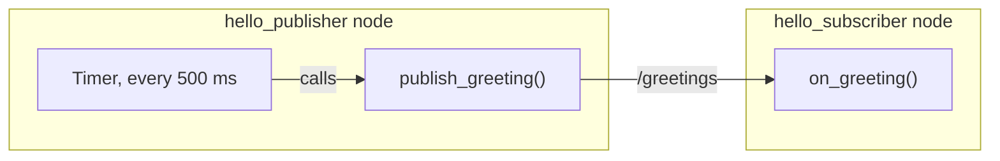
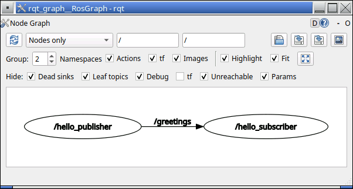

# Write your first node

So far you have run nodes that other people wrote. On this page you write two of your own
in C++, a publisher and a subscriber, build them, and watch them talk. It is exactly the
skill your first real code for the robot needs: a node that publishes made-up data for
your part of the robot.

You do not need to know C++ already; every line is explained. You need a running dev
container and its VNC desktop ([Getting started](../getting-started.md)), and the ideas
from [ROS 2 basics](ros2-basics.md). Run every command in a VS Code terminal inside the
container.

## A practice workspace

The team's code lives in `/ws/src`, and everything in it is part of the robot: building
the workspace builds it with the robot's code, and Git offers it for your next commit. So
practice in a separate workspace, `~/tutorial_ws`, in the container's home folder:

```bash
mkdir -p ~/tutorial_ws/src
cd ~/tutorial_ws/src
```

`mkdir -p` makes the folder, along with any missing folders above it. The practice
workspace lives inside the container, not in your clone, so it disappears when the
container is rebuilt ([What lives where](containers.md#what-lives-where)). That is fine
for practice, and this page tells you how to make it again in a few minutes.

## Create a package

`ros2 pkg create` makes a package folder with the files every package needs:

```bash
ros2 pkg create hello_ros --build-type ament_cmake --license Apache-2.0 --dependencies rclcpp std_msgs
```

```text
going to create a new package
package name: hello_ros
destination directory: /home/ubuntu/tutorial_ws/src
package format: 3
version: 0.0.0
description: TODO: Package description
maintainer: ['ubuntu <ubuntu@todo.todo>']
licenses: ['Apache-2.0']
build type: ament_cmake
dependencies: ['rclcpp', 'std_msgs']
creating folder ./hello_ros
creating ./hello_ros/package.xml
creating source and include folder
creating folder ./hello_ros/src
creating folder ./hello_ros/include/hello_ros
creating ./hello_ros/CMakeLists.txt
```

- `hello_ros` is the package's name.
- `--build-type ament_cmake` makes a C++ package, built with the tool CMake, like the
  team's packages.
- `--dependencies` lists what the code will use: `rclcpp`, the ROS library that lets a
  C++ program be a node, and `std_msgs`, the standard message types, which include the
  `String` message from the talker demo.

The new `hello_ros` folder holds:

| File or folder | What it is for |
| --- | --- |
| `package.xml` | The package's name, description, and what it depends on |
| `CMakeLists.txt` | Instructions for building it |
| `src/` | Your C++ files |
| `include/hello_ros/` | Header files, which this page does not need |
| `LICENSE` | The license text, from `--license` |

## The two nodes

The publisher will send a greeting on the topic `/greetings` twice a second, and the
subscriber will print each one it receives:



VS Code's file list shows only `/ws`, so open files in the practice workspace from the
terminal. In a VS Code terminal, `code` followed by a file name opens it in the editor,
and creates it when you save. If `code` is not found, for example in a `scripts/dev shell`
terminal, use `nano` instead: it edits the file right in the terminal. Save with Ctrl+O
then Enter, and quit with Ctrl+X.

## Write the publisher

Create `~/tutorial_ws/src/hello_ros/src/hello_publisher.cpp`:

```bash
code ~/tutorial_ws/src/hello_ros/src/hello_publisher.cpp
```

Copy this into it, and save:

```cpp
#include <chrono>
#include <memory>
#include <string>

#include "rclcpp/rclcpp.hpp"
#include "std_msgs/msg/string.hpp"

class HelloPublisher : public rclcpp::Node
{
public:
  HelloPublisher()
  : Node("hello_publisher")
  {
    publisher_ = create_publisher<std_msgs::msg::String>("greetings", 10);
    timer_ = create_wall_timer(
      std::chrono::milliseconds(500), [this]() {publish_greeting();});
  }

private:
  void publish_greeting()
  {
    std_msgs::msg::String message;
    message.data = "Hello, rover! " + std::to_string(count_);
    count_++;
    RCLCPP_INFO(get_logger(), "Publishing: '%s'", message.data.c_str());
    publisher_->publish(message);
  }

  rclcpp::Publisher<std_msgs::msg::String>::SharedPtr publisher_;
  rclcpp::TimerBase::SharedPtr timer_;
  int count_ = 0;
};

int main(int argc, char * argv[])
{
  rclcpp::init(argc, argv);
  rclcpp::spin(std::make_shared<HelloPublisher>());
  rclcpp::shutdown();
  return 0;
}
```

### What each part does

A few rules of C++ first: each instruction ends with `;`, curly braces `{ }` group lines
together, and `::` joins the parts of a name, the way `/` joins folders in a path. So
`std_msgs::msg::String` is the C++ name for the message type `std_msgs/msg/String`.

- **`#include` lines** bring in code from libraries, so this file can use what they
  define. `<chrono>` handles time, `<memory>` handles shared pointers (below), and
  `<string>` handles text. `rclcpp/rclcpp.hpp` is ROS's C++ library, and
  `std_msgs/msg/string.hpp` defines the `String` message.
- **`class HelloPublisher : public rclcpp::Node`** defines a **class**, a blueprint that
  bundles data with the functions that use it. `: public rclcpp::Node` means
  `HelloPublisher` is a kind of node: it gets everything any node can do, such as
  creating publishers, and adds its own parts. `public:` parts can be used from outside
  the class; `private:` parts only from inside it.
- **`HelloPublisher() : Node("hello_publisher")`** is the **constructor**, which runs once
  when the node is made. It names the node `hello_publisher`, the name that
  `ros2 node list` shows.
- **`create_publisher<std_msgs::msg::String>("greetings", 10)`** makes a publisher of
  `String` messages on the topic `greetings`. ROS adds the leading `/`, so the topic is
  `/greetings`. The `10` is a **QoS** (quality of service) setting: if a subscriber falls
  behind, keep up to the 10 newest messages for it. QoS settings also decide, for example,
  whether a lost message is sent again; each design doc's interface table lists them for
  every topic.
- **`create_wall_timer(std::chrono::milliseconds(500), ...)`** makes a **timer** that runs
  some code every 500 milliseconds. The code it runs is
  `[this]() {publish_greeting();}`, a **lambda**: a small function without a name, written
  right where it is needed. `[this]` lets it use the node's own parts, `()` means it takes
  no input, and the braces hold what it does: call `publish_greeting()`. A function you
  hand over to be called later, when something happens, is a **callback**. Older ROS code
  often writes the same thing as `std::bind(&HelloPublisher::publish_greeting, this)`.
- **`publish_greeting()`** makes a message, puts text in its `data` field, adds 1 to the
  counter, prints a line, and publishes the message.
  `RCLCPP_INFO(get_logger(), "Publishing: '%s'", ...)` prints a log message: the `%s` is
  replaced with the text after the comma, and `.c_str()` converts that text into the form
  `%s` expects. Log messages also go to the `/rosout` topic, where tools can collect them
  ([Seeing inside a running robot](ros2-tools.md#log-messages-and-rqt_console)).
- **The lines ending in `_`** are the node's own variables, which it keeps as long as it
  exists. The `_` at the end is a naming habit that marks them. A `SharedPtr` (shared
  pointer) is a handle to an object, which stays alive as long as something holds a handle
  to it. That is why the node stores its publisher and timer: a timer that nothing holds
  is deleted straight away, and never fires.
- **`main`** is where every C++ program starts. `rclcpp::init` starts ROS,
  `std::make_shared<HelloPublisher>()` makes the node (running its constructor), and
  `rclcpp::spin` hands control to ROS, which waits for events such as timer ticks and
  incoming messages and runs their callbacks, until you press Ctrl+C. `rclcpp::shutdown`
  then cleans up, and `return 0` tells the computer the program ended normally.

## Write the subscriber

Create `~/tutorial_ws/src/hello_ros/src/hello_subscriber.cpp` the same way, with:

```cpp
#include <memory>

#include "rclcpp/rclcpp.hpp"
#include "std_msgs/msg/string.hpp"

class HelloSubscriber : public rclcpp::Node
{
public:
  HelloSubscriber()
  : Node("hello_subscriber")
  {
    subscription_ = create_subscription<std_msgs::msg::String>(
      "greetings", 10,
      [this](const std_msgs::msg::String & message) {on_greeting(message);});
  }

private:
  void on_greeting(const std_msgs::msg::String & message)
  {
    RCLCPP_INFO(get_logger(), "I heard: '%s'", message.data.c_str());
  }

  rclcpp::Subscription<std_msgs::msg::String>::SharedPtr subscription_;
};

int main(int argc, char * argv[])
{
  rclcpp::init(argc, argv);
  rclcpp::spin(std::make_shared<HelloSubscriber>());
  rclcpp::shutdown();
  return 0;
}
```

It has the same shape as the publisher, with a subscription instead of a publisher and a
timer. `create_subscription` takes the topic, the same QoS depth, and a callback, which ROS
runs each time a message arrives. This lambda takes one input, the message.
`const std_msgs::msg::String &` means "the message itself, to read but not change", so
ROS does not have to copy it.

## Tell the build about the nodes

Open `~/tutorial_ws/src/hello_ros/CMakeLists.txt`. Below the line
`find_package(std_msgs REQUIRED)`, add:

```cmake
add_executable(hello_publisher src/hello_publisher.cpp)
target_link_libraries(hello_publisher rclcpp::rclcpp ${std_msgs_TARGETS})

add_executable(hello_subscriber src/hello_subscriber.cpp)
target_link_libraries(hello_subscriber rclcpp::rclcpp ${std_msgs_TARGETS})

install(TARGETS hello_publisher hello_subscriber
  DESTINATION lib/${PROJECT_NAME})
```

- `add_executable` builds a program, named first, from the C++ file after it.
- `target_link_libraries` connects the program to the libraries its `#include` lines
  use: `rclcpp`, and the code for `std_msgs`' message types.
- `install` puts both programs in the workspace's `install/` folder, where `ros2 run`
  looks for them.

The official ROS tutorial uses `ament_target_dependencies` instead of
`target_link_libraries`. It does the same job, but newer ROS releases deprecate it, and the
team's packages, such as `src/luna_drivetrain`, use `target_link_libraries`.

You do not need to change `package.xml`: `--dependencies` already added these lines to it.

```xml
  <depend>rclcpp</depend>
  <depend>std_msgs</depend>
```

`package.xml` tells ROS's tools what the package needs, so they can install it and build
packages in the right order; `find_package` lines in `CMakeLists.txt` find those same
packages during the build. Every dependency goes in both.

## Build and run

1. Build the practice workspace:

    ```bash
    cd ~/tutorial_ws
    colcon build
    ```

    ```text
    Starting >>> hello_ros
    Finished <<< hello_ros [18.1s]

    Summary: 1 package finished [18.3s]
    ```

    The build writes only into `~/tutorial_ws`, which now has `build/`, `install/`, and
    `log/` next to `src/`, and leaves your clone in `/ws` alone. If it fails, see
    [When the build fails](#when-the-build-fails).

2. Open a new terminal, load the practice workspace, and start the publisher:

    ```bash
    source ~/tutorial_ws/install/setup.bash
    ros2 run hello_ros hello_publisher
    ```

    ```text
    [INFO] [1791869036.748654030] [hello_publisher]: Publishing: 'Hello, rover! 0'
    [INFO] [1791869037.248708161] [hello_publisher]: Publishing: 'Hello, rover! 1'
    [INFO] [1791869037.748633561] [hello_publisher]: Publishing: 'Hello, rover! 2'
    ```

    Each line shows the log level, the time in seconds, the node's name, and the message.
    If you forget the `source` line, `ros2 run` answers `Package 'hello_ros' not found`.

3. Open another terminal and start the subscriber the same way:

    ```bash
    source ~/tutorial_ws/install/setup.bash
    ros2 run hello_ros hello_subscriber
    ```

    ```text
    [INFO] [1791869041.248913969] [hello_subscriber]: I heard: 'Hello, rover! 9'
    [INFO] [1791869041.748860597] [hello_subscriber]: I heard: 'Hello, rover! 10'
    ```

    It picks up from whatever number the publisher has reached.

Every terminal you open already knows ROS and the team's workspace, because the dev
container sources both. `source ~/tutorial_ws/install/setup.bash` adds the practice
workspace on top, for that terminal only. A workspace loaded on top of others like this is
an **overlay**, and the ones below it are its **underlays**: `ros2 run` looks in the
overlay first, then in each underlay.

## Look at your nodes

In a third terminal, use the tools from [ROS 2 basics](ros2-basics.md) on your own nodes:

```bash
ros2 node list
ros2 topic info /greetings
```

```text
/hello_publisher
/hello_subscriber
Type: std_msgs/msg/String
Publisher count: 1
Subscription count: 1
```

If a list is missing a node, or a count looks too low, run the command again: as in
[ROS 2 basics](ros2-basics.md), it can take a moment for the tools to find everything.

```bash
ros2 topic echo /greetings
```

```text
data: Hello, rover! 30
---
data: Hello, rover! 31
---
```

Press Ctrl+C to stop it. Now run `rqt_graph` and press its refresh button, the circular
arrows in the top-left corner:



*Your two nodes, joined by the `/greetings` topic.*

Stop both nodes with Ctrl+C. Each one prints a last line as it shuts down:

```text
[INFO] [1791869074.570325167] [rclcpp]: signal_handler(SIGINT/SIGTERM)
```

## When the build fails

C++ is checked as it is built, so most mistakes show up in `colcon build` instead of when
the robot is running. Try one on purpose: in `hello_publisher.cpp`, find the line that
publishes the message, change `publish` to `publsh`, save, and build again.

```text
Starting >>> hello_ros
--- stderr: hello_ros
/home/ubuntu/tutorial_ws/src/hello_ros/src/hello_publisher.cpp: In member function ‘void HelloPublisher::publish_greeting()’:
/home/ubuntu/tutorial_ws/src/hello_ros/src/hello_publisher.cpp:26:17: error: ‘using std::__shared_ptr_access<rclcpp::Publisher<std_msgs::msg::String_<std::allocator<void> > >, __gnu_cxx::_S_atomic, false, false>::element_type = class rclcpp::Publisher<std_msgs::msg::String_<std::allocator<void> > >’ {aka ‘class rclcpp::Publisher<std_msgs::msg::String_<std::allocator<void> > >’} has no member named ‘publsh’; did you mean ‘publish’?
   26 |     publisher_->publsh(message);
      |                 ^~~~~~
      |                 publish
gmake[2]: *** [CMakeFiles/hello_publisher.dir/build.make:76: CMakeFiles/hello_publisher.dir/src/hello_publisher.cpp.o] Error 1
gmake[1]: *** [CMakeFiles/Makefile2:139: CMakeFiles/hello_publisher.dir/all] Error 2
gmake: *** [Makefile:146: all] Error 2
---
Failed   <<< hello_ros [4.97s, exited with code 2]

Summary: 0 packages finished [5.14s]
  1 package failed: hello_ros
  1 package had stderr output: hello_ros
```

Compiler errors look frightening, but you only need two parts of this one:

- **Where:** `hello_publisher.cpp:26:17` means line 26, character 17 of that file.
- **What:** the end of the message, `has no member named 'publsh'; did you mean
  'publish'?`. Skip the long middle part, which describes the publisher's full C++ type.

Put the `i` back, build again, and it finishes.

## Python nodes

ROS nodes can also be written in Python, with the `rclpy` library, and the official
tutorial
[Writing a simple publisher and subscriber (Python)](https://docs.ros.org/en/jazzy/Tutorials/Beginner-Client-Libraries/Writing-A-Simple-Py-Publisher-And-Subscriber.html)
builds the same pair of nodes that way. The team's robot packages are C++, so use C++ for
robot code.

## Key ideas

- Practice in `~/tutorial_ws`, never in `/ws/src`, which is the robot's code.
- A node is a class derived from `rclcpp::Node`. Its constructor creates publishers,
  subscriptions, and timers, and hands them callbacks to run.
- `rclcpp::spin` waits for events and runs their callbacks until you press Ctrl+C.
- `CMakeLists.txt` needs `add_executable`, `target_link_libraries`, and `install` for
  each node; `package.xml` and `find_package` list what the package depends on.
- After `colcon build`, source the workspace's `install/setup.bash` in each new terminal,
  then `ros2 run` your nodes.

## Your next real step

The code on this page already passes the style checks that `colcon test` runs on the
team's packages, so the same shape works in the robot's code. Your next step on the team
is a node in your workstream's package that publishes made-up data, with the topic names,
message types, and rates from its design doc's interface table: the skeleton node that
[Design docs](../design/README.md#interfaces-are-contracts) describes. It starts from the
deliverable assigned to you in Turgor and goes in `src/`, on a branch, through a pull
request, as [Contributing](../contributing.md) explains. Later, real code replaces the
made-up data.

Next: [Launch files and parameter files](ros2-launch-files.md).
