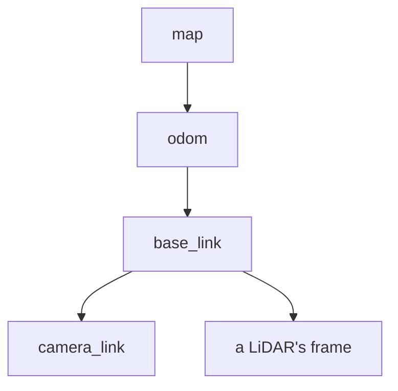
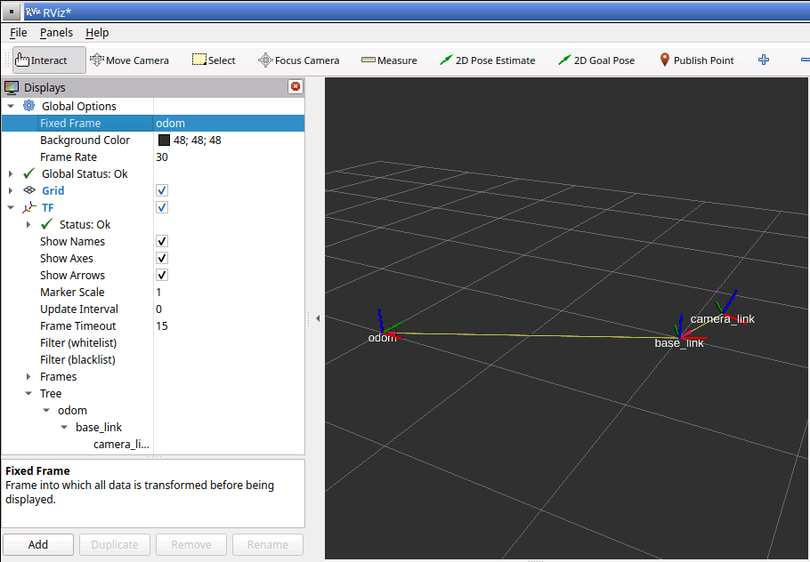

# Frames, tf2, and RViz

A robot constantly needs to know where things are: where it is in the arena, which way
its camera points, and where an obstacle its sensors see is compared with its wheels.
ROS answers these questions with coordinate frames and a library called tf2, and RViz
shows them in 3D. This page explains frames, then has you publish some, ask tf2 about
them, and look at them in RViz.

You need a running dev container and its VNC desktop
([Getting started](../getting-started.md)), and the earlier ROS pages of this guide. Run
every command in a VS Code terminal inside the container.

## "Where" always means "relative to what"

"The cup is 30 cm in front of me" and "the cup is in the middle of the kitchen table" can
describe the same cup. Each measures from a different starting point, and each is only
useful if you know which starting point it uses.

A **frame** (short for coordinate frame) is such a starting point, with its own x, y, and
z directions: the center of the robot, the lens of its camera, or a corner of the arena.
A **transform** says how to get from one frame to another: how far to move along x, y,
and z (the translation), and how far to turn (the rotation).

ROS fixes the conventions so every node measures the same way:

- **Units:** lengths are in meters
  ([REP 103, section "Base Units"](../sources.md#ros-rep-103)), and angles in radians
  ([REP 103, section "Derived Units"](../sources.md#ros-rep-103)). A full turn is about
  6.28 radians.
- **Axes:** on the robot, x points forward, y to the left, and z up
  ([REP 103, section "Axis Orientation"](../sources.md#ros-rep-103)).
- **Turning:** a positive rotation about z (yaw) turns the robot counterclockwise, seen
  from above, that is, to its left
  ([REP 103, section "Rotation Representation"](../sources.md#ros-rep-103)).

## Standard frames for a mobile robot

ROS also names the main frames of every robot that drives
([REP 105](../sources.md#ros-rep-105)):

- **`base_link`** is fixed to the robot's body and moves with it
  ([REP 105, section "base_link"](../sources.md#ros-rep-105)).
- **`odom`** is fixed to the world. The robot's position in it is worked out from
  **odometry**, such as how far the wheels have turned, so it changes smoothly but
  drifts over time
  ([REP 105, section "odom"](../sources.md#ros-rep-105)).
- **`map`** is also fixed to the world. A localization node corrects the robot's position
  in it using what the sensors see, so it does not drift, but it can jump when a
  correction arrives ([REP 105, section "map"](../sources.md#ros-rep-105)).

The frames form a tree, in which each frame has exactly one parent: `map` is the parent
of `odom`, and `odom` is the parent of `base_link`
([REP 105, section "Relationship between Frames"](../sources.md#ros-rep-105)). Each sensor
then gets its own frame below `base_link`, saying where on the body it is mounted:



**tf2** is the ROS library that keeps track of every frame. Nodes publish transforms on
two topics, `/tf` for ones that change, such as `odom` to `base_link` while the robot
drives, and `/tf_static` for fixed ones, such as where a camera is bolted on. Any node
can then ask tf2 where one frame is relative to another, and tf2 chains the transforms
along the tree to work it out.

## Try it: publish frames

Make up a robot that has driven 2 m forward and 1 m to the left of where it started,
turning 0.5 radians to its left on the way, with a camera mounted 0.3 m in front of its
center and 0.2 m up, tilted 0.4 radians down. These numbers are only for practice.

1. In one terminal, publish where the robot is in `odom`:

    ```bash
    ros2 run tf2_ros static_transform_publisher --x 2.0 --y 1.0 --yaw 0.5 --frame-id odom --child-frame-id base_link
    ```

    ```text
    [INFO] [1791870077.319681349] [static_transform_publisher_JRuGU1C8kHU7HnLg]: Spinning until stopped - publishing transform
    translation: ('2.000000', '1.000000', '0.000000')
    rotation: ('0.000000', '0.000000', '0.247404', '0.968912')
    from 'odom' to 'base_link'
    ```

    `--frame-id` is the parent frame and `--child-frame-id` the child. The rotation is
    printed as a **quaternion**, four numbers that ROS uses to store a rotation
    ([REP 103, section "Rotation Representation"](../sources.md#ros-rep-103)); you will
    rarely need to read them. On a real robot, `odom` to `base_link` changes as it
    drives, and a node publishes it on `/tf` from odometry. A fixed one is fine for
    practice.

2. In a second terminal, publish where the camera is on the robot:

    ```bash
    ros2 run tf2_ros static_transform_publisher --x 0.3 --z 0.2 --pitch 0.4 --frame-id base_link --child-frame-id camera_link
    ```

    ```text
    [INFO] [1791870080.468678885] [static_transform_publisher_Pid5jvKX2cVDF0yK]: Spinning until stopped - publishing transform
    translation: ('0.300000', '0.000000', '0.200000')
    rotation: ('0.000000', '0.198669', '0.000000', '0.980067')
    from 'base_link' to 'camera_link'
    ```

    A positive pitch, a rotation about y, tips the camera's x axis downward.

Leave both running for the rest of this page.

## Try it: ask tf2 where things are

1. In a third terminal, ask where the camera is relative to the robot's center:

    ```bash
    ros2 run tf2_ros tf2_echo base_link camera_link
    ```

    ```text
    [INFO] [1791870083.675873406] [tf2_echo]: Waiting for transform base_link ->  camera_link: Invalid frame ID "base_link" passed to canTransform argument target_frame - frame does not exist
    At time 0.0
    - Translation: [0.300, 0.000, 0.200]
    - Rotation: in Quaternion (xyzw) [0.000, 0.199, 0.000, 0.980]
    - Rotation: in RPY (radian) [0.000, 0.400, 0.000]
    - Rotation: in RPY (degree) [0.000, 22.918, 0.000]
    - Matrix:
      0.921  0.000  0.389  0.300
      0.000  1.000  0.000  0.000
     -0.389  0.000  0.921  0.200
      0.000  0.000  0.000  1.000
    ```

    The first line only means tf2 had not heard about the frames yet; a moment later it
    answers, and repeats the answer every second. The translation is what you published.
    RPY is the rotation as roll, pitch, and yaw, turns about x, y, and z: 0.4 radians of
    pitch, which is about 23 degrees. Press Ctrl+C to stop it.

2. Now ask where the camera is in `odom`, a question nobody published an answer to:

    ```bash
    ros2 run tf2_ros tf2_echo odom camera_link
    ```

    ```text
    - Translation: [2.263, 1.144, 0.200]
    - Rotation: in Quaternion (xyzw) [-0.049, 0.192, 0.242, 0.950]
    - Rotation: in RPY (radian) [0.000, 0.400, 0.500]
    - Rotation: in RPY (degree) [0.000, 22.918, 28.648]
    ```

    (The lines before and after are trimmed.) tf2 chained the two transforms: the camera
    sits 0.3 m ahead of the robot's center, and the robot is turned 0.5 radians, so the
    camera is a little further along both x and y than the robot is, tilted down 0.4 and
    turned 0.5. Doing this math by hand is error-prone; tf2 does it for every node.

3. List the whole tree. Run this from your home folder, because it saves files in the
   folder it runs in:

    ```bash
    cd ~
    ros2 run tf2_tools view_frames
    ```

    It listens for five seconds, then prints each frame and its parent (trimmed here):

    ```text
    [INFO] [1791870094.716301018] [view_frames]: Listening to tf data for 5.0 seconds...
    [INFO] [1791870099.733725316] [view_frames]: Generating graph...
    [INFO] [1791870099.739366107] [view_frames]: Result:tf2_msgs.srv.FrameGraph_Response(frame_yaml="base_link: \n  parent: 'odom'\n  broadcaster: 'default_authority'\n ...")
    [INFO] [1791870099.742479837] [view_frames]: Exporting graph in frames_2026-10-13_05.41.39.pdf file...
    ```

    It also saves the tree as a diagram in a PDF, such as
    `frames_2026-10-13_05.41.39.pdf`. The dev container has no PDF viewer, but RViz,
    next, shows the same tree.

## Try it: see the frames in RViz

**RViz** shows in 3D what the robot knows: its frames, what its sensors see, maps, and
planned paths. With both transform publishers still running:

1. Start RViz in a terminal:

    ```bash
    rviz2
    ```

    Its window appears on the VNC desktop. If it does not fit, click the maximize button,
    the square in the top-right corner of its title bar.

2. The **Displays** panel on the left says **Global Status: Error**, because
   **Fixed Frame** is set to `map`, which does not exist here. The fixed frame is the one
   RViz draws everything relative to. Click the word `map` next to **Fixed Frame**, then
   the arrow that appears, and pick `odom` from the list of frames tf2 knows. The status
   turns to **Ok**.

3. Click **Add** at the bottom of the Displays panel. In the **By display type** tab,
   scroll down to **TF**, select it, and click **OK**. Small sets of axes appear in the
   3D view, one per frame, with x in red, y in green, and z in blue, and a line from each
   frame to its parent.

4. Click the triangle next to **TF** in the Displays panel, and tick **Show Names**. Then
   open **Tree**, below it, to see `odom` holding `base_link`, which holds `camera_link`.

5. Move around the 3D view: drag with the left mouse button to rotate, scroll to zoom,
   and drag with the middle button (or hold Shift and drag) to move sideways. The bar at
   the bottom of the window lists these.



*The made-up robot in RViz, after zooming in: `base_link` is 2 m forward and 1 m left of
`odom`, and `camera_link` is just ahead of it, tilted down.*

Stop RViz and both transform publishers with Ctrl+C in their terminals.

## Frames on the rover

On a real robot, the numbers come from the robot instead of from your command line:
odometry publishes `odom` to `base_link`, localization publishes `map` to `odom`, and a
**URDF** model, a file that describes the robot's parts and where they are attached,
provides the frames of its body and sensors. For the rover, these belong in the sensors
and robot model design doc and the autonomy design doc; see
[Design docs](../design/README.md#the-docs).

## Go further: the turtle tf2 demo

The official [tf2 tutorials](https://docs.ros.org/en/jazzy/Tutorials/Intermediate/Tf2/Tf2-Main.html)
use a demo in which one turtle follows another, and show how to publish and use
transforms from your own C++ code. The demo is not installed in the dev container. To
try it, install it:

```bash
sudo apt update && sudo apt install -y ros-jazzy-turtle-tf2-py
```

Then start the demo, and drive the first turtle with `ros2 run turtlesim turtle_teleop_key`
in another terminal; the second turtle chases it:

```bash
ros2 launch turtle_tf2_py turtle_tf2_demo.launch.py
```

Anything you install this way disappears when the container is rebuilt, because it is not
in `.devcontainer/Dockerfile`; install it again if you need it. The
[RViz user guide](https://docs.ros.org/en/jazzy/Tutorials/Intermediate/RViz/RViz-User-Guide/RViz-User-Guide.html)
covers RViz's other displays.

## Key ideas

- A frame is a starting point with its own axes; a transform gets from one frame to
  another. ROS uses meters and radians, with x forward, y left, and z up.
- Mobile robots use the frames `map`, `odom`, and `base_link`, in a tree, with sensor
  frames below `base_link`.
- tf2 collects transforms from `/tf` and `/tf_static`, and chains them to answer "where
  is A relative to B?". `tf2_echo` asks it from the command line.
- RViz shows frames and sensor data in 3D; set its fixed frame to a frame that exists.

## After the guide

You have finished the learning guide. From here:

- [Everyday workflow](../everyday-workflow.md): the edit, build, test, and run loop for
  the team's code.
- [Design docs](../design/README.md): how each part of the robot is designed, starting
  with your workstream's.
- [Contributing](../contributing.md): how your first robot code gets to `main`.
