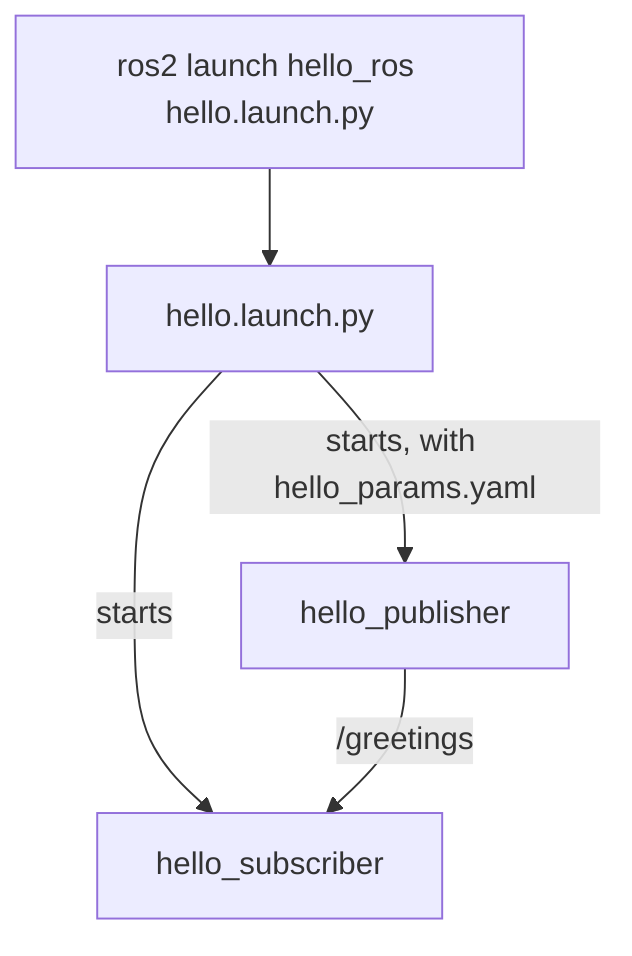

# Launch files and parameter files

The robot runs many nodes at once, each with its own settings. This page shows how to give
a node settings it reads at startup, how to keep those settings in a file, and how to
start several nodes with one command. You will add all three to the `hello_ros` package
from [Write your first node](ros2-first-node.md).

You need that page's `~/tutorial_ws` workspace. If the container was rebuilt since, the
workspace is gone: follow that page again first. Run every command in a VS Code terminal
inside the container, and run `source ~/tutorial_ws/install/setup.bash` in each new
terminal before using your nodes.

## Why the robot uses them

- **One command can start the whole robot.** A **launch file** lists every node to
  start, with its settings, so nobody has to open a terminal per node and remember each
  command.
- **Settings belong in parameter files, not in the code.** Then changing one is an edit
  to a small text file that is reviewed like code, with no C++ to rebuild, and the same
  code can run with gentle limits on the bench and real ones at competition. The
  [operating modes design](../design/operating-modes.md#4-parameters) makes current
  limits, timeouts, and the list of motor controllers to expect on the CAN bus into
  parameters, such as `link_timeout`, the time without an operator heartbeat after which
  the robot stops.

You met parameters on turtlesim in
[Services, actions, and parameters](ros2-services-actions-parameters.md#try-it-change-a-parameter).
Now your own node gets some.

## Give the node parameters

Replace everything in `~/tutorial_ws/src/hello_ros/src/hello_publisher.cpp` with this
version. The changes are the two `declare_parameter` lines, the `rate_hz` lines that set
up the timer, and the `get_parameter("message")` call that builds the text:

```cpp
#include <chrono>
#include <memory>
#include <string>

#include "rclcpp/rclcpp.hpp"
#include "std_msgs/msg/string.hpp"

class HelloPublisher : public rclcpp::Node
{
public:
  HelloPublisher()
  : Node("hello_publisher")
  {
    declare_parameter("message", "Hello, rover!");
    declare_parameter("rate_hz", 2.0);

    publisher_ = create_publisher<std_msgs::msg::String>("greetings", 10);
    double rate_hz = get_parameter("rate_hz").as_double();
    timer_ = create_wall_timer(
      std::chrono::duration<double>(1.0 / rate_hz), [this]() {publish_greeting();});
  }

private:
  void publish_greeting()
  {
    std_msgs::msg::String message;
    message.data =
      get_parameter("message").as_string() + " " + std::to_string(count_);
    count_++;
    RCLCPP_INFO(get_logger(), "Publishing: '%s'", message.data.c_str());
    publisher_->publish(message);
  }

  rclcpp::Publisher<std_msgs::msg::String>::SharedPtr publisher_;
  rclcpp::TimerBase::SharedPtr timer_;
  int count_ = 0;
};

int main(int argc, char * argv[])
{
  rclcpp::init(argc, argv);
  rclcpp::spin(std::make_shared<HelloPublisher>());
  rclcpp::shutdown();
  return 0;
}
```

- **`declare_parameter("message", "Hello, rover!")`** tells ROS the node has a parameter
  called `message`, and what to use if nobody sets it. A node declares each parameter
  before it uses it. The default also fixes the parameter's type: text here, and a
  decimal number for `rate_hz`, because `2.0` has a decimal point.
- **`get_parameter("rate_hz").as_double()`** reads the value as a decimal number (a
  `double` in C++). `double rate_hz = ...` stores it in a variable named `rate_hz`.
- **`std::chrono::duration<double>(1.0 / rate_hz)`** turns the rate into the time between
  messages, in seconds: 2 messages per second means one every 0.5 seconds. Rates are in
  hertz (per second), as ROS standardizes
  ([REP 103, section "Derived Units"](../sources.md#ros-rep-103)).
- **`get_parameter("message").as_string()`** in `publish_greeting()` reads the text each
  time a message is sent. The rate, by contrast, is read only once, when the node starts.

Build, from the practice workspace:

```bash
cd ~/tutorial_ws
colcon build
```

```text
Starting >>> hello_ros
Finished <<< hello_ros [6.26s]
Summary: 1 package finished [6.39s]
```

## Try it: set parameters when the node starts

1. Run the publisher as before. It uses the defaults, so it behaves exactly as it did:

    ```bash
    ros2 run hello_ros hello_publisher
    ```

    ```text
    [INFO] [1791869281.546617188] [hello_publisher]: Publishing: 'Hello, rover! 0'
    [INFO] [1791869282.046610905] [hello_publisher]: Publishing: 'Hello, rover! 1'
    ```

2. Stop it with Ctrl+C, and start it again with both parameters set:

    ```bash
    ros2 run hello_ros hello_publisher --ros-args -p message:="Hi from the command line" -p rate_hz:=5.0
    ```

    ```text
    [INFO] [1791869285.614811271] [hello_publisher]: Publishing: 'Hi from the command line 0'
    [INFO] [1791869285.814791876] [hello_publisher]: Publishing: 'Hi from the command line 1'
    [INFO] [1791869286.014817109] [hello_publisher]: Publishing: 'Hi from the command line 2'
    ```

    Five messages a second now, 0.2 seconds apart. Everything after `--ros-args` is for
    ROS rather than for the program, and each `-p name:=value` sets one parameter.

3. Stop it, and try `rate_hz:=5`, without the `.0`:

    ```bash
    ros2 run hello_ros hello_publisher --ros-args -p rate_hz:=5
    ```

    ```text
    terminate called after throwing an instance of 'rclcpp::exceptions::InvalidParameterTypeException'
      what():  parameter 'rate_hz' has invalid type: Wrong parameter type, parameter {rate_hz} is of type {double}, setting it to {integer} is not allowed.
    [ros2run]: Aborted
    ```

    `5` is a whole number (an integer) and `5.0` is a decimal number. ROS does not convert
    between them, so the node refuses to start. Write decimal parameters with a `.0`.

## Try it: change parameters while the node runs

Start the publisher with its defaults, then in a second terminal:

```bash
ros2 param list /hello_publisher
ros2 param set /hello_publisher message "Changed while running"
```

```text
  message
  qos_overrides./parameter_events.publisher.depth
  qos_overrides./parameter_events.publisher.durability
  qos_overrides./parameter_events.publisher.history
  qos_overrides./parameter_events.publisher.reliability
  rate_hz
  start_type_description_service
  use_sim_time
Set parameter successful
```

The publisher's next message says `Changed while running`, because it reads `message`
every time. Now try `ros2 param set /hello_publisher rate_hz 10.0`: it also answers
`Set parameter successful`, but the messages keep coming twice a second, because the node
read `rate_hz` only when it started. Each node's code decides which parameters it reacts
to while running.

Stop the publisher with Ctrl+C.

## Put the parameters in a file

Make a `config` folder in the package, and create
`~/tutorial_ws/src/hello_ros/config/hello_params.yaml` in it:

```bash
mkdir ~/tutorial_ws/src/hello_ros/config
code ~/tutorial_ws/src/hello_ros/config/hello_params.yaml
```

```yaml
hello_publisher:
  ros__parameters:
    message: "Hello from a parameter file!"
    rate_hz: 1.0
```

This is the same format `ros2 param dump` printed for turtlesim. The first line is the
node's name, the next is always `ros__parameters:` (with two underscores), and each
parameter follows as `name: value`. In YAML, the spaces at the start of each line decide
what belongs to what, so keep them exactly as shown.

Start the publisher with the file:

```bash
ros2 run hello_ros hello_publisher --ros-args --params-file ~/tutorial_ws/src/hello_ros/config/hello_params.yaml
```

```text
[INFO] [1791869331.025176374] [hello_publisher]: Publishing: 'Hello from a parameter file! 0'
[INFO] [1791869332.025165325] [hello_publisher]: Publishing: 'Hello from a parameter file! 1'
[INFO] [1791869333.025169294] [hello_publisher]: Publishing: 'Hello from a parameter file! 2'
```

One message a second, with the text from the file. Stop it with Ctrl+C.

## Write a launch file

A launch file is a short Python program that lists the nodes to start. This one starts
both of your nodes and gives the publisher its parameter file:



1. Make a `launch` folder and create `hello.launch.py` in it:

    ```bash
    mkdir ~/tutorial_ws/src/hello_ros/launch
    code ~/tutorial_ws/src/hello_ros/launch/hello.launch.py
    ```

    ```python
    import os

    from ament_index_python.packages import get_package_share_directory
    from launch import LaunchDescription
    from launch_ros.actions import Node


    def generate_launch_description():
        params_file = os.path.join(
            get_package_share_directory('hello_ros'), 'config', 'hello_params.yaml')

        return LaunchDescription([
            Node(
                package='hello_ros',
                executable='hello_publisher',
                parameters=[params_file],
            ),
            Node(
                package='hello_ros',
                executable='hello_subscriber',
            ),
        ])
    ```

    `ros2 launch` runs the function `generate_launch_description`, which returns the
    list of things to start. Each `Node(...)` is one node: its package, its executable,
    and optionally its parameters. `get_package_share_directory('hello_ros')` finds the
    folder where the package's files were installed, so the launch file works wherever
    the workspace is. In Python, the spaces at the start of each line matter, as in YAML.

2. Tell the build to install the `launch` and `config` folders, so `ros2 launch` and
   `get_package_share_directory` can find them. In `CMakeLists.txt`, below the
   `install(TARGETS ...)` lines from the first page, add:

    ```cmake
    install(DIRECTORY launch config
      DESTINATION share/${PROJECT_NAME})
    ```

3. In `package.xml`, below the `<depend>std_msgs</depend>` line, add:

    ```xml
      <exec_depend>ros2launch</exec_depend>
    ```

    `exec_depend` means the package needs `ros2launch`, the `ros2 launch` command, to
    run, but not to build.

4. Build, then launch:

    ```bash
    colcon build
    ros2 launch hello_ros hello.launch.py
    ```

    ```text
    [INFO] [launch]: All log files can be found below /home/ubuntu/.ros/log/2026-10-13-05-29-22-792603-my-laptop-16768
    [INFO] [launch]: Default logging verbosity is set to INFO
    [INFO] [hello_publisher-1]: process started with pid [16772]
    [INFO] [hello_subscriber-2]: process started with pid [16773]
    [hello_publisher-1] [INFO] [1791869364.045700126] [hello_publisher]: Publishing: 'Hello from a parameter file! 0'
    [hello_subscriber-2] [INFO] [1791869364.046080534] [hello_subscriber]: I heard: 'Hello from a parameter file! 0'
    [hello_publisher-1] [INFO] [1791869365.045654526] [hello_publisher]: Publishing: 'Hello from a parameter file! 1'
    [hello_subscriber-2] [INFO] [1791869365.045824722] [hello_subscriber]: I heard: 'Hello from a parameter file! 1'
    ```

    Both nodes run from one terminal. Each line starts with which process printed it,
    such as `[hello_publisher-1]`.

5. Press Ctrl+C once. The launch stops every node it started:

    ```text
    [WARNING] [launch]: user interrupted with ctrl-c (SIGINT)
    [hello_subscriber-2] [INFO] [1791869367.618401061] [rclcpp]: signal_handler(SIGINT/SIGTERM)
    [hello_publisher-1] [INFO] [1791869367.618692138] [rclcpp]: signal_handler(SIGINT/SIGTERM)
    [INFO] [hello_subscriber-2]: process has finished cleanly [pid 16773]
    [INFO] [hello_publisher-1]: process has finished cleanly [pid 16772]
    ```

Launch files can also be written in XML or YAML. The official
[launch tutorials](https://docs.ros.org/en/jazzy/Tutorials/Intermediate/Launch/Launch-Main.html)
show all three, and much more that launch files can do.

## Try it: change settings without rebuilding

Edit `hello_params.yaml` to say `message: "Edited without rebuilding!"` and
`rate_hz: 4.0`, save, and launch again, without running `colcon build`:

```bash
ros2 launch hello_ros hello.launch.py
```

```text
[hello_publisher-1] [INFO] [1791869376.993123590] [hello_publisher]: Publishing: 'Edited without rebuilding! 0'
[hello_publisher-1] [INFO] [1791869377.243045237] [hello_publisher]: Publishing: 'Edited without rebuilding! 1'
```

The new settings apply straight away, four messages a second. The dev container's colcon
settings (`.devcontainer/colcon-defaults.yaml`) make `install/` point at your files in
`src/` instead of copying them, in every workspace, so edits to existing parameter and
launch files need no build. C++ changes and new files still do, as
[Everyday workflow](../everyday-workflow.md#what-to-do-after-a-change) lists for the
team's workspace.

## Try it: remap a topic

**Remapping** renames a topic for one node when it starts, without changing its code.
Your subscriber listens on `/greetings`; remap it to listen to the demo talker on
`/chatter`:

1. In one terminal, start the talker:

    ```bash
    ros2 run demo_nodes_cpp talker
    ```

2. In another (with the practice workspace sourced), start your subscriber with a
   remapping:

    ```bash
    ros2 run hello_ros hello_subscriber --ros-args -r greetings:=chatter
    ```

    ```text
    [INFO] [1791869397.468418592] [hello_subscriber]: I heard: 'Hello World: 3'
    [INFO] [1791869398.468336461] [hello_subscriber]: I heard: 'Hello World: 4'
    ```

    `-r greetings:=chatter` means "where the code says `greetings`, use `chatter`".

3. Stop both, and do the same in a launch file. Create
   `~/tutorial_ws/src/hello_ros/launch/chatter.launch.py`:

    ```python
    from launch import LaunchDescription
    from launch_ros.actions import Node


    def generate_launch_description():
        return LaunchDescription([
            Node(package='demo_nodes_cpp', executable='talker'),
            Node(
                package='hello_ros',
                executable='hello_subscriber',
                remappings=[('greetings', 'chatter')],
            ),
        ])
    ```

4. Launch it:

    ```bash
    ros2 launch hello_ros chatter.launch.py
    ```

    ```text
    file 'chatter.launch.py' was not found in the share directory of package 'hello_ros' which is at '/home/ubuntu/tutorial_ws/install/hello_ros/share/hello_ros'
    ```

    The file is new, so it is not in `install/` yet. Run `colcon build` and launch again:
    the talker and your subscriber start together, and the subscriber prints
    `I heard: 'Hello World: 1'`, then 2, 3, and so on. Stop it with Ctrl+C.

## Key ideas

- A node declares each parameter with a default; `get_parameter` reads it.
- Set parameters with `--ros-args -p name:=value`, or put them in a YAML parameter file
  and pass `--params-file`. Decimal values need a `.0`.
- A launch file starts several nodes, with their parameters and remappings, from one
  `ros2 launch` command.
- Install `launch` and `config` folders in `CMakeLists.txt`. In the dev container, edits
  to existing launch and parameter files need no rebuild; new files do.

Next: [Seeing inside a running robot](ros2-tools.md).
