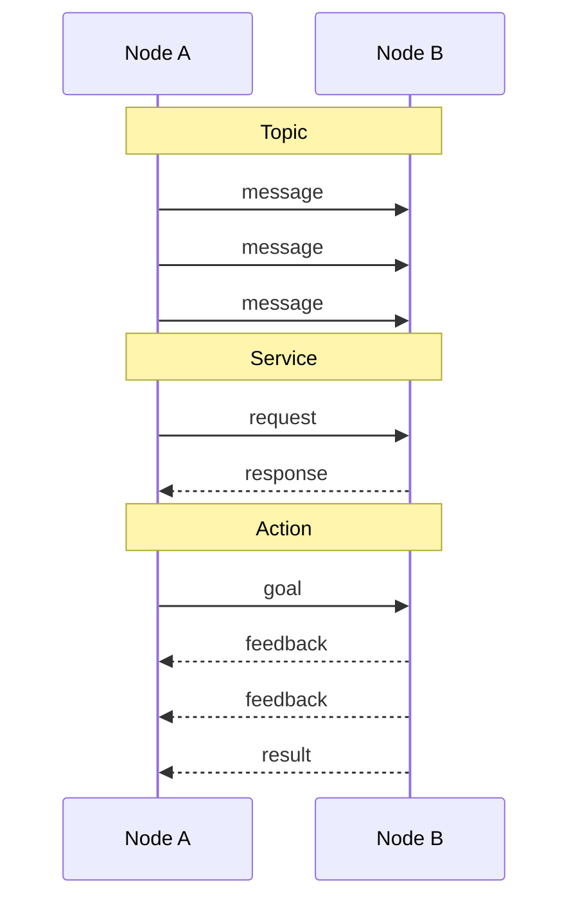

# Services, actions, and parameters

Topics are one of three ways ROS nodes talk to each other. This page covers the other two,
services and actions, and how to change a node's settings with parameters, by trying each
one on turtlesim. You will need all three to read a design doc's interface table, which
lists every topic, service, and action a part of the robot uses.

You need a running dev container and its VNC desktop; see
[Getting started](../getting-started.md). Run every command in a VS Code terminal inside
the container. This page builds on [ROS 2 basics](ros2-basics.md).

## Three ways to talk

A topic works like a radio station: the publisher keeps broadcasting, and anyone tuned in
hears it. That suits data that never stops, such as sensor readings or driving commands.
But some conversations need an answer, and some jobs take a while.

- A **topic** is a stream. A publisher sends messages whenever it likes and never learns
  who, if anyone, received them.
- A **service** is a question with one answer, like asking someone at a help desk. A
  **client** sends a **request**, and the **server**, the node that offers the service,
  sends back one **response**. Use it for quick jobs where the caller needs to know how
  it went.
- An **action** is a long job that reports its progress, like a food delivery app: you
  place an order, the app keeps telling you where the driver is, and at the end your food
  arrives. An action client sends a **goal**, the action server sends **feedback** while
  it works, and one **result** when it is done. The client can cancel the goal before it
  finishes.



How to choose, with examples of what each could look like on the rover. These are
illustrations: each subsystem's design doc decides its real interfaces.

| You need | Use | Example on the rover |
| --- | --- | --- |
| Data that keeps flowing, whether or not anyone listens | Topic | Driving commands on `/cmd_vel`, camera images |
| A quick request with an answer | Service | "Enable the robot", answered with accepted or refused, and why |
| A long job that reports progress and can be canceled | Action | "Dig until the bin is full", reporting how full it is |

The [operating modes design](../design/operating-modes.md#3-interfaces) already uses the
first two: the robot publishes its mode on a topic, `/robot/mode`, and the operator asks
to enable it through a service, `/robot/request_mode`, whose response says whether the
robot accepted.

## Try it: call a service

Open the VNC desktop (see [GUI tools](../gui-tools.md)) and start turtlesim in a terminal.
Leave it running:

```bash
ros2 run turtlesim turtlesim_node
```

Do the steps below in a second terminal.

1. List the services that exist:

    ```bash
    ros2 service list
    ```

    ```text
    /clear
    /kill
    /reset
    /spawn
    /turtle1/set_pen
    /turtle1/teleport_absolute
    /turtle1/teleport_relative
    /turtlesim/describe_parameters
    /turtlesim/get_parameter_types
    /turtlesim/get_parameters
    /turtlesim/get_type_description
    /turtlesim/list_parameters
    /turtlesim/set_parameters
    /turtlesim/set_parameters_atomically
    ```

    The first seven are turtlesim's own. ROS gives every node the ones that start with
    `/turtlesim/`; you will use them through parameters below.

2. Like a topic, every service has a type that fixes what goes back and forth. Ask for
   the type of `/spawn`, then what that type contains:

    ```bash
    ros2 service type /spawn
    ros2 interface show turtlesim/srv/Spawn
    ```

    ```text
    turtlesim/srv/Spawn
    float32 x
    float32 y
    float32 theta
    string name # Optional.  A unique name will be created and returned if this is empty
    ---
    string name
    ```

    The fields above `---` are the request and the ones below are the response: you send
    a position and a name, and get back the new turtle's name. `srv` in the type name
    marks a service type, the way `msg` marks a message type.

3. Call the service to add a second turtle:

    ```bash
    ros2 service call /spawn turtlesim/srv/Spawn "{x: 2.0, y: 2.0, theta: 0.0, name: turtle2}"
    ```

    ```text
    waiting for service to become available...
    requester: making request: turtlesim.srv.Spawn_Request(x=2.0, y=2.0, theta=0.0, name='turtle2')
    response:
    turtlesim.srv.Spawn_Response(name='turtle2')
    ```

    A second turtle appears near the bottom-left corner. Turtlesim's window is about 11
    units across, with `x: 0.0, y: 0.0` in the bottom-left corner.

4. Give the first turtle a thick red pen, then drive it:

    ```bash
    ros2 service call /turtle1/set_pen turtlesim/srv/SetPen "{r: 255, g: 0, b: 0, width: 5}"
    ros2 topic pub --once /turtle1/cmd_vel geometry_msgs/msg/Twist "{linear: {x: 2.0}, angular: {z: 1.8}}"
    ```

    The turtle draws a thick red curve. `SetPen` has one more field, `off`, which you left
    out. Fields you leave out are zero, and `off: 0` means the pen is down.

5. Move the turtle instantly with a teleport:

    ```bash
    ros2 service call /turtle1/teleport_absolute turtlesim/srv/TeleportAbsolute "{x: 8.0, y: 8.0, theta: 3.14}"
    ```

    The turtle jumps to the top right and faces left, and its pen draws a straight line
    along the jump. `theta` is its heading in radians: ROS measures angles in radians
    ([REP 103, section "Derived Units"](../sources.md#ros-rep-103)), and 3.14 is half a
    turn. To jump without drawing, lift the pen first:

    ```bash
    ros2 service call /turtle1/set_pen turtlesim/srv/SetPen "{'off': 1}"
    ```

    The quotes around `off` matter: without them, the command reads `off` as the word for
    "false" and fails with `Failed to populate field`.

6. Wipe the drawing:

    ```bash
    ros2 service call /clear std_srvs/srv/Empty
    ```

    `std_srvs/srv/Empty` has no fields at all. The request itself is the whole message:
    "clear the screen".

## Try it: change a parameter

A **parameter** is a named setting that belongs to one node, such as a maximum speed. A
node usually reads its parameters when it starts, and you can look at or change them from
the command line.

1. List turtlesim's parameters:

    ```bash
    ros2 param list
    ```

    ```text
    /turtlesim:
      background_b
      background_g
      background_r
      holonomic
      qos_overrides./parameter_events.publisher.depth
      qos_overrides./parameter_events.publisher.durability
      qos_overrides./parameter_events.publisher.history
      qos_overrides./parameter_events.publisher.reliability
      start_type_description_service
      use_sim_time
    ```

    `background_r`, `background_g`, and `background_b` are the red, green, and blue parts
    of the background color. Most of the rest exist on every node.

2. Read one, and ask what values it accepts:

    ```bash
    ros2 param get /turtlesim background_r
    ros2 param describe /turtlesim background_r
    ```

    ```text
    Integer value is: 69
    Parameter name: background_r
      Type: integer
      Description: Red channel of the background color
      Constraints:
        Min value: 0
        Max value: 255
        Step: 1
    ```

3. Change it:

    ```bash
    ros2 param set /turtlesim background_r 150
    ```

    ```text
    Set parameter successful
    ```

    The background turns purple straight away. Behind the scenes, `ros2 param` calls the
    `/turtlesim/set_parameters` service you saw in the service list.

4. Print every parameter the node has, in a form you can save:

    ```bash
    ros2 param dump /turtlesim
    ```

    ```text
    /turtlesim:
      ros__parameters:
        background_b: 255
        background_g: 86
        background_r: 150
        holonomic: false
        ...
    ```

    (The rest of the output, trimmed here, lists the other parameters.) This is the
    format of a **parameter file**, written in YAML, a plain-text format for settings.

5. Save it to a file, while turtlesim is still running:

    ```bash
    ros2 param dump /turtlesim > ~/turtlesim.yaml
    ```

    As in [The command line](command-line.md#try-it-make-a-folder-and-a-file), `>` sends
    the output into a file instead of the terminal. `~/turtlesim.yaml` is in the
    container's home folder, outside the repository, so you cannot commit it by accident.

6. Stop turtlesim with Ctrl+C in its terminal, and start it again with the file:

    ```bash
    ros2 run turtlesim turtlesim_node --ros-args --params-file ~/turtlesim.yaml
    ```

    The new turtlesim starts with the purple background, because it read the file.

The robot's nodes are designed to work the same way, so that numbers such as current
limits and timeouts live in a file instead of in the code.
[Launch files and parameter files](ros2-launch-files.md) shows how to give your own node
parameters.

## Try it: send an action goal

Turtlesim has one action, which turns a turtle to face a given direction.

1. List the actions and look at the one there is:

    ```bash
    ros2 action list
    ros2 action info /turtle1/rotate_absolute
    ```

    ```text
    /turtle1/rotate_absolute
    Action: /turtle1/rotate_absolute
    Action clients: 0
    Action servers: 1
        /turtlesim
    ```

2. See what its type contains:

    ```bash
    ros2 interface show turtlesim/action/RotateAbsolute
    ```

    ```text
    # The desired heading in radians
    float32 theta
    ---
    # The angular displacement in radians to the starting position
    float32 delta
    ---
    # The remaining rotation in radians
    float32 remaining
    ```

    An action type has three parts: the goal, the result, and the feedback, in that order.

3. Send a goal and watch the feedback:

    ```bash
    ros2 action send_goal --feedback /turtle1/rotate_absolute turtlesim/action/RotateAbsolute "{theta: 1.57}"
    ```

    The turtle turns to face the top of the window, a quarter turn, while the terminal
    prints its progress. The output starts and ends like this, with many more feedback
    messages in between:

    ```text
    Waiting for an action server to become available...
    Sending goal:
         theta: 1.57
    Goal accepted with ID: 1384db95639e4fd49c95f8f175945d35
    Feedback:
        remaining: 1.5700000524520874
    Feedback:
        remaining: 1.5540000200271606
    Feedback:
        remaining: 0.018000006675720215
    Result:
        delta: -1.5520000457763672
    Goal finished with status: SUCCEEDED
    ```

4. Cancel a goal partway through. Run the keyboard teleop in a third terminal, and keep
   that terminal selected while you press keys:

    ```bash
    ros2 run turtlesim turtle_teleop_key
    ```

    The eight letters around `f` on your keyboard send rotate goals: each one turns the
    turtle to face the way that letter sits from `f`, so `d` faces left, `g` faces right,
    `r` faces up, and `v` faces down. `f` cancels the goal. Press `g` and wait for the
    turtle to stop, then press `d` and, while it is still turning, `f`. The turtle stops
    where it is, and the turtlesim terminal prints:

    ```text
    [INFO] [1791864827.762315631] [turtlesim]: Rotation goal canceled
    ```

    Now press `v` and straight away `r`. The second goal replaces the first:

    ```text
    [WARN] [1791864833.041998527] [turtlesim]: Rotation goal received before a previous goal finished. Aborting previous goal
    ```

    Each action server decides what to do with a new goal while one is running; turtlesim
    drops the old one.

Stop everything with Ctrl+C when you are done (press `q` to quit the teleop).

## Reading an interface table

Every design doc has an interface table, the contract that says how its nodes talk to the
rest of the robot ([Design docs](../design/README.md#interfaces-are-contracts)). You can
now read every column:

- **Kind** is topic, service, or action.
- **Type** is the message, service, or action type. Look inside any of them with
  `ros2 interface show`, as you did above.
- **Publisher or server** and **subscriber or client** name the nodes on each side.
- **Rate** and **QoS** say how often a topic's messages come and how they are delivered;
  [Write your first node](ros2-first-node.md) explains QoS.

## Key ideas

- Topics are streams; services are one request with one response; actions are long jobs
  with a goal, feedback, and a result, and can be canceled.
- `ros2 service list`, `ros2 service call`, `ros2 action list`, and
  `ros2 action send_goal` let you use them from the command line.
- Parameters are a node's settings. `ros2 param list`, `get`, `set`, and `dump` read and
  change them, and a parameter file sets them when the node starts.
- `ros2 interface show` shows what any message, service, or action type contains.

The official tutorials on
[services](https://docs.ros.org/en/jazzy/Tutorials/Beginner-CLI-Tools/Understanding-ROS2-Services/Understanding-ROS2-Services.html),
[parameters](https://docs.ros.org/en/jazzy/Tutorials/Beginner-CLI-Tools/Understanding-ROS2-Parameters/Understanding-ROS2-Parameters.html),
and [actions](https://docs.ros.org/en/jazzy/Tutorials/Beginner-CLI-Tools/Understanding-ROS2-Actions/Understanding-ROS2-Actions.html)
cover the same ideas with more exercises.

Next: [Write your first node](ros2-first-node.md).
