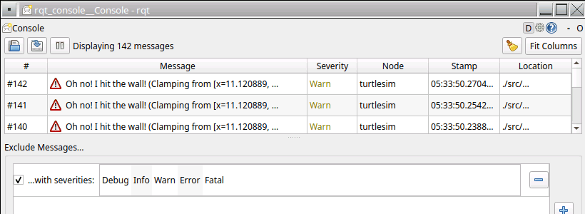
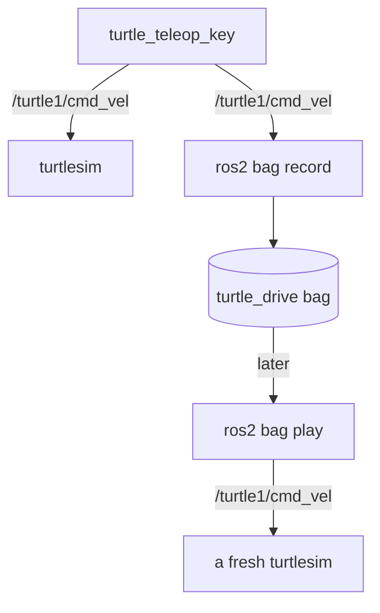

# Seeing inside a running robot

When the robot misbehaves, you cannot look inside its code while it runs, but you can
look at what its nodes say and send. This page covers the tools for that: reading log
messages, recording everything on a topic and playing it back later, finding out why a
node hears nothing, and checking your setup.

You need a running dev container and its VNC desktop
([Getting started](../getting-started.md)), the turtlesim exercises from
[ROS 2 basics](ros2-basics.md#try-it-drive-a-turtle), and the `hello_ros` package from
[Write your first node](ros2-first-node.md). Run every command in a VS Code terminal
inside the container.

## Tools you already know

From the earlier pages:

| Tool | What it tells you |
| --- | --- |
| `ros2 node list`, `ros2 topic list` | Which nodes and topics exist |
| `ros2 node info <node>` | What one node publishes, subscribes to, and offers |
| `ros2 topic info <topic>` | A topic's type, and how many publishers and subscribers it has |
| `ros2 topic echo <topic>` | The messages on a topic, as they arrive |
| `rqt_graph` | A picture of which nodes talk on which topics |

One more is worth knowing now. Design docs give each topic a rate, and
`ros2 topic hz` measures the real one. With `hello_publisher` running (with its default
parameters), run:

```bash
ros2 topic hz /greetings
```

```text
average rate: 2.000
	min: 0.500s max: 0.500s std dev: 0.00016s window: 3
```

It prints a new measurement every second or so: two messages a second, 0.5 seconds
apart. If it first says `does not appear to be published yet`, wait; it keeps trying.
Press Ctrl+C to stop it, and stop the publisher too.

## Log messages and rqt_console

Every `RCLCPP_INFO` line your nodes print is a **log message**, and so is every warning
turtlesim prints. Each has a **log level** that says how serious it is:

| Level | Meaning |
| --- | --- |
| `DEBUG` | Details for whoever is fixing the code. Hidden unless you ask for them. |
| `INFO` | Normal progress, such as "publishing" |
| `WARN` | Something unexpected that the node can live with |
| `ERROR` | Something failed |
| `FATAL` | The node cannot continue |

Besides printing them, every node sends its log messages on the `/rosout` topic, so one
tool can collect them from every node on the robot: **rqt_console**. It is one of the
**rqt** tools, small ROS programs with windows; `rqt_graph` is another.

1. Start rqt_console:

    ```bash
    ros2 run rqt_console rqt_console
    ```

    Its window appears on the VNC desktop. Like other Qt programs in the container, it
    first prints `QStandardPaths: XDG_RUNTIME_DIR not set`, which is harmless. Drag a
    corner of the window to make it bigger.

2. In a second terminal, start turtlesim:

    ```bash
    ros2 run turtlesim turtlesim_node
    ```

    rqt_console lists turtlesim's first two messages, at level Info: starting up, and
    spawning `turtle1`.

3. In a third terminal, drive the turtle into the right-hand wall, sending a command every
   second:

    ```bash
    ros2 topic pub --rate 1 /turtle1/cmd_vel geometry_msgs/msg/Twist "{linear: {x: 2.0}}"
    ```

    When the turtle reaches the wall, turtlesim complains many times a second, both in its
    terminal and in rqt_console, where each message shows its severity, `Warn`, and the
    node that sent it:

    ```text
    [WARN] [1791869628.862169082] [turtlesim]: Oh no! I hit the wall! (Clamping from [x=11.120889, y=5.544445])
    ```

    

    *rqt_console collecting turtlesim's warnings, newest first.*

    Stop the command with Ctrl+C. In rqt_console, the **Exclude Messages** section hides
    messages by severity, and its **+** button adds other filters, such as one for a
    node. **Highlight Messages** marks messages containing some text.

4. Restart turtlesim so it prints only warnings and worse: stop it with Ctrl+C, then

    ```bash
    ros2 run turtlesim turtlesim_node --ros-args --log-level WARN
    ```

    This time, the terminal shows only the `QStandardPaths` line: the two Info messages
    are gone. Drive it into the wall again, and the warnings still appear.

`--log-level` works on any node, including yours. `DEBUG` shows the details that are
normally hidden, including a flood of them from ROS's own libraries. Stop everything with
Ctrl+C before the next section.

## Record and replay with ros2 bag

A **bag** is a recording of the messages on chosen topics, with the time each one
arrived. Playing it back publishes the same messages again, at the same pace, as if the
nodes that sent them were running. On the robot, this lets you record a test run and
study it, or feed it to your code, as often as you like back at your desk. The
[operating modes design](../design/operating-modes.md#what-runs-in-each-mode) plans for
the robot to record a bag whenever it is running.



1. Start turtlesim, and the keyboard teleop in a second terminal:

    ```bash
    ros2 run turtlesim turtlesim_node
    ```

    ```bash
    ros2 run turtlesim turtle_teleop_key
    ```

2. In a third terminal, go to your home folder and start recording the turtle's driving
   commands:

    ```bash
    cd ~
    ros2 bag record -o turtle_drive --topics /turtle1/cmd_vel
    ```

    The bag goes in a new folder, `~/turtle_drive`. Record in your home folder rather
    than in `/ws`, so a recording never ends up in a commit. If the folder already
    exists, the recorder refuses with `Output folder 'turtle_drive' already exists`, so
    pick a new name each time. The recorder prints a few lines, and after a few seconds
    it has found the topic:

    ```text
    [INFO] [1791869708.324589591] [rosbag2_recorder]: Subscribed to topic '/turtle1/cmd_vel'
    [INFO] [1791869708.324628518] [rosbag2_recorder]: All requested topics are subscribed. Stopping discovery...
    [INFO] [1791869708.324634202] [rosbag2_recorder]: Topics discovery stopped.
    ```

3. Once it says `Subscribed`, click on the teleop terminal and drive the turtle around
   with the arrow keys for 15 seconds or so, drawing a shape you will recognize.

4. Stop the recorder with Ctrl+C, and look at what it saved:

    ```bash
    ros2 bag info turtle_drive
    ```

    ```text
    Files:             turtle_drive_0.mcap
    Bag size:          6.9 KiB
    Storage id:        mcap
    ROS Distro:        jazzy
    Duration:          16.351785535s
    Start:             Oct 13 2026 05:35:10.141599719 (1791869710.141599719)
    End:               Oct 13 2026 05:35:26.493385254 (1791869726.493385254)
    Messages:          15
    Topic information: Topic: /turtle1/cmd_vel | Type: geometry_msgs/msg/Twist | Count: 15 | Serialization Format: cdr
    Service:           0
    Service information:
    ```

    One message for each key press: the teleop sends a command only when you press a
    key.

5. Quit the teleop with `q`, stop turtlesim with Ctrl+C, and start a fresh turtlesim, so
   the turtle is back in the middle with a clean screen. Then play the bag:

    ```bash
    ros2 bag play --delay 5 turtle_drive
    ```

    After five seconds, the turtle drives the same path again, by itself, with the same
    timing. The delay gives turtlesim and the player time to find each other, which can
    take a few seconds. Without it, the first commands are published before turtlesim is
    listening, and the first moves go missing.


*Left: the path driven with the keyboard. Right: the same path, replayed from the bag into
a fresh turtlesim.*

The official tutorial
[Recording and playing back data](https://docs.ros.org/en/jazzy/Tutorials/Beginner-CLI-Tools/Recording-And-Playing-Back-Data/Recording-And-Playing-Back-Data.html)
shows more, such as recording several topics at once.

## When a subscriber hears nothing

A node that should be receiving messages but is not is the most common ROS problem. Check
these, in order:

1. **Is anything publishing?** `ros2 topic hz <topic>` shows whether messages arrive at
   all.
2. **Do the names match exactly?** `ros2 topic list` shows every topic. A typo, a missing
   remapping, or a missing `/` gives you two different topics, each with one side.
3. **Do the types match?** `ros2 topic info <topic>` shows the type.
4. **Is the workspace sourced?** If `ros2 run` says `Package ... not found`, run
   `source install/setup.bash` for that workspace, or open a new terminal.
5. **Do the QoS settings fit together?** Some combinations cannot talk. Try one: publish
   with "best effort" reliability, which may drop messages, and listen with "reliable",
   which insists on every one:

    ```bash
    ros2 topic pub --qos-reliability best_effort /qos_test std_msgs/msg/String "{data: hello}"
    ```

    ```bash
    ros2 topic echo --qos-reliability reliable /qos_test
    ```

    The listener prints nothing but this warning:

    ```text
    [WARN] [1791863971.113011243] [_ros2cli_6890]: New publisher discovered on topic '/qos_test', offering incompatible QoS. No messages will be received from it. Last incompatible policy: RELIABILITY
    ```

    `ros2 topic info --verbose /qos_test` shows each side's QoS, including
    `Reliability: BEST_EFFORT` for this publisher. The other way round works: a best
    effort listener does receive from a reliable publisher. Each design doc's interface
    table gives every topic's QoS so that both sides agree.

6. **Are the nodes on different computers?** They need the network settings in
   [ROS 2 networking](../ros-networking.md).

## Check the setup with ros2 doctor

`ros2 doctor` checks your ROS installation and network setup:

```bash
ros2 doctor
```

It may print many lines like this first:

```text
/opt/ros/jazzy/lib/python3.12/site-packages/ros2doctor/api/package.py: 122: UserWarning: launch has been updated to a new version. local: 3.4.11 < latest: 3.4.12
```

These are not errors. They say that newer releases of some ROS packages exist than the
ones in the dev container's image, and the team's own packages show up as
`Cannot find the latest versions` because they are not released anywhere. What matters is
the last line:

```text
All 5 checks passed
```

`ros2 doctor --report` prints much more: your network interfaces, ROS version, and the
topics and QoS it can see. It helps when you ask for help, but it includes your
computer's network addresses, so share it with the team rather than in public.

## Key ideas

- `ros2 topic hz` measures a topic's rate; compare it with the design doc.
- Every node's log messages go to `/rosout`; `rqt_console` collects and filters them, and
  `--ros-args --log-level` chooses how much a node prints.
- `ros2 bag record` saves messages to a bag, and `ros2 bag play` publishes them again
  with the same timing.
- When a subscriber hears nothing, check that something publishes, then the name, the
  type, sourcing, QoS, and the network.

Next: [Frames, tf2, and RViz](ros2-frames-and-rviz.md).
